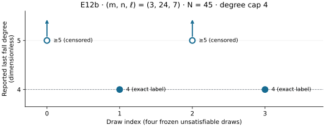

# E12b completed Spot continuation, 2026-10-28

This is an observational report and a mechanical application of the frozen
scoring rule. It is not a hypothesis promotion, an independent closure replay,
or a proof of a general fall-degree bound. Earlier partial records and reports
remain unchanged.

The one additional Spot attempt authorized by Amendment 15 completed all four
draws for `(m,n,ell)=(3,24,7)`, `N=45`, 48 equations, seed `20261012`, cap 4.
The measured solver labels are **≥5, 4, ≥5, 4**. The two censored values are
lower bounds, not exact degree 5.

| Draw | Recorded `d_F` label | Degree-4 dimension / columns | Closure rounds |
|---:|:---|---:|---:|
| 0 | ≥5 | 157926 / 164221 | 9 |
| 1 | 4 | 164221 / 164221 | 8 |
| 2 | ≥5 | 158254 / 164221 | 9 |
| 3 | 4 | 164221 / 164221 | 7 |



Figure: four rows from job `20261028-031317-fd-e12b-spot-20261028-r3-24148b`,
raw dataset SHA-256 `055811b722f441ab681172a605f9a540b174734dbb4f23ff9f03b931d948c81b`.
The graph shows recorded labels only. No confidence interval was registered;
the arrows denote censoring and are not uncertainty bars.

## Frozen statistic

Amendments 12/15 define `lowerMedian` as the second-smallest of four, replacing
a censored value by `cap + 1` for scoring only. Thus `[5,4,5,4]` sorts to
`[4,4,5,5]`, and the lower median is **4**. Two of four, rather than the required
three of four, score at least 5. The fixed reading is therefore **“mixed.”**

The carried-forward r2 cells `(3,30,4)`, `(3,27,5)`, and `(3,24,6)` each retain
four recorded values of 4. Their frozen blob hashes are in `provenance.json`.
The earlier partial `(3,24,7)` draw 0 is an identity reference, not an extra
sample; it must not be pooled with these four rows. This arithmetic does not
establish statistical significance or reject a general factor-base hypothesis.

## Execution and retained gates

- Job: `20261028-031317-fd-e12b-spot-20261028-r3-24148b`.
- Host: `i-03d408f37b22432d1`, `m7i.4xlarge` Spot, 16 vCPU, 64 GiB,
  `us-east-1`. Job status reports exit 0. The completed instance terminated.
- Frozen source commit: `371035216942660c4615dfbb88d85a14afaf5c16`.
- Frozen protocol commit: `020f03193c46d975935a065c966c81941cbdbf6d`.
- Command: `KEEP=4 CMAX=4 research/fall_degree_bounds_20261008/e12/run_par.sh OUT 3:24:7`,
  without Lean. The solver command is
  `hky_par newcells --cells 3:24:7 --seed 20261012 --keep 4 --cmax 4`.
- Four draws requested, four completed, none failed or interrupted in this
  attempt. All four record zero solutions. The field basis and target for
  each draw are preserved in the raw JSONL.
- Gate 0 records three passing counter tests. Gate 1 records 24 agreements,
  zero disagreements. Gates 2/3 reproduce 16 rows across four reference
  cells. Gate 4 matches draw 0 to r2 after removing only `secs` fields,
  including all other fields such as thread count.
- The record audit separately checked all 24 gate-1 reference rows, the 16
  gate-2/3 rows, the carried-forward cells, basis independence, Boolean
  column counts, frozen protocol hash, and draw-0 identity. It executed no
  solver. `verify_records.py` reproduces the archive/hash/status/identity
  and scoring subset; it does not claim to independently replay the gates.
- The diagnostic job interval is 03:14:14–03:45:28 UTC. The four recorded
  solver intervals sum to 1203.0 seconds (284.2, 310.3, 297.1, 311.4); this
  excludes gates/build and is not billed duration. The archive's `rusage.txt`
  records whole-command user CPU 24916.64 seconds, system CPU 505.06 seconds,
  elapsed 30:57.68 and peak RSS 13837984 KiB. Those whole-command values include
  build/gates and are not per-draw solver counts. Timing is not scored or compared.

## Durable data and reproduction

`E_3-24-7.jsonl` is an exact 1,686-byte copy from the final S3 output archive.
The archive contains 32 regular files under `out/`, plus `host.txt` and
`rusage.txt`: 34 regular files total. It retains controls, logs, identities,
completion checks and raw rows; its S3 location, SHA-256 and readback time are in
`provenance.json`.
The prior upload/status receipts remain in `../continuation-20261028/persistence/`.
An identical archive is also retained under the canonical bucket's
`research/fall-degree/e12/completed-20261028/<archive-sha256>/output.tar.gz`
prefix. `provenance.json` records that mirror's full URI and successful download
verification; neither copy replaces or modifies the original job evidence.

```sh
aws s3 cp s3://ephemeral-runs-104186811093-us-east-1/jobs/20261028-031317-fd-e12b-spot-20261028-r3-24148b/snapshots/20261028T034958Z-final/output.tar.gz /tmp/e12b-output.tar.gz --region us-east-1
python3 research/fall_degree_bounds_20261008/e12/completed-20261028/verify_records.py /tmp/e12b-output.tar.gz --repo .
```

The verifier reads the archive without extracting files or changing raw data.
`verification.json` records its result. `plot.py` renders `draws.svg` and
`draws.png` using matplotlib. `report.typ` renders `report.pdf` using Typst;
the PDF was inspected before publication. No new solver measurements are
needed to reproduce this report.

## Limits and sources

This verifies record consistency, not independently computed unsatisfiability,
saturation, or correctness of the unrestricted closure engine. An independent
closure implementation has not completed its cross-check. The earlier Lean
build checks the 282-row scoring table; these four new rows were not added
to that table, and no new Lean verification is claimed. General first-fall
assumptions and asymptotic last-fall bounds remain unresolved. E12a/E12c are
separate ongoing attempts; this completion does not supply their missing data.

Sources checked before interpretation: [frozen Amendments 12/15](https://github.com/isogeny-labs/crypto/blob/020f03193c46d975935a065c966c81941cbdbf6d/research/fall_degree_bounds_20261008/PREREGISTRATION.md),
[frozen lowerMedian definition](https://github.com/isogeny-labs/crypto/blob/020f03193c46d975935a065c966c81941cbdbf6d/research/fall_degree_bounds_20261008/lean/FallDegree/Rule.lean),
the frozen wrapper and source archive, and the existing
`research/notes/index-calculus/RESEARCH_FALL_DEGREE_BOUNDS.md` definition ledger.
This report introduces no new literature claim or theoretical bound. Historical
graphs under `reports/run-20261027T1811Z/` remain descriptions of that earlier
partial attempt; `../../RESULTS.md` points to this completed continuation.
