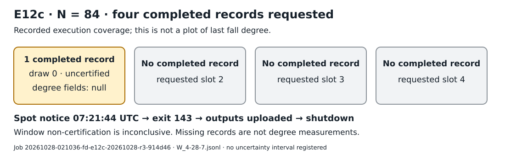

# E12c interrupted Spot continuation, 2026-10-28

This is an observational preservation report. One of the four requested draw
records completed at `(m,n,ell)=(4,28,7)`, `N=84`, before Spot reclaim stopped the
attempt with exit **143**. The recorded window result is **uncertified and
inconclusive**. This report makes no last-fall-degree lower-bound claim and no
official hypothesis decision; earlier attempts and reports remain unchanged.

| Requested cell | Completed records | Recorded draw | Solutions, producer reported | Window result |
|---|---:|---:|---:|---|
| `4:28:7`, `N=84`, seed `20261012` | **1 of 4** | 0 | 0 | `certified=false`, `d_f_window=null`, `d_f_le3=null` |



Only one new-cell observation completed, so this is a completion diagram rather
than a degree or performance plot. Three requested completed records are missing;
the retained files do not identify the attempt state of every missing draw. No
statistical uncertainty interval was registered or computed for this diagram.

## Execution and interruption

Amendment 13 authorized this one additional attempt, retaining Amendment 11's
cell, seed, four-record target, gates and `w1x` policy. Source commit
`371035216942660c4615dfbb88d85a14afaf5c16` and protocol commit
`640b58b211e464939f077ef3722f3f4c00dd8bbb` were frozen before launch.
[provenance.json](provenance.json) records their hashes and the binary identity.
The wide-variable binary ran:

```text
hky_window newcells --cells 4:28:7 --seed 20261012 --keep 4 --policies w1x
```

Job `20261028-021036-fd-e12c-20261028-r3-914d46` used
`i-0ac1c3ad72a141ac0`, `r7i.4xlarge` Spot in `us-east-1`, with 16 recorded threads
and a 128 GiB allocation. Producer logs record three passing gate-0 counter tests,
four gate-1 reference-cell comparisons, and the gate-2 `4:16:4` comparison. All
five saved comparison diff files are empty. `out/status` contains only
`gate_passed`, with no final `done`; `out/cells_status` is absent. These are
inspected producer gate records, not a fresh gate replay.

The [job log](job.log) records a **Spot interruption notice at 07:21:44 UTC**,
command exit **143**, an output upload, and shutdown. The
[terminal receipt](terminal-status.json), updated **07:22:48 UTC**, records
`phase=interrupted` and `reason=spot reclaim; resume from this job's outputs`.
The runner's cleanup explains the separately observed EC2
`Client.InstanceInitiatedShutdown` reason. The generic resume wording does not
establish a resumable solver checkpoint: Amendment 13 states that this engine
has none and authorizes no automatic replacement attempt.

## Recorded result and limits

[W_4-28-7.jsonl](W_4-28-7.jsonl) is the exact 775-byte final record, including the
field basis, target, seed and all engine counters. It records 84 equations and
84 Boolean variables. The window has 817,860 columns and dimension 447,015;
the recorded degree-2/3 dimensions are 111 and 7,637. These are producer-reported
values, not independently recomputed ranks.

The degree-4 window is a restricted subspace. Reaching `1` in it can certify an
upper bound; failing to reach `1` cannot certify failure of the unrestricted
degree-4 closure. Here `window.w1x.certified=false`, and both degree-result fields
are null. The frozen E12c rule requires at least two finished degree-4
certifications for its positive reading; this attempt has none. Its observational
rule status is **no reading**. It does not establish `d_F >= 5`, an exact degree,
unbounded growth, or a first-fall-degree conclusion.

The row retains diagnostic `secs=16667.5` and `vmhwm_kb=40268516`; these are not
comparative clocks or billed usage. [rusage.txt](rusage.txt) records a wrapper
terminated by signal 15. Its trailing `Exit status: 0` does not override terminal
exit 143, and its tiny CPU totals do not provide complete solver cost after
interrupted process accounting. No speed or cost-efficiency comparison is made.

## Durable data and checks

The original snapshot and canonical copy are byte-identical and have SHA-256:

```text
fa4edf72399ec45b293b783d8582d9a26406c1670a3612a75b6110dd1e824f09
```

The 7,678-byte archive contains **24 regular files under `out/`**, plus `host.txt`
and `rusage.txt`: **26 regular files total**. The final `out/` objects were also
downloaded separately and matched all 24 archived output files. The immutable
[snapshot manifest](snapshot.json) matched the latest pointer.
[canonical-durability.json](canonical-durability.json) preserves the canonical
PUT/GET checksum and byte-comparison receipt. Both URIs are in
[provenance.json](provenance.json); the original raw archive was not repacked.

These are durable output snapshots, not solver-memory checkpoints. They preserve
the completed row, logs and provenance, but not the roughly 30 GB closure basis
(`basis_bytes=30212692424`) or the interrupted draw's full in-flight state.
The row's `v_basis` is the small factor-base field basis, not that closure basis.
Recovering these files cannot resume an interrupted closure exactly. Complete
intermediate-state persistence remains a coverage gap; this report authorizes
no restart or retry.

Native `sha256sum`, `cmp`, `diff`, `tar` and `jq` checks verified bytes, JSON
parsing, one complete record, draw/cell identity, recorded null/false labels,
and saved completion markers. They did not recompute solutions or closure.
[readback.json](readback.json) is the observational receipt;
[evidence.sha256](evidence.sha256) binds the copied evidence and
[archive-out.sha256](archive-out.sha256) binds every archived output file.

From this directory:

```sh
sha256sum -c evidence.sha256
aws s3 cp --region us-east-2 s3://setec-astronomy-artifacts/research/fall-degree/e12/interrupted-c-20261028/fa4edf72399ec45b293b783d8582d9a26406c1670a3612a75b6110dd1e824f09/output.tar.gz /tmp/e12c-output.tar.gz
printf '%s\n' 'fa4edf72399ec45b293b783d8582d9a26406c1670a3612a75b6110dd1e824f09  /tmp/e12c-output.tar.gz' | sha256sum -c -
jq -s '{records:length,draws:map(.draw),certified:map(.window.w1x.certified),d_f_window:map(.d_f_window)}' W_4-28-7.jsonl
```

Inspect the archive member list before extracting into a fresh directory. Running
`sha256sum -c` on `archive-out.sha256` from that directory checks all `out/`
members. These storage checks require no experiment.

## Review, sources and remaining work

**Formal independent experiment review and algorithm replay were not performed.**
The historical runner supplied frozen Markdown amendments and raw files, not a
schema-validated `experiment.export/v1` bundle. This report does not convert those
historical files into a schema-validated protocol or claim a passed review-run gate.
Legacy Python schema/review tools were not executed: current `AGENTS.md` requires
native research verification. A separate reviewer and suitable native validation
tooling remain needed before promoting computational claims. No Lean theorem,
new experiment, relaunch or official hypothesis update is included.

Sources checked before interpretation:

- [Frozen Amendments 11/13](https://github.com/isogeny-labs/crypto/blob/640b58b211e464939f077ef3722f3f4c00dd8bbb/research/fall_degree_bounds_20261008/PREREGISTRATION.md): window reading rule and interruption policy.
- [Frozen wrapper](https://github.com/isogeny-labs/crypto/blob/371035216942660c4615dfbb88d85a14afaf5c16/research/fall_degree_bounds_20261008/e12/run_window.sh): four-record invocation and completion markers.
- [Window-engine scope](https://github.com/isogeny-labs/crypto/blob/371035216942660c4615dfbb88d85a14afaf5c16/research/fall_degree_bounds_20261008/e11/ENGINE.md): restricted certification versus unrestricted lower bounds.
- [Persistence contract](../continuation-20261028/S3_PERSISTENCE.md): file preservation rather than solver-memory checkpoints.

Earlier reports remain historical records. Existing degree plots and
`fall_degree.*` metrics remain unchanged: they count unrestricted degree
observations, and adding this null window result would falsely count a censored
degree and raise that frontier. The diagram records separate N=84 execution
coverage. E12c still lacks three requested completed records; E12a and general
first-/last-fall questions are separate unfinished work. Any new attempt needs
authorization and a frozen amendment.

`flow.svg` is the editable diagram source. Native Typst renders `report.typ`
to `report.pdf`; the PDF is inspected before publication. Validation and delivery
status are in [HANDOFF.md](HANDOFF.md).
[delivery-checks.json](delivery-checks.json) preserves the native library-test
results, fixture-restoration reruns and canonical S3 readback receipts for all
three validation logs. These delivery checks do not validate the closure algorithm.

The raw evidence was committed first in `cbb6b152511`; this report is a later,
separate commit. Render with Typst 0.15.1 and DejaVu Sans available (or provide its
font directory with `--font-path`):

```sh
typst compile --creation-timestamp 1793145600 report.typ report.pdf
```
