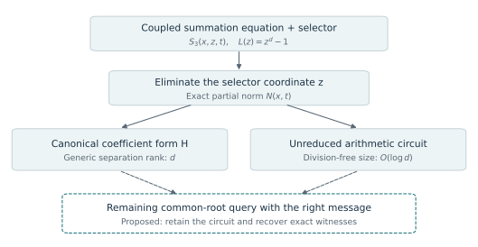
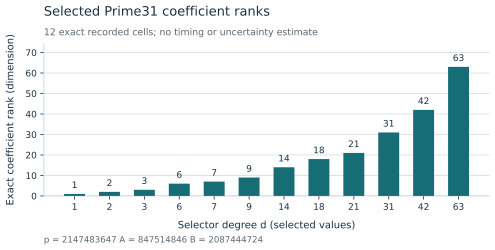

# What survives the first coupled S3 elimination?

2026-11-22 Pacific. Research component of [crypto PR #4921](https://github.com/isogeny-labs/crypto/pull/4921). Written mathematical derivation plus bounded native correctness checks; no performance measurement, complete relation solver, Lean proof, or signed execution verdict. [pcc:unverified]

## Finding and decision

The first partial norm has **generic coefficient separation rank d**, even though its unreduced resultant has a **division-free arithmetic circuit of size O(log d)**. These are different representation measures.

Consequently, a constant-size or logarithmic-size exact sum of separated x- and t-functions cannot represent this particular polynomial generically. The compact norm circuit survives. The next question is whether an exact common-root query can use that circuit without materializing the coupled coefficient array or enumerating all candidate pairs.

This is a representation-specific obstruction and a direction for further work. It is not a lower bound on ECDLP, all elimination algorithms, or all polynomials defining the same zero set. No novelty claim is made.

## 1. The polynomial being studied

Work over a prime field of characteristic p > 2d. For elliptic-curve interpretation also require p > 3 and 4A^3+27B^2 != 0. The third summation polynomial for the short Weierstrass equation y^2=x^3+Ax+B is

$$
S_{A,B}(x,z,t)=(x-z)^2t^2
-2((x+z)(xz+A)+2B)t
+(xz-A)^2-4B(x+z).
$$

This is quadratic in each coordinate separately. Its total degree is four; calling S3 a quadratic without specifying the coordinate would hide part of the elimination cost.

For the multiplicative selector L(z)=z^d-1 define

$$
N_{A,B}(x,t)=\operatorname{Res}_z(z^d-1,S_{A,B}(x,z,t)),\qquad
H_{A,B}(x,t)=N_{A,B}(x,t)\bmod(x^d-1).
$$

The remainder is canonical with degree_x H < d. Write H=sum_(i,j) c_ij x^i t^j and let M_d(A,B)=(c_ij), with d rows. The minimal r in

$$
H(x,t)=\sum_{\nu=1}^{r}u_\nu(x)v_\nu(t),
\qquad \deg u_\nu<d,
$$

is exactly the rank of M_d. Each separated term contributes a rank-one matrix, and a matrix rank factorization supplies such a representation.

The rank theorem does not require d dividing p-1. That additional condition makes the selector split completely over the ground field, as in the native fixtures. If d factors into small factors, z^d-1 also has the composed-selector presentation of interest in the photographed paper. The final norm polynomial depends on L, rather than on which composition was used to express L.

## 2. The compact norm circuit survives

For a quadratic a z^2+b z+c over a commutative coefficient ring, put

$$
U_0=2,\quad U_1=-b,\quad U_{n+2}=-bU_{n+1}-acU_n.
$$

Then the polynomial identity

$$
\operatorname{Res}_z(z^d-1,a z^2+b z+c)=a^d+c^d-U_d
\tag{1}
$$

holds, including degree-drop cases a=0. One proof takes quadratic roots r_1,r_2 over the generic fraction field: U_d=(a r_1)^d+(a r_2)^d, and the product over the d selector roots is a^d(r_1^d-1)(r_2^d-1). Since both sides are polynomial identities in a,b,c, specialization handles the degenerate cases.

Binary powering of the two-by-two recurrence matrix evaluates U_d in O(log d) coefficient-ring operations. Binary powering also computes a^d and c^d. Substituting the S3 coefficients therefore gives an ordinary O(log d)-gate, division-free arithmetic circuit for the **unreduced** N(x,t).

Interpreting this circuit in F_p[x,t]/(x^d-1) gives an O(log d)-operation program in that quotient ring representing H. Extracting H's canonical coefficients is additional work. One quotient-ring multiplication is not one field operation. The unreduced circuit evaluates canonical H at x^d=1, but need not do so at arbitrary x outside that set.

## 3. Generic full separation rank

**Theorem 1.** If p > 2d, the coefficient matrix M_d(A,B) has rank d over F_p(A,B). Its first d columns already have a determinant Delta_d(A,B) that is a nonzero polynomial in A and B.

### Proof

Specialize A=B=0 only to exhibit a nonzero polynomial minor. This singular cubic is an algebraic control, not an elliptic-curve attack fixture.

In the ring F_p[x]/(x^d-1), x is a unit. Homogeneity and z=xw, t=xT give

$$
S_{0,0}(x,xw,xT)=x^4S_{0,0}(1,w,T).
$$

The substitution preserves w^d-1, and the norm factor x^(4d) equals one. Hence

$$
H_{0,0}(x,t)=h(t/x),
$$

where

$$
h(T)=\operatorname{Res}_w\bigl(w^d-1,
(T-1)^2w^2-2T(T+1)w+T^2\bigr).
$$

In (1), the scaled quadratic roots are T(1+sqrt(T))^2 and T(1-sqrt(T))^2. Expanding their power sum eliminates the formal square root and gives the polynomial identity

$$
h(T)=(T-1)^{2d}+T^{2d}
-2T^d\sum_{k=0}^{d}\binom{2d}{2k}T^k.
\tag{2}
$$

For 0 <= j < d, only the first term contributes, so

$$
[t^j]H_{0,0}(x,t)=(-1)^j\binom{2d}{j}x^{-j}.
\tag{3}
$$

The residues x^(-j), for these d indices, are a permutation of the quotient monomial basis. All binomial coefficients are nonzero in characteristic p > 2d. Keeping track of that permutation and the column signs yields

$$
\boxed{\Delta_d(0,0)=(-1)^{d-1}
\prod_{j=0}^{d-1}\binom{2d}{j}\ne0.}
\tag{4}
$$

Thus Delta_d is not identically zero, proving the theorem. Its nonvanishing locus meets the nonsingular-curve locus: the product Delta_d(A,B)(4A^3+27B^2) is a nonzero polynomial. This last assertion is geometric genericity, not a guarantee for every fixed finite-field coefficient pair.

### A finite-field counting consequence

Every entry of M_d has total parameter degree at most 2d, since it is obtained from a product of d factors whose parameter degree is at most two. Therefore degree Delta_d <= 2d^2.

For p > max(3,2d), exactly p pairs (A,B) are singular; they are parameterized injectively by (-3u^2,2u^3). A polynomial zero count gives

$$
\Pr_{\text{uniform nonsingular }(A,B)}
[\operatorname{rank}M_d(A,B)<d]
\le \min\left(1,\frac{2d^2}{p-1}\right).
\tag{5}
$$

For p=2^31-1 and d=1302 the fraction is 3,390,408 / 2,147,483,646, approximately 0.00157878. This is a **derived sampling bound**, not a native d=1302 rank measurement. It applies to uniform nonsingular coefficient pairs, not a fixed A, uniform isomorphism classes, or a distribution conditioned on ordinary or prime-order curves. It gives no individual guarantee for the fixed project fixture.

### Full rank is not universal

For d=2 and the nonsingular curve y^2=x^3-x in odd characteristic,

$$
S_3(1,1,t)=4,\qquad S_3(1,-1,t)=4t^2.
$$

The analogous identities at x=-1 imply

$$
H(x,t)=16t^2\bmod(x^2-1),
$$

so the separation rank is one. The selector roots are coordinates of 2-torsion points. This exact exception is retained in the Rust checks.

## 4. Additional coefficient identities

The unreduced coefficient of t^(2d) is

$$
\prod_{\beta^d=1}(x-\beta)^2=(x^d-1)^2.
$$

Consequently degree_t H <= 2d-1. For d >= 2 the next coefficient is

$$
[t^{2d-1}]H=-4d^2
\left(x+A x^{d-1}+B x^{d-2}\right)\bmod(x^d-1).
\tag{6}
$$

To see (6), evaluate at a root alpha of L. The z=alpha factor contributes the linear coefficient -4(alpha^3+A alpha+B). Every other factor contributes its quadratic coefficient, whose product is L'(alpha)^2. Use alpha^d=1 and interpolate in the squarefree quotient. Colliding exponents at d=2 must be added.

Equation (2) also specifies every column at A=B=0. Its only potentially nonzero row in column j is i=-j mod d, with value

$$
(-1)^j\binom{2d}{j}+\mathbf1_{j=2d}
-2\mathbf1_{d\le j\le2d}\binom{2d}{2(j-d)}.
\tag{7}
$$

These identities check more of an implementation than a rank result alone.

## 5. What this means for three summands and Groebner bases

The affine chain for a candidate target coordinate X has the form

$$
S_3(x_1,x_2,t)=0,\qquad S_3(t,x_3,X)=0,\qquad L(x_i)=0.
$$

The target-dependent right message is

$$
R_X(t)=\operatorname{Res}_{x_3}(L(x_3),S_3(t,x_3,X)),
\qquad \deg R_X\le2d.
$$

After taking the squarefree ground-field part of R_X, let e <= 2d be its number of distinct rational roots. The unresolved algebraic join asks whether H(x,t)=0 at some selector root x and some root t of that right message.

In the split algebra

$$
\mathcal A=\mathbb F_p[x,t]/(L(x),\widetilde R_X(t)),
$$

of dimension de, this is equivalent to asking whether the residue of N is a nonunit. An exact witness still needs recovery of eliminated coordinates, point lifts, consistent signs, subgroup restrictions where required, and direct verification of the group sum. Exceptional branches involving the point at infinity must be handled separately. The rank qualifier tests none of those group-relation steps.

One baseline streams the two-coordinate norm and gcd computation over e candidate t values. Its indicative algebraic work is O(e M(d) log d), with O(d) working storage, excluding construction/factorization of the right message and signed recovery. Here M(d) denotes degree-d polynomial multiplication cost. Batching in the quotient algebra can instead expose de=O(d^2) coordinates.

The other essential baseline is a target-independent pair-sum table: quadratic setup and storage in the factor-base size, followed by linear work per target. Setup reuse and memory must be charged consistently. Beating a generic Groebner implementation alone would not establish a competitive ECDLP method.

For a Groebner or resultant solver, the useful distinction is between the low-degree input chain, the degree and size of generated intermediate polynomials, and the representation in which those polynomials are retained. Theorem 1 answers one precise compression question after the first elimination; it does not determine solving degree or a Groebner complexity exponent. A compact circuit may retain useful structure after a separated coefficient representation has already reached full rank.

### Concrete next gate

Preserve the circuit for N and design an exact nonunit/common-root test in the split algebra that avoids both a dense de-entry expansion and a full de pair scan. Count coefficient-field arithmetic, multiplication/reduction in the quotient, preprocessing, storage, and witness extraction separately. Compare against streamed norms and the reusable pair table, on equal signed outputs. This is proposed work, not an implemented speedup.

Elliptic resultant evaluation already has an important primary-source comparison: Bernstein, De Feo, Leroux and Smith, Lemma 4.9, Algorithm 2 and Theorem 4.11 of [Faster computation of isogenies of large prime degree](https://arxiv.org/pdf/2003.10118). Their fast evaluation uses a supplied compatible scalar-index decomposition; a multiplicative selector in x-coordinates does not automatically provide it. Example 4.13 explicitly charges finite-dimensional coefficient-algebra size. That structure must be established before importing a square-root evaluation estimate into this join.

## 6. Native evidence and its scope

The prospective [protocol](PROTOCOL.md) was frozen before qualification. The standalone [Rust qualifier](native/main.rs) imports the unchanged published field, S3 and formal-resultant module from base e68f631c492c15bb54d79b96714e56ff72cf9f9d. Its cyclic bivariate product is a correctness oracle that enumerates selector factors; it is not the proposed compact extraction algorithm.

| Check | Recorded result |
| --- | --- |
| Rank cells, including nonsingular and singular algebraic controls | 40 passed |
| Scalar-product consistency checks | 2,690 passed |
| Formal Sylvester-resultant checks | 270 passed |
| Cusp coefficient-column checks | 269 passed |
| Cusp determinant checks | 20 passed |
| Leading-coefficient check invocations | 40 passed; next-coefficient identity asserted for d >= 2 |
| Nonsingular rank-one exception | Passed |
| Native unit tests | 9 passed: 3 qualifier tests and 6 imported-module tests |

The F97 degrees were 1,2,3,4,6,8,12,16, with A=2,B=3 for nonsingular controls. The fixed Prime31 fixture has p=2147483647, A=847514846, B=2087444724. Exactly twelve selected degrees were checked there: 1,2,3,6,7,9,14,18,21,31,42,63. All twelve have rank d and a nonzero first minor. At d=63, rank=63, degree_t=125, the first minor is 2016915671, and the expanded polynomial has 7,307 nonzero coefficients. This is not a test of every integer through 63, or of d=1302.

Raw records are in [attempt2](evidence/attempt2/qualifier.stdout.jsonl). The complete output was reproduced byte-for-byte by a separate agent; all nine tests also replayed successfully. See the [independent review](evidence/independent/REVIEW.md) and [receipt](evidence/independent/receipt.json). Both invocations used a 60-second timeout and 2 GiB virtual-address-space ceiling. No timing or peak-memory result is reported. The binary association uses retained producer build/source hashes; the separate agent did not independently rebuild.

Attempt 1 failed to compile because the standalone manifest omitted the imported module's serde derive dependency. Its failed logs and manifest are retained in evidence/attempt1. Attempt 2 added the exact cached root-lock serde version and passed. No arithmetic source was changed to make that build pass.

### Evaluated identity certificate

Certificate IDC1h099b8aa03eee75f6, in [cusp-d6.identity.json](evidence/certificate-attempt1/cusp-d6.identity.json), compares the two expressions in the fixed d=6 specialization of (2), over p=2^61-1, at finite evaluation points. Both syntactic degrees are 12. The producer checked 32 issuer points and 32 additional points; an altered right-hand side and an altered digest were rejected. A separate agent checked the certificate points and 32 fresh seeded points. See [certificate review](evidence/independent/CERTIFICATE_REVIEW.md).

The certificate has proof:null. It is an evaluated fixed-degree identity record, not a symbolic proof for all d, a Lean proof of Theorem 1, a signed independent execution, or a DLP recovery certificate.

## 7. Validation boundaries and continuation

The [proof map](PROOF_MAP.md) lists the exact mathematical obligations. Lean and Lake are unavailable in this environment; no unchecked Lean stub or axiom is presented as a proof. Theorem 1 and its consequences are written derivations independently reviewed by another agent.

Full-repository cargo validation is a separate integration gate from the standalone qualifier; its final status is recorded in [VALIDATION.md](VALIDATION.md). The native evidence establishes fixed-fixture polynomial correctness and coefficient rank only. The project curve's group order is inherited context and is not recertified here.

No relation-yield, independent relation-rank, end-to-end recovery, timing, or cost improvement is claimed. No leaderboard or canonical speed graph changes are appropriate: this component produces a structural result and correctness checks, not a performance row. The included graph shows only the exact selected rank observations.

The obstruction applies to this canonical norm before target-specific reduction. Alternative zero-set representatives, target-specific quotients, other selectors, liftability-restricted selectors, and circuit-based algorithms remain open. Restricting the eliminated selector to liftable coordinates changes the polynomial and requires a new analysis.

## Sources and reproducibility

- Petit, Kosters and Messeng, [Algebraic approaches for the Elliptic Curve Discrete Logarithm Problem over prime fields](https://people.maths.ox.ac.uk/petit/files/16PKC_primeECDLP.pdf), sections 2.4 and 3.1: composed selectors and low-degree polynomial-system motivation. The photographed excerpt is the starting point, not evidence for a solver speedup.
- Bernstein, De Feo, Leroux and Smith, [Faster computation of isogenies of large prime degree](https://arxiv.org/pdf/2003.10118), Lemma 4.9, Algorithm 2, Theorem 4.11 and Example 4.13.
- Prior project cost analysis: [NEXT_IMPLICIT_INDEX.md at e1d1519](https://github.com/isogeny-labs/crypto/blob/e1d1519aa7f2003658df56b83af75ab4eb93e824/research/prime31_summation_compression_20261122/NEXT_IMPLICIT_INDEX.md). Dense-norm and reusable-dictionary issues were already identified there.
- Reproduction commands and exact standalone manifests: [native/README.md](native/README.md). Source-bound development evidence: [attempt2 build manifest](evidence/attempt2/manifest.build.txt), qualifier JSONL, unit-test logs, and the independent replay.
- [render_report.py](render_report.py) lays out this report and plots recorded observations only; it performs no cryptographic research computation. The accompanying [REPORT.pdf](REPORT.pdf) contains the report and visuals.
