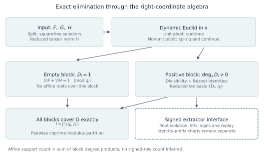
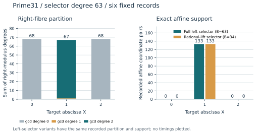

# Certificate-producing quotient queries

FASS structured elimination component · 23 November 2026

Tracking: [PR #4966](https://github.com/isogeny-labs/crypto/pull/4966), which merged before this implementation was complete. Implementation branch: `lane/fass-quotient-unit-query-implementation-20261123`. This report continues the [target-quotient study](../target_quotient/REPORT.md). Written mathematics and unsigned native evidence retain **unverified PCC standing**. Producer observations: [PCC-20261123-278c73](../../../pcc/claims/PCC-20261123-278c73.json). Written derivation: [PCC-20261123-a228b1](../../../pcc/claims/PCC-20261123-a228b1.json). [pcc:unverified]

## 1. What survives the coupling

The new component produces an exact triangular decomposition of the affine quotient query. Each empty component carries a polynomial Bézout identity; each positive component carries a monic polynomial D_i whose degree counts the left coordinates above every right coordinate in that component. The pair (D_i,q_i), including its right-coordinate modulus, is a reduced lexicographic Gröbner basis per positive component. The construction provides a concrete use for the retained structure: eliminate by univariate arithmetic with explicit splitting when a coefficient is a zero divisor. [THEORY.md](THEORY.md) gives the derivation. [pcc:PCC-20261123-a228b1]

This addresses the previous study's unresolved step. A compact norm circuit, or a coefficient matrix of full rank, does not answer whether the relevant finite grid contains a zero. The query solver answers that question and returns checkable algebraic evidence. It does not require a generic-rank hypothesis or expand the original multivariate summation system. The technique is an application of classical dynamic evaluation and regular gcds; the contribution here is its concrete contract, implementation and qualification on the existing FASS quotient.

The first frozen development call completed all 95 predeclared cases: 41 empty queries, 618 certificate identity checks, 24,454 oracle grid cells and 318 rejected certificate mutations. These are finite correctness observations, with no timing claim. All 95 certificates were checked inline; complete proof objects were retained for the preselected 27 cases. The other records bind their serialized certificate hashes and sizes. [Raw records](evidence/producer/attempt1/qualifier.stdout.jsonl). [pcc:PCC-20261123-278c73]

## 2. The precise algebraic question

Let the field be Fp, and let F(x), G(t) be monic, squarefree and fully split, of degrees B and e. For the curve application, p>3, the short-Weierstrass curve is nonsingular, and d divides p−1. Write L(z)=z^d−1. The left selector F is either L or the polynomial of its rationally liftable abscissae. The actual right selector is

$$
G(t)=\mathrm{gcd}\!\left(\prod_{z^d=1}S_3(t,z,X),\ t^p-t\right).
$$

The product is unnormalized, so a vanished quadratic leading coefficient does not cause division by zero. Construct the canonical residue

$$
H(x,t)=\mathrm{Res}_z\!\left(L(z),S_3(x,z,t)\right)\bmod(F(x),G(t)).
$$

We seek the zeros of the ideal I generated by F, G and H. This is an exact finite-grid problem. Squarefreeness and splitting ensure that its coordinate algebra is a product of copies of Fp; imposing H=0 selects factors of that product. Thus this finite-grid ideal is radical. No analogous radicality assertion is made about an unreduced composed-selector chain. Constant selector F=1 or G=1 means an empty domain; zero, repeated-root and nonsplit moduli are refused. [THEORY, sections 1–3](THEORY.md). [pcc:unverified]

## 3. From Euclid to component Gröbner bases

Compute the gcd of F and H as polynomials in x over Fp[t]/G. This coefficient ring generally is not a field. Before inverting a leading coefficient c(t), compute its gcd with the current modulus q(t). A unit permits ordinary Euclid; a zero coefficient is trimmed. A proper gcd splits q into coprime factors, and both reduced branches continue. This is the classical D5 mechanism. The present implementation uses schoolbook polynomial arithmetic and restarts on a split.

For each terminal block, return its monic modulus q_i, a monic D_i in x, divisibility cofactors and Bézout factors. The certificate requires a pairwise coprime partition G=product(q_i), together with

$$
F=D_iA_i,\qquad H=D_iB_i,\qquad U_iF+V_iH=D_i\pmod{q_i}.
$$

These identities imply equality of the two ideals on each block. Chinese remaindering then gives the full decomposition

$$
\langle F,G,H\rangle=\bigcap_i\langle q_i,D_i\rangle.
$$

Specializing at any root of q_i makes D_i the monic gcd of F and that fibre of H. Monicity preserves its x-degree r_i; squarefree split F makes its r_i roots distinct and rational. Therefore

$$
|Z|=\sum_i\deg(q_i)\deg_x(D_i).
$$

When D_i=1, its Bézout identity excludes the entire block without enumerating its points. For a positive block, coefficients reduced modulo q_i make the leading monomials of D_i and q_i equal to x raised to r_i and t raised to deg(q_i). They are coprime, and all remaining monomials are reduced. Hence the pair is a reduced Gröbner basis in lexicographic order x>t. Empty blocks have basis {1}. **The union of these component bases is not a global basis:** the full ideal is their intersection, not their sum. [THEORY, Propositions 1–2](THEORY.md). [pcc:unverified]

For a symbolic illustration over F5, take F=x(x−1), G=t(t−1), H=tx+1−t. At t=0 the gcd is 1; at t=1 it is x. Inverting t before splitting would lose the first branch. The correct decomposition returns one empty block and one point, (0,1). Degree changes therefore carry useful geometric information rather than constituting an exceptional numerical failure.

## 4. The retained norm and its actual cost

S3 is quadratic in the eliminated coordinate z. With S3=az²+bz+c, the existing division-free selector norm is

$$
N_d=a^d+c^d-T_d,\qquad T_0=2,\quad T_1=-b,\quad T_{j+2}=-bT_{j+1}-acT_j.
$$

Binary evaluation uses O(log(2d)) ring operations and remains valid when a=0. Evaluating directly in Fp[x,t]/(F,G) avoids the unreduced bivariate norm. Its explicit state still has B·e field-coefficient slots. A short circuit does not make those ring operations scalar-cost operations. [Selector derivation](../selector/REPORT.md); [THEORY, section 5](THEORY.md).

Writing M(n) for an applicable polynomial multiplication bound, nested multiplication gives the following theoretical costs in base-field operations:

| Operation | Classical arithmetic target |
| --- | --- |
| Tensor norm construction | O(M(B) M(e) log(2d)) |
| Dynamic half-gcd with organized splitting | O(M(B) log(2B) M(e) log(2e)) |

The second bound follows from Dahan and coauthors' Propositions 2.4 and 4.1. It requires their fast arithmetic and splitting organization; it is **not** a bound established for this restarting implementation. With quasi-linear multiplication, both targets remain softly proportional to B·e. State copies, inversions, root extraction and certificate construction also require accounting. An elliptic index system can enable other resultant strategies, but a multiplicative selector of x-coordinates does not automatically supply that index system. [D5 paper](https://cs.uwaterloo.ca/~eschost/publications/DMSWX-05b-TC-2006.pdf); [Bernstein–De Feo–Leroux–Smith, Example 4.13](https://arxiv.org/pdf/2003.10118).

The one selected degree-63 tensor construction records 65 tensor-ring multiplications and 2,312 reduced output slots for B=34, e=68. The latter is output storage, not measured peak memory; the former excludes the remaining query work. The other five degree-63 cases use the prior dense H construction and record `norm:null`: direct tensor construction was not attempted on them. This selection preceded calls. No speed comparison with general Gröbner software has been executed. [Raw case `prime31-d63-x0-liftable`](evidence/producer/attempt1/qualifier.stdout.jsonl). [pcc:PCC-20261123-278c73]

## 5. What the degree-63 blocks explain

The fixed Prime31 curve has p=2147483647, A=847514846 and B_curve=2087444724. At d=63, both the full left selector of degree 63 and its rational-lift selector of degree 34 produce the following recorded outcomes. The partition column groups modulus degrees by the degree of the returned x-gcd. [Raw records](evidence/producer/attempt1/qualifier.stdout.jsonl). [pcc:PCC-20261123-278c73]

| Target X | Right degree e | Gcd degree : modulus mass | Affine support |
| --- | --- | --- | --- |
| 0 | 68 | 0 : 68 | 0 |
| 1 | 67 | 1 : 1; 2 : 66 | 133 |
| 2 | 68 | 0 : 68 | 0 |

The X=1 pattern has an explanation written before the call in [CANCELLATION_PREDICTION.md](CANCELLATION_PREDICTION.md). For a selector target Q=(X,Y), with Y nonzero and the full left selector, each right fibre contains x=X. It also contains any selector x satisfying S3(x,X,t)=0. The diagonal identity

$$
S_3(X,X,t)=-4Y^2t+(X^2-A)^2-8B_{\mathrm{curve}}X
$$

has exactly one root, t=x(2Q). Every other right fibre therefore contains at least two distinct left roots; that one fibre contains at least one. This forces support at least 2e−1. Equality forces precisely the observed degree-one/degree-two partition. This lower-bound argument requires Y nonzero; the diagnostic remains descriptive on 2-torsion inputs. [pcc:unverified]

The call records 133 zero cells, 67 on x=X, 67 satisfying the S3 predicate, union 133 and zero outside it. The unique degree-one modulus root is t=1934056707. Both left-selector variants agree. These values match the preregistered aggregate partition prediction; the prediction did not require the implementation to return exactly two blocks. [Raw records](evidence/producer/attempt1/qualifier.stdout.jsonl). [pcc:PCC-20261123-278c73]

This explains coordinate support, not useful relation yield. A projected pair can admit both a cancelling signed explanation and another signed witness. For instance, when Q=3P and the relevant abscissae belong to the selector, (x(P),x(2P)) can represent P+P+P=Q as well as −P+Q+P=Q. The classifier must not discard such pairs before complete witness recovery.

## 6. Evidence, boundaries and next integration

The [frozen protocol](PROTOCOL.md) selected all fixtures and persistence decisions before calls. The first producer build and qualifier exited zero. Its separate arithmetic checker uses its own field and polynomial operations; the grid oracle does not feed roots to the query algorithm. [pcc:PCC-20261123-278c73]

| Retained check category | Count |
| --- | --- |
| Curve / synthetic cases | 88 / 7 |
| Direct tensor constructions checked | 83 |
| Complete certificates persisted | 27 of 95 |
| Identity checks / oracle grid cells | 618 / 24,454 |
| Certificate mutations rejected / inputs refused | 318 / 13 |

Separate-role replay of the same frozen executable returned exit zero and matched the producer JSONL and all 27 certificate/sidecar pairs byte for byte. A certificate-only reader then checked the 27 persisted objects, including 20 S3 inputs, with 111 identity checks and 275 grid cells; it did not call the producer solver. These are same-host, unsigned checks. The reader binds certificate bytes to the 95 compact records. Those original records did not hash sidecar bytes; the reader now records sidecar hashes and checks the S3 input binding. [Replay comparison](evidence/independent/replay1/comparison-status.txt); [reader output](evidence/independent/checker1/checker.stdout.json). [pcc:unverified]

Custody has a specific limitation: the producer's pre-call source inventory covered 13 files and omitted Cargo.lock through ignore filtering, although the lockfile had been copied read-only before the build. The original inventory is preserved. A separate 14-file inventory, including the lockfile, was added after the producer call and before independent replay. It does not retrospectively establish a pre-call lockfile hash. The retained executable has its own pre-call binding.

The [proof map](PROOF_MAP.md) separates written arguments, finite identities and formal status. The separate full-root library gate is pending at this report's freeze; the coordinator retains its outcome separately. No Lean or Lake executable was available, and no kernel proof is claimed. The native interface currently admits fields 97 and 2147483647 and modulus degrees at most 256. [Native contract](native/README.md).

Positive blocks now provide a focused interface for the existing signed extractor: isolate their right roots, then the corresponding D_i roots; recover eliminated selector witnesses; lift points; reconcile signs and collision buckets; and replay the original group equation. Nonliftable left roots can create algebraic positives when F=L. An empty full-selector grid still excludes every affine sub-base contained in it. Infinity prefixes, including P1+P2=O, and an identity target require separate charts. A complete signed EMPTY verdict must cover those charts as well.

The next implementation step is to preserve Euclidean work through splits and add fast arithmetic, while measuring the complete query and extraction phases under the repository's admitted comparison protocol. Canonical performance graphs stay unchanged: this report adds a structured algebraic component and fixed correctness evidence, with no performance ranking or complete signed-output measurement.

## Sources and reproducibility

The research KB was unavailable in this runtime and its repository wrapper reported no executable. Scoped fallback used the preceding [coupled](../coupled/REPORT.md), [target-quotient](../target_quotient/THEORY.md) and [pair-spectrum](../../prime31_summation_compression_20261122/iteration9/PAIR_SPECTRUM_RESULTANT.md) work. Primary sources read include [Petit–Kosters–Messeng](https://people.maths.ox.ac.uk/petit/files/16PKC_primeECDLP.pdf), the full [D5 author preprint](https://cs.uwaterloo.ca/~eschost/publications/DMSWX-05b-TC-2006.pdf), the regular-gcd sections of [Li–Moreno Maza–Pan](https://www.csd.uwo.ca/~mmorenom/Publications/Li.Moreno-Maza.Pan-JSC-format-2009.pdf), and [Bernstein–De Feo–Leroux–Smith](https://arxiv.org/pdf/2003.10118). These establish prior art and arithmetic conditions; no novelty priority is asserted.

Reproduce the component from the immutable source/build manifests and protocol. The [presentation-only renderer](render_report.py) reads this report and the retained JSONL, copies recorded values into the figures and embeds vector equations. Its [QA receipt](renderer-qa.json) binds the report, plotted records and PDF. It performs no cryptographic arithmetic or scientific verification.
