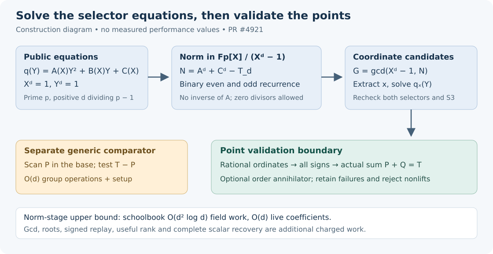

# A division-free selector resultant for prime-field S3 relations

Date: 2026-11-22. Parent: [crypto PR #4921](https://github.com/isogeny-labs/crypto/pull/4921), candidate C of the [FASS protocol](../PROTOCOL.md). Scope: an algebraic two-coordinate relation extractor, with a written universal identity and a bounded native correctness qualification. The frozen development contract is [PLAN.md](PLAN.md). The production implementation is [semaev_selector.rs](../../../src/cryptanalysis/semaev_selector.rs).

**Standing.** The derivations below are mathematical manuscripts, not Lean-kernel or signed PCC results. The [focused native qualification](evidence/attempt3/tests.stdout.log) passed all 15 tests with zero failures on its frozen FASS source inventory. Current-main reconciliation/requalification and the whole-library gate remain open, as detailed below. The independently authored test module is from the same team, not a signed external verifier. No runtime, useful-relation yield, or complete solving-cost measurement is claimed. [pcc:unverified]

## 1. Construction and instance boundary

For a nonsingular short-Weierstrass curve `E: y²=x³+ax+b` over an odd prime field, public finite target `T=(t,u)`, and positive divisor `d | p-1`, solve

\[
S_3(X,Y,t)=0,\qquad X^d=Y^d=1.
\]

The coordinate domain is the multiplicative subgroup `mu_d`. The factor base contains the rational points above those coordinates, optionally restricted by an explicitly supplied order annihilator. A coordinate solution is not yet an elliptic-curve relation: rational lifting, signs, and actual group addition are checked afterward. This distinction matters even when every selector root is in the base field.

The implementation writes `q(Y)=A(X)Y²+B(X)Y+C(X)`, with

\[
\begin{aligned}
A&=(X-t)^2,\\
B&=-2\bigl((X+t)(Xt+a)+2b\bigr),\\
C&=(Xt-a)^2-4b(X+t).
\end{aligned}
\]

In the **commutative quotient ring** `K=Fp[X]/(X^d-1)`, it computes

\[
N_d=A^d+C^d-T_d,
\quad T_0=2,\ T_1=-B,\ T_{n+2}=-BT_{n+1}-ACT_n.
\]

The support polynomial is `G=gcd(X^d-1,N_d)`. Only its roots require the subsequent quadratic solve. No factor-base pair-sum dictionary or hidden witness restricts the candidate's domain. `K` generally has zero divisors; the procedure never divides by `A`. [pcc:unverified]

The frozen Prime31 correctness instance reuses [prime31_batched_ic_same_1024q.rs](../../../examples/prime31_batched_ic_same_1024q.rs): `p=2147483647`, `a=847514846`, `b=2087444724`, declared subgroup order `r=2147446831`, and `G=(625037715,2100627251)`. The qualification checks the declared primes and replays the point/order assertions; it does not independently count the curve. The component uses chosen correctness targets plus the fixed public generator; it supplies no random-target yield estimate or new classification of the curve.

## 2. Universal resultant identity

**Proposition 1 (universal polynomial statement).** For every commutative ring `R`, every `A,B,C in R`, and every integer `d>=1`,

\[
\operatorname{Res}_Y(Y^d-1,AY^2+BY+C)=A^d+C^d-T_d.
\]

The first argument is the monic selector. Equivalently, this is the determinant of multiplication by `AY²+BY+C` on the free rank-`d` module `R[Y]/(Y^d-1)`. This convention avoids a degree-dependent sign ambiguity when the second polynomial drops from degree two to degree one, and makes specialization at degree drops explicit. The statement permits `A=0`, `B=0`, zero divisors, and every characteristic. It makes no assertion about root existence over a general ring. [pcc:unverified]

**Proof.** Work first over the polynomial ring `Z[A,B,C]` and embed it in `Q(A,B,C)`. In a splitting field let `alpha,beta` be the roots of the generic quadratic. Then `alpha+beta=-B/A`, `alpha beta=C/A`. Consequently the sequence `A^n(alpha^n+beta^n)` has initial values `2,-B` and satisfies the displayed recurrence; hence it equals `T_n`. Over a splitting field for `Y^d-1`, with roots counted with multiplicity,

\[
\begin{aligned}
\operatorname{Res}(Y^d-1,q)
 &=\prod_{\zeta^d=1}q(\zeta)\\
 &=A^d\left[(-1)^d(\alpha^d-1)\right]
          \left[(-1)^d(\beta^d-1)\right]\\
 &=A^d\bigl((\alpha\beta)^d-\alpha^d-\beta^d+1\bigr)\\
 &=C^d-T_d+A^d.
\end{aligned}
\]

Both sides belong to `Z[A,B,C]`, so equality in its fraction field is equality in that polynomial ring. Specializing its indeterminates by the universal coefficient homomorphism proves the identity for every `R`. The proof uses division only in this generic auxiliary field; the resulting identity and algorithm use none. This specialization argument is what licenses quotient rings with zero divisors. It must be retained in a formal proof; proving only the case of invertible `A` is insufficient. [pcc:unverified]

**Degree-drop and odd-degree checks.** At `A=0`, the formula becomes `C^d-(-B)^d`. For odd `d`, this is `C^d+B^d`; for even `d`, it is `C^d-B^d`. It is exactly the product of the linear polynomial over the selector roots. If `A=B=0`, the result is `C^d`, including zero when the whole polynomial vanishes. One must not replace `(-B)^d` by `B^d` for odd `d`, or silently reverse resultant arguments after a degree drop. [pcc:unverified]

For S3 the important degree drop is `X=t`: `A(t)=0` and `B(t)=-4(t^3+at+b)`. If the target has nonzero ordinate this is a linear equation and recovers the tangent branch. If `t^3+at+b=0`, then `C(t)=(3t²+a)²`, nonzero on a nonsingular curve; there is no finite second summand in that branch. The selector norm therefore handles the diagonal without inverting `(X-t)²`. Infinity targets are outside the finite-target API and require a separate inverse-pair path.

## 3. Binary doubling over a ring

Put `s=-B`, `v=AC`. The sequence is the first-kind Dickson evaluation `T_n=D_n(s,v)`, with `D_0=2`, `D_1=s`, and `D_(n+2)=sD_(n+1)-vD_n`. The following are universal polynomial identities:

\[
\begin{aligned}
T_{2n}&=T_n^2-2v^n,\\
T_{2n+1}&=T_nT_{n+1}-s v^n=T_nT_{n+1}+Bv^n,\\
T_{2n+2}&=T_{n+1}^2-2v^{n+1}.
\end{aligned}
\]

To see this, use formal roots `u,w` with `u+w=s`, `uw=v`: expand `(u^n+w^n)^2` and `(u^n+w^n)(u^(n+1)+w^(n+1))`, then specialize the resulting symmetric polynomial identities. No inverse, square root, or assumption that `v` is a unit is needed. [pcc:unverified]

Maintain `(T_n,T_(n+1),v^n)`. Starting at `(2,s,1)`, each incoming binary digit replaces `n` by `2n` or `2n+1` using these three equations and squaring `v^n`. The odd update uses `v^(2n+1)=v(v^n)²`. A constant number of ring multiplications per digit evaluates `T_d`; ordinary binary powering supplies `A^d,C^d`. Reducing after each operation is valid because the quotient map is a ring homomorphism. In particular, this is not the special power-of-two recurrence alone.

At `p=2^31-1`,

\[
p-1=2147483646=1302\cdot1649373,
\qquad1302=2\cdot3\cdot7\cdot31.
\]

Thus `X^1302-1` splits into distinct linear factors over `Fp`. Also `p-1=2*1073741823`, with odd second factor, so a selector `X^(2^k)-1` has the requested `2^k` distinct base-field roots only for `k<=1`. The correctness ladder includes odd divisors to exercise the odd doubling branch.

## 4. From support to actual relations

**Proposition 2 (coordinate extraction).** Let `p` be prime, `d>=1`, `d | p-1`, and let `q in Fp[X,Y]` have degree at most two in `Y`. Let `N=Res_Y(Y^d-1,q)` and `G=gcd(X^d-1,N)`, chosen monic. Then for every `x in Fp`,

\[
G(x)=0\iff x^d=1\text{ and there exists }y\in\mathbf F_p
\text{ with }y^d=1\text{ and }q(x,y)=0.
\]

**Proof.** For `x^d=1`, specialization gives `N(x)=product_(y^d=1) q(x,y)`. The selector is split and squarefree. A product in the field vanishes exactly when at least one factor vanishes. Taking the gcd with the selector retains exactly these roots. Reducing `N` modulo the selector does not change its values at selector roots or its gcd. Recover every quadratic root and recheck membership; if `q(x,Y)` is the zero polynomial, every selector root is a coordinate solution and output size can be quadratic. The S3 specialization on a nonsingular curve has no zero-polynomial fiber: off the diagonal `A!=0`, and the diagonal analysis above excludes it. [pcc:unverified]

**Point stage.** For each coordinate pair, enumerate the rational ordinates using the existing exact root routines, replay each signed sum, and retain only equality to the original public target. If an order `r` is supplied, require `[r]P=[r]Q=[r]T=O`. An annihilator test is not, without a separate group/order argument, a certificate that the points lie in one particular cyclic subgroup. No logarithm is provided to extraction or lifting.

**Why lifting is essential.** On `E/F7: y²=x³+x`, take target `(0,0)` and `mu_3={1,2,4}`. The pair `(2,4)` obeys both selectors and `S3(2,4,0)=(8-1)²=0 mod 7`, but `f(2)=3` and `f(4)=5` are nonsquares. It is a coordinate solution and must produce no rational signed pair. The [qualified test](../../../tests/semaev_selector.rs) retains this coordinate candidate, rejects its two ordered nonliftable forms, and separately retains the rational signed relations. This finite test does not prove the general lifting theorem. [pcc:unverified]

## 5. Cost accounting and decisive comparison

Let `M(d)` denote the field-operation cost of multiplying degree-less-than-d polynomials with reduction modulo the selector. Let `h=deg G<=d` and `k` be the number of returned coordinate pairs.

| Phase | Bound / accounting obligation |
|---|---|
| Norm construction | `O(M(d) log d)`; the actual reused schoolbook backend gives `O(d² log d)` field operations and `O(d)` live coefficient storage |
| Support gcd | Charge actual polynomial gcd; classical dense Euclidean arithmetic has `O(d²)` field-operation cost, including field divisions |
| Root extraction | Separate cost depending on `h,p` and the implemented splitter; reused `poly_roots` uses Las Vegas splitting without a deterministic retry limit |
| Quadratic recovery | At most one degree-two fiber per support root for S3, then selector checks and output; field exponentiation/square-root work remains charged |
| Signed replay | Rational square roots, all signs, actual additions, optional order checks, duplicate handling and emitted bytes |
| Complete IC | Setup + all attempts + useful relation/rank processing + linear algebra mod r + individual recovery + independent scalar replay |

An `O(M(d) log d)` formula does not mean a fast-multiplication backend has been implemented. Neither `O(d)` polynomial storage nor the norm bound covers retained outputs, recursive splitter workspace, matrices, or a complete solver. For S3, `k<=2d`; the general quadratic API must still respect its potential all-root fiber.

The appropriate algebraic comparator is the same-base original/direct and power-chain F4 system in `ic_framework/subgroup_semaev.rs`, with every arm solving the same accepted point-relation problem. Its full factor-base constraint and rejected-root work stay included. The separate generic control scans the `O(d)` signed factor-base points, computes `T-P`, and tests membership: `O(d)` group operations and expected constant-time indexed probes after charged `O(d)` setup. Counting bit operations adds the cost of field arithmetic; batched inversions may change constants. Thus this construction has **no asserted asymptotic advantage over that direct scan**. The research question is whether its structure lowers the real algebraic relation-solving cost and remains useful after integration.

No numerical cost table or quantitative graph is supplied because no admitted performance experiment accompanies this manuscript. The diagram shows the computation and validation boundary instead. Existing IC scoreboards, progress timeline and benchmark graphs receive no new measured point from this report.

## 6. Qualification, proof standing, and next work

The pre-implementation [PLAN.md](PLAN.md) fixes exhaustive small-field coefficient/selector checks, independent coordinate and signed-group oracles, degree drops, nonsplit-selector refusal, nonliftable roots, and chosen Prime31 positives at `d=6,31,1302`. It prohibits using the reference enumeration inside the candidate. Every failed attempt, source binding, command, exit code and final result belongs in the parent-owned evidence receipt. A separately authored review/test module from this same team improves error detection but is not an independently signed PCC verdict. [pcc:unverified]

The [focused qualifier](qualifier/README.md) compiles the full production selector, S3 projection and polynomial modules, together with the original identity-certificate and SHA-256 modules. Its `pkm_smooth_tower.rs` dependency is the unchanged byte prefix before the unique `// ------------------------------- Method 2 with class number > 1 (Hilbert)` anchor: complete field, RNG, curve and polynomial-root items are retained, and later unrelated F4/isogeny consumers are excluded. The [build manifest](evidence/attempt3/source.build.json) records the full 81,214-byte source and the selected range `[0,40482)`, with both hashes. The [pre-call](evidence/attempt3/tests.precall.json) and [post-call](evidence/attempt3/tests.postcall.json) records bind the same source inventory and copied executable. This is declared source-range extraction, not a whole-library build; the full repository gate remains separate.

**Current-main integration limit.** The development evidence is bound to the frozen FASS source inventory. The separate [main-integration audit](evidence/main-integration-audit.json) compared it with main commit `856dfeb0be25df78ab3877741544f64940128fac`: `semaev_projection.rs` has changed the used `s3_quadratic` and `quadratic_root_keys` wrappers and added imports/dependencies. Because the qualifier compiles that whole file, the 15 passing tests cannot be carried over to a current-main merge, and the existing qualifier has not been rebuilt against that version. The selected `pkm_smooth_tower.rs` prefix and the complete polynomial, identity-certificate and SHA-256 sources remain byte-identical at the pinned main commit. The read-only audit's inference of equivalent used arithmetic on canonical inputs is not execution evidence. Current-main reconciliation and a fresh source-bound correctness run remain open alongside the whole-library gate. This audit is unsigned same-team source review; the tested sources and retained attempt-3 evidence are unchanged.

| Item | Recorded status |
|---|---|
| Universal formula and ring-safe doubling | Written derivations above; formalization incomplete |
| Focused native qualification | [15 passed, 0 failed](evidence/attempt3/tests.stdout.log), [exit 0](evidence/attempt3/tests.exit); bounded cases below |
| Coordinate/signed-set oracle agreement | Complete equality on the registered finite panels; same-team separately authored oracle |
| Identity controls | Three issued evaluation records below; not universal proofs |
| Lean assembly/proof gate and axiom audit | Blocked: neither `lean` nor `lake` is installed in this runtime |
| Whole-library gate | Two finite `cargo test --release --lib --offline -j1` attempts, limited to 180 seconds and an additional 300 seconds, both exited 124 while compiling dependencies; no root test result |
| Current-main integration | Open at pinned main `856dfeb0be25df78ab3877741544f64940128fac`; changed projection module/dependency graph needs reconciliation and new qualification |
| Same-team mathematical/code review | [Persisted review of the prior manuscript](evidence/source-audit.json) found no defect in its stated identities/support arguments and matched all 14 source/inventory records, the selected prefix and copied binaries; unsigned |
| Performance and complete cold recovery | Future admitted experiment; no measured value |

The persisted [source audit](evidence/source-audit.json) names the preceding manuscript with SHA-256 `520f13fc8ee1ae8af222aebf2bb7fd311de3ed1cd8ac51f27e587112c436d81e`. It does not bind or review this later integration paragraph. Its reviewer also authored the integration-test module, so the review is not independent of all producer evidence. The new integration limitation is supported separately by the [main-integration audit](evidence/main-integration-audit.json); neither record is a signed PCC verdict or a fresh execution result.

The [final native receipt](evidence/attempt3/tests.stdout.log) records 2,808 constant-coefficient/Sylvester specializations, 50 polynomial-coefficient cases, 360 small-field coordinate cases (225 empty, 489 ordered pairs), and 388 rational target cases producing 450 signed pairs. Separate tests cover degree drops, extension-only coordinates, optional order constraints and input refusals. These are correctness counts, not estimates of relation yield or running cost.

| Prime31 target panel | Degrees | Ordered coordinate / signed pairs | Meaning |
|---|---|---|---|
| Chosen doubling target `(1934056707,318060938)` | 6, 31, 1302 | 1 / 1 at each degree | The initial deterministic positive selection chose the same diagonal case three times |
| Distinct-coordinate target `(1207772219,406744988)` | 1302 | 2 / 2 | Added check with witness `(1,749117756)+(2,51658786)`; both orderings recovered |
| Fixed generator target `(625037715,2100627251)` | 1302 | 0 / 0 | Empty result retained and checked against the complete reference |

At `d=1302`, the reference panel tests 1,695,204 ordered coordinate pairs and enumerates 1,306 rational selector points. The reference enumeration is confined to the test oracle; the candidate runs the norm, gcd, root and signed-replay path. The distinct-coordinate and fixed-target additions close the concrete gap discovered in the initial diagonal-only Prime31 choices. They do not turn this small, deliberately selected panel into an unbiased success-rate study.

**Preserved attempts and limits.** [Attempt 1](evidence/attempt1/build-tests.stderr.log) failed to compile because the focused crate omitted its `hex` dependency. After that harness correction, [attempt 2](evidence/attempt2/tests.stdout.log) passed the original 13 tests. Attempt 3 retained those tests and added the two targeted Prime31 checks above. Its compilation overlapped the first bounded whole-library compilation; actual qualifier test execution was serialized after that compiler ended. This compile-only plan deviation provides no timing evidence.

The first whole-library attempt reached its 180-second limit with [exit 124](evidence/library/root-tests.exit); its [compiler log](evidence/library/root-tests.stderr.log) ends during `aws-runtime` compilation. A second attempt was then allowed an additional 300 seconds using the dependency cache populated by the first. It also returned [exit 124](evidence/library/root-tests-attempt2.exit), with its [compiler log](evidence/library/root-tests-attempt2.stderr.log) ending during `isogeny_algos` compilation. Its [pre-call](evidence/library/root-tests-attempt2.precall.sha256) and [post-call](evidence/library/root-tests-attempt2.postcall.sha256) source hashes are retained. Neither attempt reached a root test result, and neither showed a compiler error or out-of-memory failure in the observed logs. The whole-library gate remains unresolved; no further test run is planned for this qualification. The checkpoint admission attempt is recorded only in the session log as lacking a configured AWS profile or upload token; no separate receipt is asserted, and no performance run or new benchmark row is supplied.

The [proof map](PROOF_MAP.md) follows `lean-instance-gate`: reuse `Polynomial.dickson 1 (A*C)`, existing recurrence/mapping laws and standard polynomial/quotient objects. The recurrence belongs over `CommRing`; the root-existence implication belongs over a field. No uncompiled Lean file or fictitious declaration is supplied. Generic missing laws belong in crypto-lean before an instance endpoint. Future proof completion requires pinned dependencies, a type-checked assembly probe, focused build, axiom audit and the repository proof gate.

The existing native identity checker accepted three producer-side controls. Each record contains 32 deterministic certificate points and 32 additional deterministic checker points over `F_(2^61-1)`. Their status is `evaluated_not_formally_proved`; the public samples do not supply an adversarial soundness bound or independent verifier randomness. These controls check the displayed low-degree root-power identities, not the universal resultant theorem, the binary algorithm invariant, the quotient implementation, or signed lifting. The [checker receipt](evidence/attempt2/certificates.stdout.json) and [pre-call](evidence/attempt2/certificates.precall.json)/[post-call](evidence/attempt2/certificates.postcall.json) bindings retain the issued artifacts.

| Evaluation record | Identity checked |
|---|---|
| [IDC1h902fa2049de745c9](identities/IDC1h902fa2049de745c9.json) | `u²+v²=(u+v)²-2uv`, the even root-power step |
| [IDC1he093a3eae6a97efd](identities/IDC1he093a3eae6a97efd.json) | `alpha*u²+beta*v²=(u+v)(alpha*u+beta*v)-(alpha+beta)uv`, the odd root-power step |
| [IDC1h6d456b2a22da4771](identities/IDC1h6d456b2a22da4771.json) | `q(y)q(-y)=A²y⁴+(2AC-B²)y²+C²`, a quadratic squaring control |

After current-main reconciliation and fresh source-bound correctness qualification, freeze the matched algebraic comparison under the existing checkpoint, runner, budget and source/image admission rules. Include the same-base F4 systems and main's `resultant_decompose_m2` / `ResultantOracleM2` implementation alongside this selector norm; the [pinned-source audit](evidence/main-integration-audit.json) identifies that additional comparator after the unchanged tower prefix. Charge failed targets, extraction and useful rank. Advance to three-summand integration only from that result; use the complete one-target cold interval for any complete-IC comparison. This comparator inventory asserts neither novelty nor a speed advantage.

## 7. Sources and reuse map

The checked source scope is intentionally explicit. KB MCP was unavailable and the repository wrapper lacked its executable. Conductor was unavailable; the parent isolated the checkout and assigned disjoint file scopes. The audit did not decrypt protected sibling-repository files. These gaps preclude an exhaustive novelty or absence claim.

| Source | What it supplies / avoids duplicating |
|---|---|
| [Semaev, ePrint 2004/031](https://eprint.iacr.org/2004/031) | Classical S3 context; metadata/search text accessible, direct PDF fetch returned 403. No theorem here relies on an unread proof from that PDF |
| [Mathlib Dickson source, 6ebcce3](https://github.com/leanprover-community/mathlib4/blob/6ebcce37335bcb6bca64596e5d57bb3035648030/Mathlib/RingTheory/Polynomial/Dickson.lean) | Existing first-kind polynomial family and recurrence/mapping laws; an inspected source revision, not this study's compiled dependency pin |
| [semaev_prime_poly.rs](../../../src/cryptanalysis/semaev_prime_poly.rs) | Reused field, schoolbook polynomial arithmetic, gcd and scalar formal-resultant oracle |
| [pkm_smooth_tower.rs](../../../src/cryptanalysis/pkm_smooth_tower.rs) | Reused curve arithmetic and polynomial root extraction |
| [semaev_projection.rs](../../../src/cryptanalysis/semaev_projection.rs) | Reused quadratic recovery; its pair-table join is a separate method |
| [subgroup_semaev.rs](../../../src/cryptanalysis/ic_framework/subgroup_semaev.rs) | Existing subgroup selectors and same-base F4 comparator |
| [Main tower source at 856dfeb0](https://github.com/isogeny-labs/crypto/blob/856dfeb0be25df78ab3877741544f64940128fac/src/cryptanalysis/pkm_smooth_tower.rs) and [integration audit](evidence/main-integration-audit.json) | Additional `resultant_decompose_m2` / `ResultantOracleM2` comparator; not part of the frozen qualifier or a completed comparison |
| [#4920](https://github.com/isogeny-labs/crypto/pull/4920), [#4922](https://github.com/isogeny-labs/crypto/pull/4922) | Chained-S3 adapter and shared Macaulay work already owned elsewhere |
| [#4692](https://github.com/isogeny-labs/crypto/pull/4692), [#4822](https://github.com/isogeny-labs/crypto/pull/4822), [#4812](https://github.com/isogeny-labs/crypto/pull/4812) | Public selector/RR9, sparse Wiedemann and Horner/F3 work, respectively |
| [#4368](https://github.com/isogeny-labs/crypto/pull/4368), [#4228](https://github.com/isogeny-labs/crypto/pull/4228) | Existing oriented S3 lift and certified quotient/direct-resultant prototypes |

Deliverables: this manuscript, [PROOF_MAP.md](PROOF_MAP.md), editable [diagram.svg](diagram.svg), [report.tex](report.tex), and the four-page [report.pdf](report.pdf). The PDF is a concise reading edition; this Markdown and proof map retain the full obligations.
