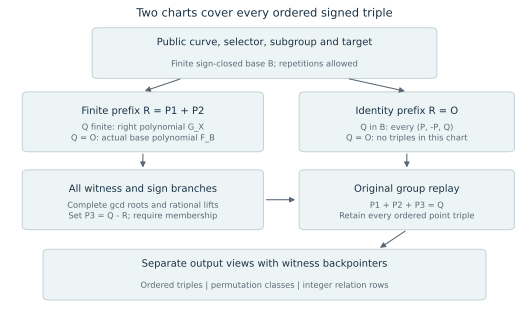
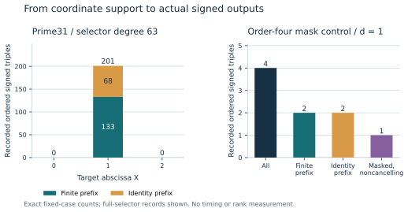

# Complete signed relation extraction

Prepared 22 November 2026 Pacific / 23 November UTC. Continuation of
[PR #4976](https://github.com/isogeny-labs/crypto/pull/4976).
The fixed producer qualification and all four separate-role checks
completed. The separate root-library gate is incomplete: its single
600-second call timed out during dependency compilation, before tests ran.
[pcc:unverified]

## What the component adds

The new Rust extractor converts the predecessor's triangular affine support
into actual ordered triples of rational curve points. It retains every
eliminated-coordinate witness and every admissible sign, handles identity
prefixes and the identity target explicitly, replays each group relation,
and records separate permutation classes and integer rows with witness
backpointers. The existing norm and dynamic quotient arithmetic are reused
without changing their frozen source or earlier evidence. The frozen
132-case producer and byte-identical replay completed with exact comparison
against the separate arithmetic oracle. The saved-output reader also
checked the 42 retained pairs without invoking extraction or quotient
solving. The degree 63 Prime31 X=1 case returns 201 ordered
triples: 133 with finite prefix and 68 with identity prefix. Every one has
an inverse pair. The fixed exceptional controls also retain noncancelling
triples on the same coordinate mask. [pcc:unverified]

The contract is a finite sign-closed base B, with the identity excluded and
repeated summands allowed. For a specified rational target Q, including O,
the output is exactly the set

$$
\mathcal{T}_Q=\{(P_1,P_2,P_3)\in\mathcal{B}^3:
P_1+P_2+P_3=Q\}.
\tag{1}
$$

This set is stronger than a count of coordinate solutions. Its complete
enumeration and replay are the acceptance conditions of the frozen
[protocol](PROTOCOL.md); independent relation rank and scalar recovery are
separate operations. The written completeness argument and its exact
hypotheses are in [THEORY.md](THEORY.md), with formal status in the
[proof map](PROOF_MAP.md). [pcc:unverified]

## Why both charts and all signs are necessary

For a finite target Q=(X,Y), the right message is the squarefree rational
part of the selector product

$$
G_X(t)=\gcd\!\left(\prod_{z\in V}S_3(t,z,X),\ t^p-t\right).
\tag{2}
$$

Each positive quotient cell (a,t) gets the complete left bucket
gcd(L(z),S3(a,z,t)) and the complete right bucket
gcd(L(w),S3(t,w,X)). The extractor visits every admitted rational signed
lift of a and z, computes R=P1+P2, requires a finite R with x(R)=t, and
then sets

$$
P_3=Q-R.
\tag{3}
$$

It checks actual base membership, the right witness backpointer and the
original group sum. Computing the actual prefix fixes its sign; independently
choosing canonical signs on two algebraic equations would not do so.

The missing case R=O contributes (P,−P,Q) for every P in B exactly when Q
is in B. When Q=O, a finite prefix instead has R=−P3, so its x-coordinate
belongs to the actual base support. This target chart uses that actual base
polynomial as G under both left-domain policies. It has no identity-prefix
output because P3=O is excluded.

Two-torsion points have one distinct lift. Doubling such a point reaches O
before any denominator is inverted. A nonliftable selector coordinate may
remain in the full-selector algebraic grid, but it contributes no base
point. Complete EMPTY requires all applicable charts and witness/sign
branches to finish; a cap or an invalid certificate cannot return EMPTY.

The main mathematical bridge is direct: every retained triple is replayed,
and every genuine triple has either a finite prefix, placing it in the
appropriate quotient grid, or the identity prefix above. The proof does
not assume that a polynomial zero already represents rational points with
compatible signs. [pcc:unverified]

## A cancellation mask cannot discard a coordinate cell

The predecessor identified a common mask for selector targets: a=X or
S3(a,X,t)=0. The mask says that cancellation can occur at those coordinates;
it does not classify every signed witness in that cell.

A fixed exceptional control makes this distinction explicit. On
y²=x³+x over F97, let P=(1,14). Its double is (0,0), so P has order four
and Q=−P=(1,83). With the degree-one selector L=x−1, both triples

$$
(P,P,P),\qquad(-P,-P,P)
\tag{4}
$$

sum to Q and have the same finite prefix coordinate t=0. Their first
coordinate is a=X=1. The first triple has no inverse pair, while the
second does. The triple (−P,P,−P) is retained separately in the identity
prefix chart. The control is deliberately exceptional and is not used as
a proxy for the ordinary Prime31 fixture. [pcc:unverified]

An order-five subgroup control on y²=x³+2x+3 over F97 also retains two
different left coordinate witnesses in one masked cell. It uses the exact
cycle generated by (3,6), selector degree 96, and both signs of the target
with x=80. A valid target outside that subgroup is admitted and has an
empty relation set. Subgroup membership comes from the complete validated
cycle, not only from an annihilator test. [pcc:unverified]

## Fixed native qualification

The first immutable build and producer call returned exit zero, with source
and executable custody checks unchanged. The frozen panel contains 132 cases and
retains complete serialized output/input pairs for 42 cases chosen before
execution. The other 90 cases retain exact serialization hashes and byte
counts after in-memory comparison. No outcome changes the persistence rule.
Aggregate totals count these fixed calls, including duplicate mathematical
problems under the two left-domain policies. They are not a count of
independent relations collected for one ECDLP instance.

| Fixed category | Cases | Coverage |
| --- | --- | --- |
| Ordinary F97, A=2, B=3 | 80 | Eight selector degrees; four finite targets and O; both left domains |
| Existing Prime31 fixture | 24 | Degrees 7, 21, 63; X=0,1,2 and O; both left domains |
| Two-torsion F97 control | 8 | Degree 2; three finite targets and O; both left domains |
| Negative target ordinates | 4 | X=1 at F97 degree 2 and Prime31 degree 7 |
| Exact order-five subgroup | 8 | Both signs, O and an external target; both left domains |
| Exceptional order-four control | 8 | Repeated points, two-torsion prefix and mask sharing |

The [retained producer output](evidence/producer/attempt1/qualifier/stdout.jsonl)
reports 1,496 ordered triples: 1,166 finite-prefix and 330 identity-prefix
triples, 884 with an inverse pair and 66 affine noncancelling triples on
the coordinate mask. There are 66 empty signed outputs. Across the repeated
calls, 9,391 coordinate support cells include 8,483 with no signed output.
All 16 invalid-input controls were refused. The largest of the 42 retained
complete result files is 10,059 bytes, below the frozen 64 KiB threshold.
[pcc:PCC-20261123-823abe] [pcc:unverified]

The ordinary Prime31 model is exactly the inherited
p=2147483647, A=847514846, B=2087444724 fixture. Its cases use the full
rational group policy, without a new assertion about the group order.
The component admits these two field moduli, nonsingular canonical curve
inputs, and selector degrees at most 128 dividing p−1. The actual-base
restriction includes both rational lifting and any configured subgroup.

The separate arithmetic oracle enumerates the complete signed relation
set from its own point inventory. It compares actual ordered triples and
backpointers, not just the producer's count or digest. The persisted reader
binds an independently specified fixture registry and exact input/output
bytes; its mathematical checking does not invoke the producer extractor,
norm constructor or quotient solver.

The [separate-role replay](evidence/independent/replay/comparison.txt)
reproduced all 132 cases with byte-identical raw output and all 84 retained
input/output files. Its in-memory mathematical checks have the full
132-case scope. The independent
[saved-output reader](evidence/independent/reader/stdout.json) bound the
132-case registry and checked the 42 persisted pairs, including 156
certificate identities, 652 grid cells, 596 exhaustive point pairs and
148 signed triples. These persisted triples include 56 identity-prefix
and 12 masked noncancelling triples; those smaller totals refer only to
the preselected saved subset.

The [reader controls](evidence/independent/controls/stdout.json) returned
all 91 required rejections and all three positive checks. Omitting the
identity chart, discarding witnesses on the cancellation-coordinate mask or collapsing
a collision bucket was rejected by exact tuple comparison even with
raw-byte binding disabled. The separate identity readback also passed,
with its narrower finite-evaluation scope described below. All four
independent calls returned exit zero with unchanged source and executable
custody checks. The [independent readout](evidence/independent/READOUT.md)
records their separate roles and limits.
[pcc:PCC-20261123-910aad] [pcc:unverified]

These are same-host development checks using the same built executable.
The independent point and polynomial arithmetic follows separate code
paths; certificate data types and SHA-256 are shared. There is no
second-host reproduction or signed execution attestation.

The same source received bounded immutable calls: a 240-second build;
300-second producer, replay, saved-output reader and controls; all at 2 GiB
and one process/thread. Identity issue and readback each had a separate
60-second limit at 2 GiB. Source, lockfile, protocol and executable digests
are recorded before calls and checked afterwards. At most one corrected
source attempt is allowed after a diagnosed implementation defect; an
earlier attempt is never overwritten. No corrected-source attempt was
needed for this qualification.

## What the Prime31 cells become after extraction

The fixed degree 63 records have the same signed outputs under the full
left selector (degree 63) and actual-base left selector (degree 34). The
base contains 68 signed points. The following counts apply to either
policy; these records were checked in memory and are hash-bound, while
their complete objects were not in the 42-case persistence selection.
[pcc:unverified]

| Target | Affine cells | Finite-prefix triples | Identity-prefix triples | Ordered triples |
| --- | --- | --- | --- | --- |
| X=0 | 0 | 0 | 0 | 0 |
| X=1 | 133 | 133 | 68 | 201 |
| X=2 | 0 | 0 | 0 | 0 |
| Q=O | 0 | 0 | 0 | 0 |

There is a prior analytical baseline for cancellation alone. If B has N
points and a finite Q belongs to B, the three possible inverse slot pairs
give

$$
|\mathcal{T}_Q^{\mathrm{cancel}}|
=3N-3+\mathbf{1}_{Q=-Q}.
\tag{5}
$$

Exactly N of these have identity prefix. For the inherited degree 63 base
with N=68 and non-two-torsion X=1 target, this predicts 201 cancellation
triples, of which 68 have identity prefix and 133 have finite prefix. This
prediction does not exclude additional noncancelling witnesses in the same
coordinate cells. The new extraction finds exactly those 201 triples and
no additional noncancelling ones for this fixed target. Its 201 tuples
collapse to 34 permutation classes and one integer row after target
subtraction. That row is zero: the guaranteed triple (Q,−Q,Q) has zero
row, and the complete output has only one row class. This is an exact
classification of this target's output, not a general rank conclusion.
[pcc:unverified]

The fixed target panel exercises chart and witness obligations. It does
not estimate random-target decomposition probability or the rate of useful
relation collection in an index-calculus cost model.

The order-four control instead returns four ordered triples, two from each
prefix chart. Three contain an inverse pair and one is noncancelling on
the mask. The two nonzero order-five targets each return 13 triples, with
four masked noncancelling triples; its identity target returns 12 triples,
all without an inverse pair. The external subgroup target returns zero
despite 102 algebraic cells under the actual-base left restriction. These
controls exercise the distinctions the Prime31 example alone cannot.
[pcc:unverified]

The output keeps ordered point triples, permutation classes and integer
rows as different objects. A row combines signs relative to the smaller
ordinate representative and subtracts the target column when Q is a base
point. A point with y=0 still contributes an integer +1, so two such
copies can give coefficient 2 even though their group sum is O. Neither
row equality nor absence of an inverse pair establishes relation rank.

## Evaluated diagonal identity and proof status

The supplemental native certificate uses the unchanged repository
identity-certificate module for

$$
S_3(a,z,a)=(3a^2+A)^2-4(a^3+Aa+B)(z+2a).
\tag{6}
$$

The producer issued
[IDC1hb354e24cbbf6ca6a](evidence/producer/attempt1/identity-issue/identity.json)
with 32 fixed evaluations and no formal proof pointer. The
[separate-role readback](evidence/independent/identity-read/stdout.json)
accepted those points and 32 further points from a different fixed public
seed over 2^61−1. It rejected both a changed coefficient with a recomputed
statement identifier and a changed digest. These checks neither establish an integer polynomial
identity by themselves nor justify an adversarial false-acceptance
probability from deterministic public samples.

The written coefficient argument shows that S3(a,z,t) is never identically
zero for a nonsingular curve: it is quadratic when a differs from t, linear
on the ordinary diagonal, and the nonzero constant f'(a)² on a two-torsion
diagonal. Thus each eliminated-coordinate bucket has at most two roots.
Let Z_Q denote the positive affine support cells defined in
[THEORY.md, section 2](THEORY.md). Once these cells are known, each has at most two left witness
coordinates and at most two rational signs at each of the first two
coordinates; the third point is fixed. A direct loose output bound is

$$
|\mathcal{T}_Q|\leq8|Z_Q|+
|\mathcal{B}|\,\mathbf{1}_{Q\in\mathcal{B}}.
\tag{7}
$$

For Q=O the last term is zero. This is a bound on the number of signed
outputs, not the cost of finding the quotient cells or isolating roots.
It identifies the compact part that survives the signed join without
asserting a bound on the original system's Groebner solving degree.
All universal statements remain written and unverified in PCC standing;
Lean and Lake are unavailable in this environment. [pcc:unverified]

For the question about coupling summands, this resolves one local step:
complete coordinate buckets can be converted into signed three-summand
outputs without keeping an unbounded number of signs per cell. It leaves
open how the support itself grows along a longer chain of summands. A
larger-chain result would need a complete inventory of intermediate states
and identity charts, a proof of compatibility across their shared points,
and a bound on the resulting support and elimination cost.

## Cost boundary and remaining work

Each call reconstructs its own selector, actual base, optional subgroup,
right message and quotient. Degrees at most 21 use the retained binary Lucas
norm directly in the tensor quotient; the fixed degree 63 and 96 cases use
the predecessor's direct selector product followed by reduction. This
protocol choice is not a measured comparison of norm strategies.

The [native interface](native/README.md) defines every diagnostic counter.
The ledger covers selector and lift calls, subgroup steps, right products,
norm construction, support-root tests, witness gcds, signed pair attempts,
prefix/residual operations, membership and replay. Sorting, tree comparisons,
field arithmetic inside these calls, allocations, serialization, exact peak
memory and cost calibration remain unpriced. Recorded output sizes and
call counts are not a complete operation total.

For the degree 63 X=1 case, both left policies record 532 first-pair group
additions, 266 residual subtractions and 402 replay additions. The positive
fibre root tests are 4,221 with full F and 2,278 with actual-base F. These
are source event counts for the completed calls; their polynomial and
field arithmetic and external comparison have not been priced.
[pcc:unverified]

The next cost qualification must charge input/base construction through
checked signed output on identical public inputs, including failed branches
and certificate handling, and compare the same output contract with the
applicable maintained external tools. A full ECDLP experiment additionally
needs target-label relation collection, independent-row selection, linear
algebra, scalar recovery and their failed attempts. This local correctness
qualification does not supply those measurements.

The canonical IC leaderboard, progress timeline, scoreboard, lab browser
and performance-gain plots are unchanged: this component adds exact signed
output and diagnostic evidence without a qualified performance row, new
curve registration or rank claim. The predecessor's report and frozen
attempts remain unchanged.

## Separate root-library gate

The one additional `cargo test --release --lib --locked --offline -j 1`
call used the fixed 600-second deadline, 6-GiB virtual-memory limit, one
Cargo job and one test thread. It returned exit 124 during dependency
compilation; the final compiler progress named `aws-sdk-s3 v1.155.0`.
The test phase was not reached. This is an incomplete root-library gate,
separate from the successful standalone component checks.
[pcc:PCC-20261123-d31263] [pcc:unverified]

The [retained outcome](evidence/root-gate/outcome.json),
[command](evidence/root-gate/call/command.sh) and
[stderr](evidence/root-gate/call/stderr.log) preserve the call.
All 1,493 pinned input hashes remained unchanged, the pre/post input
manifests were byte-identical, and custody status was zero. No retry or
larger resource limit was used. The
[root-gate note](evidence/root-gate/README.md) records its source-closure
preflight and cache scope. No root-library pass is inferred from the
component results. [pcc:unverified]

## Sources and reproducibility

- [Frozen protocol](PROTOCOL.md), [reader controls](READER_CONTROLS.md), [written theory](THEORY.md) and [proof map](PROOF_MAP.md).
- [Native extractor](native/extractor.rs), [independent arithmetic](native/independent.rs), [diagonal identity source](native/diagonal_identity.rs) and [counter definitions](native/README.md).
- [Producer call](evidence/producer/attempt1/qualifier/stdout.jsonl), [source freeze](evidence/producer/attempt1/source-freeze.json), [independent static review](evidence/independent/SOURCE_REVIEW.md) and [independent readout](evidence/independent/READOUT.md).
- [Saved-output reader](evidence/independent/reader/stdout.json), [mutation controls](evidence/independent/controls/stdout.json), [replay comparison](evidence/independent/replay/comparison.txt) and [identity readback](evidence/independent/identity-read/stdout.json).
- [Separate root-library gate and receipts](evidence/root-gate/README.md).
- [Predecessor quotient theory](../quotient_query/THEORY.md) and [retained predecessor report](../quotient_query/REPORT.md).
- Petit, Kosters and Messeng, [prime-field algebraic approaches](https://people.maths.ox.ac.uk/petit/files/16PKC_primeECDLP.pdf), sections 2.1, 2.4 and 3.1; Kosters and Yeo, [Notes on summation polynomials](https://arxiv.org/pdf/1503.08001), section 2 and Proposition 2.1.

Sources checked (KB): no loaded KB tool was available and the repository
wrapper returned exit 127. The scoped primary-source/repository fallback is
recorded in the protocol. The direct Semaev URL returned 403; it is not
described as read. The implementation was frozen at
`4d1e768c7d0a6fdeef75d9a7f2597e262b87231b` before native calls. The exact
producer raw output has SHA-256
`aac7736e0977f829eb2b638fc3a0ec45a134ebf9dd034c2103c4682c2b1dd7f8`;
the replay and saved-output reader bind that same byte sequence.
