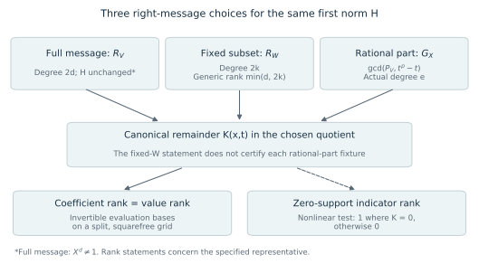
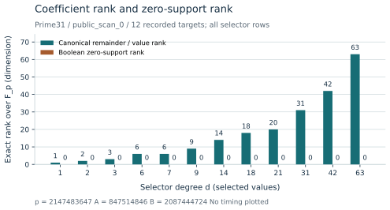

# What target reduction preserves

2026-11-22 Pacific. Component of [crypto PR #4952](https://github.com/isogeny-labs/crypto/pull/4952), following merged #4921. Written mathematics and bounded Rust correctness qualification; all PCC standing remains unverified. [pcc:unverified]

## Finding and decision

Reducing the first coupled S3 norm by a target-dependent right message does not automatically produce a polynomial of small separation rank. For each fixed subset of k selector roots, the generic rank of the canonical remainder is min(d,2k), the largest allowed by its dimensions. The full right message does not change the norm at all when the target coordinate is outside the selector. These statements concern one polynomial representation and do not give a root-finding or arithmetic-circuit lower bound. The written theorem is registered as PCC-20261123-01ad65, with unverified standing. [pcc:unverified]

The actual squarefree rational-root quotient needs a separate check. On the fixed Prime31 curve with d=63, the qualified targets X=0 and X=2 give quotient degree 68 and coefficient rank 63, yet no zero entries in the tested grid. The target X=1 lies in the selector and gives quotient degree 67, rank 62 and 133 zero entries. An exact selector-target lemma explains the forced zero row. These are fixed, deliberately chosen correctness fixtures; they are not random-target yield measurements or signed relation counts. The producer observations are registered as PCC-20261123-a3193a, with unverified standing. [pcc:unverified]

The next algorithmic question is therefore precise: can the retained compact norm circuit support an exact empty-query decision and witness extraction without constructing every coordinate of the product algebra? The matrix-rank result removes one simple compression hypothesis, while leaving circuit structure, other zero-set representatives and structured polynomial operations available for investigation.

## 1. The objects being compared

Work over a prime field with p>max(3,2d), d dividing p-1, and selector V equal to the d-th roots of unity. On a short-Weierstrass curve, use

$$
S_{A,B}(x,z,t)=(x-z)^2t^2-2((x+z)(xz+A)+2B)t+(xz-A)^2-4B(x+z).
$$

S3 is quadratic in each coordinate separately. In these coordinates its total degree is four; treating it as a quadratic system requires an additional lifting or block-degree interpretation.

The first eliminated link is the norm and its canonical selector remainder:

$$
H(x,t)=\operatorname{Res}_z(z^d-1,S_{A,B}(x,z,t))\bmod(x^d-1).
$$

The [merged coupled report](../coupled/REPORT.md) supplies the compact norm recurrence and the bounds

$$
\deg_x H<d,\qquad \deg_t H\le 2d-1.
$$

For a finite public target Q=(X,Y), distinguish the following objects.

| Object | Definition and purpose |
| --- | --- |
| Full right message P_V | Product of S3(t,z,X) over all z in V; retains nonrational roots and multiplicities. |
| Fixed-subset message R_W | Monic normalization of the product over a fixed W contained in V; degree 2k on the chart X outside W. |
| Rational squarefree message G_X | Monic gcd of P_V(t) and t^p-t; its degree e counts distinct rational right candidates. |
| Canonical remainder K_X | H reduced in t modulo G_X, with x-degree below d and t-degree below e. |
| Value matrix M_X | K_X evaluated on V times the distinct roots of G_X. |
| Boolean zero matrix Z_X | Entry one where M_X is zero, and entry zero otherwise; its rank is over F_p. |

If G_X=1, the right candidate set is empty and the remainder is zero by the empty-quotient convention. If e>0, the coefficient matrix C_X and value matrix are related by invertible Vandermonde matrices:

$$
M_X=V_x C_X V_t^{\mathsf T},\qquad \operatorname{rank}M_X=\operatorname{rank}C_X.
$$

Changing either univariate basis cannot reduce this rank. Forming Z_X is a nonlinear operation and can change it completely. These are elementary algebraic statements within the proof map, not a complexity conclusion. [pcc:unverified]

## 2. Generic rank after a fixed-subset reduction

Fix a nonempty W before varying A,B,X, and put k equal to its size. The leading coefficient of its raw right product is

$$
\lambda_W(X)=\prod_{z\in W}(X-z)^2.
$$

On the chart where this is nonzero, normalize the product to the monic R_W. Let C_W be the d-by-2k coefficient matrix of H mod R_W. The written result is

$$
\boxed{\operatorname{rank}_{\mathbb{F}_p(A,B,X)}C_W=\min(d,2k).}
$$

Here generic means outside a proper algebraic exceptional set in the indicated parameter family. It is not a guarantee for the fixed Prime31 curve or a probability statement conditional on a particular liftability pattern. [pcc:unverified]

The proof exhibits a nonzero minor. At A=B=X=0, every selector root is nonzero, normalization is regular, and R_W becomes t^(2k). For the first d coefficient columns, the prior cusp identity gives

$$
[t^j]H_{0,0}(x,t)=(-1)^j\binom{2d}{j}x^{-j},\qquad 0\le j<d.
$$

Writing r=min(d,2k), reduction keeps the first r columns. They occupy distinct rows. With rows 0,d-r+1,...,d-1 in increasing order, their minor is

$$
(-1)^{r-1}\prod_{j=0}^{r-1}\binom{2d}{j}\ne0.
$$

The characteristic condition prevents the binomial factors from vanishing. Clearing the powers of lambda_W introduced by monic division gives a nonzero polynomial minor. The singular specialization supplies a nonvanishing witness; the result also holds generically on nonsingular curves and on the target incidence variety Y^2=X^3+AX+B. The complete argument, including an explicit denominator exponent and the distinction from arithmetic liftability conditions, is in [THEORY.md](THEORY.md). [pcc:unverified]

For W=V the result is stronger and simpler. The full right polynomial has degree 2d whenever X^d differs from one, whereas H has t-degree at most 2d-1. Consequently,

$$
H\bmod R_V=H\qquad\text{if }X^d\ne1.
$$

This literal identity needs no squarefreeness assumption. It does not apply to the smaller G_X without additional work.

## 3. Rational roots and exact exceptional targets

For a nonsingular curve and a rational target with Y nonzero and X outside V, the discriminant in t is

$$
\operatorname{disc}_t S_{A,B}(t,z,X)=16Y^2(z^3+Az+B).
$$

A selector coordinate that lifts with nonzero ordinate contributes two rational roots, corresponding to x(Q+P_z) and x(Q-P_z). A nonsquare curve value contributes none; a selector point of order two contributes one repeated root. Without selector 2-torsion, the rational gcd is the squarefree part of R_W for the actual liftable subset W. It equals R_W itself only when the contributing fibers have no collisions. This is the relevant bridge from the fixed-subset family to actual rational targets. [pcc:unverified]

The cusp proof witness has R_W=t^(2k), but its radical is only t. Therefore the witness alone is not a rank certificate for the radical quotient. Generic squarefreeness can be established separately, while actual finite-field collisions and rank drops must be retained. The [independent scope review](evidence/independent/PRIOR_SCOPE_REVIEW.md) details this distinction.

### Selector-target zero row

When X belongs to V, evaluating the selector remainder at X and using S3 symmetry gives

$$
H(X,t)=P_V(t).
$$

Every monic divisor F of the nonzero P_V therefore satisfies

$$
(H\bmod F)(X,t)=0,\qquad\operatorname{rank}C_F\le\min(d-1,\deg F).
$$

This is an evaluation row, not necessarily a zero monomial-coefficient row. If the left grid is restricted to B liftable coordinates and includes X, its value-matrix rank is at most min(B-1,e). The lemma is registered as PCC-20261123-df9aec, with unverified standing, and is written in [SELECTOR_TARGET_LEMMA.md](evidence/independent/SELECTOR_TARGET_LEMMA.md). [pcc:unverified]

For ordinary targets inside V, the full right degree is 2d-1. For a nonsingular 2-torsion target inside V it is 2d-2. At a 2-torsion target the distinct rational right roots are obtained from the injective fractional-linear map

$$
t_z=X+\frac{3X^2+A}{z-X},\qquad z\ne X.
$$

Thus e=d when X is outside V and e=d-1 when it is inside. The infinity target has no affine X and is explicitly flagged outside this qualifier. Subgroup membership, consistent signs and point-sum verification remain separate from rational-coordinate membership. [pcc:unverified]

## 4. Retained native observations

The protocol was frozen before the new native calls. The qualifier reuses the published field, S3, modular polynomial multiplication, gcd, powering, remainder and interpolation routines. A separate direct-product construction and per-coordinate interpolation reconstruction check the canonical remainder. The root set from gcd is compared with the union of exact quadratic-factor roots, with exhaustive F97 membership checks. No assertion assumes that an observed rank reaches its dimension bound.

The Prime31 coefficients are p=2147483647, A=847514846 and B=2087444724. The following rows are copied from the retained JSONL. The F97 ordinary curve has A=2,B=3; the rank-one control instead has A=-1,B=0. Ranks and zero counts use all selector rows. [pcc:unverified]

| Fixture and target | d | e | Coefficient rank | Zero cells | Boolean rank |
| --- | --- | --- | --- | --- | --- |
| Prime31, X=0 | 63 | 68 | 63 | 0 | 0 |
| Prime31, X=2 | 63 | 68 | 63 | 0 | 0 |
| Prime31, X=1 in V | 63 | 67 | 62 | 133 | 34 |
| Prime31, X=0 | 7 | 6 | 6 | 0 | 0 |
| F97 ordinary, X=0 | 16 | 14 | 14 | 27 | 8 |
| F97 ordinary, X=1 in V | 16 | 15 | 15 | 65 | 10 |
| F97 rank-one, X=0 | 2 | 2 | 1 | 0 | 0 |
| F97 rank-one, X=1 in V | 2 | 1 | 0 | 2 | 1 |

At Prime31 d=63 the liftable-left restriction has 34 rows. For X=0 and X=2 its value rank is 34 and its zero-support rank is zero. For X=1 its value rank is 33 and its zero-support rank is 34. These restrictions have different dimensions from the full d-row coefficient matrix. At d=31, X=2 also belongs to V and shows the selector-target exception; a small integer target is not automatically outside the selector. [pcc:unverified]

The F97 d=16,X=0 cell includes multiplicity loss four and three cross-fiber root collisions; the qualifier records those separately from discarded nonrational degree. The d=2 rank-one curve retains the previously known special polynomial H=16t^2. Its quotient ranks for X=0,1,2 are 1,0,1. These controls prevent either generic rank or degree assumptions from silently replacing the actual arithmetic. [pcc:unverified]

The selected Prime31 degrees are 1,2,3,6,7,9,14,18,21,31,42,63. The F97 degrees are 1,2,3,4,6,8,12,16. Three public affine scan targets and the prescribed selector target were retained, including duplicate categories; F97 also includes the prescribed 2-torsion target. The finite-target count therefore includes repeated points under distinct control labels. No d=1302 numerical result or target-distribution estimate is extrapolated from this suite.

## 5. Evidence and verification scope

The producer's first bounded qualifier build and call returned zero. The retained summary records 91 finite-target cases, 52 cusp minors, 20 empty-subset controls, 91 root-set and coefficient/evaluation-rank equalities, 35,391 quotient-grid comparisons and independently reconstructed coefficients, 4,171 exhaustive F97 membership checks, and 49 checks that the full right reduction leaves H unchanged. Native outputs and manifests are in [producer attempt1](evidence/producer/attempt1/); the source snapshot, protocol and executed binary were bound before the call. [pcc:unverified]

A separate agent inspected the source and replayed the immutable qualifier on the same host under the same 60-second and 2 GiB limits. Its stdout was byte-identical to the producer's record, with source and binary hashes stable before and after. This is unsigned separate-role reproduction, not independent hardware execution or a signed scientific verdict. See the [source and replay review](evidence/independent/SOURCE_REPLAY_REVIEW.md) and [qualifier replay](evidence/independent/qualifier-replay1/). The replay and gate observations are registered as PCC-20261123-c38e68, with unverified standing. [pcc:unverified]

The fixed d=6,k=2 evaluated identity certificate is IDC1h7e169f28f6a50bb6. It checks the cusp norm recurrence against the explicit remainder 1-12T+66T^2-220T^3 plus T^4 times its quotient, over p=2^61-1 with degree bound 12. The producer checked 32 issuer points and 32 additional points; an altered expression and altered digest were rejected. The certificate has proof:null and does not discharge the universal rank theorem. Its [separate replay](evidence/independent/CERTIFICATE_REVIEW.md) accepted the certificate points and 32 fresh seeded points, with the seed and stable input hashes retained. [pcc:unverified]

The [proof map](PROOF_MAP.md) lists the remaining formal obligations. Lean and Lake are unavailable in this runtime; no unchecked theorem stub or custom axiom is supplied. The standalone native qualifier is distinct from a full repository build. Root Cargo metadata completed, but two root check attempts stopped during resolution of path dependencies omitted from the sparse checkout, first crates/certified-relations and then tools/factor-base. No root-library compilation or tests were reached; those setup failures remain in [root-gate](evidence/root-gate/). [pcc:unverified]

All four recorded claims named above have unverified standing. The complete evidence, including certificate replay and repository-gate details, is descriptive. It is neither an admitted performance experiment nor an execution-verification record.

## 6. Consequence for structured elimination

For this monomial selector, low degree in each original S3 variable and a short norm recurrence can coexist with maximal rank of the canonical eliminated polynomial. Composed selector equations therefore do not, by themselves, justify a bounded-rank message representation after coupling. The proof remains specific to the stated selector and canonical quotient; it does not cover every composed or isogeny selector. [pcc:unverified]

The zero-set question remains different. In a split quotient algebra the known Fermat indicator 1-H^(p-1) represents the zero cells, but computing or extracting that indicator can require substantial work. Its rank being zero after an empty grid has been enumerated does not supply a cheap emptiness algorithm. The report does not charge a whole quotient-algebra operation as one base-field operation.

The useful next gate is an exact query using the retained norm circuit: determine whether H and the target message have a common zero, then recover all required coordinates and signs, with setup, empty queries, exceptional charts and extraction included. The concurrent three-summand extractor and four-term pair-spectrum lanes own the witness implementation. This component contributes the generic-rank obstruction to simple separated compression, the exact selector-target exception, and source-bound correctness controls for their target quotients.

The distinction also guides Groebner-basis work. Coefficient rank here is not a degree-of-regularity bound or a measured Macaulay-matrix profile. To make a solver claim one must examine the actual elimination order, intermediate representation, field/subgroup conditions and completed root recovery. Expanding the entire norm is one possible implementation, and the present tests use it as an oracle rather than as a proposed efficient solver.

## Sources and reproducibility

- [THEORY.md](THEORY.md), [PROOF_MAP.md](PROOF_MAP.md) and [frozen protocol](PROTOCOL.md): the statement, domain, written proof and exact qualification plan.
- [Native qualifier and certificate instructions](native/README.md): published-module reuse, immutable source snapshots, build and replay commands.
- [Prior coupled report](../coupled/REPORT.md), merged #4921: first-norm circuit, degree bound and cusp-column identity.
- [Independent source comparison](evidence/independent/PRIOR_SCOPE_REVIEW.md): attribution to the prior implicit-index, root-intersection and Fermat-support notes. No novelty priority is inferred.
- [Petit-Kosters-Messeng (2016)](https://people.maths.ox.ac.uk/petit/files/16PKC_primeECDLP.pdf), sections 2.4 and 3.1: composed selectors and the structured polynomial-system motivation.
- [Bernstein-De Feo-Leroux-Smith (2020)](https://arxiv.org/pdf/2003.10118), Lemma 4.3, Lemma 4.9, Theorem 4.11 and Example 4.13: biquadratic coordinate relations, elliptic-resultant evaluation hypotheses and coefficient-algebra cost. Their compatible elliptic indexing is not automatic for a multiplicative set of abscissae.

KB unavailable: no exposed research-KB MCP and no executable behind the repository wrapper. The direct repository and primary-paper checks above are the recorded fallback. Frozen predecessor evidence was not modified.
