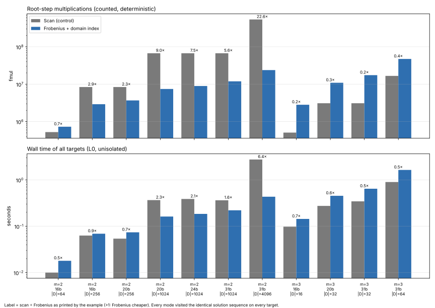

# Factor-base domain root extraction in the `f4_fp` visitor

**Date** 2026-11-19 · **Branch / PR** `claude/fb-domain-rootfind-20261119`, isogeny-labs/crypto#4826 ·
**Record** `benchmarks/records/20261119T1919Z-fb-domain-rootfind.json` ·
**Standing** every number here is `[pcc:unverified]`. The run is single-host and unisolated (L0). It has no replay certificate, validator report or `VALIDATION.json`, so it is a component diagnostic, not a leaderboard or `benchmarks/README.md` row.

## Question

`f4_fp`'s recursive visitor (`solve_visit`, `solve_visit_traced`, `solve_visit_reusing`) is the solver behind the algebraic decomposition systems. Their leaf variables are restricted to the factor-base x-set (`role: factor_base_leaf` in `ml_dataset::solvers`, the partitioned bases of `aps_single_relation`).

For a univariate in such a variable, the visitor finds the roots by **evaluating it at every element of the domain**. That costs `|D| · terms · log deg` multiplications for each univariate at each node, and none of it was counted. Unrestricted univariates already use the counted Frobenius root finder.

Can the domain-restricted root step be made independent of `|D|` without changing what the traversal does?

## Change (opt-in; the scan stays the default and the control)

`F4Options::domain_roots: DomainRootMode` (`src/cryptanalysis/f4_fp.rs`):

- `Scan`: the original domain evaluation (default).
- `Frobenius`:
  - `F_p`-roots by `gcd(g, x^p − x)` and Cantor–Zassenhaus (`glv_invariant_base::poly_roots_fp_counted_until`, `O(log p · deg²)` multiplications);
  - then a value → position index of the domain, built once per traversal and shared by every node;
  - roots are returned **in domain order**.

  This is exact because the visitor requires `D ⊂ F_p`. Because the order is preserved, the branch values, recursion order and visitor call sequence are the scan's.
- `Auto`: per univariate, the mode with the smaller estimated multiplication count (`domain_scan_cost` against `domain_frobenius_cost`).

The scan's multiplications are now counted in-process (`domain_scan_field_multiplications`, never serialised). The new report fields are omitted from serialised reports when zero, so default transcripts are unchanged.

## Prior art checked

**KB unavailable.**
- The research-kb MCP server is not loaded in this runtime.
- `scripts/research-kb status`: "no executable found".
- `crypto-autoresearcher` is Vault-encrypted here, so the lead atlas was read by file name only.

Repository sources read:
- `RESEARCH_SEMAEV_ROOTFIND_VS_GROEBNER.md`: group-law root finding replaced Gröbner for prime-field decomposition.
- `src/cryptanalysis/ic_framework/rootfind.rs` and the prime MITM frontier `docs/bounds/records/prime-ic-mitm-v2.json`.
- `src/cryptanalysis/gaudry_cubic_symmetric.rs`: elimination before root extraction already exists.
- The `F4TraceDelayed` / `F4TracePairGraph` solvers: F4 trace reuse already exists.
- `research/postgb_linear_stage_20261026/README.md`: the post-Gröbner root step is Frobenius on unstructured `f`.
- `problems/generalized-rootfinding-all-roots-8x.md` and `problems/rootfinding-complete-cost-calibration.md`.
- `docs/leads/2026-11-17/index-calculus-portfolio-resume/REPORT.md`: binary linearized root finding is owned by `claude/index-calculus-root-finding-e95kd6` and is not touched here.

Leads relevant by name: `LEAD-ICE-rootfind-pairtable-oracle`, `LEAD-ICE-gpu-rootfind-oracle`, `LEAD-ICE-generic-oracle-arity-cost-floor`, `LEAD-ICP-algebraic-membership-factor-base`.

**No novelty claim is made for the mathematics.** Frobenius root finding is textbook. What is new here is applying it to the visitor's finite-domain branch, where the code had deliberately left the scan.

## Correctness evidence

- `cryptanalysis::f4_fp::domain_root_tests` (4 tests):
  - the extractor returns exactly the scan's `Vec` (same elements, same order) on over 600 univariates, with planted, repeated and out-of-domain roots, degree ≥ `p`, `p` from 2 to `2³² − 5`, and empty and full domains;
  - **identical traced branch sequences** (node, variable, value, source) in all three modes on planted F4 systems;
  - unchanged default serialisation.
- `cargo test --release --lib -j 2 cryptanalysis::f4_fp::`: 69 passed, 0 failed.
- `examples/fb_domain_rootfind.rs` asserts, for every target, identical solution sequences, `field_ops`, `f4_runs` and completion in all three modes, and that every planted target decomposes. It exited 0 on 11 configurations, 100 targets × 3 modes.

## Results



Source table: `data/console.txt`, printed by the Rust example. Raw per-target rows: `data/fb_domain_rootfind.jsonl`.

| m | field bits | \|D\| | targets | root-step fmul, scan | root-step fmul, Frobenius | scan ÷ Frob (count) | wall scan | wall Frob | scan ÷ Frob (wall) | Auto ÷ scan (wall) |
|--:|--:|--:|--:|--:|--:|--:|--:|--:|--:|--:|
| 2 | 16 | 64 | 16 | 524,288 | 728,409 | 0.7 | 0.010 s | 0.018 s | 0.5 | 0.86 |
| 2 | 16 | 256 | 16 | 8,388,608 | 2,914,627 | 2.9 | 0.063 s | 0.069 s | 0.9 | 1.12 |
| 2 | 20 | 256 | 16 | 8,388,608 | 3,678,558 | 2.3 | 0.054 s | 0.074 s | 0.7 | 1.36 |
| 2 | 20 | 1024 | 8 | 67,108,864 | 7,442,442 | 9.0 | 0.367 s | 0.162 s | 2.3 | 0.40 |
| 2 | 24 | 1024 | 8 | 67,108,864 | 8,942,083 | 7.5 | 0.388 s | 0.185 s | 2.1 | 0.50 |
| 2 | 31 | 1024 | 8 | 67,108,864 | 11,909,735 | 5.6 | 0.363 s | 0.221 s | 1.6 | 0.61 |
| 2 | 31 | 4096 | 4 | 536,870,912 | 23,800,840 | **22.6** | 2.757 s | 0.434 s | **6.4** | 0.16 |
| 3 | 16 | 16 | 8 | 507,904 | 2,822,840 | 0.2 | 0.098 s | 0.144 s | 0.7 | 1.00 |
| 3 | 20 | 32 | 6 | 3,096,576 | 10,904,975 | 0.3 | 0.275 s | 0.454 s | 0.6 | 0.97 |
| 3 | 31 | 32 | 6 | 3,096,576 | 17,434,767 | 0.2 | 0.345 s | 0.645 s | 0.5 | 0.94 |
| 3 | 31 | 64 | 4 | 16,646,144 | 47,226,203 | 0.4 | 0.901 s | 1.642 s | 0.5 | 1.04 |

The counts are deterministic and identical to a diagnostic run earlier the same day. The wall times agree with that run within L0 noise.

## What this shows and does not show

- **Observed:**
  - the Frobenius path's root-step cost does not grow with `|D|`, while the scan's grows linearly, so the advantage rises with `|D|` and falls with `log p`;
  - in the m = 2 rows the root step is over 99% of counted multiplications.
- **Observed, against the counts:** wall-time gains are smaller than count ratios. At `|D| = 256` the Frobenius path is slower in wall time despite 2–3× fewer multiplications. The root finder's per-call overhead (allocation, gcd, splitting) is not in the multiplication count.
- **Consequence:** `Auto`'s count-based estimate is miscalibrated for wall time. It is 1.36× slower than the scan at 20 bits, `|D| = 256`.
- **For m = 3 chains with `|D|` ≤ 64, the scan wins** in both counts and wall time.
- **Not shown:**
  - any change to relation-collection, linear-algebra or complete-solve cost;
  - any comparison with rho;
  - a scaling law;
  - behaviour on other callers' systems.

  This is a component (oracle root step) result at the stated sizes. The F4 `field_ops` of the m = 2 systems is 0 at ≥ 20 bits because each system has one generator (no S-pairs). The small nonzero count at 16 bits is not explained yet; it is identical across modes.

## Owed before any admitted row

- an isolated (L2) host and an independent-host replay;
- a validator recompute;
- a `VALIDATION.json`.

## Next steps

1. Recalibrate `Auto` against wall time, or remove the per-call overhead.
2. Proposed: **batched sibling root extraction**. At a branching node, all children's univariates are specialisations of one parent polynomial over the same domain. One product tree and remainder tree over `D`, built once and shared, could extract every child's roots in `Õ(|D|)` per node instead of `|D|` separate Frobenius calls.

## Reproduce

```sh
cargo build --release --example fb_domain_rootfind
FBDR_OUT=research/fb_domain_rootfind_20261119/data ./target/release/examples/fb_domain_rootfind
cargo test --release --lib -j 2 cryptanalysis::f4_fp::    # -j 2: the lib test build peaks near 14 GB
python3 research/fb_domain_rootfind_20261119/plot.py       # layout only; matplotlib
```
