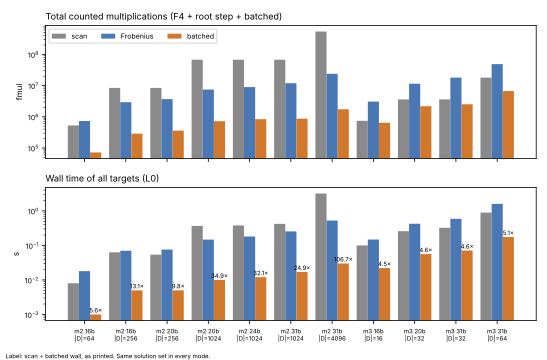

# Batched sibling extraction in the `f4_fp` visitor

**Date** 2026-11-20 · **Branch / PR** `claude/fb-domain-rootfind-20261119`, isogeny-labs/crypto#4826 ·
**Record** `benchmarks/records/20261120T0342Z-fb-sibling-batch.json` ·
**Standing**: every number here is `[pcc:unverified]`. The run is a single-host, unisolated (L0) component measurement. There is no replay certificate, validator report or `VALIDATION.json`, so it is not an admitted `benchmarks/README.md` row.
**Follows** [`research/fb_domain_rootfind_20261119`](../fb_domain_rootfind_20261119/README.md), whose Frobenius root step cut the *counted* root-step work but left most of the *wall* time.

## Why

The previous study showed that per-child overhead in the visitor dominates. At `|D| = 4096`, a child cost about 26 µs of wall time but only about 5 µs of counted arithmetic. The rest was spent on:

- a full F4 run on each specialised child system;
- normalisation and allocation;
- the setup of the general root finder.

So the per-child machinery, not the root finding, was the bottleneck.

## The algorithm (`F4Options::sibling_batch`, opt-in)

At a node that branches over a finite domain (no univariate; not the full field), every child is the parent generating set specialised at one domain value.

1. **Once per node.** Rewrite each generator as a polynomial in the remaining variables whose coefficients are univariates in the branch variable `x` (`sibling_family`).
2. **Per sibling `v`.** Specialise by Horner on each coefficient (`specialise_family`).
3. **F4-free child solve** (`tri_solve`), repeated until no variables remain:
   - take the variable whose univariates have the smallest gcd;
   - extract that gcd's roots;
   - substitute each root and recurse.

   Root extraction is closed form for degree ≤ 2 at odd `p` (one counted Tonelli–Shanks square root) and the counted Frobenius root finder otherwise. Domain membership uses the shared per-traversal domain index, and roots are kept in domain order.
4. **Fallback.** A child with no univariate is normalised and handed to the ordinary F4 `walk`.
5. **Leaves** are checked against the original input exactly as the walk's are.

The guarantees:

- **Solution set.** It is the scan's: each step keeps every solution's coordinate, and every candidate is checked against the original input.
- **Order.** It is the scan's exact sequence when each child is a single univariate (one level, as in `m = 2`). Deeper children may be solved in a different variable order than F4 would choose.
- **When it is off.** It is off by default, and never used with a trace sink or a trace-reuse pool, so traced runs stay byte-identical. New report fields are omitted from serialised reports when zero.

## Correctness evidence

- `cryptanalysis::f4_fp::sibling_batch_tests` (4 tests):
  - the counted square root and `dense_roots_fp` match brute force (`p` up to 65537);
  - **exact sequence** equality with the scan on `m = 2` `S₃` systems (24 rounds, at least 100 solutions; 1 batched node, 0 fallbacks, fewer F4 runs);
  - **set** equality on `m = 3` chains and dense 3-variable systems, with the F4 fallback exercised;
  - stop-early returns a genuine solution;
  - default serialisation is unchanged.
- `cargo test --release --lib -j 2 cryptanalysis::f4_fp::`: **73 passed, 0 failed**.
- `examples/fb_domain_rootfind.rs` asserted, for every target:
  - batched = scan **sequence** at `m = 2`, and batched = scan **set** at `m = 3`;
  - equal `solutions_visited` and completion.

  It exited 0. Its scan and Frobenius counts are **identical** to the 2026-11-19 record across all 11 configurations.

## Results



Totals are every counted multiplication of the traversal: F4 row reduction, root step and batched work. Source: `data/console.txt` (printed by the Rust example). Raw per-target rows: `data/fb_domain_rootfind.jsonl.gz`.

| m | bits | \|D\| | total fmul scan | Frobenius | **batched** | wall scan | Frobenius | **batched** | scan ÷ batched (wall) | Frob ÷ batched (wall) | fallbacks / children |
|--:|--:|--:|--:|--:|--:|--:|--:|--:|--:|--:|--:|
| 2 | 16 | 64 | 527,504 | 731,625 | **71,950** | 0.008 s | 0.018 s | **0.001 s** | 5.6 | 12.2 | 0 / 1,024 |
| 2 | 16 | 256 | 8,401,040 | 2,927,059 | **287,347** | 0.063 s | 0.070 s | **0.005 s** | 13.1 | 14.6 | 0 / 4,096 |
| 2 | 20 | 256 | 8,388,608 | 3,678,558 | **360,588** | 0.054 s | 0.076 s | **0.005 s** | 9.8 | 13.8 | 0 / 4,096 |
| 2 | 20 | 1024 | 67,108,864 | 7,442,442 | **721,176** | 0.366 s | 0.147 s | **0.010 s** | 34.9 | 14.1 | 0 / 8,192 |
| 2 | 24 | 1024 | 67,108,864 | 8,942,083 | **835,668** | 0.378 s | 0.181 s | **0.012 s** | 32.1 | 15.3 | 0 / 8,192 |
| 2 | 31 | 1024 | 67,108,864 | 11,909,735 | **868,408** | 0.421 s | 0.254 s | **0.017 s** | 24.9 | 15.0 | 0 / 8,192 |
| 2 | 31 | 4096 | 536,870,912 | 23,800,840 | **1,736,732** | 3.176 s | 0.525 s | **0.030 s** | **106.7** | 17.6 | 0 / 16,384 |
| 3 | 16 | 16 | 742,021 | 3,056,957 | **644,404** | 0.100 s | 0.148 s | **0.022 s** | 4.5 | 6.7 | 128 / 2,176 |
| 3 | 20 | 32 | 3,609,216 | 11,417,615 | **2,185,596** | 0.258 s | 0.425 s | **0.056 s** | 4.6 | 7.6 | 192 / 6,336 |
| 3 | 31 | 32 | 3,609,216 | 17,947,407 | **2,510,460** | 0.323 s | 0.589 s | **0.071 s** | 4.6 | 8.3 | 192 / 6,336 |
| 3 | 31 | 64 | 17,935,872 | 48,515,931 | **6,664,872** | 0.891 s | 1.594 s | **0.175 s** | 5.1 | 9.1 | 256 / 16,640 |

## What this shows and does not show

**Observed** (ranges derived from the printed table). The batched path has the lowest total counted multiplications and the lowest wall time in every one of the 11 configurations.

- At `m = 2`:
  - 10–14× fewer total multiplications than Frobenius;
  - 7–309× fewer than the scan;
  - 12–18× less wall time than Frobenius;
  - 5.6–107× less wall time than the scan.
- At `m = 3`:
  - 4.5–5.1× less wall time than the scan;
  - 1.2–2.7× fewer multiplications than the scan;
  - 4.7–7.3× fewer multiplications than Frobenius.

**Observed: the earlier crossover is gone.** At small `|D|` the Frobenius path lost to the scan. The batched path beats the scan everywhere, including `|D| = 64` and the `m = 3` chains. Counted and wall-time gains now agree: removing per-child F4 and allocation is what the counts could not show before.

**Observed: fallbacks.** Only the `m = 3` chains used the fallback, on about 1.5–6% of children. These are children whose system has no univariate after one specialisation. They are counted in the totals.

**Not shown:**

- any relation-collection, linear-algebra or complete-DLP change;
- any comparison with rho;
- a scaling law;
- results on other callers' systems.

This is a component result for the visitor's branching and child solve, on `S₃` and `S₃`-chain decomposition systems with small-abscissa factor bases at the stated sizes. `m = 3` uses set equality, not sequence equality, so a stop-at-first visitor may receive a different (still genuine) first solution there.

**Owed before an admitted row:**

- an L2 host;
- an independent-host replay;
- a validator recompute;
- a `VALIDATION.json`.

## Reproduce

```sh
cargo build --release -j 2 --example fb_domain_rootfind
FBDR_OUT=research/fb_sibling_batch_20261120/data ./target/release/examples/fb_domain_rootfind
gzip -9 -n research/fb_sibling_batch_20261120/data/fb_domain_rootfind.jsonl
cargo test --release --lib -j 2 cryptanalysis::f4_fp::   # -j 2: the lib test build peaks near 14 GB
python3 research/fb_sibling_batch_20261120/plot.py        # layout only; matplotlib
```
