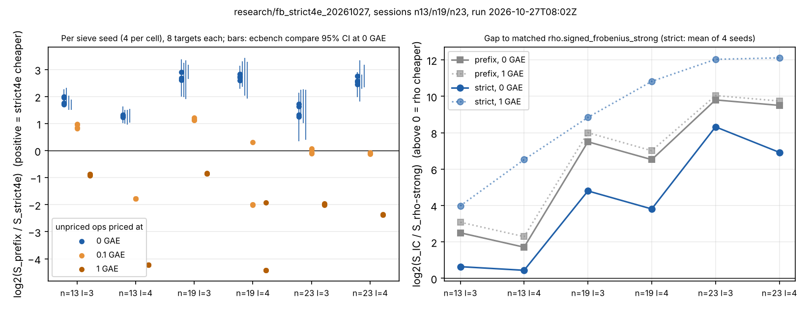

# Run report: strict-4E factor base against the default binary-subspace base

Run 2026-10-27T08:02Z (UTC start of `sessions/n13`). The spec and protocol were frozen before any solve: [`../../PROTOCOL.md`](../../PROTOCOL.md), with `../../specs/spec-n{13,19,23}.json` hashed in `../../SPECS.sha256`. The code is the option `binary-subspace:dimension=l,select=strict4e,seed=s` (`src/cryptanalysis/ic_framework/subspace_select.rs`, `plugins.rs`). The measured binary was `target/release/ecbench`, sha256 `fed03208…0186`, built from base `7831bd75d` with the change applied. The host was a shared cloud container with no isolation, so the run gives counted operations only and no wall-time figure.

## What ran

- **Curves:** Koblitz `a = 0` (`y² + xy = x³ + 1`), n = 13, 19, 23, all with h = 4.
- **Oracle and workload:** oracle `mitm:m=3,negation_folded=1`. Each curve had 8 public targets (`target_seed` 20261027) and measurement seed 20261028. Each arm ran one warm-up round and one measured round.
- **Arms per cell (n, l ∈ {3, 4}):**
  - `ic-prefix-lL`: the default `<1, z, …>` base.
  - `ic-strict-lL-s{1..4}`: four sieve seeds.
  - Per curve, `rho-strong` (`rho.signed_frobenius_strong`) and an A/A copy `rho-strong-aa`.
- **Records:** 192 per session, all completed.
- **Audit:** `ecbench verify --replay-all` was OK on all three sessions: 192 verified, 96 replays reproduced, 0 problems (`../../audit-n{13,19,23}.json`). The rho runs are verified by [d]G = Q but not replayed.
- **Strictness of the constructed bases** (`../../summary/strictness.tsv`):
  - Every l = 3 base and the n = 23, l = 4 bases are strict.
  - n = 13, l = 4: 13 of 15 abscissae are in 4E. No strict 4-space exists at n = 13, so the documented fallback was used.
  - n = 19, l = 4: seed 2 is strict; seeds 1, 3 and 4 have 14 of 15 in 4E.

## Recorded values

D is log2(S_prefix / S_strict4e), where S is counted group-operation equivalents divided by √r; positive means strict4e is cheaper. The per-seed ratios and intervals come from `ecbench compare` (`../../summary/pairs.tsv`). The cell values are means of the 4 seeds, and the pooled values are a percentile bootstrap over the 6 cells (`../../summary/pooled.json`, `../../pool.sh`). The weights price the unpriced native operations at 0, 0.1 and 1 GAE each (AGENTS.md §5a). For strict4e those operations include the 2^n membership tests that build the 4E bitmap.

| cell | D at 0 GAE | D at 0.1 GAE | D at 1 GAE |
|:--|--:|--:|--:|
| n=13, l=3 | 1.86 | 0.90 | −0.90 |
| n=13, l=4 | 1.28 | −1.77 | −4.23 |
| n=19, l=3 | 2.71 | 1.15 | −0.84 |
| n=19, l=4 | 2.72 | −1.42 | −3.80 |
| n=23, l=3 | 1.49 | −0.02 | −1.99 |
| n=23, l=4 | 2.58 | −0.11 | −2.37 |
| **pooled, 6 cells** | **2.11 [1.63, 2.55]** | **−0.21 [−1.09, +0.63]** | **−2.35 [−3.41, −1.31]** |

- At 0 GAE all 24 per-seed intervals of S_strict / S_prefix lie below 1, with ratios from 0.13 to 0.42.
- `ecbench compare` reports **"unresolved inside the band"** for all 24 strict-against-prefix pairs.

**Gap to matched rho.** The values are log2(S_IC / S_rho-strong) (`../../summary/gap_to_rho.txt`); positive means rho is cheaper.

| cell | prefix, 0 GAE | strict4e, 0 GAE (mean of 4 seeds) | strict4e, 1 GAE |
|:--|--:|--:|--:|
| n=13, l=3 | 2.50 | 0.64 | 3.98 |
| n=13, l=4 | 1.71 | 0.44 | 6.52 |
| n=19, l=3 | 7.50 | 4.80 | 8.84 |
| n=19, l=4 | 6.52 | 3.81 | 10.82 |
| n=23, l=3 | 9.80 | 8.32 | 12.03 |
| n=23, l=4 | 9.50 | 6.92 | 12.11 |

The A/A control `rho-strong-aa` matches `rho-strong` exactly in counted operations.

The figure source is `plot.py`, which plots the recorded values in `../../summary/`.

## Not run or missing

- n = 17 was refused because h = 548. n = 23, l = 5 was dropped for time.
- `select=gated-rank` is unit-tested but was not measured.
- There was no cross-host replay; `ecbench-independent-runner` was not used.
- There is no independent validator report: `validate.sh` was written by the producer.
- The S3 resume checkpoint was not pushed, because no upload token was present and `scripts/checkpoint.sh` fails under GNU `stat`.
