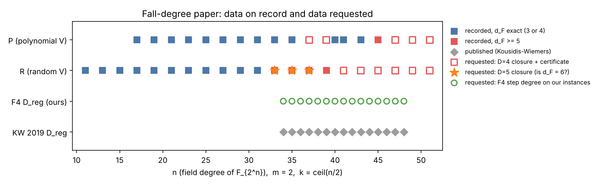

## Purpose

This is a list of the data the paper still needs, one item per gap. Each item names:

- the claim it supports;
- what is on record now;
- what is missing;
- how to get it: a new run under a protocol record in `protocols/`, collecting output from a study already running, or work that needs a person (no compute).

**Status (2026-10-30).** The owner approved building the prerequisites and launching the runs.

- **The two fall-degree protocols** now use one native instrument, `examples/fd_m2_degrees.rs`.
  - It builds the $m = 2$ descent in crypto's Boolean-ring library. It runs the full MutantXL closure (= $W_D$) and Boolean F4.
  - It replaces the draft's lfdclose2 and a new `.sys` driver. crypto forbids Python research tooling, and the 120 GiB runner serves only this repository.
  - Pilot: it reproduced lfdclose2's recorded $d_F$ on 9 recorded instances. These are R11a, R13a, R15a, R19a, P17a, P21a, P21c and U33a (exact), and T33a ($\ge 5$, with a $W_4$ rank of 48,068 equal to the record).
  - Planted solvable controls never refuted up to $D = 5$.
- **The runs** go through `.github/workflows/fd-paper-degrees.yml` on the `crypto-eks-highmem` runner (Karpenter Spot on EKS, 16 CPU, 120 GiB). This is the route `dreg-a3-eks-highmem.yml` uses for closures.
  - EKS `isolab_k8s_run` takes argv jobs only from the harness host, which this session cannot reach (`research/prime_ic_program_20261029/fall_degree_relaunch/README.md` §1).
  - The calibrate stage (claim C0) must pass before any new row is read.
- **Certificates** (checked by `cert_check.py`) for the new $d_F \ge 5$ rows are a separate crypto-autoresearcher run. Until then those rows are reported as `closure_only`.

## The paper's hypotheses and the data each needs

The paper proves:

- the first fall degree is a constant of the presentation: 2 for binary $S_3$ descent, 4 for PKM towers;
- the last fall degree is not bounded by it.

The hypothesis it cannot yet state is that **the last fall degree grows**. The table lists what would move that question, and what the paper's existing tables need to be complete and reproducible.

| # | Claim in the paper | On record | Gap | How | Priority |
|---|---|---|---|---|---|
| R1 | Thm 6.11: $d_F \ge 5$ certified (n = 33–45); Table 6.1 | 13 checked certificates; R39a/b and C21a/b closure A only | Certificates for R39a/b and C21a/b; random V at n = 41–51; polynomial V at n = 37, 39, 47–51 | **FD-BINARY-CLOSURE-EXT**, claims C1, C3 | 1 |
| R2 | Open problem: does $d_F$ reach 6? | R35a is exactly 5; no $W_5$ has ever been computed | Degree-5 closure on the 8 certified instances at n = 33–37 | **FD-BINARY-CLOSURE-EXT**, claim C2 | 1 |
| R3 | Table 6.3: KW's $D_{\rm reg}$ against our $d_F$ | KW published values only; no F4 step degree on our instances | $D_{\rm reg}$ on the same systems; reproduce KW at n = 34–48 | **FD-F4-STEP-DEGREE** | 1 |
| R4 | Table 6.4 and the C-step prediction $d_F=4+\lfloor(t-2)/4\rfloor$ | t $\le$ 10 medians session-reported, raw data lost | t = 1–14 re-run with committed rows; m = 4 rise/flat/fall reading | **Collect output** from the running relaunch: `research/prime_ic_program_20261029/fall_degree_relaunch/` (Amendments 7–8). No new protocol. | 1 |
| R5 | Every certificate "any reader can check" | sha256 values in `certificates.txt`; certificate files not public | Publish certificate files and `cert_check.py` with hashes | Aggregation: artifact store plus a public bundle | 1 |
| R6 | Table 6.3 transcription; which subspace KW used | Read from a photographed page | Check against the PDF; note KW's subspace and z | Literature (person); read HKY 2015 and KW 2019 in full | 1 |
| R7 | Closure times in Table 6.1 | Host not recorded | Host recorded for new rows | Inside FD-BINARY-CLOSURE-EXT (instance type, CPU, peak RSS per row) | 2 |
| R8 | Conclusion item 3: a measured crossover at k = 4 | m = 15 only, n = 2 per arm | 8 fresh targets per arm at m = 14–17, priced across the band | **K4-CHAR2-REPLICATION** | 2 |
| R9 | PKM raw records from the first run | Lost on the owner's Mac (`RESTART.md`) | Upload the Mac worktree | Owner action | 3 |

Out of scope for this paper: the frontier chapter's 9 unvalidated leaderboard rows. They are tracked by the validation gate, not here.

## Protocols

| protocol | question | arms and controls | size | route | prerequisites before freeze |
|---|---|---|---|---|---|
| [`fd-binary-closure-ext`](protocols/fd-binary-closure-ext/protocol.json) | Is $d_F \ge 5$ at n = 41–51? Does $d_F$ reach 6 at n = 33–37? | native closure against lfdclose2's record (calibration C0); A/A on thread count; positive: recorded refuting instances; negative: planted solvable instances | 93 recorded + 28 drawn + 10 planted + 8 D = 5; ~70 h | ARC `crypto-eks-highmem`, 16 CPU, 120 GiB | done: driver, run.sh, workflow, pilot |
| [`fd-f4-step-degree`](protocols/fd-f4-step-degree/protocol.json) | What is F4's $D_{\rm reg}$ on the same systems? Does it reproduce KW? | Boolean F4 (`pq_f4_f2`) against KW's published values; positive: d_F = 3 instances | 93 recorded + 30 drawn; steps over 1 GiB are censored | ARC `crypto-eks-highmem` | done: driver (`--f4`); still open: KW transcription check against the PDF |
| [`k4-char2-replication`](protocols/k4-char2-replication/protocol.json) | At k = 4, is IC below the strongest rho at m = 16 and 17, across w = 0, 0.1, 1? | `ic-wied` against `rho-strong`; `rho-neg` regression; A/A | 4 arms × 4 m × 8 targets; ~30 h | isolab L2 measurement pool | build `rho.negation_strong` (ecbench-extend); `ecbench verify --replay` preflight |

**Protocol details.** Each record states:

- its claims, each with a class;
- its hypotheses, with dated predictions marked out-of-sample or calibration;
- a variable ledger in which every comparison is one-factor, absolute or A/A;
- the seed rule;
- the metrics, with exact or counted quantities as primary;
- stopping and invalidation rules;
- the verdict vocabulary;
- what is inadmissible.

**Seeds.** The k = 4 seeds are listed explicitly. The red team's plan wrote `sha256("gaudry-k4-redteam-v2" || m || i)` without a byte encoding. This record fixes it as UTF-8 `gaudry-k4-redteam-v2|<m>|<i>` before any data. The other two protocols derive their seeds from the protocol hash after freeze.

## What comes back, and where it goes

Every run writes `experiment.export/v1` beside its records. Each result has a fixed destination:

- `check-export --verify-files` and the `flow` count go in the run report.
- New certified rows are appended to `crypto-autoresearcher:analysis/semaev-m2-last-fall-degree/results/`. `papers/ecdlp-index-calculus-treatise/figures/make_tab_fall_degrees.py` then regenerates Tables 6.1–6.3, with a measured $D_{\rm reg}$ column in 6.3.
- R4 output updates `figures/data-new.json` and Table 6.4.
- R8 reaches the paper only through the validation gate.

No outcome promotes a hypothesis by itself: review-evidence and the PR decide.
