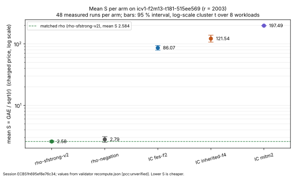
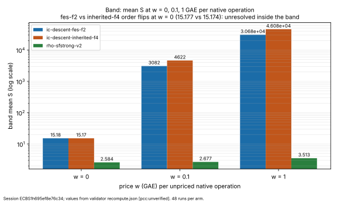

# fes-f2 vs inherited-f4 at degree 13: Runpod results

Session `ECBS1h695ef8e76c34`, study `research/fes_k13_validated_20261112`, protocol
`FES-K13-VALIDATED-20261112` (attempt a1), run 2026-11-15. Every number below is
`[pcc:unverified]`: there are no signing keys, so no figure carries a pcc claim id. All
values are the independent validator's recomputation
(`runpod-a1/validation/recompute.json`, `validator-report.json`, `findings.json`), not the
producer's.

## Question

On `icv1-f2m13-t181-515ee569` (K_0 over F_(2^13), r = 2003), does the descent solver
`fes-f2` cost less than `inherited-f4` inside the same pipeline
(`binary-subspace[dimension=7] + descent-algebraic[m=2] + <solver> + walk`)? The frozen
hypotheses ([`protocol.json`](protocol.json), [`spec.json`](spec.json)):

- **H1.** The paired ratio of S, fes/inherited, has its 95 % interval entirely below 1,
  and the order holds at every band weight (w = 0, 0.1, 1 GAE per unpriced native
  operation).
- **H2.** Both solvers are priced by the pinned word-XOR unit, with nothing left unpriced.

S is mean GAE divided by sqrt(r), counted in ecbench's unit. The matched rho reference is
`rho-sfstrong-v2` (signed-Frobenius orbits), in the same session and binary.

## Route and deviation

The protocol's instrument is the Iso Lab EKS L2 pod. On 2026-11-14 the owner moved the run
to Runpod because the AWS budget was exhausted (1,585.60 of 1,300 USD for the month);
AWS served only as S3 storage. The final pod was `cpu5m`, 4 vCPU, AMD EPYC 9575F
container on a shared 128-CPU host, image `runpod/base:1.0.2-ubuntu2404`. There is no
L2 gate and no image digest. S is a count of operations, so the host does not change it;
wall time is not usable (see Limits). This is validator finding F3.

## Launch history

| launch | pod | flavor, image | outcome |
|:--|:--|:--|:--|
| 1 | `buxbpz0nckybva` | cpu3c, `ubuntu:24.04` | container never started (runtime null for 32 min); terminated, no data |
| 2 | `cgexlkygovkp1z` | cpu3c, `buildpack-deps:noble-curl` | same outcome after 11 min; terminated, no data |
| 3 | `y1i37jqnb3511d` | cpu5m, 4 vCPU, AMD EPYC 9575F, `runpod/base:1.0.2-ubuntu2404` | produced the session |

Launch 3 took 10 s (`ecbench run`, exit 0, no `--allow-busy`). The pod audit verified
336 records and reproduced 288 replays `[pcc:unverified]`. Total Runpod cost was about 0.20 USD. Source: the
2026-11-15 session log and `runpod-a1/pod.log`. This record answers finding F6.

## Results

48 measured runs per arm (8 workloads by 6 rounds), all 48 verified. The interval is the
95 % interval of mean S (log-scale cluster t over the 8 workloads). `[pcc:unverified]`

| arm | mean S (charged) | 95 % interval | isolation grades |
|:--|--:|:--|:--|
| rho-sfstrong-v2 (matched rho) | 2.584 | [2.512, 2.659] | L1 x 48 |
| rho-negation | 2.788 | [2.505, 3.103] | L1 x 48 |
| ic-descent-fes-f2 | 86.07 | [78.91, 93.87] | L2 x 44, L1 x 4 |
| ic-descent-inherited-f4 | 121.54 | [106.69, 138.47] | L2 x 43, L1 x 5 |
| ic-pairtable-mitm2 (positive control) | 197.49 | [197.11, 197.87] | L1 x 46, L2 x 2 |
| rho-sfstrong-v2-aa (A/A) | 2.584 | identical to rho-sfstrong-v2 | L1 x 48 |

Paired S ratio fes-f2 / inherited-f4: **0.7081, 95 % interval [0.6683, 0.7503]**
`[pcc:unverified]` (48 pairs, 8 workloads, linearised t, df 7, log scale). 47 of 48 pairs
have fes below inherited.



Figure 1. Mean S per arm with 95 % intervals, log scale, rho marked. Session
`ECBS1h695ef8e76c34`. Source: `figures/plot_figures.py` reading `recompute.json`.

## Band (AGENTS.md 5a)

Mean S at w = 0, 0.1 and 1 GAE per unpriced native operation. `[pcc:unverified]`

| arm | w = 0 | w = 0.1 | w = 1 |
|:--|--:|--:|--:|
| ic-descent-fes-f2 | 15.177 | 3081.763 | 30681.037 |
| ic-descent-inherited-f4 | 15.174 | 4621.699 | 46080.422 |
| rho-sfstrong-v2 | 2.584 | 2.677 | 3.513 |

fes-f2 / inherited-f4 band ratio: 1.000184 at w = 0, 0.6668 at w = 0.1, 0.6658 at w = 1
`[pcc:unverified]`. The order of the two IC arms flips between w = 0 and w = 0.1.



Figure 2. Band S at w = 0, 0.1, 1 for fes-f2, inherited-f4 and rho-sfstrong-v2, log scale.
Session `ECBS1h695ef8e76c34`.

## Verdicts

- **H1: not supported.** The paired interval lies entirely below 1, but the order does
  not hold at every weight. At w = 0 the two arms differ by 6 group operations out of
  32,598 summed over 48 runs (0.018 %); both tried exactly 2,007 targets in total. The
  frozen amendment calls this "unresolved inside the band", not a win or a loss.
  The 0.7081 ratio is the calibration-point reading and does not replace the band. No
  improvement of fes-f2 over inherited-f4 is claimed from this session.
  `[pcc:unverified]`
- **H2: supported.** All 112 descent records (warm-ups included) are priced by the pinned
  word-XOR unit with empty `cost.unpriced` and no solver counter anywhere.
  `[pcc:unverified]`

## Distance to rho

Rho is below every IC arm at every weight; this is the distance remaining, not a gate.
`[pcc:unverified]`

| ratio | charged | w = 0 | w = 0.1 | w = 1 |
|:--|--:|--:|--:|--:|
| fes-f2 / rho-sfstrong-v2 | **33.30** | 5.872 | 1151.07 | 8734.35 |
| inherited-f4 / rho-sfstrong-v2 | 47.03 | 5.871 | 1726.25 | 13118.28 |
| fes-f2 / rho-negation | 30.87 | 5.444 | 1052.72 | 7333.93 |
| inherited-f4 / rho-negation | 43.60 | 5.443 | 1578.76 | 11014.97 |

This holds at log2 r = 10.97 only. Rho's fixed set-up is about 40 % of its S at this
size, so the gaps are not asymptotic (finding F10).

## Validator findings

The validator's disposition is "validated for counts only": the counted measurement and
the reading "H1 not supported: unresolved inside the band" are validated; any improvement
claim, wall figure, or claim needing the L2 gate or the A/A noise floor is not `[pcc:unverified]`.

| id | severity | summary |
|:--|:--|:--|
| F1 | info | All 17 quoted figures recompute from `records.jsonl`; accounting checks hold (max deviation 1.8e-12). |
| F2 | major | H1 not supported as frozen: order flips at w = 0 (see Verdicts). |
| F3 | major | Route deviation: no L2 gate, shared host; no wall figure admissible. |
| F4 | major | A/A wall control fails its frozen threshold (0 pairs at L2; each A/A solve is about 0.12 ms, under the 1 ms minimum), so the threshold was unattainable for this spec. At count level the A/A is exact: 48 of 48 pairs identical. |
| F5 | major, closed 2026-11-15 | Binary-to-source link to e9d5dbdccd. Closed by the validator's own rebuild and 288/288 identical replay (`runpod-a1/f5-rebuild/F5-ASSESSMENT.md`). |
| F6 | minor | Attempt history incomplete; recorded above. |
| F7 | minor | The producer wrote `compare --save` output into the session copy; moved to `claimed/` before validation, and session/ is byte-identical to the S3 tarball. |
| F8 | minor | rho-negation's band S is a lower bound (table work not listed as unpriced); no order changes. |
| F9 | info | H2 holds; the word-XOR basis is partial for both solvers, which leans against inherited-f4's price, that is, against the candidate. |
| F10 | info | Distance to rho is a statement at log2 r = 10.97 only. |
| F11 | minor | `scripts/validation_gate.py` needs schema `validation-gate/v1`; `tools/validate_validation_json.py` needs `validation/v1`; one file cannot pass both. |
| F12 | info | Analysis scripts never pinned; the bench record's spreads are the 95 % interval of mean S above. |
| F13 | info | Positive control reproduces: mitm2 verified 48 of 48, mean S 197.489 (local reference 197.7). |

## Limits

- No wall figure is usable: the A/A wall control failed (F4), there is no L2 gate, and the
  route is a deviation (F3). Do not cite the comparison's wall block.
- F5 is closed (2026-11-15) `[pcc:unverified]`. The validator built ecbench from its own `git
  archive` of e9d5dbdccd with official rustc 1.97.0 and `--locked`, and replayed the session:
  288 of 288 identical. A second rebuild on a fresh Runpod pod also replayed 288 of 288 and
  re-ran the frozen spec with every counted field equal to the session's. Details:
  [`runpod-a1/f5-rebuild/F5-ASSESSMENT.md`](runpod-a1/f5-rebuild/F5-ASSESSMENT.md).
- The replay on a different host class (Intel Xeon KVM guest) reproduced all 288 measured
  runs, but a replay with the same binary cannot detect a binary that miscounts.
- One curve, one size; the result says nothing about other degrees.
- No leaderboard row: the comparison is unresolved inside the band.

## How to reproduce

```sh
cd research/fes_k13_validated_20261112
sha256sum runpod-a1/session/records.jsonl   # 965d95f5...f9962c8
ecbench verify --dir runpod-a1/session --replay-all --exit-code
python3 ../../scripts/validation_gate.py evidence runpod-a1
```

The pod ran `runpod-a1/pod-run.sh` with binary sha256 `8f9576b5...e5130f4` and
`spec.json` sha256 `327e0bb4...a9d76c`. Figures: `figures/plot_figures.py` (matplotlib;
plots recorded values from `recompute.json` only). PDF: `RESULTS.pdf`, built from
`RESULTS.typ` (kept beside it).

Raw data and evidence: [`runpod-a1/session/records.jsonl`](runpod-a1/session/records.jsonl),
[`runpod-a1/claimed/`](runpod-a1/claimed/band.json),
[`runpod-a1/validation/`](runpod-a1/validation/validator-report.json),
[`runpod-a1/VALIDATION.json`](runpod-a1/VALIDATION.json).
