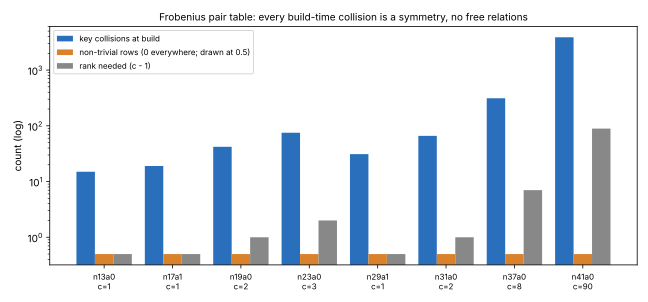

# Free relations from the Frobenius pair table's build-time collisions: none (2026-11-06)

**Question.** The Koblitz orbit index calculus (`mitm-frobenius-lazy-counted:m=2` on `compact-orbit-scan`, `research/ecbench_lazy_orbit_members_20261018`) spends 60–80 % of its counted GAE walking for about c + 1 table hits. The table build drops every insert whose orbit key is already present (`FrobeniusPairTable::build_inner`, `or_insert`). Do those dropped inserts give relations among the c column logarithms for free, as the prime-curve `ksum … free=1` and `wwalk` tables do? If they reached rank c − 1, the walk would need about 2 hits.

**Answer: no** [pcc:unverified]. On all eight cells of the frozen lazy-orbit panel:
- every build-time collision is a symmetry of the table: its row over the column unknowns is identically zero;
- the rank is 0.

Report: [`REPORT.pdf`](REPORT.pdf) (source `REPORT.typ`). Graph: [`fig_free_rows.svg`](fig_free_rows.svg), from `plot.py` over `raw/probe.txt`.

| cell | columns c | entries | collisions | non-trivial rows | rank (needed c − 1) |
|---|--:|--:|--:|--:|--:|
| n13 a0 | 1 | 10 | 15 | 0 | 0 (0) |
| n17 a1 | 1 | 14 | 19 | 0 | 0 (0) |
| n19 a0 | 2 | 70 | 42 | 0 | 0 (1) |
| n23 a0 | 3 | 198 | 75 | 0 | 0 (2) |
| n29 a1 | 1 | 26 | 31 | 0 | 0 (0) |
| n31 a0 | 2 | 118 | 66 | 0 | 0 (1) |
| n37 a0 | 8 | 2,344 | 312 | 0 | 0 (7) |
| n41 a0 | 90 | 331,830 | 3,870 | 0 | 0 (89) |

**Why.** The folded table holds one entry per orbit representative and base point, about `reps × |F|`, not `|F|²`. By IC's own balance it is sized far below the square root of the number of signed Frobenius classes, about `r / 2n`. The birthday count of genuine collisions is therefore below 1 on every cell except n41, where it is about 8. None appeared, so even there the expectation is not enough for rank 89. The collisions that do occur are the same pair sum met again through a Frobenius or sign image of the pair.

The proposal came from an estimate of `|F|²` entries, which is wrong by a factor of `|F| / reps`.

## Method

- **Probe:** the ignored test `free_rows_probe::frobenius_table_free_rows_probe` in `src/cryptanalysis/ic_framework/plugins.rs`.
- **Panel:** the bases are `compact-orbit-scan:columns=c,raw_x_cap=100000000`, with the panel's per-curve c (`research/ecbench_lazy_orbit_members_20261018/make_specs.sh`).
- **Build:** it replays `build_inner`'s orbit-representative loop.
- **Rows:** for each collision `u = ±σ^t(u₀)` it writes `coef(P_a)X_a + coef(P_b)X_b ∓ λ^t (coef(P_c)X_c + coef(P_d)X_d)` mod r, using the base's exact `col_of` and `coef_of` labels.
- **Rank:** it takes the rank modulo r.
- **Checks:** zero `σ^t` mismatches on every cell, so every collision was resolved exactly.

## Not claimed

- No change to any method, record, leaderboard row or `benchmarks/`.
- A local probe: the counts are exact, and no timing is involved.
