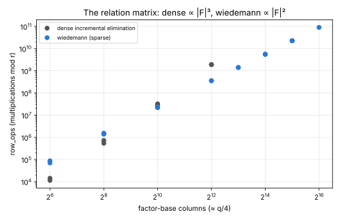
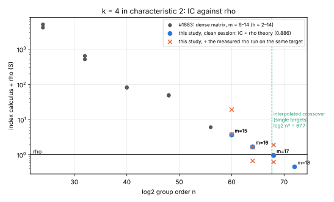
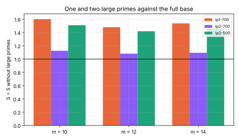

# `k = 4` in characteristic 2 past one word: a sparse matrix and `u128` orders; IC is 3.6× rho at `m = 15`, 0.95× at `m = 17` and 0.45× at `m = 18` of rho's theoretical cost (single targets, clean sessions); the crossover is indicated, not established

2026-10-15 to 2026-11-10. Protocol: [`PROTOCOL.md`](PROTOCOL.md), registered
(commit `e403626cb`) before any claim run. Every run, pilots and failures
included, is in [`EXPERIMENTS.md`](EXPERIMENTS.md). Report:
[`REPORT.pdf`](REPORT.pdf). Stacked on #1883. **Class: engineering** (Parts D
and F) plus a **comparison against rho on non-standard curves** (Part E).

## What finished

The container restarted many times during the claim runs, and each
restart kills every run in flight (`ecbench` cannot resume a session). The
first attempts (binary `c143cf62…`, the registered one) were killed; those
records are kept as `*.attemptN-killed` sessions and **no headline number
uses them**. The runs that completed did so on a second binary
(`ad1dd91a…`, commit `1b15f8b35`/`2cdffcf22`/`e20167b70`) that adds
checkpoint/resume ([`src/cryptanalysis/ckpt.rs`](../../src/cryptanalysis/ckpt.rs)):
a long run logs its oracle calls and resumes by replaying the walk against
the log. The tests `a_resumed_ic_run_has_the_counts_of_an_uninterrupted_one`
and `a_resumed_rho_run_has_the_counts_of_an_uninterrupted_one` compare every
counter, but **no completed session here has been replayed from scratch**, so
that equivalence is tested, not audited, for these sessions. Sessions on
`ad1dd91a…`: `e-m16`, `e-m17-ic-t0`, `e-m17b-ic`, `e-m18-ic`, `d-m14`.
`e-m18-ic` resumed after a filesystem fault (a `.tmp` checkpoint entry became
unreadable, the run ended in an `error` record, kept as
`e-m18-ic.attempt12-error`; the checkpoint directory was copied without the
damaged entry and the run resumed, with most of its earlier progress lost).

| | status |
|:--|:--|
| Code: `wiedemann` matrix, large primes, `u128` rho and IC pipeline, checkpoint/resume | done, tested against the one-word code |
| Part D, sparse against dense, `m = 8, 10, 12` | clean session, 18/18 verified |
| Part D, `m = 14` | clean session, 3/3 verified |
| Part E, `m = 15` (two targets) | clean session, 6/6 verified |
| Part E, `m = 16` (two targets, IC and rho) | clean session, 4/4 verified |
| Part E, `m = 17` (two targets) | rho: clean sessions 2/2; IC: two clean sessions, 1 run each |
| Part E, `m = 18` | IC: clean session, 1/1 verified; **rho: still running when this was written** (`e-m18-rho`) |
| Part F, large primes, `m = 10, 12, 14` | clean session, 15/15 verified |
| Part G, isolated hardware | not run: no isolab credentials in this container; job files are in `isolab/` |

Integrity audits (`ecbench verify --replay 0`) of every clean session pass
(`audits/`). **No session of this study has been replayed** (see Audits).

## Result 1: the matrix was the obstacle, and the sparse solver removes it

In #1883's committed sessions the dense matrix's `row_ops` grew as `|F|^3`:
×61 and ×64 per 4× columns (EXPERIMENTS W1). It was 1.06 % of the IC cost
at `m = 14` and would have reached rho's cost near `m = 18`, so the
extrapolated crossover could not have happened with that matrix.

The `wiedemann` matrix (rows kept as they arrive, a singleton-filtered core
solved once by Wiedemann on `RᵀDR` with Berlekamp–Massey, checked exactly)
grows as `|F|^2`:

| `m` | columns | dense `row_ops` | `wiedemann` `row_ops` | dense ÷ sparse | trials, sparse ÷ dense |
|--:|--:|--:|--:|--:|--:|
| 8 | 62 | 11,370; 14,252 | 69,871; 86,869 | 0.16; 0.16 | 1.0000; 1.0000 |
| 10 | 262 | 718,813; 536,268 | 1,536,771; 1,423,931 | 0.47; 0.38 | 1.0000; 1.0000 |
| 12 | 1,045 | 32,211,708; 27,959,816 | 22,221,501; 21,700,171 | **1.45; 1.29** | 1.0008; 1.0040 |
| 14 | 4,123 | 1.88·10⁹ (Part D) and 1.91·10⁹ (#1883 B3) | 3.56·10⁸ (Part D) and 3.53·10⁸ (Part F) | **5.29** (paired); 5.4 | 1.0006; 1.0003 |

(Two workloads per size for `m ≤ 12`, one at `m = 14`, paired within a
session; `raw/summary.json`.) The sparse solver loses at small sizes (it
solves in one batch) and wins from `m = 12`. Its share of the IC cost is
0.36 % at `m = 15`, 0.68 % at 16, 1.36 % at 17 and **2.57 % at 18**
(against about 1.06 % for the dense matrix at `m = 14`); it doubles per
`m`, so it reaches 5 % at `m = 19`. E4 (≤ 5 % at `m = 18`) held.



## Result 2: IC against rho, `h = 2`, `m = 15–18`

Cofactor 2 at every size, so `r = 2^59 … 2^71` and the ratio carries the
same `√h` throughout. `S` is group-addition equivalents ÷ `√r`; rho's
theoretical `S` is 0.886. Counts are deterministic; wall time is
descriptive (L1). All rows are from complete sessions and verify. The
`m = 16`–`18` IC rows and the `m = 17` rho rows of target 1 ran on the
checkpointing binary or the registered one as listed under "What finished";
none is replayed.

| `m` | `log₂ n` | target | IC `S` | rho `S` (measured) | IC ÷ rho theory | IC ÷ rho measured | matrix share |
|--:|--:|:--|--:|--:|--:|--:|--:|
| 15 | 60 | `W588ac37c7439` | 3.198 | 0.168 | 3.61 | 19.1 | 0.36 % |
| 15 | 60 | `W761fd6d9429f` | 3.253 | 0.856 | 3.67 | 3.8 | 0.36 % |
| 16 | 64 | `Wa1b3b10e6968` | 1.482 | 0.899 | 1.67 | 1.65 | 0.68 % |
| 16 | 64 | `W37a8388076b0` | 1.490 | 2.235 | 1.68 | 0.67 | 0.68 % |
| 17 | 68 | `Wd5f7dba84d0e` | 0.842 | 1.361 | 0.95 | 0.62 | 1.36 % |
| 17 | 68 | `W591d11cef5d4` | 0.849 | 0.447 | 0.96 | 1.90 | 1.36 % |
| 18 | 72 | `We3b266046ebb` | 0.400 | *running* | **0.45** | – | 2.57 % |

IC used 190–196 trials per relation at every size. Per size, the geometric
mean of IC ÷ rho theory is 3.64, 1.68, 0.95 and 0.45 (`raw/summary.json`).
The fit of `log₂(IC ÷ rho theory)` against `log₂ n` has slope **−0.246**
(−1/4 expected) and crosses 1 between `m = 16` and `m = 17`, at
`log₂ n* ≈ 67.7` (`m* ≈ 16.9`). #1883 extrapolated `2^{68.1}` from
`m ≤ 14` with the dense matrix, and the model `2^{63}–2^{69}`.

- **Measured:** IC's cost relative to rho's *theoretical* `0.886·√r`
  falls steadily from 3.6× to 0.45× over `m = 15–18`, with the two targets
  of each size agreeing within 1 % at 16 and 17. At `m = 18` the single
  IC run costs 0.45× rho's expectation.
- **Not shown:** that IC beats rho in practice. The `m = 18` point is one
  target; the individual rho runs scatter by 5× around their expectation
  (IC ÷ rho measured spans 0.62–19 at one size), so a measured-against-
  measured comparison at one target is noise; the rho half of `m = 18` was
  still running.
- **Open, and independent of this study's counts** (relayed from an
  independent red-team review of this study, not re-verified here; its
  report was reported to be on branch `claude/k4-char2-redteam-20261026`,
  which I could not fetch): (1) the **unit price**: `S` counts one
  group-addition equivalent per curve operation and charges field work at
  fixed prices, and the review reports measured corrections between 0.3×
  and 3.1× that this study does not resolve; (2) every `rho.negation` row
  is a **lower bound**, because the canonicalisations are not charged, so
  rho's true cost is higher than recorded (which favours IC); the unit-price
  corrections go both ways. Its projected crossover is `m* ≈ 17.6` (16.3–19.2), and it states the
  crossover is **not established**. This study agrees that two targets per
  size and one at `m = 18`, at an unresolved unit price, do not establish
  it.



## Result 3: large primes lose at these sizes (Part F, clean)

`F′` is 70 % or 50 % of the columns. `S` ÷ the same run without large
primes, one target per size:

| arm | `m = 10` | `m = 12` | `m = 14` |
|:--|--:|--:|--:|
| one large prime, 70 % | 1.60 | 1.48 | 1.54 |
| two large primes, 70 % | 1.13 | 1.08 | 1.10 |
| two large primes, 50 % | 1.51 | 1.42 | 1.46 |

Every arm costs more (F1 and F2 held). The matrix they shrink is under 1 %
of the cost here, and the merging and the extra trials cost more than it
saves. The linear-algebra cost does fall to 0.52–0.78× (`raw/summary.json`).
By the model in `PROTOCOL.md` the variant pays only when the sparse solve
reaches the relation cost, near `n ≈ 2^{92}`, so it is a recorded negative
at every size reachable here.



## Predictions (PROTOCOL.md)

| | registered | outcome |
|:--|:--|:--|
| D1 | dense arm reproduces #1883 to the last digit | **not met as registered**: the spec's measurement seed (202610150201) differs from #1883's (202610150002), so the arms are fresh samples (`S` 72.99, 72.27 against 71.43, 73.42). The purpose is met more strongly by W8: this branch's binary replays all 24 of B2's and all 3 of B3's committed records exactly. The pilot, which reused the seed, matched both `m = 10` values exactly |
| D2 | sparse below dense at `m = 12`, ≥ 2× at `m = 14` | **held** (1.29–1.45×; 5.29× paired at `m = 14`) |
| D3 | trials within `[1.00, 1.10]×` | **held** (1.0000–1.0040; 1.0006 at `m = 14`) |
| E1 | all runs verify; replays reproduce | all finished runs verify; **replays not done** for this study's sessions (see Audits) |
| E2 | IC ÷ rho theory in `[1.5, 8]` (`m = 15`), `[0.7, 4]` (16), `[0.4, 2]` (17), `[0.2, 1]` (18) | **held** at all four sizes (3.61–3.67; 1.67–1.68; 0.95–0.96; 0.45) |
| E3 | at `m = 18`, IC below rho's theory and the measured run | IC below rho's theory (0.45×); **measured-run half pending** (`e-m18-rho` running) |
| E4 | `wiedemann` ≤ 5 % of IC at `m = 18` | **held** (2.57 %) |
| E5 | crossover `m*` in `[16.5, 18]` | **held as an interpolation**: 16.9 (single targets, unresolved unit price, see Result 2) |
| F1, F2 | large primes cost more; best arm ≥ 1.0 at `m = 14` | **held** (1.08–1.60; best 1.10) |

## Other checks

- **Frobenius parity** (`raw/parity.jsonl`, `examples/gaudry_quartic_bin_parity`):
  the interpolated `H` is even in `s₂, s₃, π` on **375 of 375** curves (25
  per `m`, `m = 4–18`). Still measured, not proved.
- **The widening changes no count:** `ic_wide` reproduces the one-word
  `rho.negation` walk and the IC pipeline at `u64` and `u128` (unit tests),
  and the re-audits of #1883's B2 and B3 sessions with this binary
  reproduce all 27 runs (`audits/reaudit-*`).

## Audits

`ecbench verify` receipts are in `audits/`. Integrity audits (`--replay 0`:
hashes, record consistency, environment class) of every session with
records; replay audits (`--replay-all`: re-execute each run and require
identical counts) only where a receipt says so.

| session | records | integrity | replayed |
|:--|--:|:--|:--|
| `d-ladder` | 18 | OK | **no**: stopped at 04:24 after 2 h without a result |
| `e-m15` | 6 | OK | **no**: stopped after 38 min (needs about 3 h) |
| `e-m17-rho` | 2 | OK | **no**: stopped after 38 min (needs about 7 h) |
| `f-lp` | 15 | OK | **no**: not started |
| `d-m14` | 3 | OK | no |
| `e-m16` | 4 | OK | no |
| `e-m17-ic-t0`, `e-m17b-ic`, `e-m17b-rho` | 1 each | OK | no |
| `e-m18-ic` | 1 | OK | no |
| `*.attemptN-killed` (killed sessions) | partial | not audited; **not used by any number above** | no |
| #1883 `char2-ladder` (this binary) | 24 | OK | **yes: 24/24 reproduced** |
| #1883 `char2-m14` (this binary) | 3 | OK | **yes: 3/3 reproduced** |

So none of this study's own sessions has been replayed. The two replayed
sessions are #1883's, re-executed with this branch's binary (the widening
changes no committed count); the equivalence tests pin `ic_wide` to the
one-word code. The replay audits of this study's sessions are the first
thing to run on a host that does not restart (`ecbench verify --dir
research/gaudry_k4_char2_crossover_20261015/sessions/<s> --replay-all`).

## Scope

- Curves over `F_{2^{4m}}` are not standard curves; the theory predicts the
  weakness. Prices: `F_q` multiplications at the curve's own multiplications
  per addition, `row_ops` at one each, L1 isolation.
- The measured result is a steady fall of IC ÷ rho's theory from 3.6× to
  0.45× over `m = 15–18`. It is single targets (two at 15–17, one at 18) at
  an unresolved unit price; that IC beats rho in practice is **not
  established**. The first thing to add is the `m = 18` rho run, a second
  `m = 18` target, and the from-scratch replays of the `ad1dd91a…` sessions.
- Part G: the `m = 18` isolab job files are committed and unsubmitted.

## Reproduction

```sh
cargo build --release --bin ecbench --example gaudry_k4_crossover_summary --example gaudry_quartic_bin_parity
research/gaudry_k4_char2_crossover_20261015/run_claims3.sh     # skips complete sessions, resumes checkpoints (run_claims.sh/2/2b: earlier attempts)
target/release/ecbench verify --dir research/gaudry_k4_char2_crossover_20261015/sessions/<s> --replay-all
target/release/examples/gaudry_k4_crossover_summary research/gaudry_k4_char2_crossover_20261015
python3 research/gaudry_k4_char2_crossover_20261015/figures/plot.py     # layout only
```

Environment: Claude Code cloud container, Xeon @ 2.10 GHz, 4 vCPU, four
sessions at a time on separate cores (L1). Binary sha256 `c143cf62…` (registered)
for `d-ladder`, `e-m15`, `e-m17-rho`, `e-m17b-rho`, `f-lp`; `ad1dd91a…` for the rest. Conductor task T-4.
