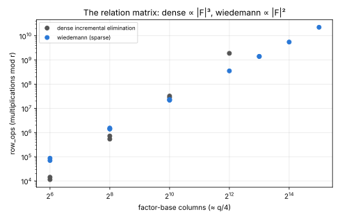
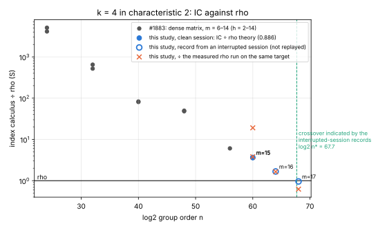
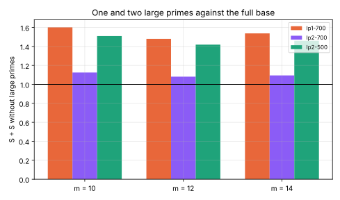

# `k = 4` in characteristic 2 past one word: a sparse matrix and `u128` orders; IC is 3.6× rho at `m = 15` (clean sessions); the `m = 16–17` records are from interrupted sessions and `m = 18` did not complete

2026-10-15 to 2026-10-26. Protocol: [`PROTOCOL.md`](PROTOCOL.md), registered
(commit `e403626cb`) before any claim run. Every run, pilots and failures
included, is in [`EXPERIMENTS.md`](EXPERIMENTS.md). Report:
[`REPORT.pdf`](REPORT.pdf). Stacked on #1883. **Class: engineering** (Parts D
and F) plus a **comparison against rho on non-standard curves** (Part E).

## What this study could and could not finish

The container restarted repeatedly during the claim runs (Oct 16, between
Oct 19 and 26, and three times in the first hour of Oct 26), and each
restart kills every run in flight: `ecbench` cannot resume a session. Runs of 3–24
hours did not survive.

| | status |
|:--|:--|
| Code: `wiedemann` matrix, large primes, `u128` rho and IC pipeline | done, tested against the one-word code |
| Part D, sparse against dense, `m = 8, 10, 12` | **clean session**, 18/18 verified |
| Part E, `m = 15` (two targets) | **clean session**, 6/6 verified |
| Part E, `m = 17` rho (two targets) | **clean session**, 2/2 verified |
| Part E, `m = 16` | **interrupted session**: one IC target and two rho targets finished |
| Part E, `m = 17` IC | **interrupted session**: one target finished (the other never did) |
| Part E, `m = 18` | **not completed** (every attempt was killed before its first record) |
| Part D, `m = 14` | **not completed** (the interrupted session has a rho and a dense record, no sparse arm) |
| Part F, large primes, `m = 10, 12, 14` | **clean session**, 15/15 verified |
| Part G, isolated hardware | not run: no isolab credentials in this container; job files are in `isolab/` |

An interrupted session was killed by a container restart before it could
mark itself finished. Its finished records are real ecbench records, and
`ecbench verify` confirms them except for completeness: for `e-m16`,
`e-m17-ic` and `d-m14` the audit passes `records`, `records_hash`,
`plan_hash`, `spec_id`, `workloads`, `env_class` and `host_hash`, and fails
exactly two checks, `session_complete` (the status is `running`) and
`record_count` (fewer records than planned). These records were also not
replayed. Everything that rests on them is therefore labelled
**indicated**, not established. The audit table at the end lists what was
replayed.

## Result 1: the matrix was the obstacle, and the sparse solver removes it

In #1883's committed sessions the dense matrix's `row_ops` grew as `|F|^3`:
×61 and ×64 per 4× columns (EXPERIMENTS W1). It was 1.06 % of the IC cost
at `m = 14` and would have reached rho's cost near `m = 18`, so the
extrapolated crossover could not have happened with that matrix.

The `wiedemann` matrix (rows kept as they arrive, a singleton-filtered core
solved once by Wiedemann on `RᵀDR` with Berlekamp–Massey, checked exactly)
grows as `|F|^2`:

| `m` | columns | dense `row_ops` | `wiedemann` `row_ops` | dense ÷ sparse | trials, sparse ÷ dense |
|--:|--:|--:|--:|--:|--:|
| 8 | 62 | 11,370; 14,252 | 69,871; 86,869 | 0.16; 0.16 | 1.0000; 1.0000 |
| 10 | 262 | 718,813; 536,268 | 1,536,771; 1,423,931 | 0.47; 0.38 | 1.0000; 1.0000 |
| 12 | 1,045 | 32,211,708; 27,959,816 | 22,221,501; 21,700,171 | **1.45; 1.29** | 1.0008; 1.0040 |
| 14 | 4,123 | 1.88·10⁹ (Part D, interrupted) and 1.91·10⁹ (#1883 B3) | 3.53·10⁸ (Part F) | **5.3–5.4** | 1.0075; 1.0003 |

(Two workloads per size for `m ≤ 12`, paired within a session.
The `m = 14` row compares different sessions with different seeds, so
it is unpaired; `raw/summary.json`.) The sparse solver
loses at small sizes (it solves in one batch) and wins from `m = 12`; at
`m = 17` it is 1.4 % of the IC cost, against about 1.06 % for the dense
matrix at `m = 14`, and it grows as `|F|` relative to the relations, so it
reaches 5 % near `m = 19`.



## Result 2: IC against rho, `h = 2`, `m = 15–17`

**The headline is the `m = 15` row.** The `m = 16` and `m = 17` rows come
from sessions that were killed before finishing and were not replayed; they
are shown in italics as *interrupted, not audited to completion* and carry no
claim.

Cofactor 2 at every size, so `r = 2^59, 2^63, 2^67` and the ratio carries
the same `√h` throughout. `S` is group-addition equivalents ÷ `√r`; rho's
theoretical `S` is 0.886. Counts are deterministic; wall time is
descriptive (L1).

| `m` | `log₂ n` | target | IC `S` | rho `S` (measured) | IC ÷ rho theory | IC ÷ rho measured | session |
|--:|--:|:--|--:|--:|--:|--:|:--|
| 15 | 60 | `W588ac37c7439` | 3.198 | 0.168 | **3.61** | 19.1 | clean |
| 15 | 60 | `W761fd6d9429f` | 3.253 | 0.856 | **3.67** | 3.8 | clean |
| 16 | 64 | `Wa1b3b10e6968` | 1.482 | 0.899 | *1.67* | 1.65 | interrupted |
| 17 | 68 | `Wd5f7dba84d0e` | 0.849 | 1.361 | *0.96* | 0.62 | IC interrupted, rho clean |

(Italics: indicated, not established.) Every IC run took about 191–196
trials per relation, as in the pilots. The second `m = 17` target has a
clean rho run (`S = 0.998`, `W652ef8c5cfb7`) and no IC run.

- **Established (clean sessions):** at `m = 15`, IC is 3.6× rho's
  theoretical cost, and far from rho's measured runs on target 0 (rho got
  lucky there: `S = 0.168`, 5× below its expectation).
- **Indicated (interrupted-session records, one target each):** 1.67× at
  `m = 16`, 0.96× at `m = 17`. The fit of `log₂(IC ÷ rho theory)` against
  `log₂ n` through the three points has slope **−0.24** (−1/4 expected) and
  crosses 1 at `log₂ n* ≈ 67.7` (`m* ≈ 16.9`). #1883 extrapolated `2^{68.1}`
  from `m ≤ 14` with the dense matrix, and a model `2^{63}–2^{69}`.
- **Not shown:** that IC beats rho. One target at `m = 17`, from a session
  that did not complete, at 0.96× rho's *theoretical* cost, inside rho's
  run-to-run spread, is not that. The registered claim (E3) was at `m = 18`,
  which did not run.



## Result 3: large primes lose at these sizes (Part F, clean)

`F′` is 70 % or 50 % of the columns. `S` ÷ the same run without large
primes, one target per size:

| arm | `m = 10` | `m = 12` | `m = 14` |
|:--|--:|--:|--:|
| one large prime, 70 % | 1.60 | 1.48 | 1.54 |
| two large primes, 70 % | 1.13 | 1.08 | 1.10 |
| two large primes, 50 % | 1.51 | 1.42 | 1.46 |

Every arm costs more (F1 and F2 held). The matrix they shrink is under 1 %
of the cost here, and the merging and the extra trials cost more than it
saves. The linear-algebra cost does fall to 0.52–0.78× (`raw/summary.json`).
By the model in `PROTOCOL.md` the variant pays only when the sparse solve
reaches the relation cost, near `n ≈ 2^{92}`, so it is a recorded negative
at every size reachable here.



## Predictions (PROTOCOL.md)

| | registered | outcome |
|:--|:--|:--|
| D1 | dense arm reproduces #1883 to the last digit | **not met as registered**: the spec's measurement seed (202610150201) differs from #1883's (202610150002), so the arms are fresh samples (`S` 72.99, 72.27 against 71.43, 73.42). The purpose is met more strongly by W8: this branch's binary replays all 24 of B2's and all 3 of B3's committed records exactly. The pilot, which reused the seed, matched both `m = 10` values exactly |
| D2 | sparse below dense at `m = 12`, ≥ 2× at `m = 14` | **held** (1.29–1.45×; 5.3–5.4× unpaired) |
| D3 | trials within `[1.00, 1.10]×` | **held** (1.0000–1.0040) |
| E1 | all runs verify; replays reproduce | all finished runs verify; **replays not done** for this study's sessions (see Audits) |
| E2 | IC ÷ rho theory in `[1.5, 8]` (`m = 15`), `[0.7, 4]` (16), `[0.4, 2]` (17), `[0.2, 1]` (18) | held at 15 (3.61, 3.67); *indicated* at 16 (1.67) and 17 (0.96); 18 not run |
| E3 | at `m = 18`, IC below rho's theory and the measured run | **not tested** |
| E4 | `wiedemann` ≤ 5 % of IC at `m = 18` | not tested; 1.4 % at `m = 17` (interrupted) |
| E5 | crossover `m*` in `[16.5, 18]` | *indicated*: 16.9 |
| F1, F2 | large primes cost more; best arm ≥ 1.0 at `m = 14` | **held** (1.08–1.60; best 1.10) |

## Other checks

- **Frobenius parity** (`raw/parity.jsonl`, `examples/gaudry_quartic_bin_parity`):
  the interpolated `H` is even in `s₂, s₃, π` on **375 of 375** curves (25
  per `m`, `m = 4–18`). Still measured, not proved.
- **The widening changes no count:** `ic_wide` reproduces the one-word
  `rho.negation` walk and the IC pipeline at `u64` and `u128` (unit tests),
  and the re-audits of #1883's B2 and B3 sessions with this binary
  reproduce all 27 runs (`audits/reaudit-*`).

## Audits

`ecbench verify` receipts are in `audits/`. Integrity audits (`--replay 0`:
hashes, record consistency, environment class) of every session with
records; replay audits (`--replay-all`: re-execute each run and require
identical counts) only where a receipt says so.

| session | records | integrity | replayed |
|:--|--:|:--|:--|
| `d-ladder` | 18 | OK | **no**: stopped at 04:24 after 2 h without a result |
| `e-m15` | 6 | OK | **no**: stopped after 38 min (needs about 3 h) |
| `e-m17-rho` | 2 | OK | **no**: stopped after 38 min (needs about 7 h) |
| `f-lp` | 15 | OK | **no**: not started |
| `e-m16.attempt3-killed` | 3 of 4 | fails `session_complete`, `record_count` only | no |
| `e-m17-ic.attempt1-killed` | 1 of 2 | fails `session_complete`, `record_count` only | no |
| `d-m14.attempt3-killed` | 2 of 3 | fails `session_complete`, `record_count` only | no |
| #1883 `char2-ladder` (this binary) | 24 | OK | **yes: 24/24 reproduced** |
| #1883 `char2-m14` (this binary) | 3 | OK | **yes: 3/3 reproduced** |

So none of this study's own sessions has been replayed. The two replayed
sessions are #1883's, re-executed with this branch's binary (the widening
changes no committed count); the equivalence tests pin `ic_wide` to the
one-word code. The replay audits of this study's sessions are the first
thing to run on a host that does not restart (`ecbench verify --dir
research/gaudry_k4_char2_crossover_20261015/sessions/<s> --replay-all`).

## Scope

- Curves over `F_{2^{4m}}` are not standard curves; the theory predicts the
  weakness. Prices: `F_q` multiplications at the curve's own multiplications
  per addition, `row_ops` at one each, L1 isolation.
- The established result is a trend through `m = 15` plus indications at 16
  and 17. The crossover and the `m = 18` comparison are open; re-running
  `run_claims.sh` on a host that does not restart completes them
  (`SPEC-E-m16/17/18`, `SPEC-D-m14`; about 15 hours for `m = 17` IC).
- Part G: the `m = 18` isolab job files are committed and unsubmitted.

## Reproduction

```sh
cargo build --release --bin ecbench --example gaudry_k4_crossover_summary --example gaudry_quartic_bin_parity
research/gaudry_k4_char2_crossover_20261015/run_claims.sh      # skips complete sessions
target/release/ecbench verify --dir research/gaudry_k4_char2_crossover_20261015/sessions/<s> --replay-all
target/release/examples/gaudry_k4_crossover_summary research/gaudry_k4_char2_crossover_20261015
python3 research/gaudry_k4_char2_crossover_20261015/figures/plot.py     # layout only
```

Environment: Claude Code cloud container, Xeon @ 2.10 GHz, 4 vCPU, four
sessions at a time on separate cores (L1). Binary sha256 `c143cf62…` for every
claim session. Conductor task T-4.
