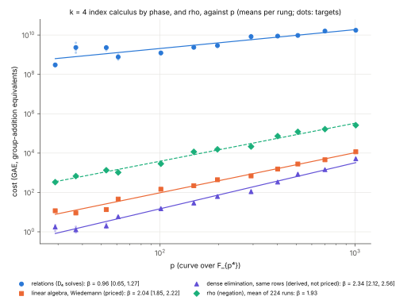
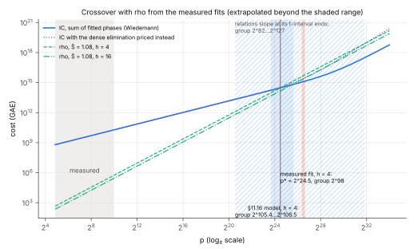
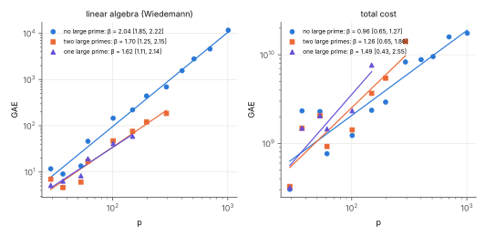
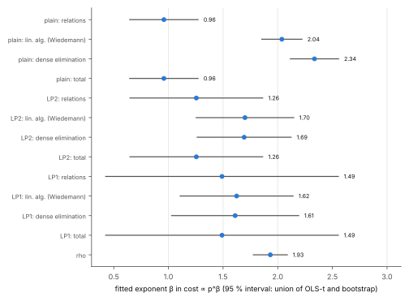

# `k = 4` index calculus on `E(F_{p⁴})`, measured: relations `∝ p^{0.96}`, Wiedemann `∝ p^{2.04}`, rho `∝ p^{1.93}`; crossover from the fits `2^{98}` (`h = 4`), sensitivity `2^{82}`–`2^{127}`

2026-10-15, extended 2026-10-19. Protocol: [`PROTOCOL.md`](PROTOCOL.md),
registered (commit `08722a2b7`) before any session, with four amendments:
queue order and a 16 h stop (runtime, before any IC record), audit scope (by
size), a relaunch after the container's CPU set shrank (infrastructure), and
(amendment 4) running the 12 jobs that missed the stop, at the owner's
request, with a correction of an earlier count. Code frozen at `0bea75038`.
Report: [`REPORT.pdf`](REPORT.pdf). Run reports:
[`reports/run-20261015T0457Z`](reports/run-20261015T0457Z/) (the first 60 jobs)
and [`reports/run-20261019T1612Z`](reports/run-20261019T1612Z/) (the last 12).
Summary: [`raw/summary.json`](raw/summary.json) (all 72 jobs; the fit made
before the last 12 ran is kept as
[`raw/summary-60-jobs.json`](raw/summary-60-jobs.json)), written by
`examples/gaudry_quartic_d4_exponent_fit.rs`. **Class: measurement.** The
exponents and constants of a known method, measured in ecbench's counted
unit; nothing here is a new algorithm or a claim about any deployed curve.

## What was measured

Gaudry/Diem index calculus with FGHR's `D₄` oracle from #1863
(`gaudry-d4:macaulay=26,weighted=1,chains=1,sparsest=1,replay=1,charge_unsolved=1`,
base `fghr-y-line:zero=1`) and rho with the negation map, on
`fp4_torsion(p, 1, 16)` for 12 primes `p = 29 … 1009`. Every run is a full
ecbench DLP: target walk, relations, linear algebra, `[d]G = Q` checked,
`S` a count (`F_p` multiplications priced at the curve's multiplications per
addition). **All 72 planned jobs ran: 312 records, 312 verified** (32 IC, 16
IC with two large primes, 12 IC with one, 252 rho of which 224 are distinct).
**Erratum.** Earlier versions of this README, the REPORT, the run report and
the PR said 59 of 72 jobs ran and 13 missed the stop; the right figures were
60 and 12 (48 IC and 12 rho-only sessions on disk, 60 audited). They also
said the one-large-prime arm had 7 rungs; it has 6 (`p ≤ 149`; the protocol's
table said 7, the generator `make_specs.sh` makes 6).

Two pieces of code are new (all opt-in, defaults unchanged):

- `linalg=wiedemann`: the target's logarithm from a left-kernel vector of the
  relation matrix by Wiedemann's method, `O(m·nnz + m²)` multiplications mod
  `r`, each priced as one `row_op` like the eliminations. The pipeline's
  default `incremental-gauss` is a dense elimination; it ran on the same rows
  as an unpriced shadow, and **both gave the same logarithm in all 60 IC
  runs**.
- `gaudry-d4:…,large_primes=1|2`: single and double large primes. The oracle
  is unchanged; a decomposition over the whole base is full when all its
  columns are among the first `⌈N^θ⌉` (θ = 7/9 and 3/4), a partial otherwise,
  and partials merge by elimination on the large columns (merge work priced
  in the relations phase).

The existing large-prime collector (`ic_framework::large_prime`) is
binary-field only (Frobenius pair tables), so it could not be reused.

## The plain method (`ic-d4-w`, 32 runs, 2–3 targets per rung)

| p | runs | trials | relations | columns | `S` (mean) | rho `S` (rung mean, n) |
|--:|--:|--:|--:|--:|--:|--:|
| 29 | 3 | 501 | 9 | 9 | 1.44·10⁶ | 1.59 (19) |
| 37 | 3 | 3,971 | 8 | 8 | 4.81·10⁶ | 1.40 (19) |
| 53 | 3 | 3,703 | 10 | 10 | 2.30·10⁶ | 1.36 (19) |
| 61 | 3 | 1,272 | 17 | 17 | 8.22·10⁵ | 1.12 (19) |
| 101 | 3 | 1,939 | 30 | 30 | 4.81·10⁵ | 1.13 (19) |
| 149 | 3 | 3,625 | 36 | 37 | 2.13·10⁵ | 1.05 (19) |
| 197 | 3 | 4,401 | 51 | 52 | 1.51·10⁵ | 0.80 (19) |
| 293 | 3 | 11,280 | 64 | 65 | 2.73·10⁵ | 0.71 (19) |
| 401 | 2 | 11,684 | 95 | 96 | 1.10·10⁵ | 0.91 (18) |
| 509 | 2 | 11,601 | 127 | 130 | 7.36·10⁴ | 0.93 (18) |
| 701 | 2 | 20,066 | 163 | 167 | 9.16·10⁴ | 0.95 (18) |
| 1009 | 2 | 21,008 | 260 | 267 | 6.87·10⁴ | 1.02 (18) |

Index calculus still loses to rho everywhere it was measured: by `9.1·10⁵×`
at `p = 29` and `6.7·10⁴×` at `p = 1009`.

**Fits** (`ln cost = c + β ln p` over the 12 rung means; interval = union of
the OLS Student-`t` 95 % interval and a bootstrap over targets within rungs):

| quantity | β | 95 % interval | expected |
|:--|--:|:--|:--|
| relations phase | **0.96** | 0.65–1.27 (bootstrap 0.90–1.03) | `q¹` |
| trials | 0.85 | 0.54–1.17 | |
| linear algebra, Wiedemann (priced) | **2.04** | 1.85–2.22 | `q²` |
| dense elimination on the same rows (derived, not priced) | 2.34 | 2.12–2.56 | `q³` asymptotically |
| factor base + set-up + verification | 1.19 | 1.16–1.22 | |
| total | **0.96** | 0.65–1.27 | |
| rho, GAE (224 distinct runs) | **1.93** | 1.78–2.09 | `q²` |

The relations phase is the whole cost: 99.9997 % at `p = 1009` (Wiedemann `1.2·10⁴` GAE of `1.7·10¹⁰`). Its slope
is `0.96` on the point fit, but its interval is wide because trials per
relation vary from curve to curve (rung mean trials over rung mean
relations): 56 at `p = 29`, 75 at `p = 61`, 383 at `p = 53` and 496 at
`p = 37`, 81 at `p = 1009`. This is **between-curve scatter**, which the
within-rung bootstrap does not see; the Student-`t` interval does. One `D₄`
solve costs `6.1·10⁵` GAE at `p = 29` and `8.3·10⁵` at `p = 1009` (about
`p^{0.09}`). Unsolved (degenerate) systems: 171 of 220,652, 0.08 %, all
charged.

The dense elimination measured `p^{2.34}`, not the cubic of its worst case,
because the rows are sparse and the elimination stops when the target is
pinned. It is steeper than Wiedemann's `2.04`, but Wiedemann's constant is
larger: at `p = 1009` the dense elimination is still 2.3× cheaper (`5.1·10³`
against `1.2·10⁴` GAE), and the fitted lines meet near `p ≈ 2^{15.7}`.

Rho: `S̄_rho = 1.08` (1.02–1.15) pooled, with a small downward drift in `p`
(slope of `S_rho` on `ln p`: `−0.15`, t-interval `−0.24` to `−0.05`), from
1.6 at `p = 29` to 0.9–1.0 at the top. The `GAE` slope `1.93` is consistent
with `√r ∝ p²`.



## Crossover with rho, from the measured fits

The IC cost is the sum of the fitted power laws of its phases; rho is
`S̄_rho · √(p⁴/h)`. `p*` is where they meet; the group size is `p*⁴`.

| | `h = 2` | `h = 4` | `h = 16` |
|:--|:--|:--|:--|
| **measured fits** (point) | `2^{96.0}` | **`2^{97.9}`** (`p* = 2^{24.5}`) | `2^{102.0}` |
| bootstrap (within rungs) | `2^{92.8}`–`2^{100.4}` | `2^{94.6}`–`2^{102.5}` | `2^{98.4}`–`2^{106.8}` |
| relations slope at its t-interval ends (0.65, 1.27) | `2^{80.6}`–`2^{124.6}` | **`2^{82.1}`–`2^{127.4}`** | `2^{85.2}`–`2^{133.2}` |
| §11.16 model (#1863, φ = 0.73 … 1) | `2^{103.0}`–`2^{103.7}` | `2^{105.4}`–`2^{106.5}` | not computed |

With rho's own fitted power law in `p` instead of `√(p⁴/h)`, the measured
crossover is `2^{105.4}` (`2^{99.9}`–`2^{113.7}`; 2 of 10,000 replicates do
not cross).

**How far this extrapolates.** The top rung is `p = 1009`, a group of
`2^{39.9}`. The crossover at `h = 4` lies **14.5 bits further in `p`**, which
is **58 bits further in group size**. The measured fits put it 7.5–8.6 bits
of group size earlier than the model. The two agree within the measured
uncertainty: the honest interval, set by the scatter between curves in the
relations slope, is `2^{82}`–`2^{127}` and contains the model's `2^{105}`.
The bootstrap interval (`2^{95}`–`2^{103}`) is narrower because it resamples
targets only; it is reported as the protocol fixed it, but it understates the
uncertainty.

At the crossover, the relations phase is still `97 %` of the cost
(`10^{14.5}` against `10^{12.9}` GAE for Wiedemann). **The crossover is the
`q¹` relation phase meeting rho's `q²`**; the linear algebra overtakes the
relations only past `p ≈ 2^{29.2}` (a group of about `2^{117}`).

**With the dense elimination priced instead** (derived, not an ecbench `S`):
at `h = 4` the point fit crosses rho at `2^{98.9}` and rises above it again
at `p = 2^{32.0}` (group `2^{128}`); 79 of 10,000 replicates do not cross. At
`h = 16` it crosses at `2^{106.3}` and is above rho again from `p = 2^{28.5}`
(group `2^{114}`); 4,396 of 10,000 replicates do not cross, and against rho's
own power law 9,067 do not. With Wiedemann the fitted cost stays below rho
through the whole extrapolated range (to `p = 2^{34}`); with the pipeline's
default elimination priced, the window closes.



## Large primes (`ic-d4-lp2`, `ic-d4-lp1`), paired on the same walks

| arm | runs (rungs) | linear algebra β | relations β | total β | crossover, `h = 4` |
|:--|:--|:--|:--|:--|:--|
| none (`ic-d4-w`) | 32 (12) | 2.04 (1.85–2.22) | 0.96 (0.65–1.27) | 0.96 | `2^{97.9}` (94.6–102.5) |
| two (`θ = 3/4`) | 16 (8, `p ≤ 293`) | **1.70** (1.25–2.15) | 1.26 (0.65–1.86) | 1.26 | `2^{127.7}` (120.4–136.1) |
| one (`θ = 7/9`) | 12 (6, `p ≤ 149`) | 1.62 (1.11–2.14) | 1.49 (0.43–2.55) | 1.49 | `2^{178}` (153–214) |

Paired `S` ratios (large primes / none, same target and walk):

| p | 29 | 37 | 53 | 61 | 101 | 149 | 197 | 293 |
|:--|:--|:--|:--|:--|:--|:--|:--|:--|
| two | 1.00, 1.00 | 1.00, 1.00 | 0.91, 1.12 | 1.09, 1.36 | 1.09, 1.32 | 1.22, 1.80 | 1.80, 2.31 | 1.44, 2.28 |
| one | 1.05, 0.89 | 1.00, 1.00 | 1.12, 0.91 | 2.03, 1.78 | 1.95, 1.96 | 3.45, 2.89 | | |

The double large prime shrinks the matrix as the analysis says: at `p = 293`
the Wiedemann cost is 3.1× to 4.7× lower on the two paired targets (233
against 726 and 137 against 645 GAE). The fitted linear-algebra slope falls
from 2.04 to 1.70, but the intervals (1.25–2.15 and 1.85–2.22) overlap, so
the measured slope is consistent with both the theory's `2 − 2/n = 1.5` and
the plain arm's 2.04; the 9-job fit gave 1.57. The matrix is `10⁻⁶` of the
cost here and about 3 % at the crossover, while the extra trials land on the
relations phase, which is everything: `S` is 1.09–2.31× higher on the paired
walks at `p ≥ 61` (0.91–1.12 at `p ≤ 53`, where the matrices are tiny).
**In the measured range, and at the crossover the fits predict, large primes
make index calculus more expensive**, and they push the fitted crossover
later (`2^{128}` and `2^{178}`). They would pay only where the linear algebra
dominates, past about `2^{117}`, beyond any measurement here. The
large-prime fits rest on two targets per rung over a narrower `p` range, so
their intervals are wide; with the relations slope at 1.86 (the top of its
interval) the double-large-prime cost never meets rho below `p = 2^{64}`.





## The fit before and after the last 12 jobs

The 60-job fit (`raw/summary-60-jobs.json`, commit `9fb5c60e6`) was computed
and read before the decision to run the rest; the 72-job fit is the headline
because it uses the full planned set. Both are computed by the same frozen
tool.

| quantity | 60 jobs | 72 jobs |
|:--|:--|:--|
| relations `β` (plain) | 1.00 (0.74–1.26) | 0.96 (0.65–1.27) |
| Wiedemann `β` | 2.04 (1.85–2.22) | 2.04 (1.85–2.22) |
| dense elimination `β` | 2.34 (2.11–2.57) | 2.34 (2.12–2.56) |
| rho GAE `β` | 1.93 (1.77–2.08) | 1.93 (1.78–2.09) |
| double large primes, linear algebra `β` | 1.57 (1.12–2.01) | 1.70 (1.25–2.15) |
| double large primes, relations `β` | 1.23 (0.55–1.91) | 1.26 (0.65–1.86) |
| crossover, `h = 4` (point; bootstrap; relations-slope band) | `2^{100.4}`; `2^{98.0}`–`2^{103.6}`; `2^{85.9}`–`2^{124.9}` | `2^{97.9}`; `2^{94.6}`–`2^{102.5}`; `2^{82.1}`–`2^{127.4}` |
| crossover, double large primes, `h = 4` | `2^{123.9}` | `2^{127.7}` |

The twelve added runs moved the plain relations slope by 0.04, the crossover
by 2.5 bits of group size, and the double-large-prime linear-algebra slope
by 0.13; the single-large-prime fit did not change (no run was added). The
relations-slope band still contains the model's value.

## Predictions (PROTOCOL.md)

- **P1 (verified, replays): held.** 312/312 verified; the replays of the first 60 sessions all reproduced, those of the last 12 are in progress (see "Audit").
- **P2 (relations `β ∈ [0.9, 1.3]`): held.** 0.96.
- **P3 (Wiedemann `β ∈ [1.6, 2.4]`): held.** 2.04.
- **P4 (dense elimination `β ∈ [2.4, 3.3]`): not held.** 2.34 (2.12–2.56).
- **P5 (rho `β ∈ [1.6, 2.4]`; `S_rho` slope in `[−0.3, 0.3]`): held.** 1.93;
  −0.15 (but its own t-interval, −0.24 to −0.05, excludes 0).
- **P6 (crossover `h = 4` in `[2^{88}, 2^{115}]`; dense elimination: none
  below `2^{200}`): first part held** (`2^{97.9}`); **second not held**: the
  dense-priced cost crosses at `2^{98.9}` and recrosses at `2^{128}`.
- **P7 (LP2: LA `β ∈ [1.1, 1.9]`; relations slope above the plain arm's;
  `S_lp2 ≥ S` on every paired target at `p ≥ 101`): held.** 1.70; 1.26 against
  0.96 (point estimates, intervals overlap); ratios 1.09–2.31.
- **P8 (LP1 `S ≥ S` at `p ≥ 61`): held.** 1.78–3.45.

## Audit

**Status, 2026-10-19:** the audit below was made on the first 60 sessions
(commit `9fb5c60e6`). The 12 sessions run after the stop are being audited
under the same scope (`run_audits.sh` is resumable); this section is replaced
when those receipts are in.

`ecbench verify` on all 60 sessions (receipts `audits/<job>.audit.json`, list
`audits/AUDITS.txt`; scope fixed by amendment 2): **audit OK on all 60, 288
records, 0 problems.**

- **Full replay (`--replay-all`), 50 sessions:** every session with
  `p ≤ 197` (all three arms), every rho-only session, and the two upper-rung
  spot checks `main-p293-t0` and `main-p401-t0`. **268 replays reproduced
  exactly**: 76 in the IC specs (IC and paired rho) and 192 rho-only.
- **Integrity only, 10 sessions** (the stored `[d]G = Q` checks, every
  planned run recorded, hashes; not re-executed): `main-p1009-t0/t1`,
  `main-p701-t0/t1`, `main-p509-t0/t1`, `main-p401-t1`, `main-p293-t1/t2`,
  `lp2-p293-t0`.

The audit was stopped twice by infrastructure (once deliberately while
amendment 3's relaunch ran, once by a container restart) and resumed;
`audits/AUDITS.aborted-1.txt` lists the lines from the stopped first run.
Every session in it was audited again and passed.

## What did not run, and what was not tried

- **Nothing planned is missing.** 60 of the 72 jobs ran before the 16 h
  stop; the other 12 (the third plain target at `p = 29, 37, 53, 61, 197` and
  the second double-large-prime target at `p = 29, 37, 53, 61, 149, 197, 293`)
  were run on 2026-10-19 at the owner's request (amendment 4, same specs and
  binary). The first fit (60 jobs, `raw/summary-60-jobs.json`) was seen before
  that decision; the section below compares the two. The queue had been sized
  on #1863's single-process timing (0.35 s a solve); with four processes the
  solves took about 1.2 s, and after the CPU set shrank (amendment 3) three
  relaunched jobs ran pinned to one CPU for four hours (wall only; the counts
  do not depend on it).
- **`p` beyond 1009.** `fp4_torsion` accepts primes up to 1021; the ladder
  stopped at 1009 for runtime (two targets at 1009 took 4.3 h each on one
  core). Extending the constructor would not have helped within the budget.
- **Not tried:** a large-prime small base other than `⌈N^θ⌉` with scale 1;
  block Wiedemann or structured Gaussian elimination before Wiedemann; a
  covariate for the per-curve trial rate (the scatter that widens the
  relations interval).
- **No challenge verdict.** There is no `docs/bounds` domain for `F_{p⁴}`
  curves; this is a measurement, not a frontier move.

## Reproduction

```sh
cargo build --release --bin ecbench --example gaudry_quartic_d4_exponent_fit
research/gaudry_quartic_d4_exponent_20261015/make_specs.sh      # specs/ and the original jobs.txt
DEADLINE=<epoch> research/gaudry_quartic_d4_exponent_20261015/run_queue.sh   # then run_queue2/3.sh (amendments 1, 3)
research/gaudry_quartic_d4_exponent_20261015/run_queue4.sh                    # the last 12 jobs (amendment 4)
research/gaudry_quartic_d4_exponent_20261015/run_audits.sh
target/release/examples/gaudry_quartic_d4_exponent_fit research/gaudry_quartic_d4_exponent_20261015
python3 research/gaudry_quartic_d4_exponent_20261015/figures/plot.py   # layout only
```

Environment: Claude Code cloud container, Intel Xeon @ 2.80 GHz, 4 vCPU at
launch and 3 from about 16:30Z, rustc 1.97.0, `ecbench` sha256
`8627cd29…0aa3` (unchanged for all 72 jobs). The last 12 ran on 2026-10-19
from 16:12Z to 20:00Z, four at a time, one per CPU. Sessions ran with
`--allow-busy` (isolation L0–L1); `S` is a count and does not depend on wall
time, which is not admitted. Conductor tasks `T-1` and `T-2` (local control
plane).
