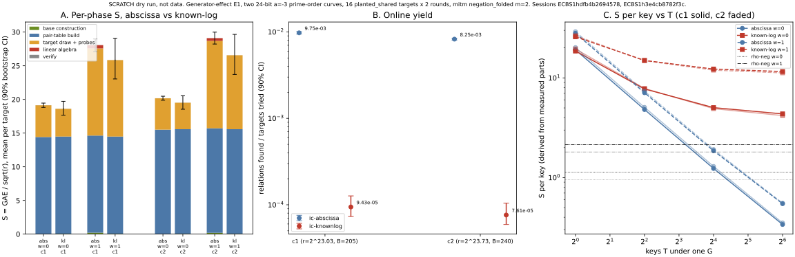
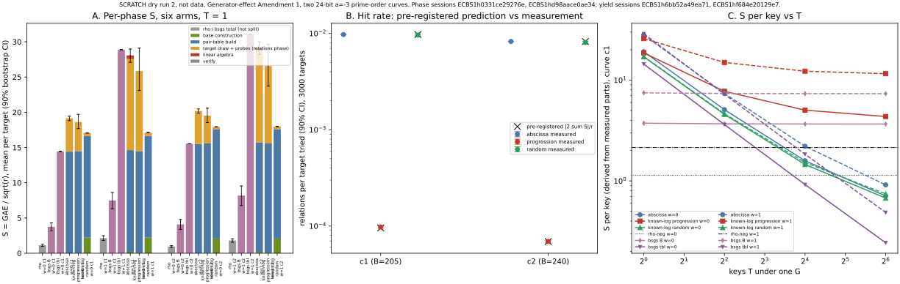

# E1 dry runs: the known-log base against the abscissa base

Two scratch dry runs. Dry run 1 (progression base) is below. Dry run 2
(PLAN Amendment 1: the random-scalar base, a BSGS comparator and a
3000-target yield block) is the section "Dry run 2". Dry run 2 also corrects
two statements of dry run 1; see "Corrections to dry run 1".

**SCRATCH, not data.** This is the PLAN §5 step 2 dry run. `PROTOCOL.md` is
not frozen, the host is L0 (no CPU pinning, no isolation lock, other load
allowed), and nothing here is a result of record. Operation counts and
group-addition equivalents (GAE) are exact and deterministic; wall time is
not used anywhere. **No security claim.** The known-log base is a generic
precomputation table in the Bernstein–Lange shape. No exponent moves.

## What ran

| item | value |
|:--|:--|
| curves | two 24-bit prime-order curves, `a = −3`, cofactor 1, found by `examples/a_minus_3_prime_order_curves.rs` (seed 20261019); generator = smallest-abscissa point |
| c1 | `p = 8582641`, `b = 6723661`, `r = 8580037` (2^23.03), B = 205 |
| c2 | `p = 13903607`, `b = 5849518`, `r = 13902853` (2^23.73), B = 240 |
| B | `ceil(r^(1/3))`, the family optimum of PLAN §4 |
| arms | `ic-abscissa` (`prime-abscissa:size=B`), `ic-knownlog` (`known-log:size=B`), `rho-neg`; both IC arms `mitm:negation_folded=1,m=2`, walk targets |
| targets | 16 `planted_shared` per curve, 2 measured rounds after 1 warm-up, so 32 runs per arm per curve, all verified (288 of 288 records including warm-up) |
| sessions | c1 `ECBS1hdfb4b2694578`, c2 `ECBS1h3e4cb8782f3c` |
| specs, records | [`dryrun/spec-c1.json`](dryrun/spec-c1.json), [`dryrun/spec-c2.json`](dryrun/spec-c2.json), [`dryrun/records/`](dryrun/records/) |
| aggregation | `examples/generator_effect_dryrun_summary.rs` writes [`dryrun/summary.json`](dryrun/summary.json); 10 000 bootstrap resamples, percentile 90% intervals, seed 20261019 |
| graph | [`dryrun/dryrun.svg`](dryrun/dryrun.svg), source [`dryrun/plot_dryrun.py`](dryrun/plot_dryrun.py) (plots recorded values only) |

**Pricing (AGENTS.md §5a).** The pinned calibration prices group additions
only. Lookups, target-guard probes, square roots, Legendre symbols and
`row_ops` have no pinned ratio on these fresh curves, so they are priced at
`w` ∈ {0, 0.1, 1} GAE per operation and every number is shown at all three.
S = GAE / √r. At `w = 0` the abscissa base's construction and its linear
algebra cost exactly 0 GAE, because they are only unpriced native work.

## Result 1: the baseline's set-up and linear-algebra share is small

Share of the `ic-abscissa` total S (measured counts, derived shares).

| curve | w | total S | base construction | linear algebra | **set-up + LA** | pair-table build | target draw + probes |
|:--|--:|--:|--:|--:|--:|--:|--:|
| c1 | 0 | 19.14 | 0 | 0 | **0.0%** | 75.3% | 24.6% |
| c1 | 0.1 | 20.03 | 0.11% | 0.24% | **0.35%** | 72.0% | 27.6% |
| c1 | 1 | 28.07 | 0.76% | 1.73% | **2.5%** | 51.4% | 46.1% |
| c2 | 0 | 20.17 | 0 | 0 | **0.0%** | 76.9% | 23.1% |
| c2 | 0.1 | 21.07 | 0.09% | 0.19% | **0.29%** | 73.6% | 26.0% |
| c2 | 1 | 29.10 | 0.68% | 1.40% | **2.1%** | 53.3% | 44.6% |

The cost of the baseline at this size is the pair table (42 230 additions on
c1) and the walk that feeds it, not the base's construction or its matrix.
Removing base construction and LA alone saves at most **0% to 2.5%** of S.
This does not count the relations the abscissa run must collect to fill the
matrix: see "Corrections to dry run 1". Rho on the same curves:
S = 1.13 / 1.24 / 2.14 on c1 and 0.95 / 1.04 / 1.81 on c2 at
w = 0 / 0.1 / 1, so both IC arms sit at about 13 to 21 times rho at T = 1 (derived).

## Result 2: the online yield is about 100 times lower, not equal

Relations found per target tried, pooled over 32 runs per arm, 90% bootstrap
interval.

| curve | abscissa | known-log | **ratio known-log / abscissa** |
|:--|:--|:--|:--|
| c1 | 9.75e-3 [9.45e-3, 1.006e-2] | 9.43e-5 [7.32e-5, 1.266e-4] | **0.0097 [0.0074, 0.0130]** |
| c2 | 8.25e-3 [8.04e-3, 8.46e-3] | 7.61e-5 [5.93e-5, 1.032e-4] | **0.0092 [0.0072, 0.0126]** |

PLAN §4 E1 predicted a ratio of 1.00 with a 90% interval inside
[0.97, 1.03]. **That prediction is false, and structurally so.** The base
`{±[i]G}` is an arithmetic progression, so every sum of two of its members is
one of `±i ± j`, an integer multiple of G in `[−2B, 2B]`. The pair table
holds at most `4B + 1` distinct sums (821 on c1, 961 on c2), where an
unstructured base of B points holds about `C(2B, 2)` (about 84 000 on c1). The
oracle tests membership of a *sum*, and sums of a progression collide. The
predicted hit probability per target, `(4B + 1) / r`, is 9.57e-5 on c1 and
6.91e-5 on c2 (derived), against 9.4e-5 and 7.6e-5 measured, both inside the
interval. PLAN §1D and §2 said that the MITM oracle makes the base "an
arbitrary set of B points". It does not: it makes the base's *sumset* the
object, and the sumset of `F_G(B)` has size O(B), not O(B^m).

## Result 3: total S at T = 1 is a tie, by coincidence of trial counts

Total S of `ic-knownlog` over `ic-abscissa`, paired by workload and round.

| curve | w = 0 | w = 0.1 | w = 1 |
|:--|:--|:--|:--|
| c1 | 0.973 [0.922, 1.030] | 0.965 [0.908, 1.030] | 0.921 [0.819, 1.031] |
| c2 | 0.968 [0.917, 1.022] | 0.960 [0.902, 1.022] | 0.913 [0.809, 1.021] |

Every interval contains 1. Under PLAN §4's decision rule (interval below 1 at
every weight) this is **"accounting, no improvement"** at T = 1. The ratio is
not a saving from removed algebra (Result 1 caps that at 2.5%). It is two
trial counts that happen to be close: the abscissa run collects about 118
relations at 1% each, about 12 000 targets; the known-log run needs one
relation at 0.01% each, about 10 600 targets. The pair-table build, 14.4 and
15.5 S, is identical in both arms.

## Result 4 of dry run 1: withdrawn

Dry run 1 reported a multi-target model in which the abscissa arm's per-key
online cost was 0.04 S and the known-log progression lost by a factor 12 to 21
at T = 64. The per-key cost was wrong: it spread the walk's per-target set-up
over the roughly 118 relations an abscissa run collects. Dry run 2 measured
the per-key cost directly (see below). The corrected figures are in dry run
2, Result E. The yield and T = 1 results above do not depend on this.

## Corrections to dry run 1

1. **The abscissa baseline's removable set-up is larger than Result 1 said.**
   Result 1 counted base construction and the matrix (0% to 2.5%). The
   abscissa run also collects about 118 relations to fill the matrix before the
   target is pinned. That is most of its relations phase: 4.71 S of 19.14 S on
   c1 at w = 0 (24.6%), 12.9 S of 28.1 S at w = 1 (46%), and a known base
   needs one relation, 0.41 S. So the set-up a known base can remove is about
   4.3 S at w = 0 and 12.5 S at w = 1 on c1, not 0%. What it cannot remove is
   the pair table (14.4 S). See Result C.
2. **Result 4 is withdrawn** (above); Result E replaces it.

## Dry run 2 (PLAN Amendment 1)

**SCRATCH, not data; PROTOCOL.md not frozen; L0 host; no security claim.**

| item | value |
|:--|:--|
| curves, B | as dry run 1: c1 (r = 8580037, B = 205), c2 (r = 13902853, B = 240) |
| new base | `known-log:size=B,scalars=random`: B scalars uniform in [1, r−1], seed 20261019, classes {s, r−s} distinct, **B charged scalar multiplications** (not the chained-increment walk: direct multiplications keep the scalars independent, so the sumset prediction is the generic one; the walk would cost about B additions and was not run) |
| arms | rho-neg; ic-abscissa; ic-knownlog (progression); ic-knownlog-random; bsgs-neg-B (baby table of B + 1 classes, the base size); bsgs-neg-tbl (baby table of B(B+1) + 1 classes, the entries of the pair table the IC arms build); all IC arms `mitm:negation_folded=1,m=2` |
| BSGS method | new id `bsgs.negation_table` with parameter `baby`: the same code as `bsgs.negation` with the table half-width given; `bsgs.negation` and its recorded ids are unchanged |
| phase readings | 16 `planted_shared` targets x 2 rounds (+1 warm-up), 32 runs per arm per curve; sessions c1 `ECBS1h0331ce29276e`, c2 `ECBS1hd98aace0ae34`; all 288 records per session verified |
| yield block | 3000 `planted_shared` targets, 1 round, all six arms; sessions c1 `ECBS1h6bb52a49ea71`, c2 `ECBS1hf684e20129e7`; 18 000 of 18 000 records verified per session |
| run time | phase sessions 15.9 s and 12.5 s wall; yield sessions 793 s and 729 s wall (397 s and 391 s user CPU) on a host shared with other builds; the three IC arms' summed solve time in the yield block is 10 to 17 s per arm per curve |
| pre-registration | [`dryrun/prereg.jsonl`](dryrun/prereg.jsonl), committed before any run of the new arms (commit "Pre-register the sumset hit-rate predictions"), made by `examples/known_log_sumset.rs` from the actual built base |
| aggregation | `examples/generator_effect_dryrun_v2_summary.rs` writes [`dryrun/summary2.json`](dryrun/summary2.json); 10 000 bootstrap resamples, percentile 90%, seed 20261019 |
| records, specs | `dryrun/spec2-*.json`; phase records and all session files in `dryrun/records/`; the 90 MB yield records are stored gzipped (`d2-*-yield-records.jsonl.gz`, 4.6 MB each) |
| pricing | as dry run 1: lookups, table inserts, probes, square roots, `row_ops` priced at w = 0 / 0.1 / 1 GAE per operation |

### Result A: the pre-registered hit rate holds, for both bases

Prediction `|2ΣS| / r`, where `2ΣS` is the set of distinct nonzero values
`±s_i ± s_j` (i ≤ j) counted from the built base; measurement is relations per
target tried over 3000 targets, 90% bootstrap interval.

| curve | base | sumset | predicted | measured | measured / predicted |
|:--|:--|--:|--:|:--|:--|
| c1 | progression | 820 | 9.56e-5 | 9.80e-5 [9.48e-5, 1.007e-4] | 1.023 [0.992, 1.054] |
| c1 | random | 83 630 | 9.75e-3 | 9.63e-3 [9.34e-3, 9.94e-3] | 0.988 [0.959, 1.020] |
| c2 | progression | 960 | 6.91e-5 | 6.90e-5 [6.70e-5, 7.13e-5] | 1.001 [0.971, 1.033] |
| c2 | random | 114 688 | 8.25e-3 | 8.06e-3 [7.82e-3, 8.31e-3] | 0.977 [0.948, 1.007] |

All four predictions fall inside the interval. The abscissa base measured
9.74e-3 (c1) and 8.25e-3 (c2) in the same block, so the yield ratio to the
abscissa base is **random 0.989 [0.958, 1.020] (c1), 0.976 [0.947, 1.005]
(c2)** and progression 0.0100 [0.0097, 0.0104] (c1), 0.0084 [0.0081, 0.0086]
(c2). The equal-yield prediction of PLAN §2 is true for the random-scalar
base, within about ±3%, and false for the progression.

### Result B: per-phase S at T = 1

Mean S per target (S = GAE / √r), 32 runs; intervals on the totals are in
`summary2.json`.

| curve | w | rho-neg | bsgs B | bsgs tbl | abscissa | progression | **random** |
|:--|--:|--:|--:|--:|--:|--:|--:|
| c1 | 0 | 1.13 | 3.74 | 14.44 | 19.14 | 18.62 | **17.06** |
| c1 | 0.1 | 1.24 | 4.12 | 15.89 | 20.03 | 19.34 | **17.07** |
| c1 | 1 | 2.14 | 7.48 | 28.88 | 28.07 | 25.85 | **17.13** |
| c2 | 0 | 0.95 | 4.09 | 15.54 | 20.17 | 19.52 | **17.93** |
| c2 | 0.1 | 1.04 | 4.50 | 17.09 | 21.07 | 20.22 | **17.94** |
| c2 | 1 | 1.81 | 8.18 | 31.07 | 29.10 | 26.57 | **17.99** |

Phases of the random arm on c1 (w = 0): base construction 2.23 S (205
charged scalar multiplications), pair-table build 14.42 S, relations phase
0.41 S, linear algebra 0 (0 `row_ops`, rank 1), verify 0.01. Abscissa on c1:
base construction 0, table 14.42, relations 4.71, linear algebra 0 (0.05 at
w = 0.1, 0.49 at w = 1). The random arm's S is nearly flat in w because
it does almost no probing: about 103 targets per key, against about 12 000
for the abscissa run.

### Result C: the random base against the abscissa baseline, the §5a band

Total S, random over abscissa, paired by workload and round, 90% interval.

| curve | w = 0 | w = 0.1 | w = 1 |
|:--|:--|:--|:--|
| c1 | 0.891 [0.877, 0.907] | 0.852 [0.836, 0.869] | 0.610 [0.590, 0.632] |
| c2 | 0.889 [0.876, 0.902] | 0.852 [0.838, 0.867] | 0.618 [0.600, 0.638] |

The interval is below 1 at every weight on both curves: at T = 1 the
random-scalar arm is cheaper than the abscissa baseline by 11% to 39%. The
mechanism is the relations the matrix no longer needs (Corrections, item 1),
paid for in part by the 2.2 S that building the random base costs. The
pair-table build, 14.4 and 15.5 S, is unchanged and is still 84% to 87% of the
random arm's S at w = 0.

### Result D: against BSGS and rho (T = 1)

bsgs over random, total S, 90% interval:

| curve | w = 0 | w = 0.1 | w = 1 |
|:--|:--|:--|:--|
| c1, bsgs B | 0.219 [0.185, 0.252] | 0.241 [0.205, 0.278] | 0.437 [0.369, 0.504] |
| c2, bsgs B | 0.228 [0.189, 0.266] | 0.251 [0.208, 0.294] | 0.455 [0.377, 0.531] |
| c1, bsgs tbl | 0.847 [0.846, 0.847] | 0.931 [0.931, 0.931] | 1.686 [1.684, 1.688] |
| c2, bsgs tbl | 0.866 [0.866, 0.867] | 0.953 [0.952, 0.953] | 1.727 [1.725, 1.729] |

- **bsgs B** (a baby table of the base's size) is cheaper than the random arm
  at every weight, by a factor 2.3 to 4.6 on c1 and 2.2 to 4.4 on c2.
- **bsgs tbl** (a baby table of the pair table's size, which is the memory the
  IC arms actually hold) is cheaper at w = 0 and 0.1 and dearer at w = 1,
  because its 42 000 table inserts are priced at w. **The order does not hold
  across the band, so §5a ranks them as unordered at T = 1.**
- Against rho the random arm is 15.0 [13.1, 17.5] / 13.8 / 8.0 [6.9, 9.4]
  times rho-neg on c1 and 18.8 [16.7, 21.5] / 17.3 / 10.0 [8.8, 11.5] on c2,
  at w = 0 / 0.1 / 1. The abscissa baseline is 16.9 times rho (c1, w = 0),
  13.1 times (c1, w = 1), 21.2 times (c2, w = 0) and 16.1 times (c2, w = 1).

PLAN Amendment 1, item 5 reads: improvement only if the random arm is below
the abscissa baseline at every band weight **and** below `bsgs.negation` at
equal memory. The first clause holds (Result C). The second does not: it
fails against bsgs B at every weight, and against bsgs tbl the order is not
stable. **Under the amended decision rule this is "no improvement" at T = 1**,
while it is a measured 11% to 39% saving over the abscissa baseline inside the
IC family. Under the CLAUDE.md criterion that is an IC-baseline row, scratch
and unfrozen, and it stays about 8 to 19 times from rho and does not beat
generic BSGS.

### Result E: S per key with several keys under one G (corrected model)

Built from measured parts. The first key is the measured run. Each further
key costs the arm's measured per-key online S: for the known-log arms a run
stops at its first relation, so one run's relations plus verify is exactly
that, walk set-up included (progression 4.13 / 3.94 S, random 0.415 / 0.336 S
at w = 0 on c1 / c2). The abscissa run collects about B relations, so its
per-key cost is taken equal to the random arm's: same relation law and walk
(the yield ratio in Result A, within 3%, is the check). BSGS reuses its baby
table and pays its giant steps per key; rho is not amortised.
Curve c1; c2 is in `summary2.json` and within a few per cent.

| w | T | rho-neg | bsgs B | bsgs tbl | abscissa | progression | random | random / abscissa |
|--:|--:|--:|--:|--:|--:|--:|--:|:--|
| 0 | 1 | 1.13 | 3.74 | 14.44 | 19.14 | 18.62 | 17.06 | 0.891 [0.877, 0.907] |
| 0 | 4 | 1.13 | 3.69 | 3.62 | 5.10 | 7.75 | 4.58 | 0.898 [0.884, 0.913] |
| 0 | 16 | 1.13 | 3.67 | 0.92 | 1.59 | 5.03 | 1.46 | 0.918 [0.907, 0.930] |
| 0 | 64 | 1.13 | 3.67 | 0.24 | 0.71 | 4.36 | 0.68 | 0.954 [0.947, 0.961] |
| 1 | 1 | 2.14 | 7.48 | 28.88 | 28.07 | 25.85 | 17.13 | 0.610 [0.590, 0.632] |
| 1 | 16 | 2.14 | 7.34 | 1.84 | 2.21 | 12.27 | 1.52 | 0.690 [0.672, 0.710] |
| 1 | 64 | 2.14 | 7.34 | 0.49 | 0.91 | 11.59 | 0.74 | 0.813 [0.800, 0.828] |

- The random arm's advantage over the abscissa baseline shrinks as T grows
  (0.89 to 0.95 at w = 0, 0.61 to 0.81 at w = 1), as PLAN predicted for the
  multi-target block, and it does not reverse.
- The progression is 6 to 17 times the random arm at T = 64 (c1 and c2,
  w = 0 and 1), not 12 to 21 times the abscissa arm as dry run 1 modelled.
- At w = 0 both ic arms pass below rho-neg between T = 16 and T = 64 (random
  1.46 against 1.13 at T = 16, 0.68 at T = 64). At w = 1 the random arm is
  below by T = 16 and the abscissa arm between T = 16 and T = 64. This is
  a model on one G at 24 bits and says nothing about 192 or 224 bits.
- **A baby table of the pair table's size, probed by giant steps, costs
  0.24 S per key at T = 64 on c1 at w = 0 against 0.68 S for the random arm**
  (2.8 times), and 0.49 against 0.74 at w = 1 (1.5 times). At the memory the
  IC arms already hold, the generic table is ahead from T = 4 at w = 0 and
  between T = 16 and T = 64 at w = 1 on c1.

## What changes in PLAN

1. **§2 yield law.** The sumset law `|2ΣS| / r` predicts the hit rate of
   both bases within about ±3% (Result A). Keep it as the pre-registered
   prediction for every known-log arm.
2. **Equal yield** (E1) is a property of the random base, not of "any known
   log base". It is confirmed at ±3% on both curves.
3. **E1's decision rule** (Amendment item 5) reads "no improvement at T = 1"
   on these two curves because the second clause fails (Result D).
   The first clause, the saving over the abscissa baseline, is real.
4. **Where the saving comes from.** The removable set-up is the relation
   collection for the matrix (about 4.3 S at w = 0), not base construction or
   LA (0% to 2.5%). A cheaper random base (the chained-increment walk,
   about B additions instead of B scalar multiplications) would add up to
   2.2 S to the saving. It was not run, and its sumset has not been counted.
5. **The comparator that matters is BSGS at the pair table's memory.** It is
   unordered with the random arm at T = 1, ahead from T = 4 at w = 0 and
   from T = 64 at w = 1. A
   follow-up that tests whether any IC row can beat it must either shrink the
   pair table or drop it.
6. **The model for multi-key rows** must price each arm's per-key online cost
   from a run that stops at its first relation (this correction), and amortise
   BSGS's table as well.
7. **E2, E3, E4, E5, E0.** Not run.

## Checks

- All 288 records of each phase session and all 18 000 of each yield session
  verified (`[d]G = Q` checked by the runner).
- Known-log arms' linear algebra: 0 group operations, 0 `row_ops`, rank 1,
  GAE 0 in every record (`phases[linear_algebra]`).
- Base construction: progression B − 1 charged additions (0.064 to 0.070 S);
  random B charged scalar multiplications (2.09 to 2.23 S).
- Unit tests in `src/cryptanalysis/ic_framework/mod.rs`: progression and random
  logs recovered on a 24-bit prime-order curve with zero LA; same-G digest;
  closure under negation; random scalars give B scalar multiplications and the
  same base for the same seed.
- Not done: E0 coupled-seed checks, `ic-abscissa-online`, A/A control, `m = 3`,
  the planted `B + 1` control, the chained-increment random base, any other
  bit size, an independent re-run on an isolated host.
- Registry: the two curves are not in `docs/curves/registry.json` (AGENTS.md
  §11); register them before any citation in prose outside this scratch note.
- No canonical graph or leaderboard is changed: this is a scratch row.

*Figure 1 (dry run 1). A: mean S per target by phase. B: relations per target
tried. (Dry run 1's panel C, the withdrawn multi-target model, is dropped;
Figure 2, panel C replaces it.) Sessions ECBS1hdfb4b2694578 and
ECBS1h3e4cb8782f3c.*

*Figure 2 (dry run 2). A: mean S per target by phase, six arms, c1 and c2 at
w = 0 and 1 (90% bootstrap interval on the totals). B: hit rate over 3000
targets, measured with 90% interval against the pre-registered sumset
prediction (crosses). C: S per key against keys T under one G on c1, derived
from measured parts. Sessions ECBS1h0331ce29276e, ECBS1hd98aace0ae34,
ECBS1h6bb52a49ea71, ECBS1hf684e20129e7; scratch dry run.*
