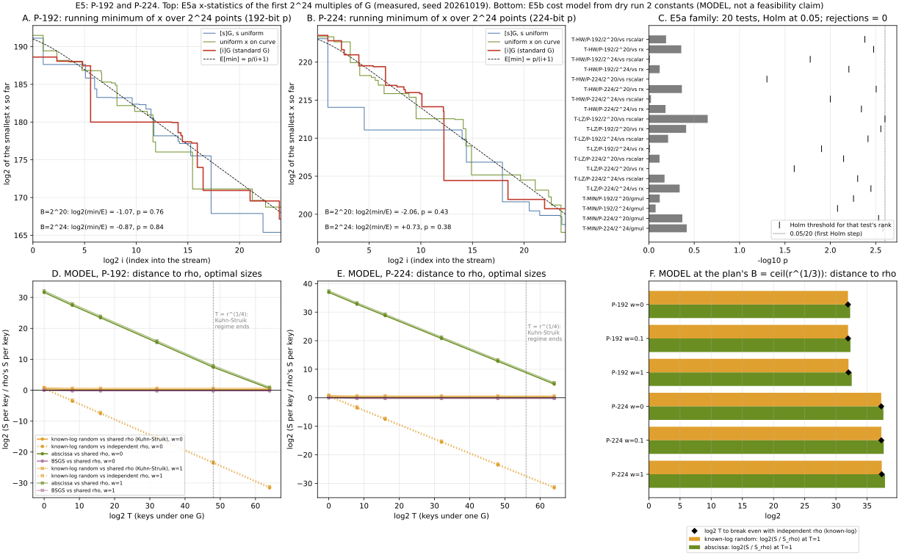

# E5: free checks on P-192 and P-224 (no ECDLP run)

**Status.** E5a is measured under a protocol frozen before the run
([`e5/PROTOCOL.md`](e5/PROTOCOL.md), commit `ff44dd462`). E5b is a **model**:
constants from dry run 2 at 24 bits (scratch, `PROTOCOL.md` of E1 not frozen),
projected by derived formulas. **No ECDLP run. No security claim. E5b is not a
feasibility claim.** All statements below are labelled measured, derived or
model.

**The owner's question.** On P-192 and P-224 the generator `G` is fixed by the
standard and every key is `[k]G`. Does the fixed `G` give index calculus
anything? E5 runs the only checks that are feasible on the real curves:

- **E5a:** do the first `2^24` multiples of the standard `G` look different, in
  their abscissae, from random points?
- **E5b:** what would a base built from `G` (known logs, no linear algebra) cost
  at 192 and 224 bits, against the abscissa baseline, BSGS and rho?

**Answer in one line.** E5a: no. None of 20 pre-registered tests rejects after
Holm at 0.05; the smallest p is 0.22. E5b (model): the known-log base is a
generic precomputation table. At the plan's `B = ⌈r^{1/3}⌉` it sits `2^32`
(P-192) and `2^37` (P-224) from rho at one key. At its own optimal size it
comes within `2^0.4` to `2^0.8` of rho at one key, using a table of `2^95.5`
or `2^111.5` entries. It never reaches rho with shared distinguished points
(Kuhn–Struik), and it never reaches BSGS at equal memory.

*Figure 1. A, B (measured): running minimum of `x` over the first `2^24`
elements of each stream, against the order-statistic expectation
`p/(i + 1)`. C (measured): the 20 tests of the family, `−log10 p` against each
test's Holm threshold. D, E (model): log2 of S per key over rho's S per key
against the number of keys `T`, each arm at its optimal size, at `w = 0`
(solid markers) and `w = 1` (faded). F (model): the plan's equal `B`, distance
to rho at `T = 1` and break-even `T` against independent rho. E5a seed
20261019; E5b constants from sessions ECBS1h0331ce29276e and
ECBS1hd98aace0ae34. Source: [`e5/plot_e5.py`](e5/plot_e5.py) (lays out the
JSON only).*

## E5a: the first 2^24 multiples of G (measured)

**What ran.** `cargo run --release --example generator_effect_e5a`
([source](../../examples/generator_effect_e5a.rs)) on `CurveParams::p192()` and
`CurveParams::p224()`. It builds three streams of `2^24` canonical abscissae per
curve: `gmul = x([i]G)`, `rscalar = x([s]G)` with `s` uniform in `[1, n−1]`, and
`rx`, uniform `x ∈ [0, p)` on the curve. Seeds and chunking are as in the
protocol. `B = 2^20` is the prefix of each stream. Arithmetic: 4-limb
Montgomery field (`ct_bignum::Uint<4>`), Jacobian points, batched inversion
per `2^16` points, and an 8-bit fixed-base comb for `[s]G`. Output:
[`e5/e5a.json`](e5/e5a.json). Log: [`e5/e5a.log`](e5/e5a.log). Run report:
[`reports/run-20261019T2159Z/`](reports/run-20261019T2159Z/).

**Checks (all pass).** `G` is on each curve and `[n]G = O`. 202 BigUint
cross-checks per curve: `x([i]G)` at `i ∈ {1, 2, 3, 1000, 2^16, 2^16+1, 2^20,
2^24}` plus the first 64 of `gmul`, 64 `rscalar` points through
`Point::scalar_mul_vartime`, and 64 `rx` right-hand sides by Euler's criterion.
0 mismatches. The planted positive control (rx with element `B/2` replaced
by the first valid abscissa, `x = 0` on P-192 and `x = 3` on P-224) is
detected in all 4 cells: p = 0, 0, 2.3e-61 and 3.7e-60 against 0.0025. A
second run from the final committed source gave identical JSON except for wall
times.

**The family (measured).** Holm–Bonferroni over 20 tests, family-wise
α = 0.05. **Rejections: 0.** The prediction holds.

| curve | B | T-LZ vs rscalar | T-LZ vs rx | T-HW vs rscalar | T-HW vs rx | T-MIN (gmul) |
|:--|:--|--:|--:|--:|--:|--:|
| P-192 | 2^20 | 0.225 | 0.389 | 0.646 | 0.439 | 0.759 |
| P-192 | 2^24 | 0.613 | 0.969 | 0.971 | 0.759 | 0.843 |
| P-224 | 2^20 | 0.763 | 0.991 | 0.992 | 0.432 | 0.427 |
| P-224 | 2^24 | 0.672 | 0.458 | 0.948 | 0.655 | 0.382 |

*p-values. T-LZ: two-sample chi-square on leading-zero bins `0…K−1, ≥K`,
`K = log2 B − 6`, df = K. T-HW: two-sample chi-square on Hamming-weight bins
`ℓ/2 ± 3σ` with pooled tails, df = 44 (P-192) and 48 (P-224). T-MIN:
two-sided, `F(u) = 1 − e^{−u}`, `u = B·x_min/p`. The smallest p is 0.225
against a first Holm threshold of 0.0025.*

**The statistics themselves (measured).**

| curve | B | set | mean HW | smallest `x`: log2 | its index | log2(x_min / (p/(B+1))) |
|:--|:--|:--|--:|--:|--:|--:|
| P-192 | 2^24 | gmul | 96.0002 | 167.13 | 15 193 886 | −0.87 |
| P-192 | 2^24 | rscalar | 96.0012 | 165.39 | 5 076 147 | −2.61 |
| P-192 | 2^24 | rx | 95.9987 | 168.73 | 5 991 468 | +0.73 |
| P-224 | 2^24 | gmul | 111.9963 | 200.73 | 4 133 403 | +0.73 |
| P-224 | 2^24 | rscalar | 111.9994 | 198.65 | 13 191 441 | −1.35 |
| P-224 | 2^24 | rx | 111.9992 | 197.63 | 12 482 318 | −2.37 |
| P-192 | 2^20 | gmul | 95.9999 | 170.93 | 91 246 | −1.07 |
| P-224 | 2^20 | gmul | 111.9954 | 201.94 | 354 421 | −2.06 |

The full histograms, all record lows and the `2^20` controls are in
`e5a.json`. Bit length is `ℓ − lz`, so it carries the same information as the
leading-zero test. The shortest abscissa among the `gmul` points is 168 bits
on P-192 and 201 bits on P-224.

**Calibration, outside the family (measured).** Each of the 12 (curve, B, set)
cells was also tested against its analytic law: leading zeros of a uniform
`x ∈ [0, p)`, and Hamming weight Binomial(ℓ, 1/2). The smallest of the 24
p-values is 0.022 (P-192, `2^20`, gmul, leading zeros). Under any multiplicity
correction over 24 tests that is not significant. Every T-MIN on the controls
lies in `[0.11, 0.85]`.

**What E5a rules out (derived from the measured minima).** T-MIN would have
rejected for `log2(x_min/E) ≤ −9.6` at the first Holm step. Directly, without
any statistics: no `±[i]G` with `1 ≤ i ≤ 2^24` has an abscissa below
`2^167.1` on P-192 or below `2^200.7` on P-224. In particular the
lexicographically first point (`x = 0`, `x = 3`) is not `±[i]G` for any such
`i`.

**Power, stated plainly (derived).** The two-sample chi-square tests at
`2^24` per sample detect a change of about 1% in a bin holding 1/64 of the
mass, and much less in the large bins. A generator chosen to hide structure
outside these statistics would pass. E5a is a test for visible structure, not
a proof of its absence.

### Cross-reference: trapdoor program slot S4

[`nist_trapdoor_slot_program_20261011/PROTOCOL.md`](../nist_trapdoor_slot_program_20261011/PROTOCOL.md)
§10 lists two pending S4 items: E4a, rigid-derivation tests against four
candidate rules, and E4b, a protocol audit.

- **E4a, rule "`G = [h]·(first point)` with `h = 1`":** E5a **narrows it, in
  one direction only.** It excludes `P_first = ±[i]G` for `1 ≤ i ≤ 2^24`, that
  is `G = [h]·P_first` with `h ≡ ±i⁻¹ (mod n)`. That family includes
  `h = 1`, which closes the rule as written for both curves (the census
  already had it from `G.x ≠ x_first`). It does **not** cover small `h > 1`,
  because `h⁻¹ mod n` is then a large scalar. The direct check, `[h]·P_first`
  for `h ≤ 2^24` compared with `G`, is a cheap follow-up and is not run here.
- **E4a, SHA-1 rules** (`x = SHA-1(seed ‖ i)`, the X9.62 construction): not
  touched.
- **E4b** (protocol audit): not touched.
- **P-192 specifically.** `nist_seed_provenance_20261016/README.md` attributes
  P-192's `G` to Lenstra's FreeLIP `zrandom` (seeds 20000–20517). That is
  random output, and E5a's null result is what that provenance predicts. For
  P-224 the provenance is unexplained; E5a finds no visible structure in its
  first `2^24` multiples.

**S4 stays pending.** E5a closes the `h = 1` case, which was already closed,
and adds the inverse family `P_first = ±[i]G`, `i ≤ 2^24`. It closes no other
listed item.

## E5b: the known-log base at 192 and 224 bits (MODEL)

**What it is.** `cargo run --release --example generator_effect_e5b`
([source](../../examples/generator_effect_e5b.rs)) reads the 384 measured
(non-warm-up) records of dry run 2's two phase sessions and `summary2.json`'s
yield block. It extracts the constants below and evaluates derived cost
formulas at `r = n(P-192) ≈ 2^192` and `r = n(P-224) ≈ 2^224`. Output:
[`e5/e5b.json`](e5/e5b.json). **The dry run reports no fitted exponents** (two
curves at one size); the exponents here come from the structure of each
algorithm, not from a fit. That is the main caveat of this section.

**Constants (measured at 24 bits, pooled over both curves).**

| constant | value | source |
|:--|--:|:--|
| GAE per scalar multiplication, per bit of r | 1.373 | known-log random, factor-base phase (B charged scalar mults) |
| per-key walk overhead | 34.4 scalar mults | relations phase GAE minus walk steps |
| verify | 1.00 scalar mult | verify phase |
| additions per trial | 0.959 | walk steps / trials |
| unpriced ops per trial (lookup + guard probe) | 2.00 | relations phase |
| abscissa: relations per base element `f_R` | 0.554 | relations / B |
| abscissa: LA row ops per (B · relations) | 0.053 | linear algebra phase |
| abscissa: base native ops per element | 3.06 | Legendre + square roots |
| hit rate, measured / `2B(B+1)/r` | 0.973 | 3000-target yield block |
| BSGS giant steps, measured / `r/(2(2M+1))` | 1.033 | bsgs-neg-B |
| rho-neg S at w = 0 / 0.1 / 1 | 1.044 / 1.137 / 1.975 | rho-neg, canonicalisations at w |

**Formulas (derived).** `E = B(B+1)` pair-table entries; hit rate
`h = 0.973 · 2E/r`; `sm = 1.373 · log2 r` GAE; trial `= 0.959 + 2w` GAE.

- known-log random: `B·sm + E(1+w) + T·[(34.4 + 1.0)·sm + trial/h]`.
- abscissa: `w·3.06·B + E(1+w) + (f_R·B − 1)·trial/h + w·0.053·B·f_R·B + T·[(35.4)·sm + trial/h]`.
- `bsgs.negation_table`, M baby classes: `sm + M(1+w) + T·[sm + 1.033·(1+w)·r/(2(2M+1))]`.
- rho: `s_rho(w)·√r` per key, keys independent (dry run's convention). A
  second variant shares distinguished points across keys (Kuhn–Struik 2001):
  total `≈ (2/√π)·√T·s_rho(w)·√r`. This is an asymptotic valid for
  `T ≪ r^{1/4}` (`2^48`, `2^56`); points beyond are drawn but flagged
  `ks_regime_ok = false` in the JSON.
- Pricing: the dry run left the IC arms' pair-table inserts uncounted while it
  priced BSGS's inserts at `w`. Here both are priced at `w`, symmetrically.

### At the plan's equal B = ⌈r^{1/3}⌉ (model)

| curve | log2 B | log2 table | online probes per key, log2: known-log / BSGS same memory / abscissa first key | log2(S/S_rho) at T=1, w = 0 / 0.1 / 1: known-log | same: abscissa | break-even T vs independent rho (log2), known-log | vs shared rho |
|:--|--:|--:|:--|:--|:--|:--|:--|
| P-192 | 64.0 | 128.0 | 63.0 / 62.0 / 126.2 | 31.9 / 32.0 / 32.0 | 32.3 / 32.3 / 32.5 | 31.9 / 32.0 / 32.0 | never |
| P-224 | 74.7 | 149.3 | 73.7 / 72.7 / 147.5 | 37.3 / 37.3 / 37.4 | 37.6 / 37.7 / 37.9 | 37.3 / 37.3 / 37.4 | never |

At this `B` the pair table (`2^128`, `2^149`) is the whole cost. The known-log
arm breaks even with *independent* rho only after about `2^32` (P-192) or
`2^37` (P-224) keys. With shared distinguished points, rho's per-key cost
falls as `1/√T` and the fixed table never catches it. Against BSGS holding
the same table, the known-log arm pays 1.91 / 2.10 / 2.94 times the online
cost per key at `w = 0 / 0.1 / 1`: random sums cover `2E` residues per probe
by chance, where BSGS strides cover `2(2M+1)` deterministically. It never
catches BSGS at equal memory.

### Each arm at its own optimal size (model)

| curve | w | known-log: log2 B, log2 table at T=1 | log2(S/S_rho) at T=1 | log2(S/S_shared rho), T ≥ 2^8 | break-even T vs independent rho | BSGS optimum vs shared rho (log2) | abscissa at its optimum, log2(S/S_rho) at T=1 |
|:--|--:|:--|--:|--:|--:|--:|--:|
| P-192 | 0 | 47.7, 95.5 | 0.43 | 0.25 | 2^0.86 ≈ 1.8 | −0.04 (T=1), −0.21 | 31.6 |
| P-192 | 0.1 | 47.8, 95.6 | 0.51 | 0.34 | 2^1.02 ≈ 2.0 | −0.02, −0.20 | 31.7 |
| P-192 | 1 | 47.9, 95.8 | 0.82 | 0.65 | 2^1.64 ≈ 3.1 | +0.04, −0.13 | 32.1 |
| P-224 | 0 | 55.7, 111.5 | 0.43 | 0.25 | 2^0.86 ≈ 1.8 | −0.04, −0.21 | 36.9 |
| P-224 | 0.1 | 55.8, 111.6 | 0.51 | 0.34 | 2^1.02 ≈ 2.0 | −0.02, −0.20 | 37.1 |
| P-224 | 1 | 55.9, 111.8 | 0.82 | 0.65 | 2^1.64 ≈ 3.1 | +0.04, −0.13 | 37.4 |

At its optimum (`B ≈ r^{1/4}`, table `≈ √r`) the known-log arm is plain
generic precomputation. It costs about `√(2(1+w)(1+2w)·r/T)` per key, within
`2^0.4` to `2^0.8` of rho at one key and below independent rho from two or
three keys. That is the Bernstein–Lange shape PLAN §2 named, with memory
`2^95.5` (P-192) and `2^111.5` (P-224) entries at one key, growing as `√T`.
Against shared rho its per-key cost is a constant factor `2^0.25` to
`2^0.65` above, for every `T` in the Kuhn–Struik regime. BSGS at its own
optimum ties shared rho to within `2^0.04` at one key and sits `2^0.13` to
`2^0.21` below it for more keys; that is inside the model's accuracy (an
idealised BSGS against a measured rho overhead). The abscissa baseline's
optimum is `B ≈ r^{1/3}` (`2^63`, `2^74`), and it stays `2^32` to `2^37` from
rho at one key. Its relation collection is what the known-log base removes.

**Distance remaining (model).** On the CLAUDE.md criterion, the known-log
random-scalar base is an improvement over the abscissa baseline in this
model: `2^31` to `2^37` at `T = 1` once each is at its optimum. The reason is
that it no longer needs `0.55·B` relations before the first key. It is no
improvement over generic algorithms. At equal memory it is 1.9 to 2.9 times
BSGS's online cost per key, and it stays `2^0.25` to `2^0.82` above rho with
shared distinguished points. None of this is a feasibility statement: the
tables hold `2^95` to `2^149` entries.

**What the model does not cover.** No fitted exponent from a size sweep;
24-bit constants carried to 192 and 224 bits. A per-key walk overhead
proportional to `log2 r` (scalar mults). Hit rate from the sumset law,
checked only at 24 bits. Memory access cost, which is unpriced. Parallelism.
The chained-increment base (B additions instead of B scalar mults), which
changes the known-log setup by less than `2^−39` of the table at these sizes.
Semaev oracles, for which a set `{[s]G}` has no polynomial description
(PLAN §2).

## What this says about the owner's question

- **Measured (E5a):** the standard `G`'s first `2^24` multiples carry no
  visible abscissa structure on P-192 or P-224. Their sizes, bit patterns and
  smallest values are those of random points.
- **Derived (PLAN §1B) and modelled (E5b):** the only thing a fixed `G` gives
  index calculus is that logs computed once, base `G`, are reused for every
  key. A base built from `G` makes those logs free. In the MITM pipeline that
  base is a generic precomputation table, and generic precomputation is
  already bounded by rho and BSGS. It does not move an exponent.

## Files

| file | what |
|:--|:--|
| [`e5/PROTOCOL.md`](e5/PROTOCOL.md) | E5a protocol, frozen before the run (commit `ff44dd462`) |
| [`e5/e5a.json`](e5/e5a.json), [`e5/e5a.log`](e5/e5a.log) | E5a output and log (run 20261019T2159Z) |
| [`e5/e5b.json`](e5/e5b.json) | E5b model output |
| [`e5/e5.svg`](e5/e5.svg), [`e5/e5.png`](e5/e5.png), [`e5/plot_e5.py`](e5/plot_e5.py) | figure, 150 dpi render, plotting-only source |
| [`E5.typ`](E5.typ), [`E5.pdf`](E5.pdf), [`build_e5_pdf.sh`](build_e5_pdf.sh) | this report as PDF |
| [`../../examples/generator_effect_e5a.rs`](../../examples/generator_effect_e5a.rs) | E5a scan |
| [`../../examples/generator_effect_e5b.rs`](../../examples/generator_effect_e5b.rs) | E5b model |
| [`reports/run-20261019T2159Z/`](reports/run-20261019T2159Z/) | run report of the E5a run |

Graphs checked and left unchanged: `docs/ic-leaderboard.html` and
`docs/ic/LEADERBOARD.md` (no measured IC row; E5b is a model),
`docs/index-calculus-scoreboard.html`, and the trapdoor program's figures (S4
is narrowed, not closed). No `benchmarks/` entry, because nothing here
measures speed. Conductor: the MCP returned 404 and the CLI has no project
configured on this host, so no task was obtained.
