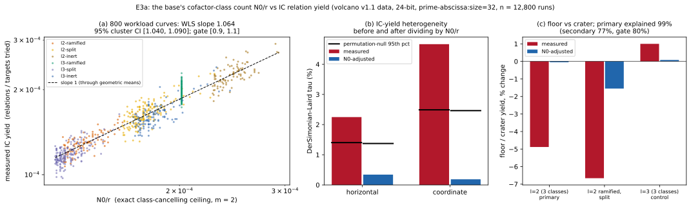

# E3a: the base's cofactor classes and the volcano study's IC yield effects

**Result (measured, existing data, no new runs).** Dividing each workload's
IC relation yield by its exact class-cancelling ceiling `N0/r` removes the
coordinate and horizontal heterogeneity and the pooled ℓ = 2 floor/crater
contrast. All four pre-registered gates in [`PROTOCOL.md`](PROTOCOL.md)
(frozen in commit `23dbdb5c1`, before any N0 was regressed on a yield) pass
by their frozen rules. Two secondary readings are weaker and are reported
below, not folded into the verdict.

Scope: 24-bit `p`, `prime-abscissa:size=32`, MITM `negation_folded`, the six
ordinary volcano classes of `research/isogeny-volcano-cost_20261017` (PROTOCOL
v1.1): 800 workload curves, 12,800 verified runs. No security statement, and
nothing here is about generators (E1) or a changed base (E3b).

Verdict wording (PROTOCOL §4): **yield follows the base's cofactor classes:
slope 1.064 (cluster 95% CI [1.040, 1.090]), residual τ 0.3% horizontal and
0.2% coordinate (null 95th percentiles 1.4% and 2.5%).**



## Gates

| gate | frozen rule | measured | verdict |
|:--|:--|:--|:--|
| instrument | all 800 rebuilt bases hash to the recorded `points_sha256`; records match `MANIFEST.sha256` | 800/800; manifest exact; 0 values capped at 1 | pass |
| reproduction (not a gate) | `volcano-stats` reproduces the v1.1 IC rows | τ_h 2.25%, τ_model 4.67%, floor/crater 0.980 (volcano study: 2.25%, 4.67%, 0.980) | reproduced |
| **G1** slope | WLS slope of ln yield on ln N0/r in [0.9, 1.1] | **1.064**, 95% [1.040, 1.090] (OLS 1.054) | pass |
| **G2** horizontal τ | adjusted τ ≤ null p95 | 0.34% vs 1.37% (p = 0.57); was 2.25% vs 1.40% | pass |
| **G3** coordinate τ | adjusted τ ≤ null p95 | 0.19% vs 2.46% (p = 0.96); was 4.67% vs 2.49% | pass |
| **G4** ℓ = 2 contrast | ≥ 80% of ln(floor/crater) explained | measured 0.951 → adjusted 0.9995; **99%** explained, bootstrap 95% [71%, 158%] | pass |

## What the secondary readings say

- **The ℓ = 2 contrast is −4.9%, not the −6.5% of the hypothesis.** The
  protocol's primary definition pools all three ℓ = 2 classes with equal
  weight, and `l2-inert` (one crater curve) shows almost nothing. Its raw
  95% interval is [−6.7%, −3.0%], so G4 was testable. For `l2-ramified` and
  `l2-split` alone (the two classes where the exploratory contrast was
  nominally significant) the raw contrast is −6.7% and N0 explains **77%**,
  under the 80% bar; the adjusted residual is −1.6% (90% interval
  [−3.7%, +0.6%], permutation p = 0.21). This is a secondary, so it does not
  change the verdict, but the "explains ≥ 80%" claim is solid for the
  pooled contrast and borderline for the two-class one. The intervals on
  the explained fraction are wide (the ratio of two small numbers).
- **Slope inside curves is at the edge of the band.** The class fixed-effect
  slope is 1.085 [1.003, 1.165] and the curve fixed-effect slope (models of
  one curve only, the coordinate effect) is 1.103 [1.008, 1.191]. The
  frozen gate is the pooled point estimate, which passes. The within-curve
  estimate is imprecise (its interval spans the band's edge); it is
  consistent with slope 1 and does not show a coordinate effect beyond N0.
- **ℓ = 3 control.** Raw contrast +1.0% [−0.3%, +2.3%], adjusted +0.08%:
  nothing to explain (G4's "not testable" rule applies to it).
- **Yield by cofactor `h`** (context): h = 1: 1.97e−4 (128 curves),
  h = 4: 1.62e−4 (368), h = 5: 1.18e−4 (188), h = 7: 1.61e−4 (116).
  `N0/r` ranges 1.24e−4 to 2.93e−4 (sd of ln = 0.21).

## What it does not show

- `N0/r` is an upper bound, and a slope near 1 across six classes means the
  shortfall (duplicate sums, the negation fold) is roughly constant. The
  slight excess over 1 (1.06) is inside the pre-registered tolerance but
  is not explained here.
- The adjustment is by `N0/r` as computed for the *measured* base; it says
  yield follows it, not that a different base (`subgroup=filter|project`,
  E3b) would raise yield by the predicted factor. That is E3b.
- Per-class τ and the residual after adjustment are small, not zero; at this
  N a residual below about 1% is not distinguishable from none.
- The generator question (E0, E1) is not touched.
- Not a speed measurement, so no `benchmarks/` entry (nothing timed; counted
  yields only).

## Method and files

- `src/bin/generator_n0.rs` (native Rust): `census` rebuilds each base with
  `prime_factor_base(&inst, 32)`, checks its hash, computes
  `exact_decomposition_ceiling(…, m = 2)` (and m = 3, unused); `regress`
  does G1 (WLS, OLS and fixed-effect variants, cluster bootstrap of the 200
  curves, 2,000 replicates) and G4 (class-stratified contrast, curve
  bootstrap within class × level, 10,000-label permutation).
- `volcano-stats --n0 n0.json` (G2, G3): divides each run's relations by
  its workload's `N0/r` (numerator, so `(num, den)` stay exchangeable),
  then the unchanged heterogeneity tests with 2,000-permutation nulls.
  Seed 20261017 throughout; only `ic-mitm` and `rho-neg` records of the
  `spec` sessions (with `l3-split/spec-r2`) were passed, so the null
  percentiles differ from the volcano study's in the third digit.
- Outputs: `n0.json`, `n0.csv` (per workload), `workloads.csv` (yield and
  `N0/r` per workload), `regression.json`, `stats-unadjusted.{json,log}`,
  `stats-adjusted.{json,log}`; `plot.py` draws the figure from them.
- Reproduce:

```sh
cargo build --release --bin generator-n0 --bin volcano-stats
D=research/generator_effect_ic_20261019
./target/release/generator-n0 census --out $D/n0.json --csv-out $D/n0.csv
./target/release/generator-n0 regress --n0 $D/n0.json --out $D/regression.json --csv-out $D/workloads.csv
```

  then `volcano-stats` as in the `argv` fields of `stats-*.json`.
- Sources: sessions `research/isogeny-volcano-cost_20261017/sessions/*/spec`
  (`l3-split/spec-r2`); the volcano branch is
  `aburan28/youthful-ride-6u51pp-volcano-v2`, so this branch is based on it.
- Graphs checked and left unchanged: the volcano study's figures (this adds
  none to them); no canonical scoreboard graph is affected.

## Consequence for the plan

E3a's pre-registered success means the PLAN's working hypothesis stands for
the three volcano effects: they are N0 effects. E3b (new factor-base arms
at equal B) is the next test of whether the same lever raises yield.
