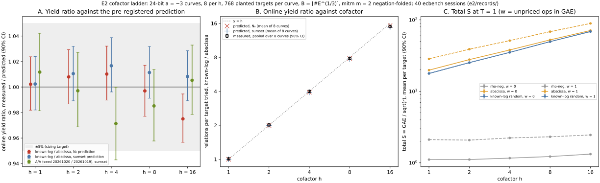

# Run report: E2 cofactor ladder, 2026-10-19 22:13 to 22:35 UTC

Observations only. The interpretation is in [`../../E2.md`](../../E2.md).

| item | value |
|:--|:--|
| what | experiment E2 of `research/generator_effect_ic_20261019` (PROTOCOL frozen in `E2.md`, commit `abc53177e`) |
| specs | `e2/specs/h{1,2,4,8,16}-c{1..8}.json`, 40 specs, one curve each |
| command | `ecbench run --spec e2/specs/hH-ci.json --out e2/records/hH-ci --lock $TMPDIR/e2-hH.lock`, five `h` streams in parallel |
| binary | `target/release/ecbench` built from `abc53177e` (`binary_sha256` in every record) |
| host | one shared macOS host, `--cpus none` (no CPU topology on this OS), isolation level earned L0 on every run |
| workloads | 40 curves (`e2/curves.jsonl`), 24-bit `p`, `a = −3`, `#E = h·r`, `h ∈ {1, 2, 4, 8, 16}`, 8 per `h`; 768 `planted_shared` targets per curve, target seed 20261019 |
| arms | `rho-neg`; `ic-abscissa` (`prime-abscissa:size=B`); `ic-knownlog-random` (`known-log:size=B,scalars=random,seed=20261019`); `ic-knownlog-random-aa` (`seed=20261020`); IC arms `mitm:negation_folded=1,m=2`, `B = ⌈#E^{1/3}⌉` per curve |
| measurement | 1 round, no warm-up, order alternate, seed 20261019, timeout 600 s |
| runs requested / completed | 122 880 / 122 880; **122 880 verified**, 0 exhausted, 0 errors, 0 timeouts |
| audit | `ecbench verify` OK on all 40 sessions; `--replay 16` reproduced 16 of 16 on `h1-c1` and `h16-c8` |
| wall | about 22 min for the 40 sessions; summed in-method solve time 505 s (wall time is reported as run time only, not used in any result) |
| raw records | `e2/records/h{H}-c{i}/` (`records.jsonl.gz`, `plan.json.gz`, `session.json`, `spec.json`, `host.json`) |
| aggregation | `examples/generator_effect_e2_summary.rs` → `e2/summary.json` |

Measured values (unit S = GAE / √r; yields in relations per target tried;
90% bootstrap intervals over targets within curves, 10 000 resamples):

| h | yield, abscissa | yield, known-log | yield ratio | S abscissa, w = 0 / 1 | S known-log, w = 0 / 1 | S rho, w = 0 / 1 |
|--:|:--|:--|:--|:--|:--|:--|
| 1 | 0.00864 | 0.00871 | 1.008 [0.987, 1.030] | 19.81 / 28.49 | 17.76 / 17.83 | 1.11 / 2.11 |
| 2 | 0.00845 | 0.01702 | 2.015 [1.972, 2.057] | 27.83 / 38.90 | 25.23 / 25.27 | 1.11 / 2.08 |
| 4 | 0.00865 | 0.03455 | 3.997 [3.915, 4.084] | 37.98 / 51.31 | 35.14 / 35.17 | 1.16 / 2.23 |
| 8 | 0.00855 | 0.06696 | 7.832 [7.676, 7.991] | 52.56 / 68.54 | 49.63 / 49.65 | 1.22 / 2.31 |
| 16 | 0.00884 | 0.13253 | 14.99 [14.70, 15.29] | 71.12 / 89.31 | 68.75 / 68.77 | 1.32 / 2.45 |

Pooled yields are relations found over targets tried across 6144 runs per
arm per `h` (derived from the records' `relations_found` and
`targets_tried`). The per-`h` intervals and every other ratio are in
`e2/summary.json`.

*Figure. The E2 figure (`e2/plot_e2.py`, recorded values only): yield
ratio against prediction, yield ratio against `h`, and total S per arm.
40 sessions, ids in `E2.md`.*
