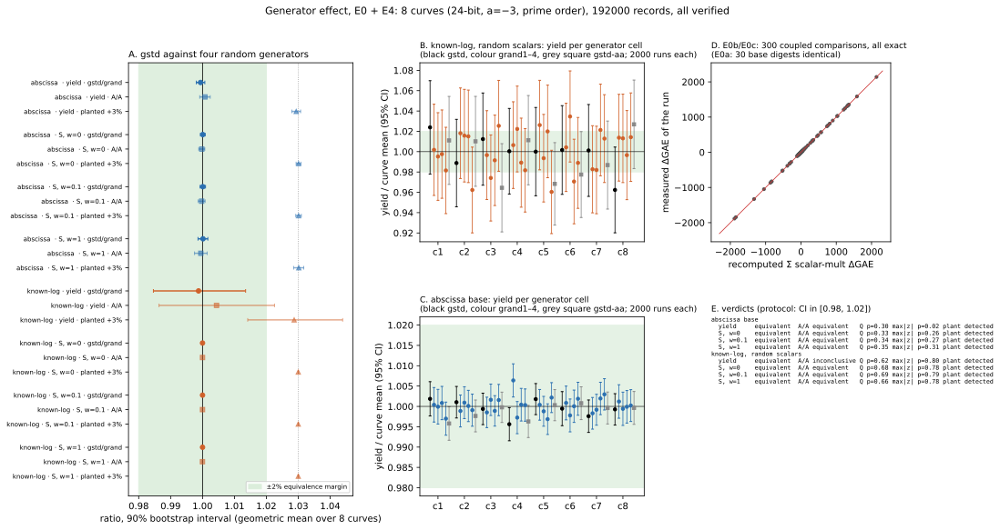

# Run report: generator-effect E4, 2026-10-19T22:15Z

Descriptive record of the E4 ecbench run. The interpretation is in
[`../../E0_E4.md`](../../E0_E4.md).

| item | value |
|:--|:--|
| specs | 16 files in [`../../e4/specs/`](../../e4/specs/) (`e4-cN.json`: 5 generators × 2000 `planted_shared` targets; `e4-cN-aa.json`: gstd, `target_seed` 20261020, 2000 targets) |
| protocol | `E0_E4.md` "E4 PROTOCOL", frozen in commit `b3eba557b` before the first record |
| command | `research/generator_effect_ic_20261019/e4/run_e4.sh`: `ecbench run --cpus none --allow-busy`, four sessions at a time, one lock file each |
| host | shared macOS host, 14 cores, about 46 load from other work; isolation L0 (no pinning, busy preflight allowed); wall time is not a metric |
| curves | c1–c8, 24-bit `a = −3` prime order ([`../../e4/generators.jsonl`](../../e4/generators.jsonl)) |
| arms | `ic-abscissa` (`prime-abscissa:size=B`), `ic-knownlog-random` (`known-log:size=B,scalars=random`), both `mitm:negation_folded=1,m=2`, walk targets; B = ceil(r^(1/3)) |
| seeds | measurement seed 20261019 (algorithm seed per workload and round); target seeds 20261019 (main) and 20261020 (A/A) |
| requested / completed | 192 000 / 192 000 records (8 × 20 000 + 8 × 4 000), 192 000 verified, 0 failures, 0 timeouts |
| audit | `ecbench verify --replay 10` per session: [`../../e4/verify.txt`](../../e4/verify.txt) |
| wall | 22:15:49Z – 23:03:54Z (48 min); per session in `e4/times.txt` (main 875–1 164 s, A/A 162–365 s) |
| raw records | `e4/runs/` (packed as [`../../e4/runs.tar.xz`](../../e4/runs.tar.xz), sha256 in `runs.tar.xz.sha256`) |
| aggregation | `examples/generator_effect_e4_analysis.rs` → [`../../e4/analysis.json`](../../e4/analysis.json) |

## Measured values (all derived from exact operation counts)

The pooled ratio gstd / grand is the geometric mean over the 8 curves. The
interval is a 90% bootstrap over runs within cells, 10 000 resamples.

| arm | yield | S, w = 0 | S, w = 0.1 | S, w = 1 |
|:--|:--|:--|:--|:--|
| abscissa | 0.9994 [0.9980, 1.0007] | 1.0001 [0.9993, 1.0008] | 1.0001 [0.9992, 1.0009] | 1.0002 [0.9986, 1.0017] |
| known-log, random | 0.9988 [0.9846, 1.0135] | 1.0000 [1.0000, 1.0000] | 1.0000 [1.0000, 1.0000] | 1.0000 [0.9999, 1.0001] |

The A/A ratio gstd / gstd-aa and the planted +3% control are in `analysis.json`
and in E0_E4.md. Base construction and oracle set-up have one distinct value
per curve and arm across all 12 000 records of that curve.

*Figure: the run's recorded values (`e4/plot_e4.py` from `e4/analysis.json` and
`e0/e0_sweep.log`); sessions ECBS1h5482084cbe02, ECBS1h172c8ce5a162,
ECBS1hc2d8241ad1ba, ECBS1h2db857bc6761, ECBS1h48a0812f6528, ECBS1he3de0a146b14,
ECBS1h412a8daba919, ECBS1h3f5a2fdfff6d (main) and ECBS1hba211a0e071e,
ECBS1h47e14b4b3342, ECBS1h70538d39d667, ECBS1hf2f98b50150c, ECBS1h70422a44cae0,
ECBS1h6a8a38bf38a3, ECBS1h261d45f24f5c, ECBS1hbf40278ea7dc (A/A).*
