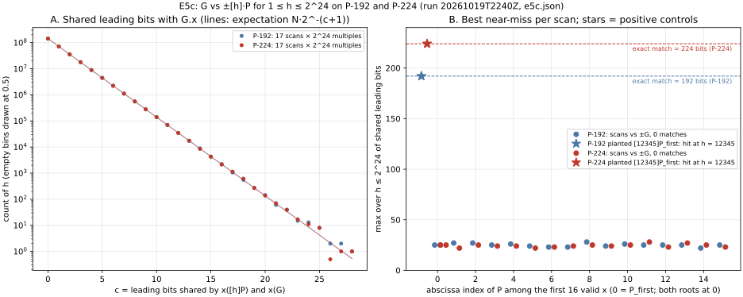

# Run report: E5c, G against ±[h]·P on P-192 and P-224, 2026-10-19T22:40Z

**Observations only.** The interpretation is in [`../../E5c.md`](../../E5c.md).
No ECDLP run.

| item | value |
|:--|:--|
| command | `cargo run --release --example generator_effect_e5c -- research/generator_effect_ic_20261019/e5/e5c.json` |
| protocol | [`e5/PROTOCOL_E5c.md`](../../e5/PROTOCOL_E5c.md), frozen at commit `8aab54912` before any run |
| code | `examples/generator_effect_e5c.rs` as committed in the PR that adds this report; the run used the working tree on `8aab54912` with that file, byte-identical to the commit |
| host | Apple arm64 (MacBook Pro), Darwin 25.6.0, 14 rayon threads; isolation **L0** (no pinning, other sessions running) |
| curves | `CurveParams::p192()`, `CurveParams::p224()`, cofactor 1 |
| scans | per curve: `P_first` with both roots and the next 15 valid abscissae with one root each (17 scans), plus 2 control scans against `±[12345]P_first`; each scan `1 ≤ h ≤ 2^24` |
| seeds | none (deterministic) |
| requested / completed | 38 scans / 38 of 38; no failures |
| wall time (informational, L0) | 47.0 s total; about 1.0–1.6 s per scan |
| raw output | [`e5/e5c.json`](../../e5/e5c.json), [`e5/e5c.log`](../../e5/e5c.log) |

## Measured values

- Checks: `G` on curve and `[n]G = O`; 16 base points on curve; 18 BigUint
  cross-checks per curve (9 checkpoints × 2 roots), 0 mismatches.
- Positive controls: against `[12345]P_first` exactly one match `(12345, +)`,
  against `−[12345]P_first` exactly one match `(12345, −)`, on both curves.
- Scans against `±G`: **0 matches** in 34 scans (`34 · 2^24` multiples).
- Most leading bits shared with `G.x`, per scan: P-192 22–28, P-224 22–28.

*Figure. Run 20261019T2240Z, `2^24` multiples per scan, 17 scans per curve.
Source: `e5/plot_e5c.py`.*
