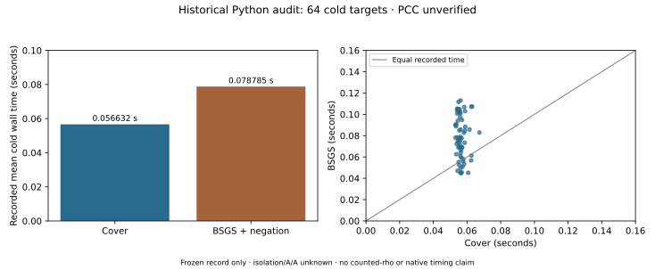

# Historical cold-target observations — not admitted

**[pcc:unverified]** The preserved Python audit reports 64 separately set-up
one-target solves. Mean cover wall time is 0.05663239334374559 s and mean
negation-aware BSGS wall time is 0.07878538950000369 s. Their recorded ratio is
1.3911718161334716, with producer bootstrap interval [1.301961216113285,
1.4815007696886637]. These observations are implementation diagnostics, not
counted IC/rho evidence.

Source: `../historical/cold_target_audit_q1061_v65.json`, whose SHA-256 is in
`native-check.json` and `../MANIFEST.sha256`. Every plotted value comes from
that frozen record. Host isolation, A/A spread and physical timing provenance
are unknown; they are not reconstructed from the software version strings.

The native checker replays scalar arithmetic and recomputes the original
means, medians, ratio and win count using separate arithmetic. Its local
result has no independent signature. It does not replay the original
relation collection, NumPy bootstrap sampling, or timing conditions.
**[pcc:unverified]**

## Scope and flow

The historical record contains 64 requested, 64 recorded completed and zero
recorded failed targets, with per-target rows retained. This is the
producer's record, not an authenticated execution receipt. The preservation
and native local checks are this import's work; no new benchmark was run.

The interval is setup through checked scalar recovery, with a fresh factor
base, relations and matrix solve per cover target and a fresh BSGS table per
direct target. Known inputs, imports and common target generation are
excluded for both. The exact source, seeds, versions and timing order are
preserved in the record/archive. See the [study README](../README.md) for
the model, subgroup, generator, literature receipt and limitations.

## Required next evidence

Native complete execution, counted operations, matched strong Pollard rho,
qualified isolation/A/A, calibration and independent replay are missing.
They are tracked in the [admission problem](../../../problems/genus3-cold-target-native-counted-replay.md).
The graph is a new study-local diagnostic; the canonical scoreboard,
leaderboard, timeline, registry and browser remain unchanged because this
record does not meet their admission/identity contracts.
