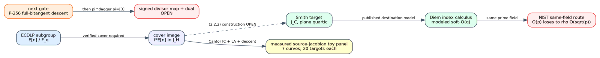
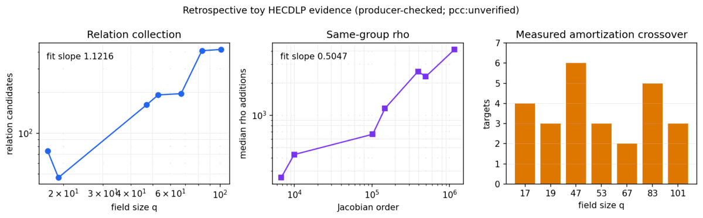

# Genus-3 transfer evidence: measured status and next gate

Date: 2026-11-20
Status: retrospective integration; no new native benchmark row or NIST reduction [pcc:unverified]

## Outcome

The imported work contains real toy measurements, but it does **not** yet contain
the construction that would turn those measurements into an attack on a NIST
ECDLP. [pcc:unverified]

The strongest established HECDLP mechanism remains Smith's rational `(2,2,2)`
isogeny from an eligible genus-3 hyperelliptic Jacobian to a non-hyperelliptic
plane-quartic Jacobian, followed by Diem-style index calculus. Its published
soft-`O` comparison is `q^(4/3)` to `q` for the HECDLP stage. That is an exponent
change for eligible genus-3 Jacobians, not an automatic reduction of an elliptic
DLP. [pcc:unverified]



Editable source: `figures/transfer-program.dot`.

## What was actually measured

The retained producer artifact in `cryptanalysis` runs a complete toy genus-3
hyperelliptic index-calculus pipeline on seven prime fields
`q={17,19,47,53,67,83,101}`. Each row includes relation collection, sparse online
elimination, dense-solve agreement, individual descent for 20 targets, scalar
replay of every result, and same-Jacobian Pollard rho on the same targets. All 140
target logs were recovered. [pcc:unverified]

| Retained reading | Producer result | Interpretation |
|---|---:|---|
| Relation candidates vs `q` | fitted slope `1.1216` | Descriptive seven-point toy fit |
| Same-Jacobian rho additions vs `#J` | fitted slope `0.5047` | Expected generic square-root control |
| Batch crossover | 2 to 6 targets | Setup amortizes at these toy sizes |
| Largest field / Jacobian | `q=101`, `#J=1,163,011` | Far below cryptographic scale |
| Sparse/dense agreement | 7 of 7 rows | Correctness control, not scaling proof |



The plot is derived from the committed `cryptanalysis` JSON artifacts. The timing
panel was not rerun during this integration and has no signed PCC standing.
[pcc:unverified]

There is also an earlier, narrower relation-only artifact on Klein quartics for
`q=101..809`, and a generic multiplicative-group rho control. It does not include
rank, sparse linear algebra, or individual descent, so the complete seven-curve
Jacobian artifact is the relevant empirical answer. [pcc:unverified]

## Comparison with the native evidence

The existing native `research/genus_ladder_20261114` study is the stronger
repository benchmark: 1,809 certified Rust runs across genera 2–5 and plane
quartics, with counted field-operation currencies, frozen inputs, confidence
intervals, and matched solver arms. It found, at `p=4099`, plane-quartic index
calculus about 2.5 times cheaper than hyperelliptic genus-3 index calculus in its
instrument; the two curve populations were independent, and no Smith isogeny was
built. [pcc:unverified]

That native study also screened 14,000 random genus-3 hyperelliptic curves for
Smith's combinatorial conditions and found 2,364 positives (`0.169`, Wilson 95%
interval `0.163..0.175`). Only one of 28 admitted near-prime-order instances was
positive. This makes explicit construction on a checked positive control the next
useful HECDLP experiment; more untransported source-Jacobian timings would not
close the missing edge. [pcc:unverified]

## Transfer obligation ledger

| Obligation | State | Evidence and limit |
|---|---|---|
| Smith-family existence | Supported | Smith 2008; native 14,000-curve screen; toy `F_37` screen control |
| Explicit target-specific Smith construction | Open | No executable `(2,2,2)` map or destination quartic in the imported package |
| Map correctness and dual recovery | Open | Theorem-level identities only; elliptic 2-isogeny controls do not instantiate Smith |
| Odd-order subgroup preservation | Conditional theorem | Trivial kernel intersection and `phi^dagger phi=[2]` when the hypotheses hold |
| Source-Jacobian toy solve | Measured | Seven curves, 20 targets each, retained producer timings [pcc:unverified] |
| Plane-quartic destination solve after Smith | Open | Modeled from literature; not run end to end |
| NIST `(3,3,3)` signed divisor map | Open | P-224 map stops at sign-blind Kummer coordinates; P-256 descent remains open |
| NIST advantage | Not established | A same-prime-field `O(p)` quartic route loses to elliptic rho `O(sqrt(p))` |

The exact preservation certificate for a degree-`d` cover followed by Smith is

```text
f_* o phi^dagger o phi o f^* = [2d].
```

On an odd prime-order subgroup with `gcd(2d,n)=1`, recovery is
`[(2d)^(-1) mod n] o f_* o phi^dagger`. This certifies the scalar only after the
cover and isogeny maps have been constructed and verified; it is not a substitute
for those maps. [pcc:unverified]

## Why this is not a NIST break

For a NIST curve over its native prime field `F_p`, moving to a plane quartic over
the same field gives a modeled `O(p)` destination algorithm, while elliptic Pollard
rho is `O(sqrt(p))`. A complexity-changing route must therefore supply a genuinely
smaller field, a destination exponent below one half in `p`, or an independently
exploitable order/endomorphism weakness. No such route is present here.
[pcc:unverified]

The NIST `(3,3,3)` work is still structurally valuable: it constructs an explicit
P-224 plane quartic and Kummer-level quotient map, and a P-256 quartic over
`F_(p^3)`. But Kummer coordinates identify `Q` and `-Q`; without a signed divisor
class and executable polarized dual, the claimed ECDLP transfer cannot be tested.
[pcc:unverified]

## New primary goal

Complete the **P-256 full-bitangent Frobenius descent certificate** before spending
more effort on large timing panels. The acceptance contract is in
`NEXT_GOAL.md`. This is the smallest open construction gate that can decisively
separate a base-field genus-3 quotient from an extension-field artifact. If it
fails, retain the obstruction and move to the P-224 signed divisor lift; if it
succeeds, immediately require the signed map and `pi^dagger pi=[3]` composition
test before making any DLP claim. [pcc:unverified]

## Provenance and novelty boundary

- Executable imported packages: `isogeny-labs/cryptanalysis` PR #1876.
- Existing native comparisons: `research/genus_ladder_20261114`,
  `research/nist_cover_three_tests_20261116`,
  `research/hecdlp_fastgroup_20261116`, and
  `research/hecdlp_sieve_20261116`.
- Primary source: Benjamin Smith, *Isogenies and the Discrete Logarithm Problem in
  Jacobians of Genus 3 Hyperelliptic Curves*, arXiv:0806.2995.
- The repository KB executable was unavailable; local canonical records and the
  primary source were used. No novelty claim is made for the Smith or Diem
  mechanisms.

No benchmark dashboard or leaderboard is changed: the imported timings are toy,
retrospective, Python-produced, and not a native admitted record. [pcc:unverified]
