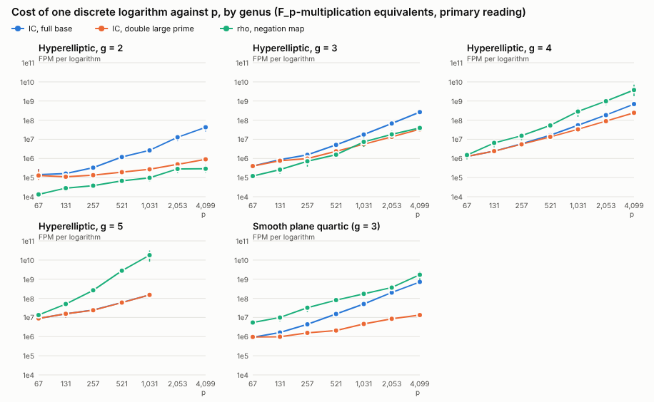
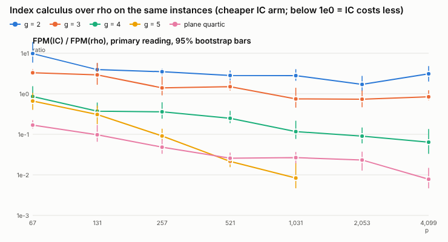

# Genus ladder: the discrete logarithm at genus 2, 3, 4, 5 over one field — results (2026-11-14)

Status: `[pcc:unverified]`. One session on a shared 4-vCPU container, no isolation, no
independent replay, no signed pcc claim. Nothing here is a row of the IC leaderboard
or of `benchmarks/README.md` (validation gate). Synthetic random curves; no statement
about any deployed curve. Protocol: [`PROTOCOL.md`](PROTOCOL.md), frozen in commit
`6e937a2a60` before any grid datum (`frozen.sha256`, `binary.sha256`). Data:
`part_a.jsonl`, `part_b.jsonl` (raw, one JSON object per run), `analysis.json`
(`genus_ladder_analyze`), [`tables.md`](tables.md) (every cell), `data.sha256`.

## What was built

- `src/cryptanalysis/genus_ladder.rs`: one counted instrument for imaginary
  hyperelliptic Jacobians of genus 2 to 5 over `F_p` (`p < 2^31`): Cantor arithmetic
  with a tally of the `F_p` multiplications and inversions behind every group
  operation, exact `#J`, full-base and double-large-prime index calculus on the
  linear algebra of the genus-3 positive control, the lab's negation-map rho, and a
  discriminant-parity smoothness prefilter.
- `src/cryptanalysis/quartic_ladder.rs`: the discrete logarithm in `Pic^0` of a
  generic smooth plane quartic (genus 3, not hyperelliptic): Diem's line relations
  (full base and double large prime) and rho, on `plane_quartic_pic`.
- `src/bin/genus_ladder.rs` (grid driver, JSONL) and `src/bin/genus_ladder_analyze.rs`
  (cell means, hierarchical bootstrap, band verdicts, exponent fits).
- Unit tests: group law against `H64Curve` divisor for divisor (g = 2, 3); group
  axioms (g = 2..5); `#J` against a brute-force zeta function (g = 2, 3, 4) and the
  brute-force order annihilating random divisors (g = 4, 5); prefilter exactness;
  every arm certifying; the quartic conventions (`kappa`, decompositions), its order
  against an independent count, and its arms end to end.

## What was run

1,809 runs, **all certified** (`[t]G = T` twice, `t` equal to the planted value):
7 primes (67 to 4099; genus 5 to 1031), 4 admitted curves per cell (`#J = h r`,
`h <= 8`), 3 solver seeds, arms A, a, C, c, R and the three quartic arms. Three rho
runs were skipped by the frozen cap (genus 5, `p = 1031`, the curve with the largest
`r`). Wall clock 1,318 s + 399 s on four workers (indicative only).



*Cost of one logarithm in `F_p`-multiplication equivalents (primary reading:
`cantor_mul + 10 inv + rel_mul + g^2 la_mul`), same y scale in every panel. Bars are
95% bootstrap intervals (curves, then runs).*



*The cheaper index-calculus arm over rho on the same instances.*

## Findings

### 1. Difficulty by genus on one field

Mean cost at `p = 1031` (FPM, primary reading; 95% interval):

| curve kind | group size `ln r` | best IC arm | rho (negation) | IC / rho |
|---|--:|--:|--:|--:|
| hyperelliptic g = 2 | 12.3 | 2.74e5 (C+pre) | 9.74e4 | 2.82 [2.09, 4.03] |
| hyperelliptic g = 3 | 20.1 | 5.50e6 (C+pre) | 7.32e6 | 0.75 [0.46, 1.40] |
| hyperelliptic g = 4 | 26.9 | 3.32e7 (C+pre) | 2.84e8 | 0.117 [0.077, 0.216] |
| hyperelliptic g = 5 | 33.6 | 1.50e8 (C+pre) | 1.80e10 (3 curves) | 0.0084 [0.0047, 0.020] |
| plane quartic g = 3 | 19.5 | 4.58e6 (2LP) | 1.72e8 | 0.027 [0.019, 0.037] |

Each extra unit of genus multiplies the group by about `p` and rho's cost by about
`sqrt(p)` times the dearer group law (90, 219, 393, 693 field multiplications per
Cantor step at genus 2, 3, 4, 5), while the index calculus grows by a factor 4 to
20. Fitted exponents in `p` (FPM primary; 7 primes, 5 at genus 5):

| | rho | IC full base | IC double large prime | theory: rho / 2LP |
|---|--:|--:|--:|---|
| g = 2 | 0.77 [0.66, 0.87] | 1.45 [1.33, 1.57] | 0.50 [0.37, 0.59] | 1 / 1 |
| g = 3 | 1.47 [1.37, 1.55] | 1.59 [1.56, 1.63] | 1.08 [1.04, 1.11] | 1.5 / 1.33 |
| g = 4 | 1.90 [1.74, 2.05] | 1.55 [1.53, 1.56] | 1.29 [1.27, 1.30] | 2 / 1.5 |
| g = 5 | 2.69 [2.42, 2.92] | 1.03 [0.94, 1.13] | 1.02 [0.93, 1.12] | 2.5 / 1.6 |
| quartic | 1.36 [1.24, 1.46] | 1.67 [1.64, 1.70] | 0.69 [0.63, 0.76] | 1.5 / 1 |

The measured exponents sit below the asymptotic ones wherever a constant set-up
(walk jump table, distinguished points, the quartic's decomposition rows) is still a
large share of the cost: genus 2 everywhere, genus 5 and the quartic 2LP arm at
these sizes. They are fits over the stated primes, not asymptotic statements.

Band verdicts against rho (T3 of `tables.md`):

- **FPM band** (the cross-genus unit): genus 2 above rho at every prime but one (2053, unresolved); genus 3
  above at `p <= 131` and unresolved from 257 (ratio 0.75 to 0.85 for arm c from
  `p = 1031`, intervals include 1);
  genus 4 below from `p = 131`; genus 5 below from `p = 131`; quartic below at every
  prime.
- **GAE band** (`w = 0, 0.1, 1` per native multiplication, AGENTS.md 5a): no cell is
  below rho across the whole band. At `w = 0` genus 3, 4, 5 and the quartics are far
  below; at `w = 1` they are above or unresolved, because one relation trial drags
  hundreds of native multiplications (smoothness test, roots) and the band prices each
  like a whole Cantor step. Genus 5 at `p = 1031`: 0.0030, 0.090, 0.48 [0.27, 1.14].

### 2. Hyperelliptic against non-hyperelliptic at genus 3

At `p = 4099` the best arm on a random plane quartic costs 1.33e7 FPM
[1.04e7, 1.73e7] against 3.32e7 [3.26e7, 3.38e7] on a random genus-3 hyperelliptic
curve, and the fitted exponents are 0.69 against 1.08. The quartic's rho is 44 times
dearer than the hyperelliptic rho at the same prime (about 8,900 field
multiplications per `Pic` addition against 219 per Cantor step), which is why its
IC/rho ratio is so small; the comparison that matters for an attacker is IC against
IC. The two populations are independent random samples: these are not the same
logarithm problems.

### 3. Smith's isogeny

Census of 2,000 random squarefree genus-3 curves `y^2 = f(x)`, `deg f = 7`, per prime
(Propositions 2 and 4, `smith_prop24::analyze_curve`):

| p | 67 | 131 | 257 | 521 | 1031 | 2053 | 4099 |
|---|--:|--:|--:|--:|--:|--:|--:|
| `full_success` | 331 | 334 | 327 | 328 | 347 | 338 | 359 |
| share | 0.166 | 0.167 | 0.164 | 0.164 | 0.174 | 0.169 | 0.180 |

Pooled 2,364 / 14,000 = 0.169 (Wilson 95%: 0.163 to 0.175). That is inside the
predicted range and below Smith's 0.1857; these models all have a rational
Weierstrass point at infinity, which changes the mix of Frobenius cycle types
(reading not checked here).

Among the 28 **admitted** genus-3 instances (near-prime order, `h <= 8`) only 1
passes (p = 521, seed 5, `h = 4`), against about 4.7 expected at 0.169: a binomial
tail of about 0.04. One sample of 28 and a post-hoc look, so this is a lead, not a
finding: near-prime Jacobians may pass Smith's conditions less often than random
ones. The census needed to test it is cheap (condition on the 2-part of `#J`).

What a Smith-positive curve gains is finding 2: its logarithm moves to a plane
quartic, 2.5 times cheaper at `p = 4099` in this instrument with a lower exponent.
That sentence joins two measurements by a model. The explicit isogeny is not built
in this repository, so no logarithm was carried across.

### 4. Curve-to-curve difficulty: the split rate follows the point count

The share of walk elements whose `u` splits is not `1/g!` but
`C(n_x, g) 2^g / #J`, with `n_x` the number of abscissae carrying two rational
points. Observed over model, pooled per cell, is 0.967 to 1.020 in all 18 cells with
`p >= 257`. The spread of the model across curves of one genus widens with the
genus: standard deviation of `ln(model x g!)` 0.07, 0.14, 0.19, 0.38 at genus 2, 3,
4, 5 (range 0.31 to 1.12 of `1/g!` at genus 5). Since the base also has `n_x`
columns, trials per logarithm scale as `n_x^{1-g}`: at genus 5 a curve with 5% more
points needs about 18% fewer trials. Two instances of the same genus over the same
field can differ in index-calculus cost by a factor 2 or more for this reason alone,
and the factor is predictable from `N_1`.

### 5. The parity prefilter

624 of 624 paired runs have identical trials, candidates, splits, relations, group
operations, Cantor field work and linear algebra; only the relation phase's native
multiplications change. Mean ratio on/off of `rel_mul` per cell: 0.60 to 0.65
(genus 2), 0.72 to 0.76 (genus 3), 0.63 to 0.70 (genus 4), 0.61 to 0.67 (genus 5).
On the whole logarithm it is worth 1% to 9% in FPM (primary) and 3% to 35% at
`w = 0.1` GAE, largest at genus 5, because the linear algebra (priced at `g^2` per
multiplication modulo `r`) and the Cantor arithmetic are the larger shares in FPM. An improvement of a component of the
index-calculus baseline, small on the total; unverified until replayed.

## Scorecard of the frozen predictions

| id | outcome |
|---|---|
| H1 rho exponent `g/2 +- 0.2` | **failed at genus 2** (0.77 [0.66, 0.87]: set-up and distinguished-point overhead at `r < 2^24`); held at genus 3 (1.47), 4 (1.89); genus 5 2.68 [2.42, 2.91] overlaps the range |
| H2 full-base trials exponent in [0.8, 1.25] | not falsified, but the point estimates at genus 2 (0.71 [0.52, 0.99]) and 5 (0.76 [0.66, 0.88]) are below the range; genus 3 0.85, genus 4 0.92 |
| H3 `GAE_0(A)/GAE_0(R)` falls with the genus | held at 4 of 5 primes; at 131 genus 5 (0.221) is above genus 4 (0.183), inside the intervals |
| H4 band verdicts | genus 2: held (no IC arm below rho). Genus 4 at 4099, FPM band: held (0.064 [0.033, 0.135]). Genus 5 at 1031: FPM band held; **GAE band failed** (unresolved at `w = 1`: 0.48 [0.27, 1.14]) |
| H5 split rate model in [0.9, 1.1] per cell | **failed in 3 of the 23 cells with at least 500 splits**, all at `p <= 131`: (g, p) = (3, 131) 0.69, (4, 67) 1.14, (5, 131) 1.14; held in every cell with `p >= 257`. Widening with genus: held |
| H6 prefilter | held (624/624 identical; ratios 0.595 to 0.761) |
| H7 Smith census share in [0.15, 0.22] | held at all 7 primes |
| H8 quartic IC below quartic rho, FPM band | held at every prime |
| H9 every run certifies | held (1,809 / 1,809) |

## Amendment 1 (post hoc, not preregistered): the walk restart

The frozen instrument restarts the relation walk every 4096 steps (inherited from
the genus-3 positive control). In a group of order `r` a walk meets itself after
about `sqrt(pi r / 2)` steps and then repeats, so cells with `r` below about `2^24`
(all of genus 2, genus 3 at `p <= 257`) can waste trials. After seeing the data, the
driver got `--restart-sqrt` (`min(4096, max(16, sqrt(r)/2))`). The rebuilt binary
reproduces the frozen rows exactly without the flag (`repro.jsonl`: 240 rows, 0
mismatches). With it (`amend1.jsonl`, genus 2 and 3, same instances and seeds, 840
runs, all certified):

- trials fall where the walk was cycling: (2, 67) 420 to 83; (3, 131) 819 to 501;
  elsewhere within noise;
- the split-rate model then holds in every genus-2 and genus-3 cell (0.976 to
  1.051), so the H5 failure at (3, 131) was this artifact; (4, 67) and (5, 131) are
  not covered by the amendment and stay unexplained;
- the fitted exponent of full-base trials at genus 2 becomes 0.965 [0.932, 0.997];
- no band verdict of section 1 changes: genus 2 stays above rho, genus 3 unresolved.
  The shorter walks pay more restarts (two scalar multiplications each), so genus-2
  FPM does not fall.

Source note: the amendment (the `restart` parameter and flag), three clippy fixes and
a `rustfmt` pass were applied after the grid, so `genus_ladder.rs`, the driver and
the analysis binary no longer match `frozen.sha256` (the frozen bytes are commit
`6e937a2a60`). The final build was checked against the frozen data: 312 rows of
`part_a.jsonl` (p = 67, 131; genus 2, 3; quartics) rerun with 0 mismatches in any
counted field, and `analysis.json` regenerated identically.

## Limits

- Toy sizes: groups up to about `2^48`. Exponents are fits over 5 to 7 primes.
- Rho at genus 2 and the small-prime cells are dominated by fixed set-up.
- The GAE band prices a native multiplication like a group operation at `w = 1`
  whatever the genus; the FPM band depends on `I` (inversion) and `kappa` (modulus
  size) prices that are assumptions, bracketed, not measured.
- Group law: generic Cantor by extended gcd, not explicit formulas; explicit
  formulas would lower every hyperelliptic row, rho included.
- Smith's map is not built; non-hyperelliptic curves of genus 4 and 5 are not
  covered; single large prime and sieving are not implemented.
- `quartic_ladder.rs`: clippy was not run to completion on it; its double-large-prime
  `exhausted` path is not exercised by a test.
- No research-kb or lead-atlas query was possible in this container (no backend);
  the theory cited is from the repository's own notes and the standard literature,
  not re-read here. No Conductor task, no S3 checkpoint, no isolab-eks run: none of
  the three is available in this container.

## Next steps

1. The two largest shares of the best arm's primary FPM at `p = 1031`: linear algebra
   (about two thirds at genus 3, half at genus 5, under `kappa = g^2`) and the generic
   Cantor arithmetic (about a fifth to a third). Tune the base constant and the
   elimination before the Wiedemann step; explicit-formula group law for genus 2, 3.
2. The Smith census conditioned on the 2-part of `#J` (the lead in finding 3), then
   the explicit `(2,2,2)` map so a logarithm can be carried to the quartic.
3. Bind `r` to `p` (`h = 1` or 2) and extend genus 4 and the quartics to `p ~ 2^16`
   on isolated hosts, with a validator replay, to make rows eligible for the gate.
4. Use `N_1` to pick or predict easy instances (finding 4) in the factor-base studies.

## Reproduce

```sh
cargo test --release --lib genus_ladder && cargo test --release --lib quartic_ladder
cargo build --release --bin genus_ladder --bin genus_ladder_analyze
# section 6 of PROTOCOL.md, then:
cat part_a.jsonl part_b.jsonl > ladder.jsonl
target/release/genus_ladder_analyze ladder.jsonl analysis.json
python3 render.py analysis.json
```
