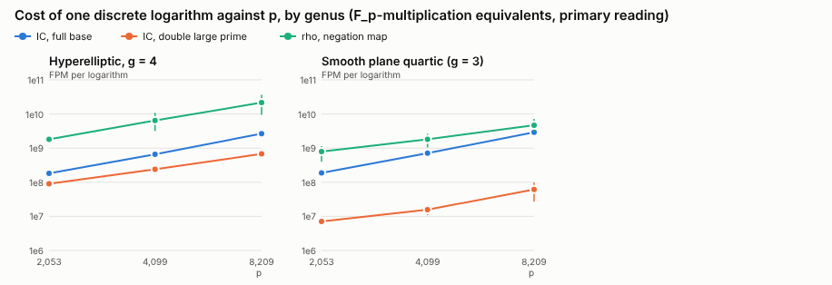
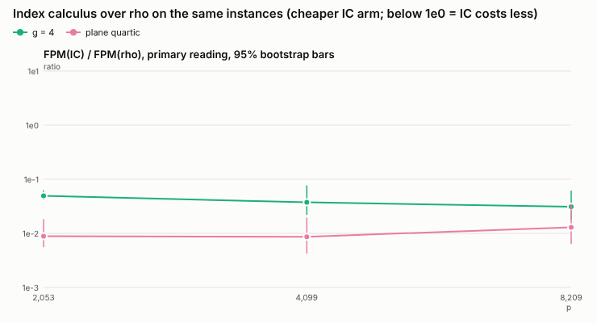

# Genus ladder, follow-up 1: `r` bound to `p`, genus 4 and plane quartics to p = 8209 — results (2026-11-15)

Status: `[pcc:unverified]`; independent replay by a validator agent on the same shared
host is in `VALIDATION_REPORT.md` (see "Validation" below). No isolated host, so no row
reaches the IC leaderboard or `benchmarks/README.md`. Protocol: [`PROTOCOL.md`](PROTOCOL.md)
(frozen before data, `frozen.sha256`); binary `binary.sha256` (sha 61ccabd2…, source
commit `14ab74ec8b`); data `bound_r.jsonl`, `analysis.json`, `data.sha256`; tables
[`tables.md`](tables.md); bench record `benchmarks/records/20261115T0031Z-genus-ladder-bound-r.json`.

## Run

Genus-4 hyperelliptic curves and smooth plane quartics over `p = 2053, 4099, 8209`,
cofactor `h <= 2` (so `ln r` is within `ln 2` of `ln #J`), 3 curves per cell, 2 solver
seeds, arms a (full base + prefilter), c (double large prime + prefilter), R (negation
rho) and the three quartic arms. **108 runs, all certified**; no rho run hit the cap.
Admission at genus 4 with `h <= 2` took 109, 418 and 407 seeds (1 in 36 to 1 in 139);
the whole run was 4,246 s on four workers (the genus-4 instance search at 8209 alone was
3,744 s single-threaded; the solver runs were seconds each, rho at 8209 about 100 s).

## Findings

Primary reading, `F_p`-multiplication equivalents (`cantor_mul + 10·inv + rel_mul + g²·la_mul`),
means over 6 runs with hierarchical bootstrap 95% intervals.

| p | genus-4 arm c | genus-4 rho | c / rho | quartic 2LP | quartic rho | 2LP / rho |
|--:|--:|--:|--:|--:|--:|--:|
| 2053 | 8.93e7 | 1.81e9 | 0.049 [0.041, 0.062] | 7.0e6 | 7.9e8 | 0.0089 [0.0056, 0.018] |
| 4099 | 2.40e8 | 6.42e9 | 0.038 [0.022, 0.077] | 1.6e7 | 1.8e9 | 0.0086 [0.0042, 0.020] |
| 8209 | 6.74e8 | 2.16e10 | 0.031 [0.018, 0.062] | 6.1e7 | 4.7e9 | 0.013 [0.0064, 0.035] |

- Genus 4: arm c is below rho across the whole FPM band at every prime, and its
  distance grows with `p`: exponent 1.458 [1.449, 1.467] against rho's 1.79 [1.20, 2.22]
  (theory 1.5 and 2; three primes give a wide rho interval). Under the GAE band the
  verdict stays unresolved at every prime: at `w = 1` the interval straddles 1
  (8209: [0.48, 1.64]); at `w = 0` and `w = 0.1` the arm is below (8209: [0.0022, 0.0074]
  and [0.089, 0.304]).
- Quartics: double-large-prime Diem is below rho across the FPM band at every prime,
  by a factor 75 to 115; under the GAE band it is below at `w = 0` and above at
  `w = 0.1` and `w = 1` (one line relation costs no group operation but hundreds of
  native multiplications, which that band prices against rho's one step). Its FPM
  exponent is 1.56 [0.97, 1.96] on three primes, dominated by the conic evaluations of
  the decomposition rows (`rel_mul` is 70% to 80% of its FPM); the full-base Diem arm
  grows as 1.98 [1.90, 2.05] because of its dense-ish linear algebra.
- Binding `r` to `p` removed the cofactor scatter: `mean ln r` is 30.3, 33.0, 35.6 at
  genus 4 (`ln #J` minus at most `ln 2`), and the rho exponent moved from 1.90 (first
  run, `h <= 8`) to 1.79 with a much wider interval, because only three primes and six
  runs per cell are behind it.
- Every admitted genus-4 curve has `f` with 1 or 2 irreducible factors (9 of 9),
  as the rational 2-rank forces under `h <= 2`.

Scorecard (PROTOCOL.md section 3): B1 held (108/108); B2 held (1.79 [1.20, 2.22]
overlaps 2.0 ± 0.25; a weak test); B3 held (FPM band below at all three primes; GAE
`w = 0` and `w = 0.1` below at 8209); B4 held; B5 held.

## Validation

`VALIDATION_REPORT.md` is written by a separate validator agent that builds its own
binary from the stated commit, replays cells of the protocol's command and compares
every counted field with `bound_r.jsonl`, and recomputes the cell means from the raw
data. The host is this same shared 4-vCPU container: that replay is a reproducibility
check of the counted units on one machine, not the isolated-host measurement the
validation gate asks for. Standing after the replay: see the report's verdict.

## Deviations

- The run was launched with `nohup`, not under `tools/benchrec.py run`; the command,
  start time, wall and exit code were added to the bench record afterwards from the
  driver's own `config` and `done` lines, and the record says so.
- The analysis binary and `render.py` are the first study's, unchanged.

## Limits

Three primes; 3 curves and 6 runs per cell; genus 4 only on the hyperelliptic side;
generic Cantor group law; the quartic rho's per-step cost (about 8,900 field
multiplications per `Pic` addition) makes its IC/rho ratios small for a reason that is
not the index calculus. Toy sizes: `#J` up to 2^51.
