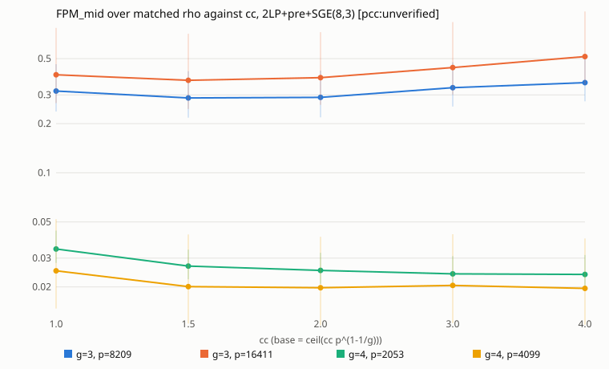

# Lead C2: base constant `cc` for 2LP + prefilter + SGE(8,3), genus 3 and 4 — results (2026-11-21)

Status: `[pcc:unverified]` (shared 4-vCPU host with other jobs running, no independent replay). Protocol
[`PROTOCOL.md`](PROTOCOL.md) and `analyze_cc.py` frozen before data (`frozen.sha256`); analysis-plan
[`AMENDMENT1.md`](AMENDMENT1.md) (prior art F1, kappa-sensitivity), also before data, grid unchanged. Binary: the main
session's clean-tree build (`build_done.txt`: HEAD c9749cbf, `dirty_src: []`), copies hashed in `binary.sha256`.
Data `raw/` (hashes in `data.sha256`), full tables `tables.md`, figure `fig_cc.svg`, analysis `analysis.json`, `amend1.json`.

## Run
240 runs: 5 cc values × 4 cells × 3 curves × 2 seeds × {unmerged, SGE(8,3)}, one invocation per (genus, cc) with the
protocol's flags (genus 4 with `--max-trials 5e7 --seed-search 4000`, the bound-r study's values; `--threads 1`
per invocation, five invocations concurrent: counted units do not depend on that). Rho rows are the earlier studies'
(`scale_g3.jsonl`, `bound_r.jsonl`), same instances and seeds.

## Per-cell optimum (FPM_mid, SGE arm; gain = 1 - best/cc 2.0; paired interval in `tables.md`)

| g | p | best cc (low / mid / high) | gain mid | mid/rho at cc 2.0 | mid/rho at best cc |
|--:|--:|---|--:|--:|--:|
| 3 | 8209 | 4.0 / **1.5** / 2.0 | 0.8% (paired 0.992 [0.976, 1.002]) | 0.290 [0.219, 0.423] | 0.287 [0.217, 0.419] |
| 3 | 16411 | 4.0 / **1.5** / 1.5 | 3.7% (paired 0.963 [0.939, 0.983]) | 0.383 [0.261, 0.726] | 0.368 [0.246, 0.710] |
| 4 | 2053 | 4.0 / **4.0** / 4.0 | 5.5% (paired 0.945 [0.925, 0.965]) | 0.0252 [0.020, 0.032] | 0.0239 [0.020, 0.031] |
| 4 | 4099 | 4.0 / **4.0** / 4.0 | 0.8% (paired 0.992 [0.955, 1.010]) | 0.0198 [0.012, 0.040] | 0.0196 [0.012, 0.040] |

The FPM_mid curve is flat near cc 1.5–2.0 at genus 3 (cc 1.0 +4% to +9%, cc 3 +15%, cc 4 +23% to +35% vs 2.0, all
intervals excluding 1). At genus 4 the base reaches the cap near cc 4 (`fb_cols` 1022 of at most p/2 = 1026 at
2053; 2022 of 2050 at 4099): cc 3 and 4 differ by under 0.2% in trials, and the cost is flat from cc 2 to 4.
cc = 2.0 is within noise of optimal in g3 8209 and g4 4099; the gains with paired intervals excluding 1 are genus 4 at 2053
(cc 3–4, 5.5%) and genus 3 at 16411 (cc 1.5, 3.7%), both below the 10% bar.

## Scorecard

| id | verdict | evidence |
|---|---|---|
| F1 | **held** | 240/240 certified with the planted t; the 12 instance lines (6 per genus) equal the earlier studies' in every invocation (10/10 invocations); at cc 2.0 the unmerged arm's rows equal `scale_g3.jsonl` (12/12) and `bound_r.jsonl` (12/12) field for field except wall |
| F2 | **fails** (2 of 4 cells) | relation trials fall with cc in all four cells; `la_mul` of the SGE arm rises monotonically at genus 3 (both primes) but not at genus 4: 2053 cc 3 → 4: 1.57e6 → 1.56e6, 4099: 5.81e6 → 5.56e6 (cap saturation: the base stops growing, the merge removes slightly more of a larger core). The unmerged arm is monotone (`la/rel` table) |
| F3 | **fails** | genus 3 optimum cc 1.5 is inside [1.5, 3.0], genus 4 optimum cc 4.0 is outside; gain at the largest prime: 3.7% (16411) and 0.8% (4099), both under 10%. 2.0 is optimal within noise |
| F4 | genus 3 **fails**, genus 4 **holds** | genus 3, p = 16411, best cc 1.5: 0.368 [0.246, 0.710] > 0.33 (cc 2.0: 0.383, as the earlier study). Genus 4, p = 4099: 0.0196 [0.012, 0.040] ≤ 0.030 (at cc 2.0: 0.0198). SGE effect at genus 4, p = 4099, cc 2.0 (new at this cell): `la_mul` 0.400 of the unmerged arm's, FPM_mid 0.527 of it; ratio to rho 0.0375 (unmerged, the bound-r value; reproduced) → 0.0198. At 2053: 0.352 and 0.512, 0.0493 → 0.0252 |
| F5 | **fails** (3 of 4 cells) | ranking low vs mid vs high differs in g3 8209 (best 4.0 / 1.5 / 2.0), g3 16411 (4.0 / 1.5 / 1.5, rankings differ), g4 4099 (same best 4.0, order of the others differs); only g4 2053 has one ranking (4.0 < 3.0 < 2.0 < 1.5 < 1.0) under all three. FPM_low (kappa = 1) always prefers the largest cc; FPM_mid and high put the optimum at 1.5–2.0 at genus 3 |

## Against the prior art, PR #4852 (F1 study, `research/g2plus_followups_20261117/F1_L03_base_constant_lab_instrument/`)
F1 swept cc 0.5–3 WITHOUT SGE at genus 3 (8209–32771) and found the best cc tracks the LA price kappa
(kappa 1 → cc 2, kappa about 2 → 1.5, kappa 9 → cc 1, gain 36–40%). The unmerged arm of this sweep, recomputed over
kappa from the same counts (`tables.md`, "Best cc against kappa"), reproduces that: genus 3, unmerged: kappa 1 → 2.0, kappa 2 → 1.5
(2.5–2.9%), kappa 9 → 1.0 (36.4% at 8209, 37.5% at 16411). Same direction, same size.
SGE(8,3) moves the optimum back toward (and past) cc 2.0, as the amendment asked: the SGE arm's `la_mul` is 0.32–0.40 of the unmerged
arm's, its `la_mul/rel_mul` at cc 2.0 is 0.24–0.28 (unmerged 0.61–0.76), and at the primary price kappa = g² (9 at genus 3) the optimum is
cc 1.5 with a 0.8–3.7% gain, against cc 1.0 with 36–40% for the unmerged arm. At genus 3 the merged arm's best cc by kappa is
4.0 (kappa 1–2), 2.0 (kappa 4–6), 1.5 (kappa 9): the whole lever shrinks to a few percent at the priced kappa. At genus 4 the
merged arm prefers the cap (cc 4) at every kappa from 1 to 9 (gain 7–24%), the unmerged arm cc 2.0 at kappa up to 4 and 1.5 at kappa 6–9
(7–15%). The measured kappa at genus 3 F1 asked for is not measured here (counts only); this study gives the sensitivity.

## kappa-sensitivity: measured la_mul / rel_mul per cc (SGE arm; unmerged in brackets)

| g, p | cc 1.0 | 1.5 | 2.0 | 3.0 | 4.0 |
|---|--:|--:|--:|--:|--:|
| 3, 8209 | 0.071 (0.13) | 0.148 (0.37) | 0.241 (0.76) | 0.482 (2.04) | 0.659 (3.83) |
| 3, 16411 | 0.074 (0.13) | 0.158 (0.36) | 0.275 (0.76) | 0.540 (2.08) | 0.840 (4.06) |
| 4, 2053 | 0.055 (0.08) | 0.137 (0.28) | 0.216 (0.61) | 0.275 (1.51) | 0.272 (1.86) |
| 4, 4099 | 0.057 (0.08) | 0.154 (0.30) | 0.280 (0.70) | 0.463 (1.95) | 0.460 (3.31) |

## Reading
At the primary reading the factor-base constant is not a lever for the best arm: cc = 2.0 is within noise of the
optimum in g3 8209 and g4 4099 (0.8% each) and loses 3.7% (g3 16411) and 5.5% (g4 2053) elsewhere.
The ratio to rho at the best cc is 0.287 and 0.368 at genus 3 (8209, 16411) and 0.024 and 0.020 at genus 4 (2053, 4099).
Distance remaining to rho (FPM_mid): about 3x at genus 3, 50x at genus 4, as before. The conclusion depends on the LA price: at kappa = 1 the merged arm's optimum is cc 4.0 in every cell, a gain of 21% (genus 3) and 15–24% (genus 4) over cc 2.0.

## Deviations and limits
- Execution deviation: five invocations of a genus ran concurrently with `--threads 1` each (not `--threads 4`), on a host
  that other sessions also loaded; counted fields do not depend on it and wall time is not used.
- Genus-4 `--max-trials` and `--seed-search` taken from the bound-r config, not given in the task; no run exhausted.
- F2 fails at genus 4 because the base saturates at p/2 near cc 4; the protocol did not anticipate the cap.
- Three curves, two seeds per cell, two primes per genus; paired intervals resample 3 curves only and are narrow where the
  per-run ratio is nearly deterministic; genus-4 4099 ratio intervals to rho are wide because the rho rows are few.
- The best cc by kappa is read from recorded counts at I = 10; kappa itself is a convention (not measured).
- No leaderboard row; `[pcc:unverified]` on every figure.
