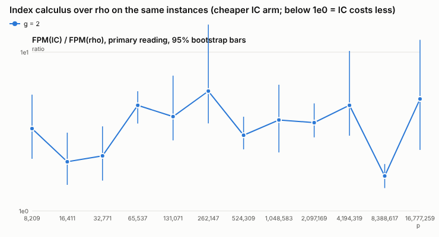
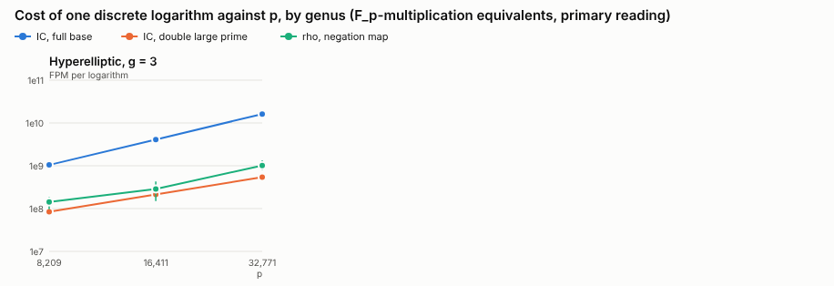

# Genus ladder, follow-up 2: genus 2 to p = 2^24 and genus 3 to p = 2^15 — results (2026-11-15)

Status: `[pcc:unverified]` (shared 4-vCPU host, no independent replay). Protocol
[`PROTOCOL.md`](PROTOCOL.md), frozen `30e46a98d6`; Amendment 1 (full-base arm dropped
above 2^18, before any datum of those cells) in the same file. Binary sha `61ccabd2…`.
Data `scale_g2.jsonl`, `scale_g2b.jsonl`, `scale_g3.jsonl`; `g2_analysis.json`,
`g3_analysis.json`; `tables_g2.md`, `tables_g3.md`; `data.sha256`. Bench record
`benchmarks/records/20261115T0317Z-genus-ladder-scale.json`.

## Run
234 runs, all certified, 0 skipped. Genus 2: 12 primes 8209 … 16,777,259 (arms a to
262,147; c and R throughout), 3 curves × 2 seeds, `h <= 8`. Genus 3: 8209, 16411, 32771,
arms a, c, R. Wall: 1h50 + 1h for genus 2 (the full-base solve alone was 54 min at
262,147), about 1h for genus 3 (dominated by the O(p²) point count of the order search).

## Genus 2: parallel lines, constant 3–5×, no crossing

Exponents in `p` (FPM primary), 8209 … 2^24: rho **0.975 [0.908, 1.037]**, double large
prime + prefilter **1.004 [0.991, 1.020]** (trials 0.980); full base 1.97 (8209 … 2^18).
Ratio 2LP/rho (FPM mid): 3.3, 2.0, 2.2, 4.6, 3.9, 5.7, 3.0, 3.7, 3.6, 4.6, 1.7, 5.1 from
8209 to 2^24, intervals always above 1, no trend. The linear-algebra share of the 2LP arm
is 0.08–0.20 throughout. Reading: at genus 2 both methods are `p^1` and the method is a
constant factor behind in this instrument; the cost is the relation walk (one Cantor step
per trial, half the trials split, each split a single edge of a large-prime graph with
about `p/2` vertices), not the algebra. Nothing here suggests a crossing at any size.

## Genus 3: the gap opens as `p^{1/12}`… measured as `p^{0.07}` and the arm is below rho

| p | 2LP+pre FPM | rho FPM | 2LP / rho [95%] | FPM band | LA share of 2LP |
|--:|--:|--:|--:|---|--:|
| 8209 | 8.42e7 | 1.43e8 | 0.591 [0.437, 0.870] | below | 0.75 |
| 16411 | 2.14e8 | 2.89e8 | 0.741 [0.492, 1.42] | unresolved | 0.76 |
| 32771 | 5.42e8 | 1.01e9 | **0.537 [0.407, 0.686]** | below | 0.77 |

Exponents: 2LP+pre **1.344 [1.334, 1.358]** (theory 4/3), rho **1.413 [1.145, 1.751]**
(theory 3/2; three primes, six runs each), full base 1.98. GAE band: unresolved at every
prime (above at `w = 1`). Three quarters of the 2LP arm's primary cost at genus 3 is the
linear algebra, which the SGE study (`research/genus_ladder_sge_20261115/`) cuts to about
a quarter: the two results compose, and the composition is the next measurement.

## Scorecard
| id | outcome |
|---|---|
| X1 | held: 234/234 certified, no exhaustion |
| X2 | held: rho 0.975, arm c 1.004 (arm a's clause on 8209 … 2^18 only, by Amendment 1: 1.97, not a `p^1` quantity, and not what X2 was about) |
| X3 | **failed**: ratio at 2^24 (5.1) is not 2× smaller than at 8209 (3.3) |
| X4 | **failed**: no prime with arm c below rho across the FPM band at genus 2; distance remaining 3–5×, flat in `p` |
| X5 | held: c exponent 1.344 in [1.20, 1.45]; rho 1.41 in [1.35, 1.65]; below across the FPM band at 32771 with ratio 0.537 ≤ 0.6 |
| X6 | **failed**: the genus-2 LA share stays below 0.2 (a 2-LP relation at genus 2 carries no base column, so cycle rows are short) |

## Deviations
- 131071 (= 2^17 − 1, prime) was run where "first prime at or above 2^17" is 131101.
- Amendment 1 as stated in the protocol; the first launch's stopped process had no
  partial rows of the dropped cells.

## Limits
Three curves × two seeds per cell; `h <= 8`; rho's genus-3 exponent interval is wide on
three primes; shared host; the FPM prices are stated conventions.
