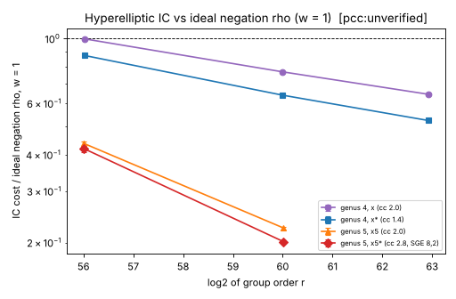

# Results: genus-4 three-point exponent and genus 5 at matched group size (lead C)

Every number is `[pcc:unverified]`. The protocol is `PROTOCOL.md`, frozen at b5971d86dd
(`frozen.sha256`). Deviation D1 is in `DEVIATIONS.md`: the third genus-4 prime is 54293, not 60013,
because of the binary's 63-bit #J guard. `run.sh`, `curves.py` and `analyze.py` differ from their
frozen hashes only by that prime substitution, which was checked by reversing it and re-hashing. The
tables are `tables.md`, produced by `analyze.py` (frozen); `analysis.json` is its machine-readable
form. `fig_scaling.svg` and `fig_scaling.png` are post hoc presentation (`report.py`). The host was
local and shared with other jobs. The metric is counted operations, so timing does not enter.

## Headline

At w = 1 (every native F_p and mod-r operation priced as one group operation), IC cost over the
ideal negation-rho bound `sqrt(pi r/4)`:

| genus | p | #J ≈ | arm | w = 0 | w = 0.1 | w = 1 | below at all w |
|---|---|---|---|---|---|---|---|
| 4 | 54293 | 2^63 | x (cc 2.0) | 0.001 | 0.065 | 0.645 [0.643, 0.647] | yes |
| 4 | 54293 | 2^63 | **x\* (cc 1.4)** | 0.001 | 0.054 | **0.524 [0.523, 0.526]** | yes |
| 5 | 2357 | 2^56 | x5 (cc 2.0) | 0.001 | 0.044 | 0.437 [0.427, 0.445] | yes |
| 5 | 2357 | 2^56 | **x5\* (cc 2.8, SGE 8,2)** | 0.001 | 0.043 | **0.419 [0.407, 0.430]** | yes |
| 5 | 4099 | 2^60 | x5 | 0.000 | 0.023 | 0.224 [0.222, 0.227] | yes |
| 5 | 4099 | 2^60 | **x5\*** | 0.000 | 0.020 | **0.201 [0.199, 0.204]** | yes |

The genus-4 rows at p = 16411 and 32771 are the validated prime-order study's rows, re-analysed:
x\* 0.876 and 0.640.

- **C1, genus-4 three-point fit.** For x\* the slope of ln(ratio) in ln p is −0.431 [−0.435, −0.426],
  a cost exponent of **1.568 [1.564, 1.573]**. The double-large-prime theory value is p^(2 − 2/g) =
  p^1.5. For x the slope is −0.366, exponent 1.633. The middle points sit on the line (residuals
  −0.011 and −0.005).
- **C2, genus 5 against genus 4 at the same group size.** Genus 5 is ahead at both sizes:
  - x5\* / x\* = **0.479 [0.465, 0.491]** at N ≈ 2^56;
  - x5\* / x\* = **0.315 [0.311, 0.319]** at N ≈ 2^60.

  In ln N, the genus-5 ratio falls with slope −0.264, against −0.114 for genus 4. The theory
  exponents in N = p^g are (2 − 2/g)/g: 0.375 for genus 4 and 0.32 for genus 5, against 0.5 for rho.
- **Linear algebra share at w = 1.** Genus 4: 0.56–0.62 for x\*. Genus 5: only 0.11–0.19. At genus 5
  the relation search dominates, which is why the tuning moved the other way (below).
- **Measured plain rho, genus 5, p = 2357** (G3 sanity check, 2 runs): 0.82 × `sqrt(pi r/2)`.

## Predictions (frozen, PROTOCOL §7)

| # | prediction | outcome |
|---|---|---|
| P1 | x\* at the third prime, w = 1, in [0.42, 0.58] (stated for 60013) | **holds**: 0.524 at 54293. It is also inside the D1 reference window [0.44, 0.61]. |
| P2 | three-point slope in [−0.60, −0.35]; x\* exponent in [1.40, 1.65] | **holds**: −0.431; 1.568 |
| P3 | genus-5 tuned cc ≤ 1.4 | **fails**: cc5\* = 2.8, SGE (8, 2), the top of the frozen grid |
| P4 | x5\* / x\* falls from N ≈ 2^56 to 2^60 | **holds**: 0.479 → 0.315. The first half of its wording ("the genus-5 constant hurts at small N") is not supported: genus 5 is already ahead at 2^56. |
| P5 | G1–G3 pass | **holds** |

## What this is and is not

- **Known in theory, measured here.** Double-large-prime IC beats rho in genus 4 and 5 over prime
  fields asymptotically, and the higher genus wins at fixed group size (GTTD 2007; Diem). What is new:
  this lab's implementation, every native operation charged at up to 1 GAE, and prime-order
  Jacobians up to #J ≈ 2^63. At fixed N ≈ 2^60, genus 5 costs 0.20 of the ideal negation-rho bound,
  and genus 4 costs 0.64.
- **Hyperelliptic only.** These are transfer targets, not elliptic-curve results. They are also not
  cryptographically relevant sizes.
- **The genus-5 tuning hit the edge of the grid.** P3 failed: cc 2.8 was the largest constant tried,
  so the genus-5 optimum may lie beyond it. x5\* is therefore an upper bound on the tuned cost.
- **The reference is a closed form.** `sqrt(pi r/4)` is the heuristic expected step count of an ideal
  negation-map rho, not a lower bound. Per-step rho bookkeeping is not counted (prime-order study,
  ERRATA E1).
- **The genus-5 rho check is thin.** It rests on 2 runs.
- **Not validated yet.** No independent replay, no `VALIDATION.json`, no leaderboard row.

## Gates and deviations

- G1, G2 and G3 pass (`tables.md`).
- **D1.** The third prime is 54293, because the guard rejects 60013. The protocol's #J check was
  against 2^64, not against the guard's 9.0e18. A runaway extension loop was stopped and cleaned up.
- **Unrecorded operational events.** None of these changes a count:
  - two 2-hour background stops and one container restart during the searches;
  - one search worker killed by the out-of-memory killer;
  - resumable chunks recovered all of it.

## Sources checked

- `research/genus4_prime_order_20261118` (validated) for the genus-4 rows at 16411 and 32771.
- `research/genus4_cost_calibration_20261119`: the measured weights are about 0.003 GAE, so w = 1
  is the conservative end.
- research-kb is not available in this session.
