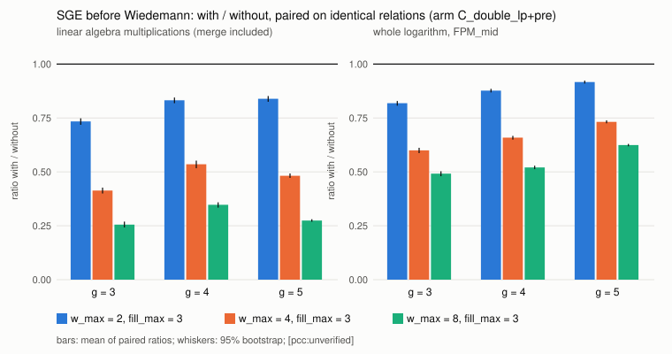

# Genus ladder, follow-up 2: structured Gaussian elimination before Wiedemann — results (2026-11-15)

Status: every figure `[pcc:unverified]` (one session on a shared 4-vCPU container, no
isolated host, no independent replay, no signed pcc claim). Nothing here is a row of
the IC leaderboard or of `benchmarks/README.md` (validation gate). Synthetic random
curves; no deployed-curve statement. Protocol: [`PROTOCOL.md`](PROTOCOL.md), hashed into
`frozen.sha256` (with `paired.py` and the two Rust sources) at 03:08 UTC, before any
measured run (first grid row 03:08:16 UTC). Binary: `binary.sha256`. Data:
`sge_g34.jsonl`, `sge_g5.jsonl` (raw, one JSON object per run; `sge.jsonl` is their
concatenation), `paired.json` (`paired.py`), `analysis.json` (`genus_ladder_analyze`,
unchanged), [`tables.md`](tables.md), `fig_sge.svg`, `data.sha256`.

## What was built

- `src/cryptanalysis/genus_ladder.rs`: `IcParams.sge: Option<SgeParams { w_max,
  fill_max }>`; `sge_reduce` (merge of columns of weight `<= w_max` by the shortest
  pivot row, refused when worst-case fill would pass `fill_max` x the peeled core's
  non-zeros; weight-1 columns removed with their row; empty and duplicate rows
  dropped; `t` never eliminated; no back substitution since only `t` is needed);
  counts in `IcResult.la_sge` (included in `la`) and `IcResult.sge: SgeStats`. The
  merged system is solved with a copy of the random stream while the stream advances
  exactly as the unmerged solve would (`skip_wiedemann_draws`), so the relation phase
  is the same even after a failed attempt.
- `src/bin/genus_ladder.rs`: `--sge W,F` (repeatable, default off): each IC arm runs
  once without and once per setting, merged arm named `<arm>+sge(W,F)`, with
  `w_max, fill_max, la_sge_mul, la_sge_add, la_wied_add` and core rows / columns /
  non-zeros / non-`±1` entries before and after, merges, weight-1 removals, empty and
  duplicate rows and refused merges in its record. Without the flag the records and
  the config line are unchanged.
- Tests (`cargo test --release --lib genus_ladder`: 9 passed):
  `sge_none_reproduces_frozen_counts` (16 golden runs, genus 2 to 5, both arms, with
  and without prefilter; the counts were recorded from the source before the stage
  was added: trials, relations, `rel.mul`, `rel.add`, `cantor_mul`, `la.mul`, `la.add`,
  `la_wied.mul`, core size, recovered `t`), `sge_keeps_relation_phase_and_t` (6
  instances x 2 arms x 4 settings: every relation-phase field identical, certified,
  same `t`, `la = graph + peel + sge + Wiedemann`), `skip_draws_match_wiedemann`,
  `sge_preserves_t_on_random_systems` (general coefficients, non-unit pivots).
  `rustfmt --edition 2021` clean; `cargo clippy --release --lib --bin genus_ladder
  --tests` reports nothing in the two files (only the crate-wide unknown-lint warning).

## Reproduction of the unmerged instrument

- Protocol section 6: `genus_ladder run --primes 67,131 --genera 2,3 --curves 4 --seeds 3
  --arms AaCcR --max-h 8 --threads 2` with the new binary (`repro.jsonl`) against the
  same rows of the first study's `part_a.jsonl` (SHA-256 `32061f65…`, matches its
  `data.sha256`): **240 run rows compared, 7,152 fields, 0 mismatches** (all fields but
  `wall_ns`).
- The unmerged arm of the grid against the first study's `C_double_lp+pre` rows of the
  same cells: **60 of 60 rows identical** (48 from `part_b`/`part_a` at genus 3, 4; 12 at
  genus 5); every admitted `curve_seed` equals the first study's (protocol table).

## Smoke (before the freeze; not data)

`smoke.jsonl`: `p = 257`, genus 3 and 4, 2 curves x 2 seeds, the three settings: 24/24
identical relation phases, 24/24 certified; `w_max = 8` `la_mul` ratio 0.16 / 0.24 and
`FPM_mid` ratio 0.59 / 0.57 (g = 3 / 4). Genus 3 at 257 had on average 8 to 14 duplicate core
rows per run (depending on the setting) (the walk-cycling artefact of the first study's Amendment 1); the grid has none.

## Run

240 runs (20 instances x 3 seeds x {no merge, `sge(2,3)`, `sge(4,3)`, `sge(8,3)`}),
arm `C_double_lp+pre`, `cc = 2.0`, `--max-h 8`; all 240 certified (`[t]G = T` twice),
all 240 recovered the planted `t`, every run solved on its first linear-algebra attempt.
Wall: 59 s (genus 3, 4) and 941 s (genus 5, almost all instance search), informational.



## Findings

Paired ratios with / without, mean of per-pair ratios, hierarchical bootstrap 95%
(`paired.json`; per cell in `tables.md` T2):

| setting | g | pairs | `la_mul` ratio | `FPM_mid` ratio |
|---|--:|--:|--:|--:|
| `sge(2,3)` | 3 | 24 | 0.734 [0.718, 0.748] | 0.818 [0.807, 0.829] |
| `sge(2,3)` | 4 | 24 | 0.832 [0.819, 0.845] | 0.877 [0.868, 0.885] |
| `sge(2,3)` | 5 | 12 | 0.839 [0.825, 0.852] | 0.917 [0.909, 0.923] |
| `sge(4,3)` | 3 | 24 | 0.413 [0.400, 0.427] | 0.600 [0.587, 0.611] |
| `sge(4,3)` | 4 | 24 | 0.535 [0.517, 0.552] | 0.659 [0.650, 0.667] |
| `sge(4,3)` | 5 | 12 | 0.482 [0.472, 0.492] | 0.732 [0.725, 0.739] |
| **`sge(8,3)`** | 3 | 24 | **0.255** [0.242, 0.269] | **0.492** [0.480, 0.503] |
| **`sge(8,3)`** | 4 | 24 | **0.347** [0.334, 0.359] | **0.520** [0.513, 0.528] |
| **`sge(8,3)`** | 5 | 12 | **0.274** [0.269, 0.280] | **0.624** [0.618, 0.630] |

Absolute (cell means, `FPM_mid`, unmerged → `sge(8,3)`): genus 3 5.50e6 → 2.74e6
(p = 1031), 1.34e7 → 6.47e6 (2053); genus 4 3.32e7 → 1.74e7 (1031), 8.89e7 → 4.59e7
(2053); genus 5 1.50e8 → 9.37e7 (1031). Every merged-arm interval lies below the
unmerged arm's (`tables.md` T5).

What the merge did (`sge(8,3)`, cell means; T3):

- The peeled core shrinks to about half or less: genus 4, p = 2053, 598 x 576 →
  334 x 312; genus 5, p = 1031, 513 x 497 → 254 x 238; genus 3, p = 1031, 191 x 171 →
  85 x 65. Almost every removed column is a merge (171 to 264 per run); weight-1
  removals are 0 to 1.6 per run; no empty or duplicate rows; **no merge was refused**:
  the fill bound `fill_max = 3` never bound, so `w_max` alone set how far the merge
  went.
- Non-zeros grow at genus 4 and 5 (genus 5: 3,109 → 4,236, x 1.36; genus 4, 2053:
  x 1.25) but the non-`±1` entries, which are what Wiedemann pays a multiplication for,
  fall (genus 5: 513 → 327), and so do rows and columns.
- Where the multiplications went: in this instrument `build_rows` and `peel` charge
  additions only, so the unmerged `la_mul` is all Wiedemann. The merge's own
  multiplications are negligible (tens per run; at most 2.5e-4 of the merged `la_mul`)
  because almost every pivot coefficient and multiplier is `±1`; its additions are
  0.7% to 2.3% of the merged `la_add`. The Wiedemann multiplications fall from 4.20e6 to
  1.51e6 (genus 4, 2053) and from 3.10e6 to 8.5e5 (genus 5): that is the whole gain.
  `la_add` falls too (ratio 0.39 to 0.63 at `w_max = 8`).
- The linear algebra's share of `FPM_mid` (`g^2 la_mul / FPM_mid`, cell means) falls
  from 0.66 to 0.76 (genus 3, 4) and 0.52 (genus 5) unmerged to 0.32 to 0.53 and 0.23
  with `sge(8,3)`. At genus 5 the relation phase and the Cantor arithmetic are now the
  larger share, so the whole-logarithm gain there is smallest even though the
  linear-algebra gain is as large as at genus 3.

## Scorecard (PROTOCOL.md section 5)

Best setting by the frozen rule (lowest pooled `la_mul` ratio over genus 4 and 5):
`sge(8,3)`.

| id | outcome |
|---|---|
| P1 relation phase identical on every pair | **held**: 180 / 180 pairs identical on all 18 fields |
| P2 every run certifies with the planted `t` | **held**: 240 / 240 |
| P3 `la_mul` ratio < 0.5 at genus 4 and 5, upper bound < 1 | **held**: 0.347 [0.334, 0.359] (g = 4), 0.274 [0.269, 0.280] (g = 5) |
| P4 `FPM_mid` ratio < 0.8 at genus 4 and 5 | **held**: 0.520 (g = 4), 0.624 (g = 5) |
| P5 gain grows with genus, `FPM_mid` ratio g5 <= g4 <= g3 | **failed** (flagged at risk in the protocol): 0.624 > 0.520 > 0.492, both inequalities reversed, intervals disjoint. The `la_mul` ratio is not monotone either (0.255, 0.347, 0.274). The cause is the one the protocol named: the linear algebra is a smaller share of genus-5 cost |

## Reading

On identical relations and identical certified answers, the merge removes about two
thirds to three quarters of the counted linear-algebra multiplications and about half
(genus 3, 4) or 38% (genus 5) of the whole logarithm's cost in the primary reading, at
the five cells measured. This is a component improvement of the index-calculus
baseline of the first study (same instances, same relations, same answers, lower
counted cost), not a relabelling: the unpriced work it adds (index bookkeeping,
`combine` additions) is counted in `la_add` and is below the additions it saves.
Against rho it moves the first study's genus-3 FPM verdict (IC/rho 0.75 [0.46, 1.40]
at p = 1031 for the unmerged arm) only by the arithmetic of these ratios; no rho was
rerun here, so no band verdict is claimed.

## Deviations

- The driver flag is repeatable and runs the unmerged arm alongside the merged ones,
  so each merged arm is named `<arm>+sge(W,F)` (the setting in the name) rather than a
  bare `+sge`; a single setting still gives a name ending in `+sge(W,F)`.
- `core_rows` / `core_cols` keep their meaning (the peeled core, before the merge);
  the merged size is in `sge_rows_out` / `sge_cols_out`.
- The paired analysis is `paired.py` (frozen with the protocol), not an extension of
  `genus_ladder_analyze`, whose source is untouched; its cell means are used as is.
- Runs were launched as background shell jobs, not under `tools/benchrec.py`; no bench
  record, S3 upload, Conductor task, resume checkpoint, research-kb query or isolab run
  was made in this container. No session log entry was written by this agent.

## Limits

Five cells, 4 curves x 3 seeds; one factor-base constant (`cc = 2.0`). `w_max` above
8 and smaller `fill_max` were not tested; since the fill bound never bound, larger
`w_max` may gain more (next step). The merge's fill criterion counts non-zeros while
Wiedemann's multiplications follow non-`±1` entries; a Markowitz cost on non-`±1`
entries, and dropping excess rows (the peeled cores keep 15 to 23 surplus rows on average), are untried.
The `g^2` price of a multiplication modulo `r` and the `I = 10` inversion price are the
first study's assumptions. Same shared host as the producer: counts are deterministic
and reproducible, but nothing here is an isolated-host measurement.

## Reproduce

```sh
cargo test --release --lib genus_ladder
cargo build --release --bin genus_ladder --bin genus_ladder_analyze
# PROTOCOL.md section 3 (two invocations), then:
cat sge_g34.jsonl sge_g5.jsonl > sge.jsonl
python3 paired.py sge.jsonl paired.json
target/release/genus_ladder_analyze sge.jsonl analysis.json
python3 render.py paired.json analysis.json
```
