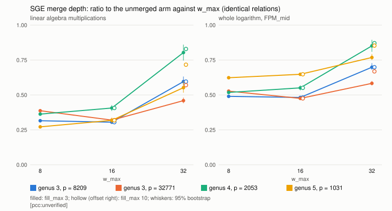

# SGE merge depth, genus 3-5: results (2026-11-21, lead C1)

Status: `[pcc:unverified]` (shared 4-vCPU host at load average 13-18, no independent replay, synthetic
random curves). Protocol [`PROTOCOL.md`](PROTOCOL.md) (frozen before data, `frozen.sha256`); binaries
`binary.sha256` (hashes of the build products equal the main session's `BUILD_DONE` record, HEAD
c9749cbf, no dirty sources; copies in the scratchpad were used); commands `run_cmds.sh`; data
`g3a.jsonl g3b.jsonl g4.jsonl g5.jsonl rho4.jsonl rho5.jsonl`, joined with the scaling study's genus-3
rho rows into `joined.jsonl`; `analysis.json` (genus_ladder_analyze), `paired.json` (`paired.py`),
`scorecard.json` and `tables.md`, `fig_depth.svg` (`render.py`), `model_check.md`; `data.sha256`.

## Headline
Deeper is not better beyond w_max = 16, and at genus 4 and 5 not even that. Best setting (lowest `la`
ratio at genus 3, p = 32771): SGE(16, 3) = SGE(16, 10) (identical rows). It cuts the genus-3, p = 32771
linear algebra to 0.320 [0.311, 0.330] of the unmerged arm (SGE(8,3): 0.387) and FPM_mid to 0.255 [0.197,
0.324] of rho (SGE(8,3): 0.283; unmerged 0.537). w_max = 32 is worse than 16 in every cell, and at genus 4
and 5 w_max = 16 is worse than 8. D2 and D4 are falsified; D1 and D3 hold; D5 is half testable.

## Run
312 runs, 0 uncertified (225 merged/unmerged pairs, 225/225 certified with the planted t). Instances: the 9
genus-3 instance lines equal `scale_g3.jsonl`'s field for field; the unmerged arm's 18 genus-3 rows equal the
scaling study's (all fields but `wall_ns`); genus 4 and 5 instance lines equal the SGE study's
`analysis.json` (9/9) and the rho runs' instance lines equal the c runs'. The genus-3 rho rows are the
scaling study's (same instances and seeds). Cells: genus 3 at 8209, 16411 (6 instances x 2 seeds) and 32771
(3 x 2); genus 4 at 1031, 2053 and genus 5 at 1031 (3 curves x 3 seeds).

## la ratio to the unmerged arm (paired mean, 95% bootstrap) by setting
| cell | (8,3) | (16,3) | (16,10) | (32,3) | (32,10) |
|---|--:|--:|--:|--:|--:|
| g3 p=8209 | 0.315 | 0.305 | 0.305 | 0.596 | 0.596 |
| g3 p=16411 | 0.360 | 0.337 | 0.337 | 0.546 | 0.559 |
| g3 p=32771 | 0.387 | **0.320** | **0.320** | 0.460 | 0.570 |
| g4 p=1031 | **0.334** | 0.405 | 0.405 | 0.811 | 0.811 |
| g4 p=2053 | **0.363** | 0.407 | 0.407 | 0.803 | 0.829 |
| g5 p=1031 | **0.272** | 0.318 | 0.318 | 0.552 | 0.717 |

Intervals, per-cell la_mul, FPM_mid ratio to the unmerged arm and to rho: `tables.md` T1. FPM_mid / unmerged
at the lowest setting per cell: g3 0.482 / 0.499 / 0.475 (p = 8209, 16411, 32771, all (16,*)), g4 0.524 /
0.518 (8,3), g5 0.623 (8,3). FPM_mid / rho, best setting per cell: g3 0.285 / 0.370 / 0.255, g4 0.068 /
0.061, g5 0.004 (the genus-4 and 5 rho references are the rho arm on the same cells; matched-rho band
`unresolved` at the §5a GAE reading is not re-evaluated here).

## Scorecard
| id | verdict | evidence |
|---|---|---|
| D1 | held | 225/225 pairs have identical relation-phase fields; 225/225 certified with the planted t |
| D2 | falsified | `la_mul` is not monotone in w_max: 16 -> 32 rises in all six cells (both fill_max), 8 -> 16 rises in the three genus-4/5 cells (falls only at genus 3); best la ratio at g3 p=32771 is 0.320 > 0.25 |
| D3 | held | best setting (16,*): ratio 0.305 at 8209, 0.320 at 32771, difference 0.015 <= 0.03 (16411: 0.337). SGE(8,3) drifts 0.315 -> 0.387 (+0.072, reproducing the earlier 0.32 -> 0.39); (32,3) drifts the other way (-0.136) |
| D4 | falsified | g3 p=32771 FPM_mid/rho = 0.255 > 0.22; g4 p=2053 best/unmerged FPM_mid = 0.518 for (8,3) (0.551 for the (16,*) setting that is "best" by the protocol rule) > 0.45. Measured: each is a gain over SGE(8,3) at genus 3 only |
| D5 | untestable half, direction falsified | the grid has no (8,10) arm (deviation below), so "no change at w_max 8" is not tested. At w_max 16: F 3 vs 10 identical (0 refusals either way). At w_max 32: a change in 3 of 6 cells (la_mul +2.2% g3 p=16411, +24% g3 p=32771, +3.2% g4 p=2053, +29.9% g5; 0% in the other two), in the opposite direction to the stated expectation: fill_max 10 allows the 4.7 / 91.8 / 1.2 / 15.6 mean refused merges of F = 3, and `la_mul` rises |

## What the merge did
Cell means (`tables.md` T2). At g3 p = 32771: rows 1997 -> 1216 (8,3), 955 (16,*), 831 (32,3), 801 (32,10);
non-zeros 19069 -> 24657, 38632, 57124, 65872 (1.29x, 2.03x, 3.00x, 3.45x); generic (non-+-1) entries 2016
-> 1396, 1829, 3811, 5198. The merge's own work is small (multiplications 21 / 128 / 356 / 420, additions
2.1e5 / 5.2e5 / 1.0e6 / 1.3e6 against Wiedemann 1.8e7 / 1.5e7 / 2.1e7 / 2.6e7); the cost is Wiedemann on the
denser system. The `fill_max` bound is inactive up to w_max = 16 in every cell; at w_max 32 with F = 3 it
refuses merges in the three largest-core cells, and refusing is the better choice.

Descriptive check (`model_check.md`, no fitted parameter): the recorded Wiedemann multiplication ratio equals
`n_out (generic_out + n_out) / (n_in (generic_in + n_in))` (n = columns) to within 0.016 in all 30
rows (e.g. g3 p=32771 (16,*): 0.320 vs 0.318; g4 p=2053 (32,3): 0.805 vs 0.815). Reading: the solver cost is
about n times (generic entries + n); merging shrinks n but each merge multiplies the non-+-1 entries, so
the product has a minimum in w_max (about 16 at genus 3 with cores of 1-2 thousand columns; at or below 8 at
genus 4 and 5 with their smaller, more strongly merged cores). This is an observation on 6 cells, not a law.

## Reading
- Merge depth buys a further 17% off the genus-3, p = 32771 linear algebra (0.387 -> 0.320) and 0.028 off
  FPM_mid/rho (0.283 -> 0.255), a measured improvement over SGE(8,3) at the largest genus-3 prime only.
- At genus 4 and 5 SGE(8,3) stays the best of the five settings. The `la` ratio of the genus-3 best setting is
  nearly flat in p (0.305, 0.337, 0.320), so the drift stops for (16,*), but the level (0.32) is above the
  predicted 0.25; a depth rule that depends on the core size (cheaper merges first, stop when
  n (generic + n) stops falling) is the unexplored next step, with the model above as a hypothesis, not a result.
- Distance remaining to rho on the primary reading at genus 3, p = 32771: 0.255 (about 4x below rho).

## Deviations from the protocol
- D5 asks for fill_max 10 vs 3 "at w_max 8", but the frozen grid (set by the task's setting list) has no
  (8,10) arm; that half of D5 was not measured. No re-run was made.
- The protocol's best-setting rule picks (16,*) (genus 3, p = 32771); at genus 4 the lower FPM comes from
  (8,3), so D4's genus-4 clause is reported for both.
- Genus-4/5 "rho" arms are separate invocations (`--arms R`); runs were executed concurrently with another
  agent's study (load 13-18), so wall times are meaningless; counted fields are unaffected.
- `render.py`/`paired.py`/`join.py`/`model_check.py` were written after the freeze, layout and ratios of
  recorded numbers only; the best-setting rule was applied as frozen.

## Limits
Six cells, 3 curves per cell, 2-3 seeds per curve; intervals are conditional on
the sampled instances; a single host family; no independent replay; FPM prices are conventions; no
GAE-band resolution; no validation-gate evidence, so nothing here is a leaderboard or benchmarks row.
