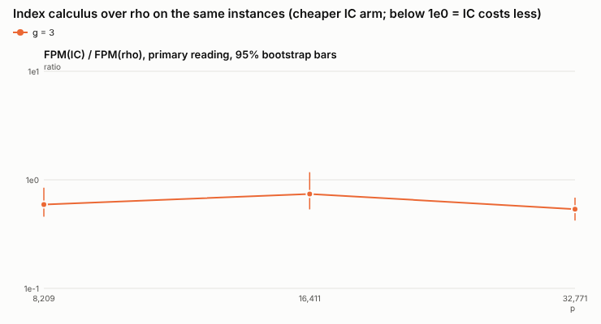

# Genus 3 at p = 8209 … 32771: 2LP + prefilter + SGE against rho — results (2026-11-21)

Status: `[pcc:unverified]` (shared host, no independent replay). Protocol [`PROTOCOL.md`](PROTOCOL.md)
(frozen before data, `frozen.sha256`); binary `binary.sha256`; data `sge_g3.jsonl`, joined with the
scaling study's `scale_g3.jsonl` (rho rows) into `joined_analysis.json`; `tables.md`; `data.sha256`;
bench record `benchmarks/records/20261115T0609Z-genus-ladder-sge-scale.json`.

## Run
36 runs (3 primes × 3 curves × 2 seeds × {unmerged, SGE(8,3)}), all certified with the planted t.
The nine instances are the scaling study's (9/9 instance lines identical) and the unmerged arm's 18
rows are identical to the scaling study's field for field, so the rho rows of that study are the
matched reference (same instances, same seeds).

## Result

| p | 2LP+pre / rho | 2LP+pre+SGE(8,3) / rho | SGE arm's `la_mul` / unmerged | FPM band (SGE arm) |
|--:|--:|--:|--:|---|
| 8209 | 0.591 [0.457, 0.846] | **0.290 [0.224, 0.428]** | 0.32 | below |
| 16411 | 0.741 [0.534, 1.175] | **0.383 [0.266, 0.726]** | 0.36 | below |
| 32771 | 0.537 [0.422, 0.687] | **0.283 [0.221, 0.361]** | 0.39 | below |

Exponents (FPM primary, three primes): unmerged 1.344 [1.335, 1.356]; SGE arm 1.398 [1.385, 1.410];
rho 1.413 [1.143, 1.740]. The SGE arm's exponent is higher than the unmerged arm's because the merge
removes a smaller share of the linear algebra as the core grows (`la` ratio 0.32 → 0.39): with
`w_max = 8` fixed, the fraction of columns light enough to merge falls with the core size. GAE band:
unresolved at every prime (at `w = 1` the arm is 10–14× rho; at `w = 0` it is 0.07–0.10).

Scorecard: Z1 held (9/9, 18/18); Z2 held (36/36); Z3 held (0.283 in [0.22, 0.42]; below across the FPM
band at all three primes); Z4 held (0.31–0.39 in [0.20, 0.40]); Z5 held.

## Reading
This is the best measured arm of the program at genus 3 over F_p: about 0.3 of negation-map rho on the
primary cross-genus reading, with the whole stack (double large primes, parity prefilter, structured
elimination) certified on every run and the baseline path byte-identical to the frozen studies.
Under the §5a GAE band the comparison with rho stays unresolved, because that band prices a native
multiplication like a group operation at `w = 1`. Distance remaining to rho at `w = 1`: about 10×.
The next knob is the merge depth (the `la` ratio drifts up with `p`).

## Limits
Three primes, nine instances, two seeds; shared 4-vCPU host; no independent replay; the FPM prices
are stated conventions.
