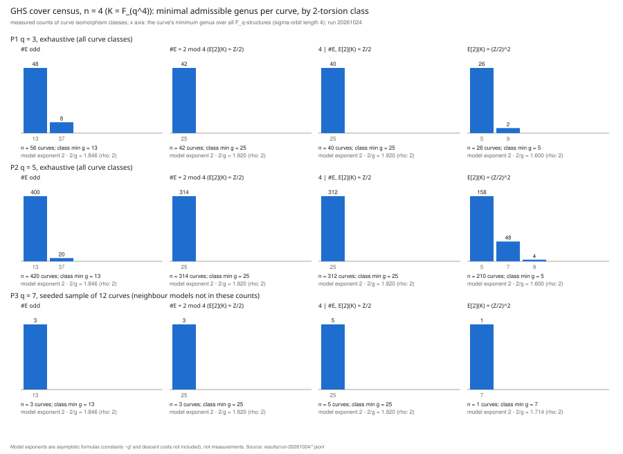

# GHS cover census for `n = 4` (odd characteristic), by 2-torsion class — interim

**Status: interim (2026-10-24, 05:55Z snapshot).** The `q = 3` panels are complete. The exhaustive `q = 5` panel (`P2`, 2,034,500 structures) was still running when this snapshot was taken. The final README, with the `q = 5` (and, if time allows, sampled `q = 7`) results and the full report PDF, replaces this one in the same PR.

Structural stage diagnostic on toy fields. It finds the smallest genus of the `(Z/2)^m` compositum of the four conjugate double covers branched at `x(E[2]) ∪ ∞`, over every `F_q`-structure. No curve over `F_q` is constructed, no transfer map is evaluated, no logarithm is solved, and no speedup is claimed.

Protocol: [`PROTOCOL.md`](PROTOCOL.md), frozen before data. Amendment A1 was appended after the first `q = 3` run and corrects two derived statements and one check bug. The corrected statements are post-hoc for `q = 3` and out of sample for `q = 5, 7`. Tool: [`cover_census_n4.rs`](cover_census_n4.rs), extended from `research/ghs_cover_census_n5_20261013/cover_census_n.rs`.

## Controls

- The reproduction control passed: the extended tool reproduces the committed `n = 3` (q = 3, 5, 7) and `n = 5` (q = 3) records (`results/run-20261024/R1*`, `compare.sh`).
- The two independent enumerations (cosets and cocycles) agree on all 166 curve classes at `n = 4, q = 3`, with 0 mismatches.
- The derived-statement checks after A1 found 0 violations. The first run with the wrong checks is kept as `R4-firstrun-n4-q3-cosets-WRONG-CHECKS.jsonl`.

## `n = 4`, `q = 3`, exhaustive (measured; 166 curve classes)

| class | curves | minimum genus per curve (count) | class floor | model exponent 2 − 2/g (rho: 2) |
|:--|--:|:--|--:|--:|
| `#E` odd | 56 | 13 (48) · 37 (8) | **13** | 1.846 |
| `#E ≡ 2 mod 4` | 42 | 25 (42) | 25 | 1.920 |
| `4 \| #E`, `E(K)[2] = Z/2` | 40 | 25 (40) | 25 | 1.920 |
| `E(K)[2] = (Z/2)^2` | 28 | 5 (26) · 9 (2) | 5 | 1.600 |

- Derived in A1 (post-hoc at `q = 3`): an odd-order curve has floor 13 if `j ∉ F_{q^2}` and floor 37 otherwise, never 25. The `q = 3` data fit this (48 / 8).
- The preregistered prediction of genus 21 for `E(K)[2] = Z/2` failed. The derived floor is 25 (A1, item 1).
- Model only: the exponents are asymptotic in `q` at fixed `g`. They leave out the decomposition constants (about `g!`) and any descent cost. A genus-13 floor for odd-order curves over `F_{q^4}` gives an asymptotic exponent below rho's `q^2`, but with `13!` ≈ 2^32.5 in the constant. That says nothing about cryptographic sizes.
