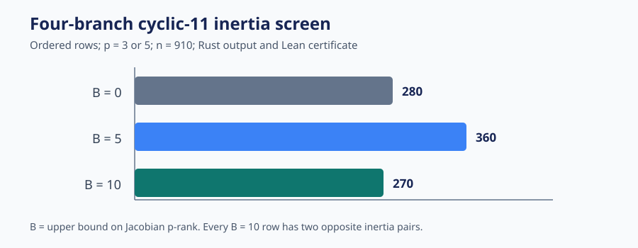

# Four-branch cyclic-11 carriers: an ordinary-source criterion and exact F5 isogeny-class leads

16 November 2026. The bound is a finite specialization of published signature and p-rank results. The F5 carrier equations and matching elliptic source equations are exact search hits at the isogeny-class level. Publication priority is unresolved. Claim standing: unverified.

## Exact population and result

Let (p=3) or (5), let (C/\mathbf F_p) be a smooth cyclic degree-11 cover of (\mathbf P^1) with four distinct geometric branch points, and let its nonzero inertia exponents be ((a,b,c,d)\in(\mathbf Z/11)^4), with (a+b+c+d=0). Riemann–Hurwitz gives (g(C)=10). The normal form with rational branch points is

\[
 C_{a,b,c,\lambda}: y^{11}=x^a(x-1)^b(x-\lambda)^c,
 \quad d=-a-b-c\pmod {11},\quad \lambda\ne0,1.
\]

Put (s_i=-1+\sum_{e\in\{a,b,c,d\}}\langle-ie/11\rangle). The order-five character orbits are (R=\{1,3,4,5,9\}) and (N=\{2,6,7,8,10\}), so the published Bouw bound is

\[
 f_p(JC)\le B=5\min_{i\in R}s_i+5\min_{i\in N}s_i.
\]

The native Rust enumeration and kernel-checked Lean finite certificate give the same result for all **910 ordered** admissible triples ((a,b,c)): 280 rows have (B=0), 360 have (B=5), and 270 have (B=10). Moreover (B=10) **if and only if** the inertia multiset is two opposite pairs (\{u,-u,v,-v\}). The 270 ordered rows represent 15 sorted exponent patterns. These counts classify inertia only; they do not count distinct curves or isomorphism classes. [pcc:unverified]

## Conditional exclusion for a simple ordinary restriction

Assume an ordinary elliptic curve (E/\mathbf F_{p^5}) has a Weil restriction (A=\operatorname{Res}_{\mathbf F_{p^5}/\mathbf F_p}E) that is **simple over (\mathbf F_p)**, and assume a nonzero (\mathbf F_p)-homomorphism (A\to JC). Simplicity makes its image an ordinary dimension-five isogeny factor. If (B\le5), that image uses all of the Jacobian's possible ordinary p-rank. After base change to (\mathbf F_{p^5}), its isogeny class is (E^5), and it is the unique ordinary isogeny factor of (JC). [pcc:unverified]

The deck automorphism is defined over (\mathbf F_{p^5}), since (p^5\equiv1\pmod {11}). It preserves the ordinary factor. Because (C/\langle\sigma\rangle\cong\mathbf P^1), the deck action on (JC) obeys (1+\sigma+\cdots+\sigma^{10}=0). Its faithful action on the ordinary factor embeds (\mathbf Q(\zeta_{11})) into (\operatorname{End}^0(E^5)=M_5(K)), where (K=\operatorname{End}^0(E)) is an imaginary quadratic field. The degree bound over (K) forces (K) to be the unique quadratic subfield (\mathbf Q(\sqrt{-11})). Consequently the Frobenius trace (t) of (E) satisfies (t^2+11m^2=4p^5) for an integer (m\ge1). This is a necessary condition, not a construction of a transfer map. [pcc:unverified]

The exhaustive Hasse-range arithmetic gives only (t=\pm31,m=1) for (p=3), and (t=\pm57,m=29) for (p=5). All four traces are fifth-power traces of elliptic isogeny classes already defined over (\mathbf F_p): base traces (\pm1) at (p=3) and (\mp3) at (p=5), using (t_5=s^5-5ps^3+5p^2s). Thus, **under the simple-restriction and nonzero-map hypotheses**, a non-descended ordinary isogeny class can occur only in the (B=10) opposite-pair stratum. This does not assert that such a map exists in that stratum. [pcc:unverified]

## Exact opposite-pair quotients and source curves

An opposite-pair rational normal form can be written

\[
 y^{11}=x^a\left(\frac{x-1}{x-\lambda}\right)^b,
 \quad (a,b,-b,-a),\quad \lambda\in\mathbf F_p\setminus\{0,1\}.
\]

It admits an involution (\tau:(x,y)\mapsto(\lambda/x,\delta/y)), with (\delta^{11}=\lambda^{a-b}); substitution gives (f(\lambda/x)=\lambda^{a-b}/f(x)). Because (\gcd(11,p-1)=1), (\delta\in\mathbf F_p). For the following exact F5 rational models, (\lambda=2,\delta=1), and the invariant quotient coordinates are (u=x+2/x,\ v=y+1/y). The numerator identities underlying these involutions have evaluated certificates [IDC1ha61ebaac2a79b72e](IDC_E2.json) and [IDC1h01d6f75e07ec20c7](IDC_E24.json), issued with 32 derived and 32 extra checks each. At the two geometric fixed base points (x^2=2), the involution has one fixed point on each 11-point fiber. Riemann–Hurwitz therefore gives a smooth quotient (Q=C/\langle\tau\rangle) of genus five. The field-invariant and genus argument is on paper; the separate F3 quotient equation still lacks an identity certificate. [pcc:unverified]

Let (K=\mathbf F_5[z]/(z^5+4z+1)), (q=5^5=3125). The rational-base F5 census covered 270 ordered opposite-pair inertia rows for each (\lambda\in\{2,3,4\}). The table gives one exact ordered representative for each of two non-descended ordinary trace classes at (\lambda=2). The formulas for (C) are equivalent to the frozen exponent rows after removing an eleventh power. [pcc:unverified]

Across all 810 ordered rational F5 rows, the quotient trace spectrum is exactly (\{-75,-20,2,24,90\}). The three traces divisible by five are nonordinary. The two ordinary traces, (2) and (24), are both non-descended. This is a finite classification of this rational opposite-pair quotient route; it does not classify four-branch covers with nonrational branch positions or other correspondences. [pcc:unverified]

| Trace (t) | (C/\mathbf F_5) | (E/K:y^2=\cdots) | Character count (N) | (\#Q(\mathbf F_{3125})) | (\#E(K)) | Largest prime divisor |
|---:|---|---|---:|---:|---:|---:|
| 2 | (y^{11}=x(x-1)/(x-2)), inertia ((1,1,10,10)) | (x^3+x+1+z^2) | 282 | 3116 | 3124 | 71 |
| 24 | (y^{11}=x((x-1)/(x-2))^9), inertia ((1,9,2,10)) | (x^3+2x+2+z+2z^3) | 262 | 3006 | 3102 | 47 |

For either displayed involution, the Frobenius orbit formula gives (\#Q(\mathbf F_{5^m})=(\#C(\mathbf F_{5^m})+5^m+1)/2). For (m=1,2,3,4), (11\nmid5^m-1), so every rational base coordinate has one point above it and (\#C=5^m+1); hence (\#Q=5^m+1). At (m=5), (\#C=4+11N), because each nonbranch value that is an eleventh power has eleven roots. The native field census gave (N=282,262). Newton identities and the genus-five functional equation then give (L_Q(T)=1-tT^5+3125T^{10}), with (t=(3122-11N)/10=2,24), respectively. The orbit formula uses (\gcd(11,5^m+1)=1) to count exactly one lift for each of the (5^m+1) twisted base points. These geometric and zeta-function deductions remain paper arguments outside Lean. [pcc:unverified]

Both (t) values are ordinary and outside the fifth-trace list from (\mathbf F_5), as checked by `FourBranchFinite.lean` using the native counts as inputs. The native elliptic search counted every point on the two displayed (E/K) equations; independent PARI/GP `ellcard` replay confirmed orders 3124 and 3102 and `polisirreducible` confirmed both (X^{10}-tX^5+3125) polynomials irreducible. Thus the proposed (JQ/\mathbf F_5) and (\operatorname{Res}_{K/\mathbf F_5}E) have matching simple isogeny classes by [Tate's finite-field isogeny theorem](https://pazuki.perso.math.cnrs.fr/index_fichiers/Tate66.pdf), conditional on the quotient point-count derivation. This is an **abstract existence statement** for an isogeny. Its degree, action on the order-71 or order-47 subgroup, and an executable map have not been determined. [pcc:unverified]

For **trace 2**, the quotient has an explicit smooth hyperelliptic model. Put
\[
D_{11}(v,1)=v^{11}-11v^9+44v^7-77v^5+55v^3-11v,
\qquad P_5(v)=v^5+v^4+v^3+2v^2+3v+1\quad(\bmod 5).
\]
The Dickson relation (D_{11}(y+1/y,1)=y^{11}+y^{-11}) and the invariant equation give
\[
H_2/\mathbf F_5:\quad W^2=(v-2)(D_{11}(v,1)-1),\qquad
v=y+1/y,\quad W=\frac{2(x+2/x)-D_{11}(v,1)-2}{P_5(v)}.
\]
The polynomial identity (D_{11}(v,1)-2=(v-2)P_5(v)^2) holds modulo 5. Its integer lift has evaluated certificate [IDC1h6d280bfce398a853](IDC_H2.json); the invariant quotient identity has certificate [IDC1hefd1850ab22dcdff](IDC_Q2.json). Both use 32 derived and 32 extra evaluation points and are **evaluated certificates**, not formal identity proofs. Independent PARI/GP replay verifies the factor identity, squarefreeness of the degree-12 right side, genus five, and `hyperellcharpoly=x^10-2*x^5+3125` in [HYPERELL_REPLAY.stdout](HYPERELL_REPLAY.stdout). This independently supports the trace-2 quotient zeta and its isogeny class. The trace-24 quotient still has the paper point-count derivation only. [pcc:unverified]

The exact quotient coordinates yield a carrier-side degree-two morphism (\pi:C\to Q). Its Jacobian pullback preserves each odd prime subgroup: (\pi_*\pi^*=[2]), so (\pi^*:JQ(\mathbf F_5)[r]\to JC(\mathbf F_5)[r]) is injective for (r=71) or (47). The construction and its geometric assumptions are in [MAPS.md](MAPS.md). This is a verified algebraic relation on the quotient-to-carrier leg; the needed elliptic-to-quotient isogeny remains abstract. [pcc:unverified]

For trace 24, an integral Tate argument proves that **some** source-to-quotient isogeny preserves the order-47 subgroup: (\operatorname{disc}(X^{10}-tX^5+3125)=5^{30}(t^2-12500)^5), and (24^2-12500=-11924\not\equiv0\pmod {47}). The shared irreducible Weil polynomial then gives isomorphic free rank-one (\mathbf Z_{47}) Frobenius lattices and an isogeny of degree prime to 47. For trace 2, (2^2-12500=-12496) is divisible by 71, so this criterion is inconclusive. These are existence statements, not evaluable transfer formulas; the derivation and primary sources appear in [MAPS.md](MAPS.md). The modular arithmetic is checked in Lean, the discriminant formula has independent [PARI/GP replay](DISCRIMINANT_REPLAY.stdout), and the integral Tate theorem is external. [pcc:unverified]

The complete F3 rational opposite-pair screen gave quotient traces (24,-9,2). The only ordinary value was (2), a fifth trace of a base-field class. The two other values are divisible by 3. This is a finite negative result for that rational four-branch quotient population, not for all branch configurations or transfer mechanisms. [pcc:unverified]

## Prior work and novelty boundary

The literature screen used [Ozman–Pries–Weir, Lemma 2.1 and Theorem 2.3](https://doi.org/10.1017/nmj.2022.12) for the signature and bound; [Iijima–Momose–Chao](https://eprint.iacr.org/2015/805.pdf) for direct-cover context; [dihedral Jacobian decompositions](https://arxiv.org/abs/1609.01562) for the quotient family; and [Magma's Weil-descent documentation](https://magma.maths.usyd.edu.au/magma/handbook/text/517) for transfer context. Two recent Chebyshev papers [Kazemifard–Tafazolian](https://arxiv.org/abs/2611.10255) and [Tafazolian–Top](https://arxiv.org/abs/2611.14198) address related but differently defined curves, respectively Kummer equations (y^n=D_m(x,1)) and hyperelliptic equations (w^2=D_d(v,1)); neither directly states the displayed (H_2) equation or its GHS transfer. Targeted exact-equation and Weil-polynomial searches did not locate these two exact F5 instances in a publication; the LMFDB `av_fq_isog` table returned no genus-five, q=5 rows, so it cannot resolve priority. The **exact curve equations** are new findings within this project. The **dihedral family and quotient method** are prior art. Whether the ordinary, non-descended F5 subfamily has been documented as a GHS-eligible family remains open. Neither exact instance is yet a demonstrated vulnerability. [pcc:unverified]

## Reproduction and evidence limits

The original bound has [PROTOCOL.md](PROTOCOL.md), [screen.rs](screen.rs), [RUN.stdout](RUN.stdout), and [SOURCE.sha256](SOURCE.sha256). Additional frozen protocols and outputs are [F243_PATTERNS_PROTOCOL.md](F243_PATTERNS_PROTOCOL.md) with [F243_PATTERNS_RUN.stdout](F243_PATTERNS_RUN.stdout), [F3125_PROTOCOL.md](F3125_PROTOCOL.md) plus [F3125_AMENDMENT.md](F3125_AMENDMENT.md) with [F3125_RUN_V2.stdout](F3125_RUN_V2.stdout), [ELLIPTIC_SOURCE_PROTOCOL.md](ELLIPTIC_SOURCE_PROTOCOL.md) with [ELLIPTIC_RUN.stdout](ELLIPTIC_RUN.stdout), [GP_REPLAY_PROTOCOL.md](GP_REPLAY_PROTOCOL.md) with [GP_REPLAY.stdout](GP_REPLAY.stdout), [HYPERELL_PROTOCOL.md](HYPERELL_PROTOCOL.md) with [HYPERELL_REPLAY.stdout](HYPERELL_REPLAY.stdout), and the evaluated [identity-certificate protocol](IDENTITY_PROTOCOL.md) with its four JSON records and two amendments. Native sources and the independent GP scripts are hashed in [EXTRA_SOURCES.sha256](EXTRA_SOURCES.sha256). The finite Lean certificate is [FourBranchFinite.lean](FourBranchFinite.lean), its design boundary [PROOF_MAP.md](PROOF_MAP.md), and its focused proof gate [status](lean-gate/research_ghs_cyclic11_four_branch_cm_20261116_FourBranchFinite_lean/status), now 22 theorems and zero trusted exceptions under Lean 4.35.0. Lean checks inertia, trace and modular discriminant arithmetic; finite-field counts, quotient geometry, CM and isogeny arguments remain external. [pcc:unverified]

The two exact elliptic source curves have been counted and independently replayed. The F5 involution identities have evaluated certificates, the trace-2 quotient has an independent smooth-model/zeta replay, and the quotient-to-carrier pullback has a subgroup-preservation proof on paper. Integral Tate proves existence of a subgroup-preserving source-to-quotient isogeny for trace 24, but its formula is unknown. The trace-24 smooth-model replay, an evaluable **elliptic-source-to-quotient** subgroup map for either case, and a complete same-subgroup GHS-versus-rho run remain open. At this base size the largest source prime subgroups have orders 71 and 47, so their rho baselines are small; any performance claim requires measured total transfer, relation collection, linear algebra, descent, and verification on the same subgroup. The next falsifier is to construct and independently replay the isogeny on those exact prime subgroups. [pcc:unverified]
