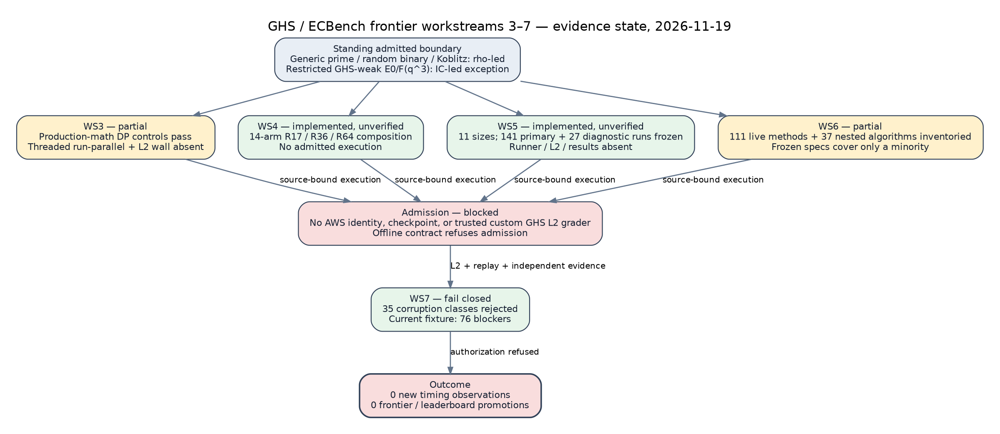

# Decision

The frontier is **not regraded**. Workstreams 3–7 produced stronger
implementations, complete prospective protocols, a live source census, and a
fail-closed publication gate, but they produced **zero admitted performance
observations**. The generated frontier and leaderboard therefore remain
unchanged.

The established boundary continues to be the only supported one:

- generic prime, random-binary, and Koblitz curves are rho-led in the admitted
  cold one-target comparisons;
- the deliberately restricted GHS-weak `E_0/F_(q^3)` family is the separate
  IC-led exception;
- prime P20 with the validated `N=45` factor base remains 7.95 / 8.24 / 9.62
  times matched rho across the `0 / 0.1 / 1` pricing band;
- F5/F6 improvements remain solver-local; and
- signed-Frobenius rho retains a 1.246642-fold instruction reduction, with its
  isolated L2 wall effect still unmeasured.

These values are carried historical controls, not new measurements
`[pcc:unverified]`.



# What workstreams 3–7 established

**3. Parallel rho — partial.** Real curve transition, SHA-256 indexed starts,
shared jump identity, sharded DP tables, a lossless bounded queue,
collision/scalar verification, useful/overshoot identities and a literal
transcript hash are implemented. The deterministic round-robin control is not
threaded latency; per-thread affinity, NUMA policy, CPU/wall phases, D00–D10
adversarial closure and L2 remain absent.

**4. Composition — implemented-unverified.** The exact fourteen-arm
baseline/R17/R36/R64 closure, five widths, counted/native/bare authority split,
disjoint development and holdout sets, and a native five-corruption validator
exist. No source-bound development or holdout measurement exists.

**5. Matched GHS — implemented-unverified.** The frozen design covers eleven
q values, three seeds, 141 primary rho runs, 27 diagnostics, 33 calibrations,
all eight historical IC arms, and complete cost/phase/replay gates. The
source-bound runner, archive readback, custom-binary admission and complete
grid remain absent.

**6. Solver coverage — partial.** A live registry-derived census, optimization
policy for every method parameter, nested system/PDP3/tower engine census and
strict require-all audit exist. Frozen specs cover only a minority of the live
registry; inventory is not execution.

**7. Validation/publication — implemented-unverified.** The strict manifest,
create-new authorizer, 35-case corruption matrix, independent replay checklist
and generated-view dry run exist. The current honest fixture has 76 blockers
and authorizes nothing.

No lane substitutes local timing, a plan, or a validator self-test for a
performance observation.

# Optimized rho: what is real and what is not

The new `check-parallel` path exercises the production mathematics without a
clock. The independent integration review found and corrected four evidence
defects before publication:

1. job IDs now bind source revision, binary bytes and every scientific/control
   knob;
2. the emitted JSONL has a literal SHA-256 and byte count distinct from its
   canonical semantic digest;
3. every nonempty masked-tail control must recover and verify the scalar; and
4. calibration output is a development-only, ungraded schema with
   `timing_admissible=false`; environment strings cannot label it L2.

The retained deterministic suite covers 66 masked tails, shard counts
`1/2/4/8`, queue depths `1/2/64`, stop delays `0/1/3/8`, natural P=1/2/4
recovery twice, exact replay, and four fail-closed cases. This validates the
mathematical/coordinator control. It does not measure scaling.

`run-parallel` deliberately exits 3. The remaining production implementation
needs real worker threads, pinning, NUMA memory-policy readback, contention,
exclusive wall/CPU phase accounting, forced-close/panic records, million-start
uniqueness, transition vectors, and the remaining collision fixtures. See the
exact D00–D10 ledger in `ws3_parallel_rho/README.md`.

# Candidate composition

The composition protocol prevents the common error of adding isolated deltas.
It measures the composed binary again:

```text
baseline
  -> R17: five-evaluation F_(q^3) multiplication
  -> R36: initial-walker joint-table reuse
  -> R64: remove counter mutations only in the paired bare wall arm
```

At width 8 the closure has fourteen arms: six counted controls/candidates,
four native-diagnostic arms and four bare wall arms. Correctness screening also
runs widths 1, 4, 8, 16 and 32. Development uses q=4,051/16,363/65,479 and
seeds 101–103; holdout uses seeds 1–3 with the frozen `ic-repeat` target law.

Each candidate is paired with a byte-identical A/A reference under five frozen
interleaving blocks. A candidate reaches holdout only if every development
record verifies and its admitted interval is below one at all three sizes. No
such execution occurred in this round `[pcc:unverified]`.

# Matched restricted-family IC/rho grid

The M3 protocol asks a narrow question only: on the GHS-weak
`E_0/F_(q^3)` family with order `4*ell`, does the lowest complete historical IC
arm remain below composed `strong-b8-mul5-walker-table` at all eleven sizes and
all three pricing weights?

The frozen grid covers q=4,051 through 4,194,271; seeds 1–3; eight IC arms
`B0,S,L0,L1,L,D,DL1,DL`; 141 primary rho runs; 27 width/legacy diagnostics;
and 33 host calibrations. Cold setup, relation/walk, filtering/collision,
solving/recovery and independent verification must all be charged. Online-only
figures are secondary.

The result templates are machine-blocked: the runner is absent and the
standalone command route cannot earn L2. This is honest incompleteness, not a
smaller experiment.

# Live algorithm coverage

The live census supersedes the historical 74-method/11-solver snapshot. The
current source registry contains **111 methods**. Its nested algorithm inventory
contains **37 entries**: 21 system solvers, 12 PDP3 engines and 4 PKM tower
engines. This round found a real inventory defect: the parser accepted three
batched/harvest root-finding engines that the inventory omitted. The additive
fix registers all three and changes no solver behavior. The exact inventory
unit assertion initially exposed a duplicate test name in an unrelated plug-in
module; the weaker duplicate was removed, the retained superset test remains,
and the inventory assertion then passed 1/1 with 7,717 other tests filtered.

- **F4/Buchberger/M4GB:** `f4-f2`, Buchberger, M4GB local/server, matrix
  F4, and inherited F4 legacy/next/batched are inventoried. Solver units are
  not cross-ranked without a common enclosing pipeline.
- **F5:** matrix F5 and prime-tower signature F5 are inventoried; there is no
  new cold ECDLP result.
- **F6:** F6-IC, F6-IC pair and prime-tower F6 are inventoried; there is no new
  cold ECDLP result.
- **SAT/SMT:** CDCL SAT, Primo SMT and Primo SMT file are inventoried. WD-SAT
  remains non-promotable until its retained false-UNSAT path is repaired and
  replayed.
- **FES / Gray-style enumeration:** FES F2, wide and GPU;
  FES-then-inherited/batched; and the exhaustive engine are inventoried. There
  is no new matched end-to-end run.
- **Crossbred / XL:** crossbred F2 and XL F2 are inventoried; unlike native
  units remain separate.
- **Root/table engines:** rootfind, window, negation fold, batch,
  batch-harvest, batch-harvest-torsion and window-negfold are inventoried. They
  are table setup/probe routes, not algebraic-solver wins by themselves.

The strict coverage audit demonstrates the remaining gap rather than hiding it:
the existing frozen development specs cover 20 methods and 17 nested
algorithms. Registry coverage and E2E performance coverage are different
claims.

# Admission bottleneck

No paid launch was attempted. Read-only checks found no AWS identity, no
`kubectl`, no installed IsoLab MCP server, and no checkpoint transport. The
latest inspected main workflow failed artifact hydration before build.

The offline standalone-GHS contract now binds exact account/region image
digest, source/binary/runner/validator hashes, no-shell argv, zero retries,
warmup/rounds, byte-identical A/A, replay-all and exact artifact hashes. Its
normal verifier always exits 3 because a Pod cannot self-certify isolation.
The contract also cannot represent the longer WS5 high/top IC jobs.

The smallest safe route is to add the restricted GHS workload and canonical
record/validator natively to ECBench. That reuses the qualified build,
fresh-owner custody, native isolation grader, replay-all, A/A and exact Pod-UID
S3 readback instead of duplicating that trusted boundary.

# Publication boundary and next implementation order

The WS7 authorizer requires exact source/binary/image/protocol identities,
four verified-complete upstream lanes, cold one-target phase coverage, L2/L3,
at least five A/A pairs, the `0/0.1/1` price band, table-work pricing, 600
calibration triples, scalar checks, replay-all, distinct-host validation,
`VALIDATION.json`, PCC CI-main standing and regenerated reports/frontier/
leaderboard/browser views. The current fixture exits 3 with 76 blockers
`[pcc:unverified]`.

The shortest defensible sequence is:

1. implement the native GHS ECBench adapter and canonical replay validator;
2. complete threaded `run-parallel` and D00–D10, then freeze one pushed source;
3. execute WS4 development and holdout under admitted L2/A/A;
4. materialize the WS5 runner/archive and execute the complete matched grid;
5. expand frozen ECBench specs until the live 111/37 census has an explicit
   executed or non-applicable disposition; and
6. run the independent authorizer and regenerate the leaderboard only if it
   returns ready.

Until then the correct leaderboard update is no update.

# Source and verification map

The source receipt is `SOURCES.md`. Protocols and native validators live under
`ws3_parallel_rho/` through `ws7_validation_publish/`; admission evidence is
under `eks_admission/` and `l2_bridge/`. Primary controls include Shoup's
generic bound, GLV symmetry matching, van Oorschot–Wiener parallel collision
search, F4/F5, Semaev/Gaudry index calculus, and FPPR Weil-descent accounting.

The PDF is generated from this Markdown after rendering `frontier-gate.dot` to
both SVG and PNG. It is a report of implementation and evidence status, not a
benchmark record.

