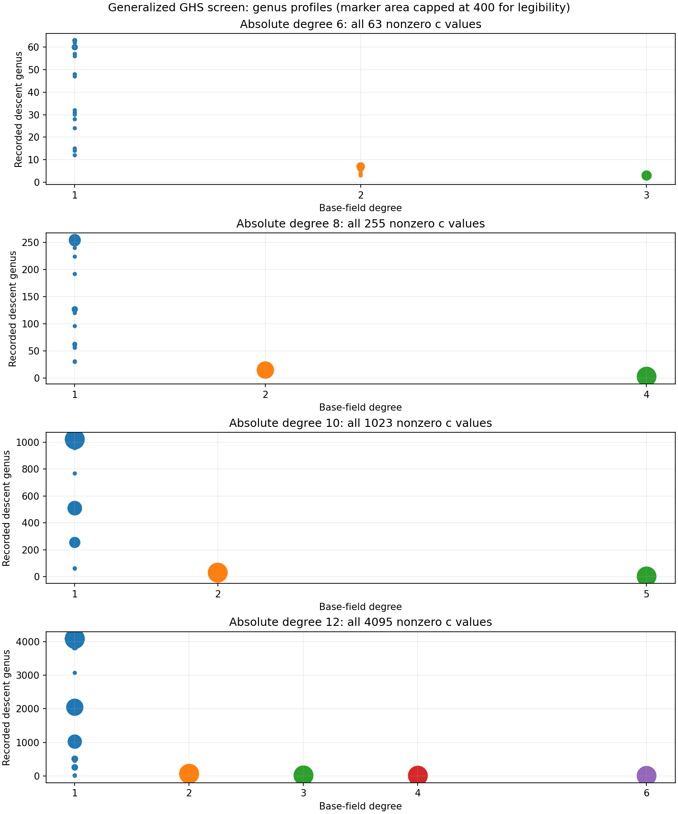

# Generalized binary GHS: explicit map and attack controls

24 October 2026. Source base `a53a7e2bfa20080a424b9a2484a16932b6e3c116`. This report cites raw JSON under `results/`, the frozen `PROTOCOL.md`, and `PRIOR_WORK.md`.

## Scope and decision

All exact instances below are members of prior-known binary GHS/isogeny families ([Galbraith–Hess–Smart 2002](https://www.iacr.org/archive/eurocrypt2002/23320028/smart.pdf); [Hess 2004](https://www.cambridge.org/core/journals/lms-journal-of-computation-and-mathematics/article/generalising-the-ghs-attack-on-the-elliptic-curve-discrete-logarithm-problem/315278965D8D277A85812D9498236A88)). An exact hexadecimal instance has not been matched to a publication, but that does not establish novel vulnerability. The measurements below do not support a calibrated GHS advantage over rho. The end-to-end executable work is the quadratic genus-two branch for the listed exact curves; other screen profiles have no complete attack map.

## Search and mathematical map

For each proper `GF(2^s)` in `GF(2^n)` and each nonzero Hess parameter `c` in the finite field, the screen records a Frobenius-order profile, MMT gate, and genus. Degrees 6/8/10/12 use respectively 63/255/1023/4095 values: the full nonzero `c` range. The quadratic model is constructed over `GF(2^(n/2))` when `D = beta + beta^(2^(n/2)) != 0`, where `beta^2=b`. Given trace-one `lambda`, define `A=a+a^q`, `B=beta+lambda^2 D`, `mu=sqrt(B/D)`, `L=B/D+mu+lambda^2+lambda`, `H=u^2+u+A`, `C0=a+lambda^2 A`; then `C: W^2+H W = D H+(L u+(B/D)A+C0) H^2` (genus two). The curve-to-elliptic morphism is `X=beta H/D`, `Y=beta W/D+(mu+lambda)X u+beta`. The executed elliptic-to-Jacobian map is `trace(conorm(P-O))`; a source point maps to an explicitly reduced Mumford divisor. For a rational kernel `K` of order 2, 3, or 5, Vélu-style coordinates are `X=x(P)+sum_(T in K\{O})(x(P+T)+x(T))`, `Y=y(P)+sum_(T in K\{O})(y(P+T)+y(T))+shift`, with the destination coefficients fitted and independently checked on every rational source point. These formulas are source-linked to [Magma descent documentation](https://magma.maths.usyd.edu.au/magma/handbook/text/1561) and [the original isogeny extension](https://www.iacr.org/archive/eurocrypt2002/23320028/smart.pdf). The executable checks establish the properties for the enumerated finite groups and chosen subgroups; the Lean module proves the abstract subgroup implication, not the concrete coordinate identity.

Screen population and exact counts: `results/screen-n6-a0-b20.json`, `screen-n8-a0-b20.json`, `screen-n10-a0-b20.json`, `screen-n12-a1-b200.json`. Marker area grows with the number of `c` values yielding a genus at that subfield degree, capped at 400 for legibility; read the exact histogram counts in JSON. The editable renderer is `render_screen.py`; the vector copy is `genus-profiles.svg`.

For degree 12, `results/leads-n12-a1-b200-g2.json` contains 147 screened genus-at-most-two profiles, including 15 genus-one profiles over GF(2^4); the first is `c=0x1`. These are structural leads only: their individual maps and attacks were not run.

## Exact instances, subgroup maps, and measured work

All curves use `y²+xy=x³+a x²+b` in the indicated polynomial-basis field. `P`, `Q`, `phi(P)`, and `phi(Q)` are exact JSON coordinates; the GHS image is a pair of exact Mumford coefficient arrays. Each successful row enumerates all `r` scalars to check the full composite subgroup map, as well as `[r]phi(P)=O`, `phi([37]P)=[37]phi(P)`, nonzero Jacobian image, `[r]G=O`, source scalar replay, and a canonical-negation-folded rho on the same `(P,Q)`. Isogeny construction validates every rational source point against the codomain equation and 400 group pairs; the degree-six test checks every pair.

| n | edge | #E / r | FB / rank | smooth / attempts | rho EC add / dbl / steps | result |
|--:|:--|--:|--:|--:|--:|:--|
| 6 | direct | 76 / 19 | 8 / 7 | 10 / 18 | 3 / 5 / 7 | verified |
| 6 | two-isog | 76 / 19 | 8 / 7 | 10 / 18 | 3 / 5 / 7 | verified |
| 8 | direct | 268 / 67 | 16 / 16 | 50 / 66 | 5 / 2 / 6 | verified |
| 8 | two-isog | 268 / 67 | 16 / 16 | 50 / 66 | 5 / 2 / 6 | verified |
| 10 | direct | 1032 / 43 | 32 / 22 | 26 / 42 | 12 / 3 / 6 | verified |
| 10 | two-isog | 1032 / 43 | 32 / 22 | 26 / 42 | 12 / 3 / 6 | verified |
| 10 | three-isog | 1032 / 43 | 32 / 18 | 26 / 42 | 12 / 3 / 6 | verified |
| 12 | direct | 3980 / 199 | 64 / 56 | 132 / 198 | 33 / 9 / 9 | verified |
| 12 | two-isog | 3980 / 199 | 64 / 56 | 132 / 198 | 33 / 9 / 9 | verified |
| 12 | five-isog | 3980 / 199 | 64 / 56 | 132 / 198 | 33 / 9 / 9 | verified |

The matched reference is deterministic `rho.negation` with a memory collision table and up to 12 partition reseeds; its counted additions/doublings and field operations include restarts. `results/MANIFEST.json` binds the executable SHA-256, source base, host and each receipt hash. Operation counts are phase-specific and preserve the field degree. Inverse-call counters are informational and include multiplications and squarings already tallied, so do not add inverses to those counts. The genus-two field operations, source-field rho operations, matrix entry operations, and hash/table work use different units. `wall_ns` is one unisolated L0 observation, so no elapsed-time ratio or speedup is inferred; this rho has not been measured against the fastest external implementation. A calibrated GAE 0/0.1/1 band and an external implementation comparison remain outstanding.

### Raw cost vectors (one sample per arm)

**exact-n6-a0-b32-direct.json**, sha256 `c8c76329fad84b689ad650b4d7fea7af8941223de3ae70f0b07d32679c0b9ff2`. E over GF(2^6), modulus 0x43, a=0, b=32; source #E=76, subgroup r=19, P=(6,31), Q=(6,25); rho scalar 18.

- Setup construction: f2m3_add=26, f2m3_inverse_informational=3, f2m3_mul=26, f2m3_square=6, f2m6_add=94, f2m6_inverse_informational=4, f2m6_mul=51, f2m6_square=179; wall_ns=75875 (L0).
- Setup full_subgroup_checked_scalars: 19.
- Setup full_subgroup_map_check: f2m3_add=4386, f2m3_inverse_informational=190, f2m3_mul=3547, f2m3_square=304, f2m6_add=5925, f2m6_inverse_informational=276, f2m6_mul=5424, f2m6_square=1235; wall_ns=1885958 (L0).
- Setup source_order_enumeration: f2m6_add=227, f2m6_inverse_informational=63, f2m6_mul=289, f2m6_square=258; wall_ns=105500 (L0).
- GHS factor_base: f2m3_add=2378, f2m3_inverse_informational=192, f2m3_mul=2354, f2m3_square=448; wall_ns=2042292 (L0).
- GHS map: f2m3_add=87, f2m3_inverse_informational=6, f2m3_mul=73, f2m3_square=12, f2m6_add=556, f2m6_inverse_informational=26, f2m6_mul=526, f2m6_square=122; wall_ns=116708 (L0).
- GHS relations_and_linear_algebra: f2m3_add=5141, f2m3_inverse_informational=206, f2m3_mul=4298, f2m3_square=314; wall_ns=1715334 (L0).
- GHS target_descent_and_replay: f2m3_add=188, f2m3_inverse_informational=9, f2m3_mul=168, f2m3_square=15, f2m6_add=29, f2m6_inverse_informational=5, f2m6_mul=25, f2m6_square=19; wall_ns=39167 (L0).
- Unpriced GHS counters: {"decomposition_reconstructions": 11, "factor_base_hash_inserts": 8, "factor_base_hash_lookups": 13, "matrix_entry_operations": 61, "polynomial_root_tests": 152}.
- Isogeny image P/Q: [6, 31, 0] / [6, 25, 0]; Jacobian image P/Q: {"u": ["0x4", "0x0", "0x1"], "v": ["0x7", "0x4"]} / {"u": ["0x4", "0x0", "0x1"], "v": ["0x3", "0x5"]}.
- Descended curve `h=["0x0", "0x1", "0x1"]`, `f=["0x0", "0x7", "0x7", "0x3", "0x0", "0x3"]`, base basis `["0x1", "0xe", "0x17"]`.
- Rho: f2m6_add=80, f2m6_inverse_informational=12, f2m6_mul=60, f2m6_square=45; wall_ns=56417 (L0); {"algorithm": "rho.negation", "elliptic_additions": 3, "elliptic_doublings": 5, "hash_inserts": 7, "hash_lookups": 8, "negation_folds": 3, "restarts": 0, "scalar": 18, "steps": 7}.

**exact-n6-a0-b32-two_isogeny.json**, sha256 `359eb058ef4daf13708579e213da98008a8452429447519611cc2d8fe898298d`. E over GF(2^6), modulus 0x43, a=0, b=32; source #E=76, subgroup r=19, P=(6,31), Q=(6,25); rho scalar 18.

- Setup construction: f2m3_add=26, f2m3_inverse_informational=3, f2m3_mul=26, f2m3_square=6, f2m6_add=94, f2m6_inverse_informational=4, f2m6_mul=51, f2m6_square=179; wall_ns=60417 (L0).
- Setup full_subgroup_checked_scalars: 19.
- Setup full_subgroup_map_check: f2m3_add=4687, f2m3_inverse_informational=195, f2m3_mul=3859, f2m3_square=309, f2m6_add=6212, f2m6_inverse_informational=294, f2m6_mul=5532, f2m6_square=1289; wall_ns=2841708 (L0).
- Setup source_order_enumeration: f2m6_add=227, f2m6_inverse_informational=63, f2m6_mul=289, f2m6_square=258; wall_ns=584542 (L0).
- Degree-2 kernel [[0, 36, 0]]; codomain a=0x0, b=0x24; kernel and codomain construction: f2m6_add=22190, f2m6_inverse_informational=1804, f2m6_mul=9273, f2m6_square=5619; wall_ns=7029208 (L0).
- GHS factor_base: f2m3_add=2378, f2m3_inverse_informational=192, f2m3_mul=2354, f2m3_square=448; wall_ns=410500 (L0).
- GHS map: f2m3_add=98, f2m3_inverse_informational=6, f2m3_mul=84, f2m3_square=12, f2m6_add=633, f2m6_inverse_informational=26, f2m6_mul=569, f2m6_square=122; wall_ns=125625 (L0).
- GHS relations_and_linear_algebra: f2m3_add=5405, f2m3_inverse_informational=211, f2m3_mul=4573, f2m3_square=319; wall_ns=781375 (L0).
- GHS target_descent_and_replay: f2m3_add=158, f2m3_inverse_informational=5, f2m3_mul=141, f2m3_square=8, f2m6_add=29, f2m6_inverse_informational=5, f2m6_mul=25, f2m6_square=19; wall_ns=31667 (L0).
- Unpriced GHS counters: {"decomposition_reconstructions": 10, "factor_base_hash_inserts": 8, "factor_base_hash_lookups": 12, "matrix_entry_operations": 51, "polynomial_root_tests": 152}.
- Isogeny image P/Q: [8, 40, 0] / [8, 32, 0]; Jacobian image P/Q: {"u": ["0x5", "0x6", "0x1"], "v": ["0x1", "0x2"]} / {"u": ["0x5", "0x6", "0x1"], "v": ["0x4", "0x5"]}.
- Descended curve `h=["0x0", "0x1", "0x1"]`, `f=["0x0", "0x5", "0x5", "0x7", "0x0", "0x7"]`, base basis `["0x1", "0xe", "0x17"]`.
- Rho: f2m6_add=80, f2m6_inverse_informational=12, f2m6_mul=60, f2m6_square=45; wall_ns=20625 (L0); {"algorithm": "rho.negation", "elliptic_additions": 3, "elliptic_doublings": 5, "hash_inserts": 7, "hash_lookups": 8, "negation_folds": 3, "restarts": 0, "scalar": 18, "steps": 7}.

**exact-n8-a0-b32-direct.json**, sha256 `0b195de3a34bd4ae5fd9c350dff80ce15808672f79e276bac9f82e92e936aa46`. E over GF(2^8), modulus 0x11b, a=0, b=32; source #E=268, subgroup r=67, P=(244,61), Q=(4,8); rho scalar 37.

- Setup construction: f2m4_add=26, f2m4_inverse_informational=3, f2m4_mul=29, f2m4_square=10, f2m8_add=100, f2m8_inverse_informational=4, f2m8_mul=56, f2m8_square=170; wall_ns=103250 (L0).
- Setup full_subgroup_checked_scalars: 67.
- Setup full_subgroup_map_check: f2m4_add=14814, f2m4_inverse_informational=659, f2m4_mul=12956, f2m4_square=1854, f2m8_add=21884, f2m8_inverse_informational=993, f2m8_mul=20926, f2m8_square=6127; wall_ns=16776291 (L0).
- Setup source_order_enumeration: f2m8_add=899, f2m8_inverse_informational=255, f2m8_mul=1408, f2m8_square=1283; wall_ns=606667 (L0).
- GHS factor_base: f2m4_add=9378, f2m4_inverse_informational=768, f2m4_mul=10094, f2m4_square=2816; wall_ns=6704625 (L0).
- GHS map: f2m4_add=86, f2m4_inverse_informational=6, f2m4_mul=81, f2m4_square=20, f2m8_add=623, f2m8_inverse_informational=28, f2m8_mul=604, f2m8_square=176; wall_ns=138750 (L0).
- GHS relations_and_linear_algebra: f2m4_add=22189, f2m4_inverse_informational=889, f2m4_mul=20130, f2m4_square=2434; wall_ns=17359125 (L0).
- GHS target_descent_and_replay: f2m4_add=208, f2m4_inverse_informational=9, f2m4_mul=195, f2m4_square=26, f2m8_add=43, f2m8_inverse_informational=7, f2m8_mul=42, f2m8_square=33; wall_ns=104875 (L0).
- Unpriced GHS counters: {"decomposition_reconstructions": 51, "factor_base_hash_inserts": 16, "factor_base_hash_lookups": 86, "matrix_entry_operations": 1448, "polynomial_root_tests": 1072}.
- Isogeny image P/Q: [244, 61, 0] / [4, 8, 0]; Jacobian image P/Q: {"u": ["0xf", "0x1"], "v": ["0xb"]} / {"u": ["0xa", "0x5", "0x1"], "v": ["0xd", "0x1"]}.
- Descended curve `h=["0x0", "0x1", "0x1"]`, `f=["0x0", "0x5", "0x5", "0x9", "0x0", "0x9"]`, base basis `["0x1", "0xc", "0x50", "0xed"]`.
- Rho: f2m8_add=96, f2m8_inverse_informational=13, f2m8_mul=78, f2m8_square=59; wall_ns=49792 (L0); {"algorithm": "rho.negation", "elliptic_additions": 5, "elliptic_doublings": 2, "hash_inserts": 6, "hash_lookups": 7, "negation_folds": 1, "restarts": 0, "scalar": 37, "steps": 6}.

**exact-n8-a0-b32-two_isogeny.json**, sha256 `a9619272ec7b0a55d9c1b4190f16cd7a9b059f92385fc4c1545a441e1f64d8f4`. E over GF(2^8), modulus 0x11b, a=0, b=32; source #E=268, subgroup r=67, P=(244,61), Q=(4,8); rho scalar 37.

- Setup construction: f2m4_add=26, f2m4_inverse_informational=3, f2m4_mul=29, f2m4_square=10, f2m8_add=100, f2m8_inverse_informational=4, f2m8_mul=56, f2m8_square=170; wall_ns=358250 (L0).
- Setup full_subgroup_checked_scalars: 67.
- Setup full_subgroup_map_check: f2m4_add=17674, f2m4_inverse_informational=712, f2m4_mul=15192, f2m4_square=1960, f2m8_add=22788, f2m8_inverse_informational=1058, f2m8_mul=21307, f2m8_square=6388; wall_ns=7759791 (L0).
- Setup source_order_enumeration: f2m8_add=899, f2m8_inverse_informational=255, f2m8_mul=1408, f2m8_square=1283; wall_ns=477834 (L0).
- Degree-2 kernel [[0, 197, 0]]; codomain a=0x0, b=0xc5; kernel and codomain construction: f2m8_add=25754, f2m8_inverse_informational=2020, f2m8_mul=12949, f2m8_square=8659; wall_ns=9835542 (L0).
- GHS factor_base: f2m4_add=9378, f2m4_inverse_informational=768, f2m4_mul=10094, f2m4_square=2816; wall_ns=1900416 (L0).
- GHS map: f2m4_add=87, f2m4_inverse_informational=6, f2m4_mul=79, f2m4_square=20, f2m8_add=555, f2m8_inverse_informational=25, f2m8_mul=545, f2m8_square=167; wall_ns=131167 (L0).
- GHS relations_and_linear_algebra: f2m4_add=25025, f2m4_inverse_informational=942, f2m4_mul=22354, f2m4_square=2540; wall_ns=9853208 (L0).
- GHS target_descent_and_replay: f2m4_add=212, f2m4_inverse_informational=8, f2m4_mul=197, f2m4_square=24, f2m8_add=43, f2m8_inverse_informational=7, f2m8_mul=42, f2m8_square=33; wall_ns=766125 (L0).
- Unpriced GHS counters: {"decomposition_reconstructions": 51, "factor_base_hash_inserts": 16, "factor_base_hash_lookups": 85, "matrix_entry_operations": 857, "polynomial_root_tests": 1072}.
- Isogeny image P/Q: [232, 168, 0] / [254, 218, 0]; Jacobian image P/Q: {"u": ["0xf", "0x0", "0x1"], "v": ["0x3", "0x9"]} / {"u": ["0xc", "0x0", "0x1"], "v": ["0x6", "0x3"]}.
- Descended curve `h=["0x0", "0x1", "0x1"]`, `f=["0x0", "0x3", "0x3", "0xe", "0x0", "0xe"]`, base basis `["0x1", "0xc", "0x50", "0xed"]`.
- Rho: f2m8_add=96, f2m8_inverse_informational=13, f2m8_mul=78, f2m8_square=59; wall_ns=26084 (L0); {"algorithm": "rho.negation", "elliptic_additions": 5, "elliptic_doublings": 2, "hash_inserts": 6, "hash_lookups": 7, "negation_folds": 1, "restarts": 0, "scalar": 37, "steps": 6}.

**exact-n10-a0-b32-direct.json**, sha256 `5809b8d1e81e00e119a90cbd4eaf870970c39271e996c59311b1da216c8af282`. E over GF(2^10), modulus 0x409, a=0, b=32; source #E=1032, subgroup r=43, P=(262,371), Q=(626,155); rho scalar 37.

- Setup construction: f2m10_add=314, f2m10_inverse_informational=4, f2m10_mul=57, f2m10_square=1033, f2m5_add=26, f2m5_inverse_informational=3, f2m5_mul=29, f2m5_square=8; wall_ns=318791 (L0).
- Setup full_subgroup_checked_scalars: 43.
- Setup full_subgroup_map_check: f2m10_add=14204, f2m10_inverse_informational=641, f2m10_mul=13589, f2m10_square=3775, f2m5_add=11840, f2m5_inverse_informational=463, f2m5_mul=10223, f2m5_square=893; wall_ns=19094083 (L0).
- Setup source_order_enumeration: f2m10_add=3585, f2m10_inverse_informational=1023, f2m10_mul=5630, f2m10_square=4102; wall_ns=6087666 (L0).
- GHS factor_base: f2m5_add=37219, f2m5_inverse_informational=3072, f2m5_mul=40175, f2m5_square=9216; wall_ns=15259250 (L0).
- GHS map: f2m10_add=647, f2m10_inverse_informational=28, f2m10_mul=623, f2m10_square=170, f2m5_add=91, f2m5_inverse_informational=6, f2m5_mul=83, f2m5_square=16; wall_ns=166666 (L0).
- GHS relations_and_linear_algebra: f2m5_add=17749, f2m5_inverse_informational=563, f2m5_mul=16030, f2m5_square=1033; wall_ns=9068875 (L0).
- GHS target_descent_and_replay: f2m10_add=43, f2m10_inverse_informational=7, f2m10_mul=42, f2m10_square=26, f2m5_add=563, f2m5_inverse_informational=16, f2m5_mul=515, f2m5_square=31; wall_ns=100125 (L0).
- Unpriced GHS counters: {"decomposition_reconstructions": 27, "factor_base_hash_inserts": 32, "factor_base_hash_lookups": 50, "matrix_entry_operations": 836, "polynomial_root_tests": 1408}.
- Isogeny image P/Q: [262, 371, 0] / [626, 155, 0]; Jacobian image P/Q: {"u": ["0x7", "0x18", "0x1"], "v": ["0x0", "0x9"]} / {"u": ["0xd", "0x18", "0x1"], "v": ["0x17", "0x13"]}.
- Descended curve `h=["0x0", "0x1", "0x1"]`, `f=["0x0", "0x6", "0x6", "0x1c", "0x0", "0x1c"]`, base basis `["0x1", "0xe", "0x54", "0x358", "0x134"]`.
- Rho: f2m10_add=234, f2m10_inverse_informational=31, f2m10_mul=186, f2m10_square=108; wall_ns=61167 (L0); {"algorithm": "rho.negation", "elliptic_additions": 12, "elliptic_doublings": 3, "hash_inserts": 12, "hash_lookups": 15, "negation_folds": 8, "restarts": 2, "scalar": 37, "steps": 6}.

**exact-n10-a0-b32-two_isogeny.json**, sha256 `3f5614db15369035963a2fb3e768dd13aa7c87de4ba6a965f7e3f38858cde2a7`. E over GF(2^10), modulus 0x409, a=0, b=32; source #E=1032, subgroup r=43, P=(262,371), Q=(626,155); rho scalar 37.

- Setup construction: f2m10_add=314, f2m10_inverse_informational=4, f2m10_mul=57, f2m10_square=1033, f2m5_add=26, f2m5_inverse_informational=3, f2m5_mul=29, f2m5_square=8; wall_ns=164625 (L0).
- Setup full_subgroup_checked_scalars: 43.
- Setup full_subgroup_map_check: f2m10_add=14799, f2m10_inverse_informational=683, f2m10_mul=13848, f2m10_square=3901, f2m5_add=12336, f2m5_inverse_informational=461, f2m5_mul=10707, f2m5_square=891; wall_ns=5365666 (L0).
- Setup source_order_enumeration: f2m10_add=3585, f2m10_inverse_informational=1023, f2m10_mul=5630, f2m10_square=4102; wall_ns=5019333 (L0).
- Degree-2 kernel [[0, 66, 0]]; codomain a=0x0, b=0x42; kernel and codomain construction: f2m10_add=38742, f2m10_inverse_informational=2784, f2m10_mul=19825, f2m10_square=10459; wall_ns=17314916 (L0).
- GHS factor_base: f2m5_add=37219, f2m5_inverse_informational=3072, f2m5_mul=40175, f2m5_square=9216; wall_ns=7569625 (L0).
- GHS map: f2m10_add=631, f2m10_inverse_informational=28, f2m10_mul=607, f2m10_square=170, f2m5_add=89, f2m5_inverse_informational=6, f2m5_mul=81, f2m5_square=16; wall_ns=164334 (L0).
- GHS relations_and_linear_algebra: f2m5_add=18218, f2m5_inverse_informational=561, f2m5_mul=16491, f2m5_square=1031; wall_ns=2618750 (L0).
- GHS target_descent_and_replay: f2m10_add=43, f2m10_inverse_informational=7, f2m10_mul=42, f2m10_square=26, f2m5_add=212, f2m5_inverse_informational=9, f2m5_mul=211, f2m5_square=19; wall_ns=1448667 (L0).
- Unpriced GHS counters: {"decomposition_reconstructions": 27, "factor_base_hash_inserts": 32, "factor_base_hash_lookups": 50, "matrix_entry_operations": 815, "polynomial_root_tests": 1376}.
- Isogeny image P/Q: [546, 278, 0] / [823, 487, 0]; Jacobian image P/Q: {"u": ["0x19", "0x1a", "0x1"], "v": ["0x9", "0x18"]} / {"u": ["0x0", "0x3", "0x1"], "v": ["0x0", "0x1c"]}.
- Descended curve `h=["0x0", "0x1", "0x1"]`, `f=["0x0", "0x1d", "0x1d", "0x17", "0x0", "0x17"]`, base basis `["0x1", "0xe", "0x54", "0x358", "0x134"]`.
- Rho: f2m10_add=234, f2m10_inverse_informational=31, f2m10_mul=186, f2m10_square=108; wall_ns=127625 (L0); {"algorithm": "rho.negation", "elliptic_additions": 12, "elliptic_doublings": 3, "hash_inserts": 12, "hash_lookups": 15, "negation_folds": 8, "restarts": 2, "scalar": 37, "steps": 6}.

**exact-n10-a0-b32-three_isogeny.json**, sha256 `3ec2b722a9d4d64acc364c29e4bd5b9f8623463fa963a2268c50afbd3fb36d79`. E over GF(2^10), modulus 0x409, a=0, b=32; source #E=1032, subgroup r=43, P=(262,371), Q=(626,155); rho scalar 37.

- Setup construction: f2m10_add=314, f2m10_inverse_informational=4, f2m10_mul=57, f2m10_square=1033, f2m5_add=26, f2m5_inverse_informational=3, f2m5_mul=29, f2m5_square=8; wall_ns=161583 (L0).
- Setup full_subgroup_checked_scalars: 43.
- Setup full_subgroup_map_check: f2m10_add=15207, f2m10_inverse_informational=723, f2m10_mul=13955, f2m10_square=4023, f2m5_add=12107, f2m5_inverse_informational=461, f2m5_mul=10501, f2m5_square=891; wall_ns=10892542 (L0).
- Setup source_order_enumeration: f2m10_add=3585, f2m10_inverse_informational=1023, f2m10_mul=5630, f2m10_square=4102; wall_ns=7434000 (L0).
- Degree-3 kernel [[861, 103, 0], [861, 826, 0]]; codomain a=0x0, b=0x15a; kernel and codomain construction: f2m10_add=80040, f2m10_inverse_informational=6772, f2m10_mul=43748, f2m10_square=23290; wall_ns=14911792 (L0).
- GHS factor_base: f2m5_add=37202, f2m5_inverse_informational=3072, f2m5_mul=40166, f2m5_square=9216; wall_ns=11118417 (L0).
- GHS map: f2m10_add=603, f2m10_inverse_informational=27, f2m10_mul=589, f2m10_square=168, f2m5_add=90, f2m5_inverse_informational=6, f2m5_mul=82, f2m5_square=16; wall_ns=168458 (L0).
- GHS relations_and_linear_algebra: f2m5_add=17944, f2m5_inverse_informational=561, f2m5_mul=16289, f2m5_square=1031; wall_ns=5534375 (L0).
- GHS target_descent_and_replay: f2m10_add=43, f2m10_inverse_informational=7, f2m10_mul=42, f2m10_square=26, f2m5_add=256, f2m5_inverse_informational=9, f2m5_mul=245, f2m5_square=19; wall_ns=68292 (L0).
- Unpriced GHS counters: {"decomposition_reconstructions": 27, "factor_base_hash_inserts": 32, "factor_base_hash_lookups": 45, "matrix_entry_operations": 1073, "polynomial_root_tests": 1376}.
- Isogeny image P/Q: [297, 625, 0] / [284, 723, 0]; Jacobian image P/Q: {"u": ["0xb", "0x4", "0x1"], "v": ["0x7", "0x13"]} / {"u": ["0x19", "0x0", "0x1"], "v": ["0x1f", "0x8"]}.
- Descended curve `h=["0x0", "0x1", "0x1"]`, `f=["0x0", "0x1f", "0x1f", "0x1a", "0x0", "0x1a"]`, base basis `["0x1", "0xe", "0x54", "0x358", "0x134"]`.
- Rho: f2m10_add=234, f2m10_inverse_informational=31, f2m10_mul=186, f2m10_square=108; wall_ns=312583 (L0); {"algorithm": "rho.negation", "elliptic_additions": 12, "elliptic_doublings": 3, "hash_inserts": 12, "hash_lookups": 15, "negation_folds": 8, "restarts": 2, "scalar": 37, "steps": 6}.

**exact-n12-a1-b512-direct.json**, sha256 `f03fa0e59887fae6e50576bbe199c38f7be9cd508eedc95e2269e9f20733343b`. E over GF(2^12), modulus 0x1009, a=1, b=512; source #E=3980, subgroup r=199, P=(23,94), Q=(2212,1499); rho scalar 37.

- Setup construction: f2m12_add=258, f2m12_inverse_informational=4, f2m12_mul=66, f2m12_square=311, f2m6_add=28, f2m6_inverse_informational=3, f2m6_mul=34, f2m6_square=12; wall_ns=91333 (L0).
- Setup full_subgroup_checked_scalars: 199.
- Setup full_subgroup_map_check: f2m12_add=67474, f2m12_inverse_informational=2977, f2m12_mul=67573, f2m12_square=22661, f2m6_add=60114, f2m6_inverse_informational=2163, f2m6_mul=54756, f2m6_square=6714; wall_ns=56046167 (L0).
- Setup source_order_enumeration: f2m12_add=14275, f2m12_inverse_informational=4095, f2m12_mul=26559, f2m12_square=20487; wall_ns=18170584 (L0).
- GHS factor_base: f2m6_add=156372, f2m6_inverse_informational=12288, f2m6_mul=180712, f2m6_square=53248; wall_ns=86119708 (L0).
- GHS map: f2m12_add=666, f2m12_inverse_informational=28, f2m12_mul=670, f2m12_square=220, f2m6_add=102, f2m6_inverse_informational=6, f2m6_mul=100, f2m6_square=24; wall_ns=181417 (L0).
- GHS relations_and_linear_algebra: f2m6_add=109237, f2m6_inverse_informational=2749, f2m6_mul=103737, f2m6_square=8270; wall_ns=58762042 (L0).
- GHS target_descent_and_replay: f2m12_add=43, f2m12_inverse_informational=7, f2m12_mul=49, f2m12_square=33, f2m6_add=341, f2m6_inverse_informational=9, f2m6_mul=345, f2m6_square=30; wall_ns=71333 (L0).
- Unpriced GHS counters: {"decomposition_reconstructions": 133, "factor_base_hash_inserts": 64, "factor_base_hash_lookups": 260, "matrix_entry_operations": 9811, "polynomial_root_tests": 12736}.
- Isogeny image P/Q: [23, 94, 0] / [2212, 1499, 0]; Jacobian image P/Q: {"u": ["0x7", "0x2", "0x1"], "v": ["0x3e", "0x19"]} / {"u": ["0x38", "0x12", "0x1"], "v": ["0x18", "0x1c"]}.
- Descended curve `h=["0x0", "0x1", "0x1"]`, `f=["0x0", "0x8", "0x9", "0x9", "0x1", "0x9"]`, base basis `["0x1", "0x20", "0x400", "0x48", "0x900", "0x82"]`.
- Rho: f2m12_add=665, f2m12_inverse_informational=87, f2m12_mul=609, f2m12_square=388; wall_ns=189625 (L0); {"algorithm": "rho.negation", "elliptic_additions": 33, "elliptic_doublings": 9, "hash_inserts": 36, "hash_lookups": 42, "negation_folds": 23, "restarts": 5, "scalar": 37, "steps": 9}.

**exact-n12-a1-b512-two_isogeny.json**, sha256 `5e6398f50e03a0170aca76da9db591ccec9af605f557869e57517506495e1f91`. E over GF(2^12), modulus 0x1009, a=1, b=512; source #E=3980, subgroup r=199, P=(23,94), Q=(2212,1499); rho scalar 37.

- Setup construction: f2m12_add=258, f2m12_inverse_informational=4, f2m12_mul=66, f2m12_square=311, f2m6_add=28, f2m6_inverse_informational=3, f2m6_mul=34, f2m6_square=12; wall_ns=96459 (L0).
- Setup full_subgroup_checked_scalars: 199.
- Setup full_subgroup_map_check: f2m12_add=70246, f2m12_inverse_informational=3175, f2m12_mul=68959, f2m12_square=23453, f2m6_add=60200, f2m6_inverse_informational=2171, f2m6_mul=54839, f2m6_square=6730; wall_ns=58742333 (L0).
- Setup source_order_enumeration: f2m12_add=14275, f2m12_inverse_informational=4095, f2m12_mul=26559, f2m12_square=20487; wall_ns=37121458 (L0).
- Degree-2 kernel [[0, 520, 0]]; codomain a=0x1, b=0x208; kernel and codomain construction: f2m12_add=88858, f2m12_inverse_informational=5732, f2m12_mul=52089, f2m12_square=30931; wall_ns=52770625 (L0).
- GHS factor_base: f2m6_add=156372, f2m6_inverse_informational=12288, f2m6_mul=180712, f2m6_square=53248; wall_ns=71948667 (L0).
- GHS map: f2m12_add=666, f2m12_inverse_informational=28, f2m12_mul=670, f2m12_square=220, f2m6_add=102, f2m6_inverse_informational=6, f2m6_mul=100, f2m6_square=24; wall_ns=716292 (L0).
- GHS relations_and_linear_algebra: f2m6_add=109323, f2m6_inverse_informational=2757, f2m6_mul=103820, f2m6_square=8286; wall_ns=40024166 (L0).
- GHS target_descent_and_replay: f2m12_add=43, f2m12_inverse_informational=7, f2m12_mul=49, f2m12_square=33, f2m6_add=356, f2m6_inverse_informational=9, f2m6_mul=352, f2m6_square=30; wall_ns=74708 (L0).
- Unpriced GHS counters: {"decomposition_reconstructions": 133, "factor_base_hash_inserts": 64, "factor_base_hash_lookups": 260, "matrix_entry_operations": 9594, "polynomial_root_tests": 12736}.
- Isogeny image P/Q: [1232, 650, 0] / [3431, 3562, 0]; Jacobian image P/Q: {"u": ["0x3b", "0x29", "0x1"], "v": ["0x34", "0x14"]} / {"u": ["0x3e", "0x3d", "0x1"], "v": ["0x3e", "0x2b"]}.
- Descended curve `h=["0x0", "0x1", "0x1"]`, `f=["0x0", "0x9", "0x8", "0x8", "0x1", "0x8"]`, base basis `["0x1", "0x20", "0x400", "0x48", "0x900", "0x82"]`.
- Rho: f2m12_add=665, f2m12_inverse_informational=87, f2m12_mul=609, f2m12_square=388; wall_ns=175458 (L0); {"algorithm": "rho.negation", "elliptic_additions": 33, "elliptic_doublings": 9, "hash_inserts": 36, "hash_lookups": 42, "negation_folds": 23, "restarts": 5, "scalar": 37, "steps": 9}.

**exact-n12-a1-b512-five_isogeny.json**, sha256 `bdcff8794675bee6a2e3b3016a9b02004f5e88ef057cd2e5297848f674c845f4`. E over GF(2^12), modulus 0x1009, a=1, b=512; source #E=3980, subgroup r=199, P=(23,94), Q=(2212,1499); rho scalar 37.

- Setup construction: f2m12_add=258, f2m12_inverse_informational=4, f2m12_mul=66, f2m12_square=311, f2m6_add=28, f2m6_inverse_informational=3, f2m6_mul=34, f2m6_square=12; wall_ns=188291 (L0).
- Setup full_subgroup_checked_scalars: 199.
- Setup full_subgroup_map_check: f2m12_add=77968, f2m12_inverse_informational=3769, f2m12_mul=73117, f2m12_square=25829, f2m6_add=59992, f2m6_inverse_informational=2163, f2m6_mul=54687, f2m6_square=6714; wall_ns=47021167 (L0).
- Setup source_order_enumeration: f2m12_add=14275, f2m12_inverse_informational=4095, f2m12_mul=26559, f2m12_square=20487; wall_ns=27124750 (L0).
- Degree-5 kernel [[8, 576, 0], [72, 513, 0], [72, 585, 0], [8, 584, 0]]; codomain a=0x1, b=0x249; kernel and codomain construction: f2m12_add=284080, f2m12_inverse_informational=20764, f2m12_mul=157302, f2m12_square=91079; wall_ns=111204583 (L0).
- GHS factor_base: f2m6_add=156372, f2m6_inverse_informational=12288, f2m6_mul=180712, f2m6_square=53248; wall_ns=76226959 (L0).
- GHS map: f2m12_add=666, f2m12_inverse_informational=28, f2m12_mul=670, f2m12_square=220, f2m6_add=102, f2m6_inverse_informational=6, f2m6_mul=100, f2m6_square=24; wall_ns=170625 (L0).
- GHS relations_and_linear_algebra: f2m6_add=109115, f2m6_inverse_informational=2749, f2m6_mul=103668, f2m6_square=8270; wall_ns=32300083 (L0).
- GHS target_descent_and_replay: f2m12_add=43, f2m12_inverse_informational=7, f2m12_mul=49, f2m12_square=33, f2m6_add=1245, f2m6_inverse_informational=25, f2m6_mul=1195, f2m6_square=74; wall_ns=182042 (L0).
- Unpriced GHS counters: {"decomposition_reconstructions": 133, "factor_base_hash_inserts": 64, "factor_base_hash_lookups": 260, "matrix_entry_operations": 9787, "polynomial_root_tests": 12864}.
- Isogeny image P/Q: [1139, 254, 0] / [1369, 3458, 0]; Jacobian image P/Q: {"u": ["0x1d", "0x2c", "0x1"], "v": ["0xd", "0x22"]} / {"u": ["0x28", "0x3a", "0x1"], "v": ["0xc", "0x4"]}.
- Descended curve `h=["0x0", "0x1", "0x1"]`, `f=["0x0", "0x8", "0x9", "0x9", "0x1", "0x9"]`, base basis `["0x1", "0x20", "0x400", "0x48", "0x900", "0x82"]`.
- Rho: f2m12_add=665, f2m12_inverse_informational=87, f2m12_mul=609, f2m12_square=388; wall_ns=175958 (L0); {"algorithm": "rho.negation", "elliptic_additions": 33, "elliptic_doublings": 9, "hash_inserts": 36, "hash_lookups": 42, "negation_folds": 23, "restarts": 5, "scalar": 37, "steps": 9}.

## Formal scope, prior work and limits

The Lean file `lean/SubgroupTransfer.lean` proves additive-map scalar transfer, nonzero image plus prime subgroup injectivity, and push-pull injectivity under a coprimality hypothesis. `lean --run ../../../tools/lean/AuditAxioms.lean SubgroupTransfer` audited nine declarations with zero failing and zero `native_decide` trusted; `propext` appears in generated constructor and injectivity declarations. It does not prove that the coded trace-conorm and Vélu formulas satisfy those abstract hypotheses. That geometric proof and a characteristic-two identity certificate are open.

The 2002 isogeny extension and the 2004 generalization establish prior family coverage; see `PRIOR_WORK.md` for the per-instance searches. None of these rows is classified as potentially new vulnerable. The `c` screen, direct degree-two cover, and small rational-kernel isogenies are distinct capabilities: most screened profiles have no executable transfer and no index-calculus cost. Fields beyond degree 12, arbitrary isogeny chains, degree-7 end-to-end examples, higher-genus index calculus and odd characteristic are not covered. The provided target scalar is used to prepare and independently validate the instance; the attack and rho routines only receive source P and Q.

Reproduce with `cargo build --release --bins`, `bash research/ghs_generalized_20261024/run_exact.sh`, `cargo test --release --bin ghs_quadratic_attack`, `cargo test --release --lib ghs_generalized`, `cargo test --release --lib ghs_quadratic`, and `LEAN_PATH=. lean --run ../../../tools/lean/AuditAxioms.lean SubgroupTransfer` from the Lean directory. Host: macOS-26.6-arm64-arm-64bit-Mach-O.
