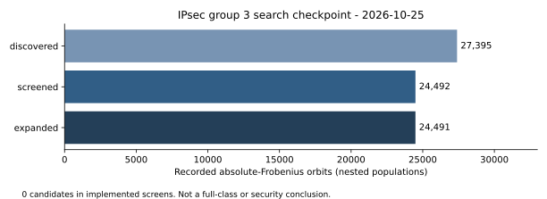

# IPsec group 3 GHS search evidence

This study archives the Python investigation completed outside this repository
on 2026-10-23 through 2026-10-25. The saved checkpoint reports **24,492
Frobenius orbits screened and zero low-genus candidates in the implemented
tests**. The entire isogeny class has not been enumerated. This archive does
not establish resistance to arbitrary Weil descent or a discrete-log attack.

The executable Python sources are **historical snapshots**, preserved under
the historical-evidence exception in `AGENTS.md`. They are not a new supported
research execution path. No new research computation was run for this import.
Native continuation of the checkpointed degree-3/17/31 search remains open.

## Question and exact input

The requested search targets the whole base-field isogeny class of RFC 2409
Oakley group 3, using low-genus GHS screens to find candidate representatives.
The working field and model are

```
K = F2[z]/(z^155 + z^62 + 1)
E: y^2 + x*y = x^3 + b, a=0, b=0x7338f
N = 45671926166590716193865565914344635196769237316
r = 3805993847215893016155463826195386266397436443
N = 12*r
```

The intended subgroup is the order-r subgroup of the RFC model. This search
does not select a generator or produce cross-repository EC1/ICV1 map-route
records. Modular j-correspondences must not be read as certified subgroup
transport. The historical degree-three maps have separate identity and
sample-point checks; degrees 17 and 31 have modular-root witnesses only.

## Recorded findings

| Quantity | Recorded result | Evidence and scope |
| --- | ---: | --- |
| Seed direct GHS to F32 | m=26; genus 33,554,432 | `historical_python/results.json` |
| JMS comparison curve direct GHS to F32 | m=6; genus 31 | Same file; comparison curve, not the IPsec class |
| Seed Hess two-factor necessary genus bound over F32 | 992 | `historical_python/bound_certificate.json`; 46 lower support pairs excluded |
| Search checkpoint, 2026-10-25 | 24,492 screened orbits | `historical_python/search_snapshot.json`; no live database in this archive |
| Low-genus candidates in implemented screens | 0 | Same checkpoint; not a nonexistence theorem |
| Class-size lower bound | 74,173,379,224,089,213,153,040 | Exact quadratic-form subgroup certificate |

The Hess value is a necessary bound within a specified construction, not an
actual genus-992 descent. The subgroup certificate is an unconditional lower
bound. Equality with the PARI class number, and whole-class coverage by the
selected generator set, rely on GRH-dependent class-group completeness.

The earlier degree-3/7 search preserves quadratic genus characters and does
not reach the whole class. The later worker uses degrees 3,17,31 and
canonicalizes all 155 absolute-Frobenius conjugates. It records direct GHS
ranks for all proper subfields and the Hess necessary bound over F32.
Screens are invariant on the conjugacy orbit; they are not 155 independent
tests. See the historical source for exact candidate thresholds.



The figure displays counts copied from the checkpoint, with no sampling
interval or attack-cost interpretation. A necessary genus bound is a filter,
not a constructed descent. [PDF report](reports/REPORT.pdf).

## Evidence and verification status

`historical_python/` retains the prepared source, compact JSON outputs,
modular-polynomial inputs, exact GP certificate, and verification receipts.
`evidence-manifest.json` binds every historical file by byte count and SHA256.
The operational SQLite database, worker log, downloaded papers, and extracted
PARI binary are not included. The aggregate search count is therefore a
checkpoint observation; individual records from all 24,492 orbits cannot be
independently replayed from this archive alone.

Historical verification receipts report field checks, the independent
binary product-span exclusion, degree-three identities and point samples,
SIGKILL recovery, deterministic resume comparison, file-lock exclusion,
18 modular-edge witnesses, and the exact GP subgroup certificate. These
receipts are not an independent replay of the entire long-running search.
No Lean formalization or `identity.certificate/v1` promotion is claimed.
The general class-group torsor implication is a literature theorem; the
GP calculation is an arithmetic certificate, not a Lean proof of it.

## Native continuation and prior work

The repository already has native direct-GHS arithmetic and a bounded
census. Start with
[the existing Oakley study](../ghs_oakley_extended_20261023/REPORT.md),
`src/bin/ghs_screen.rs`, `examples/ghs_oakley_isogeny_census.rs`, and
`src/cryptanalysis/binary_velu.rs`. Reuse those implementations when replacing
the historical degree-3/17/31 persistent worker. Its native replacement and
independent replay have not been completed by this archival PR.

The previous Oakley report agrees on the seed's large direct descent to F32,
the n=5 tower's genus 16, and the absence of a security conclusion. This
archive adds historical support-screen and class-group evidence; it does
not supersede that study's native measurements or extend its cost claims.

Sources reviewed during the original investigation and repository import:

- [RFC 2409, section 6.3](https://www.rfc-editor.org/rfc/rfc2409.html#section-6.3): exact field, model and order.
- [Jacobson, Menezes and Stein (2001)](https://www.math.uwaterloo.ca/~ajmeneze/publications/124.pdf): classical GHS parameters and comparison example.
- [Hess (2004)](https://doi.org/10.1112/S146115700000108X): generalized two-factor construction; only its specified support relaxation is tested.
- [Achter and Howe (2017), section 4](https://msp.org/ant/2017/11-1/ant-v11-n1-p.pdf): ordinary isogeny-class torsors.
- [PARI 2.15 manual](https://pari.math.u-bordeaux.fr/pub/pari/manuals/2.15.5/users.pdf): exact form operations and conditional class-number completeness.
- [Sutherland modular-polynomial data](https://math.mit.edu/~drew/ClassicalModPolys.html): bundled input data. Attribution: Broeker, Lauter and Sutherland, *Modular polynomials via isogeny volcanoes*, Mathematics of Computation 81 (2012), 1201–1231.

## Requirement status and workflow limits

| Requirement | Status | Remaining gap |
| --- | --- | --- |
| Preserve completed work in a reviewable PR | Implemented | GitHub review and applicable checks |
| Search the entire class | Partial | Only the recorded bounded population has been screened |
| Find a low-genus representative | Not established | Zero candidates in the implemented screens |
| Resume natively in this repository | Open | Replace persistent worker using native arithmetic and storage |
| Independent whole-search replay | Open | Full operational database and a separate native replay are absent |
| Formal proof of general exclusions | Open | No universal exclusion or Lean proof is claimed |

The diagram and PDF are an archival rendering of recorded values, not a
new experiment or benchmark. No IC/rho ratio, phase cost, new exponent,
scalar-recovery result, or best-of result is promoted. Accordingly the
existing Oakley diagram, `docs/index-calculus-scoreboard.html`,
`docs/ic/progress-timeline.json` and `docs/ic-leaderboard.html` are left
unchanged; none of their compared costs is revised. A progress-metrics entry
tracks the imported checkpoint population, explicitly as historical data.

Conductor could not be used in this execution environment: the command is
not installed and `.conductor/WORKFLOW.md` returned HTTP 404 at the inspected
base commit. Cargo and Lean are also unavailable here. No new cryptographic
tests, full Rust-library build, EKS job, S3 checkpoint, or proof build was
claimed for this import. Native continuation must satisfy those execution
and replay requirements before its results are promoted.
