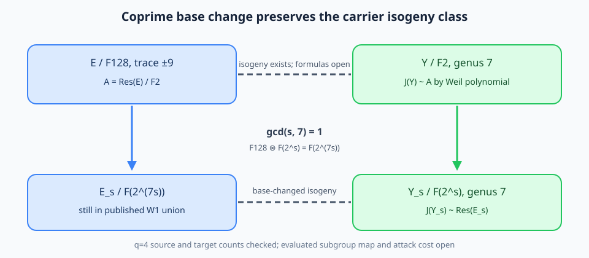

# Coprime base-change carrier line from the ±9 W1 witnesses

15 November 2026. [Theorem and proof](THEOREM.md), [frozen protocol and amendment](PROTOCOL.md), [q4 target raw output](reports/run-20261115T0918Z/result.txt), [q4 source/W1 raw output](reports/run-20261115T0918Z/source.txt), and [run receipt](reports/run-20261115T0918Z/RUN.md). The geometric claim is awaiting independent PCC review. [pcc:unverified]

## Result and novelty boundary

The earlier [q2 census](../ghs_n7_prym_trace_20261115/HYPERELLIPTIC_CLASSIFICATION.md) found a genus-seven hyperelliptic curve Y/F2 whose Jacobian has the same Weil polynomial as the restriction of scalars of a nonclassical W1 elliptic curve E/F128 with trace ±9. For each positive s coprime to seven, base-change E to F_(2^(7s)) and Y to F_(2^s). Finite-field linear disjointness and base change of Weil restriction imply `J(Y_s) ~ Res(E_s)` over F_(2^s). The original W1 cubic-kernel presentation persists, possibly swapping the two cubic arms. This constructs an **infinite isogeny-class carrier line inside the published W1 family**. It does not construct a new GHS transfer map or establish a lower-cost DLP method.

{width=85%}

The source pair is `E_-(a,b)=(1,8)` with t=-9 and `E_+(a,b)=(0,8)` with t=9 over `F2[z]/(z⁷+z+1)`. The target pair is `Y_-(v,u)=(0x8f,0xc07a)` and `Y_+(v,u)=(0x8f,0x802f)` over F2, where bit i is the coefficient of x^i in `y²+v(x)y=u(x)`. These are exact curves. A fixed F2-isogeny exists by Tate because the Weil polynomials match; its degree and rational formulas have not been found. For every prime ℓ outside that fixed degree, its base change injects the ℓ-primary source group into the target Jacobian mathematically, but there is no executable subgroup map in this study.

## q=4 independent check

At s=2, the trace recurrence from t_1=±9 and q2 extension size 128 gives `t_2=t_1²−256=−175`. Both source twists therefore have predicted order `4⁷+1−t_2=16560`. The new native source code independently embedded F128 into `F2[z]/(0x4021)`, found `w=0xd2e` satisfying `w⁷+w+1=0`, mapped b=8 to `w³=0x1dee`, and counted **16,560** points on each E. It found a W1 presentation with old and new cubic arm 2: `r=0x2549`, `v=0xd30` in the q4 field.

| m | Target extension | Predicted and measured N_m for both Y twists | Check |
|---:|:---|---:|:---|
| 1 | F4 | 5 | direct `(x,y)` and trace |
| 2 | F16 | 17 | direct `(x,y)` and trace |
| 3 | F64 | 65 | direct `(x,y)` and trace |
| 4 | F256 | 257 | direct `(x,y)` and trace |
| 5 | F1024 | 1025 | direct `(x,y)` and trace |
| 6 | F4096 | 4097 | direct `(x,y)` and trace |
| 7 | F16384 | 17610 | Artin–Schreier trace |

The seven counts determine the full genus-seven Weil polynomial `1+175T⁷+4⁷T¹⁴`, which matches the source restriction-of-scalars polynomial. This replay checks one nontrivial tower instance; the all-s statement follows from the algebraic argument in `THEOREM.md`.

## Prior work and proof status

The W1 source family is in [Menezes–Teske, Section 5.2](https://cacr.uwaterloo.ca/techreports/2004/corr2004-25.pdf). The hyperelliptic enumeration method is in [Borodin–May, Section 4](https://arxiv.org/pdf/2508.16886). An earlier internal `research/ic_next10_20261014/10-torelli-toy/README.md` already produced the ±13 genus-seven carriers; its explicit `v=0xb9,u=0x8051` is the +13 class in the new q2 census. That is a rediscovery. The predecessor did not report a ±9 W1 carrier, though its all-model search may have traversed its equations. Base change of Weil restriction is standard. Novelty is limited to identifying this ±9 W1 carrier line in the present audit, subject to wider source and data review. [pcc:unverified]

| Claim | Evidence | Status |
|:---|:---|:---|
| q2 ±9 target class | q2 finite census and separate direct replay | local computational result, geometric reduction pending review |
| q4 source, target, W1 membership | two native q4 programs and raw records above | measured finite arithmetic, local replay |
| trace recurrence and q4 predicted count | `CoprimeBaseChangeTrace.lean` | Lean 4.35.0 proof gate: 3 theorems, 0 trusted |
| all-s isogeny-class carrier | finite-field tensor product and Weil-restriction/Jacobian base-change proof | paper-level; not formalized in Lean |
| explicit isogeny, subgroup evaluation, complete GHS vs rho cost | none | open |

The q2 group orders are 138 and 120; their q4 base changes both have order 16,560. These first two rungs are geometry and membership controls. Any security claim at larger s would require a large chosen source subgroup, an explicit nonzero map, full target recovery, and a matched total-cost benchmark against rho. The source family remains W1, and a Jacobian in the same isogeny class need not be the endpoint of the published GHS cover map.
