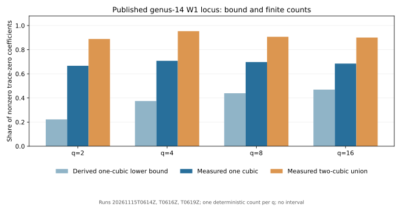

# Degree-seven generalized GHS: projective membership study

14 November 2026. Status: **[pcc:unverified] producer result**. Source branch
`codex/ghs-n7-membership-20261114`, initial frozen commit `eacae612c8f8`.
This study tests membership in the *published* genus-14 W1 locus, not a
new curve family or a full ECDLP attack. The decisive prior source is
[Menezes--Teske, §5.2](https://cacr.uwaterloo.ca/techreports/2004/corr2004-25.pdf).
They define W1 and report that they did not have a decomposition test below
q^2.5 per candidate. Their estimate `#W1 ≈ q^6` is heuristic. The later
[Weil-descent product analysis](https://math.dartmouth.edu/~carlp/WeilDescent-Product.pdf)
changes attack comparisons, so a faster membership test alone cannot show
an end-to-end advantage.

## Exact domain and method

Let `k=F_q`, `K=F_(q^7)`, `q=2^ell`, and `sigma(x)=x^q`. For either cubic
`p=T^3+T+1` or `p=T^3+T^2+1`, let `V=ker p(sigma)`. W1 consists of curves
`E: y^2+xy=x^3+a*x^2+b`, with absolute trace of `a` equal to one and
`sqrt(b)=gamma1*gamma2`, where `gamma1` has exact sigma order `p` and
`gamma2` has exact order `p(T)(T+1)`.

The candidate test computes a basis of V over k by binary Gaussian
elimination, enumerates its `q^2+q+1` projective representatives, and for
each representative `r` checks `gamma2=sqrt(b)/r`. The exact second-order
test checks nonzero relative trace, exclusion from k, and
`p(sigma)(sigma+1)gamma2=0`. A successful quotient supplies an explicit
decomposition. The per-candidate bound is at most `q^2+q+1` quotient tests
after polynomial-time basis setup. It is a mathematical operation bound;
it is **not** a measured attack cost. The scaling step is checked in
[`ProjectiveMembership.lean`](ProjectiveMembership.lean); its hypotheses
must be discharged for the concrete field. Kernel dimension, projective
line count, trace prefilter, and GHS geometry remain outside that Lean file.

The relative-trace prefilter rejects a candidate when
`Tr_(K/k)(sqrt(b)) != 0`. It passed every direct finite member below. There
is also a short algebraic derivation. Write `p*=T^3+T^2+1` when
`p=T^3+T+1`, and reverse the roles for the other cubic. For the first
cubic, `(T+1)p*+T p=1` in `F2[T]`. Hence any `y` in `V=ker p(sigma)` is
`p*(sigma)(sigma+1)y`. The trace pairing
`B(x,y)=Tr_(K/k)(xy)` satisfies
`B(x,p*(sigma)u)=B(p*(sigma^-1)x,u)`; because
`p*(sigma^-1)=sigma^-3 p(sigma)`, this is zero for `x in V`.
For the other cubic, the same identity is `T p*+(T+1)p=1`, so the
argument again puts `y` in the image of `p*(sigma)`.
Also `Tr_(K/k)(x)=0` for `x in V`, since `p(1)=1`. Thus if
`gamma2=w+c` with `w in V` and `c in k*`, both
`Tr(gamma1*w)` and `Tr(c*gamma1)` vanish. Squaring preserves zero trace.
This establishes the prefilter under the stated finite-field identities;
the derivation has not yet received an independent proof check or an
identity certificate and remains **[pcc:unverified]** for repository claims.

## Native finite evidence

All rows are one deterministic run per field and two cubic arms, on a local
arm64 macOS host. They have no statistical interval. The q=2 and q=4
projective sets were exhaustively compared with direct product enumeration;
the q=8 run used direct products only. `W1 union` is the union of both cubic
sets for `sqrt(b)`; squaring permutes K, so it has the same cardinality for
coefficients b. `Trace-zero nonzero` is `q^6-1`.

| q | K modulus | each cubic W1 | W1 union | trace-zero nonzero | complement | arm |
|---:|---:|---:|---:|---:|---:|---|
| 2 | `0x83` | 42 | 56 | 63 | 7 | both |
| 4 | `0x4021` | 2898 | 3906 | 4095 | 189 | both |
| 8 | `0x200005` | 182938 | 237839 | 262143 | 24304 | direct |

The q=2 and q=4 complement values happen to fit
`(q-1)(q^3-1)`. Amendment 2 froze a q=8 falsification test. Its prediction
was 3577, while the measured complement was **24304**. The proposed
formula is false. The figure shows the three observed proportions; its
percentages are derived from the exact counts in the table.

Raw records: [original q=2,4 control](reports/run-20261115T0542Z/),
[Gaussian setup q=2,4](reports/run-20261115T0547Z/), and
[q=8 falsifier](reports/run-20261115T0551Z/). The q=8 binary used
`src/main.rs` SHA-256 `7dcf817b3b87a78de36693f6121529e4b4a5aca9149314a20f20d799b94deb01`
and executable SHA-256
`c1986b7006ea3daa9b6bd04d5f468ef64841dfa66ed52fb25939d7fcfc416f7d`.
The q=8 direct run took 26.57 seconds wall and 4.88 seconds user time as
reported by `/usr/bin/time -l`; this was not a per-candidate benchmark.
All commands were gated by an S3 checkpoint before their run. The q=8
pre-run checkpoint is `20261115T055032Z-eacae612c8f8`.

## Exact finite source curves and novelty boundary

The q=2 field is `F2[w]/(w^7+w+1)`; the checked example has `a=1`, `b=w^2`,
group order 130. The q=4 field is
`F2[w]/(w^14+w^5+1)`; examples have `a=w^9`, `b=w^4+w^2`
with order 16514 and `a=w^9`, `b=w^2+1` with order 16298. Coefficient
masks are respectively `(1,4)`, `(512,20)`, `(512,5)` in the native
polynomial basis. Their W1 decompositions are checked by the direct and
projective membership program. A point-level subgroup map and complete
GHS transfer have not been implemented for these examples. There is no
same-subgroup GHS-versus-rho total-cost result.

These equations are **examples in an existing family**. The projective
membership approach may be a new *method* relative to the cited 2004 gap,
but the prior-work screen is incomplete and we make no priority claim.
The tested data give no new eligible family and no demonstrated new
vulnerability. Future promotion requires: an independent membership
implementation, formal discharge of the Lean hypotheses and trace lemma,
prior-work review beyond the screened sources, a nonzero subgroup map,
complete transfer/decomposition/linear algebra/target recovery, and a
matched rho cost for the same source subgroup.

## Proof map and bounds

The projective normalization has three forms `(1,u,v)`, `(0,1,u)`,
`(0,0,1)` over k, hence `q^2+q+1` trials **assuming** `dim_k V=3`.
Irreducibility of p and the normal-basis decomposition of `K/k` imply that
dimension, but that field-theoretic bridge is not in the Lean proof. The
Lean theorem checks the exact scaling equivalence under explicit coverage
and second-factor stability hypotheses. The Rust program checks the
dimension, line count, and exact membership equality at q=2,4; at q=8 it
checks the direct count and the trace-zero containment. The only general
count bounds presently justified from the construction are the coarse
`(q^3-1)(q-1) <= #W1 <= q^6-1` for each cubic, and the upper bound
`#(W1 union) <= q^6-1`, using the trace-zero derivation above. The lower
bound uses a fixed nonzero gamma1: all `(q^3-1)(q-1)` choices of gamma2
are distinct. The q=8 counterexample forbids promoting a sharper count
from q=2,4 interpolation.

Canonical graphs checked: no GHS-specific canonical density graph is
present in this sparse branch. The existing IC leaderboard is unrelated
to this membership-only result and was not changed.
