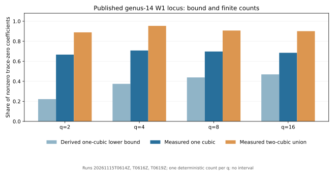

# A uniform incidence bound for the published degree-seven W1 locus

15 November 2026 UTC. Scope: a mathematical count of coefficient eligibility,
not a new GHS family or a full attack-cost bound. The W1 locus and genus-14
transfer are from [Menezes--Teske, §5.2](https://cacr.uwaterloo.ca/techreports/2004/corr2004-25.pdf),
which estimates its size heuristically. The root-space Sidon property is
**prior work**: [Roth--Raviv--Tamo, Lemma 25](https://arxiv.org/pdf/1705.04560)
states it for `X^(q^k)+X^q+X`, attributing the construction to
[Ben-Sasson--Etzion--Gabizon--Raviv](https://arxiv.org/pdf/1404.7739).
The reciprocal cubic case follows by applying their theorem over
`F_(q^3)` inside `F_(q^21)` and intersecting with `F_(q^7)`; factor
scalings then lie in `F_(q^3)∩F_(q^7)=F_q`. The W1 incidence application
below was not located in the screened papers; its publication priority
remains open.

## The two kernel spaces are Sidon

Let `k=F_q`, `K=F_(q^7)`, `q=2^ell`, and `sigma(x)=x^q`. For
`p_1(T)=T^3+T+1` or `p_2(T)=T^3+T^2+1`, put `V_p=ker p(sigma)`.
The normal basis theorem and `p_i | (T^7-1)` give `dim_k V_p=3`.
Since `p_i(1)=1`, `V_p ∩ k=0`. We claim that for every `t∈K\k`,

    dim_k(V_p ∩ t V_p) ≤ 1.                         (1)

For `p_1`, suppose `x,y∈V_p` and `tx,ty∈V_p`. The two kernel equations
give, for `u=x,y`,

    (t^(q^3)+t)u + (t^(q^3)+t^q)u^q = 0.            (2)

If `x,y` are independent over `k`, the determinant
`x*y^q-y*x^q` is nonzero: equality would make `x/y` fixed by `sigma`.
Equation (2) then forces `t^(q^3)=t=t^q`, hence `t∈k`, a contradiction.
For `p_2`, replace `u^q` by `u^(q^2)` and `t^q` by `t^(q^2)`.
The determinant is nonzero because the fixed field of `sigma^2` is `k`
(`gcd(2,7)=1`), and the same conclusion follows. This establishes (1).
The two algebraic elimination steps are formalized in
[`SidonKernel.lean`](SidonKernel.lean). Its finite-field fixed-field and
dimension bridges, and the trace-pairing step below, are paper proofs at
present, not Lean theorems.
The repository's `identity.certificate/v1` checker evaluates polynomial
equalities over `2^61-1`; it does not certify this characteristic-two
Frobenius and subspace argument. No IDC1 certificate is claimed for it.

## Exact one-cubic W0 product count

The Sidon property makes a nonzero product `uv` with `u,v∈V_p` unique
up to exchanging the two projective lines and rescaling the factors by
inverse elements of `k*`. There are `m=q^2+q+1` projective lines, and
each unordered pair of lines yields `q-1` distinct products. Thus

    |V_p* V_p*| = (q-1)m(m+1)/2
                = (q^3-1)(q^2+q+2)/2.             (3)

Menezes--Teske §5.1.2 gave (3) as a heuristic count and reported finite
checks at degrees 7, 14 and 21. Equation (3) follows directly from the
published Sidon theorem by counting unordered projective pairs; it is not
claimed as a new Sidon theorem or a new attack against W0 curves.

The determinant argument extends as a search filter. If `p(T)=T^d+T^s+1`
divides `T^n-1` over `F_2`, `gcd(s,n)=1`, and `V=ker p(sigma)` in
`F_(q^n)`, then `dim_k V=d` by a normal basis and
`dim_k(V∩tV)≤1` for `t∉k`: replace `q^3,q` in (2) by `q^d,q^s`.
For example `T^4+T+1` divides `T^15-1`, so its four-dimensional kernel
has this property. The `s=1` construction is in the cited Sidon
literature. This is a **structural coefficient-space family**;
the [Maurer--Menezes--Teske 2002 analysis](https://www.cambridge.org/core/services/aop-cambridge-core/content/view/D4B264D082FF67354EE9968D9803102A/S1461157000000723a.pdf/analysis_of_the_ghs_weil_descent_attack_on_the_ecdlp_over_characteristic_two_finite_fields_of_composite_degree.pdf)
already treats degree 15 and magic number 5. It is a rediscovery as a GHS
candidate, and the degree-seven W1 incidence bound below does not carry
over without a new trace-geometry argument.

## Rigorous W1 bounds

Write `H=k⊕V_p`. Its dimension is four. The trace pairing
`B(u,v)=Tr_(K/k)(uv)` is nondegenerate. The reciprocal-polynomial Bezout
identity `(T+1)p_2+T p_1=1` (and its exchanged version) gives
`V_p⊂(V_p)^perp`; also `Tr_(K/k)(V_p)=0`. Hence `H^perp=V_p` by dimensions.
For distinct lines represented by `r,s∈V_p*`,

    (rH)^perp = r^(-1)V_p,
    dim_k(rH∩sH)=2.                              (4)

Indeed the two orthogonal complements intersect in exactly `k`, by (1),
and the dimension formula gives (4).

For each projective representative `r`, let

    S_r = {r(w+c) : w∈V_p*, c∈k*}.

The exact W1 square-root coefficient locus for this cubic is
`W1_p=union_r S_r`; `w+c` has exact order `p(T)(T+1)`.
Each `S_r` has `(q^3-1)(q-1)` elements. Therefore, writing `t_z` for
the number of sets containing `z`,

    M = sum_z t_z = (q^3-1)^2,
    sum_z t_z^2 = M + 2 sum_{r<s}|S_r∩S_s|
                 ≤ M + m(m-1)(q^2-1) = D.         (5)

The inequality uses (4), since each pairwise intersection contains at most
`q^2-1` nonzero field elements. Cauchy--Schwarz now gives

    ceil(M^2/D) ≤ |W1_p| ≤ q^6-1.                 (6)

The upper bound follows from `W1_p⊂ker Tr_(K/k)\{0}`.
For the union of both cubic arms, (6) remains a lower bound and the same
`q^6-1` upper bound holds. The lower bound is asymptotic to `q^6/2`,
establishing the published `q^6` order of growth without a distribution
assumption. These are bounds on equation eligibility; isogeny-class
reachability and total GHS cost require separate evidence.

| q | rigorous lower `ceil(M²/D)` | measured one-cubic count | measured union |
|---:|---:|---:|---:|
| 2 | 14 | 42 | 56 |
| 4 | 1535 | 2898 | 3906 |
| 8 | 115128 | 182938 | 237839 |
| 16 | 7875807 | 11490570 | 15110970 |

The exact one-cubic expression
`(q^3-1)(2q^3+q^2-2q+2)/3` fits all four measured sizes but is only an
interpolation. The q=8 and q=16 complements falsify the earlier proposed
simple complement formula. Neither expression is promoted to a theorem.

## Verification and limits

The native all-pairs rank census in
[`run-20261115T0619Z`](reports/run-20261115T0619Z/) found dimension two
for every pair in both arms at q=2,4,8,16. The incidence census
[`run-20261115T0614Z`](reports/run-20261115T0614Z/) and q=16 bitset census
[`run-20261115T0616Z`](reports/run-20261115T0616Z/) reproduce the counts
above. They are checks of finite instances, not a substitute for (1)--(6).
The prior-work screen covered the primary GHS paper and two Sidon-space
papers, plus focused index searches; broader novelty review remains open.

The genus-14 W1 curves remain a **known eligible family**. A new exact
equation in this locus would be a new instance only. The W1 incidence
bound may be a new application of published Sidon theory, subject to a
full prior-work review.
No new vulnerable family or same-subgroup GHS-versus-rho advantage follows
from it.
