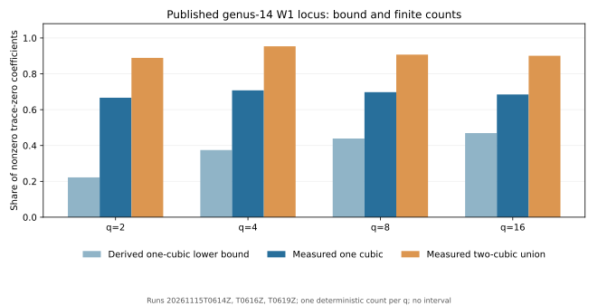

# Run 20261115T0614Z: projective incidence census

One deterministic native Rust census per `q=2,4,8` and cubic arm on
Darwin arm64 `Mac.attlocal.net`; there is no statistical interval. Frozen
specification: [`AMENDMENT_3.md`](../../AMENDMENT_3.md). The command was
`cargo test --release` followed by `cargo run --release -- --incidence`.
Both tests passed. An S3 checkpoint gate preceded the run; its checkpoint
identifier was not copied into this run directory.

For each projective representative `r`, the run formed
`S_r={r(w+c):w∈V*,c∈k*}`. It recorded the exact union, first incidence
moment `M=Σt_z`, second moment `E=Σt_z²`, and multiplicity histogram.

| q | one-cubic union | `M` | `E` | Cauchy lower from measured `E` | two-cubic union |
|---:|---:|---:|---:|---:|---:|
| 2 | 42 | 49 | 63 | 39 | 56 |
| 4 | 2898 | 3969 | 6615 | 2382 | 3906 |
| 8 | 182938 | 261121 | 482895 | 141199 | 237839 |

Both cubic arms had the same one-cubic values; their complete histograms
and the two-cubic moments are in [`result.txt`](result.txt). Union counts
match the earlier direct enumeration. The graph shows these one-cubic
counts and the proved bound as shares of the nonzero trace-zero population.

Source SHA-256 at execution:
`2008479371af548a070041be49a0113946f2e2ee07e5320139bc232b64669c5e`.
Executable SHA-256:
`28616d5ac7c8ee06b503bfac10ae7caf78aa8acec1d9941f0e91d7e9ab408c37`.
`/usr/bin/time -l` recorded 4.83 seconds wall, 0.29 seconds user,
0.02 seconds system, and 10,698,752 bytes maximum resident size for the
native run. These are aggregate run timings, not per-candidate attack costs.
Raw files: [`result.txt`](result.txt), [`timing.txt`](timing.txt), and
[`cargo-test.log`](cargo-test.log). The coefficient-count interpretation
and proof are in [`SIDON_BOUND.md`](../../SIDON_BOUND.md).
