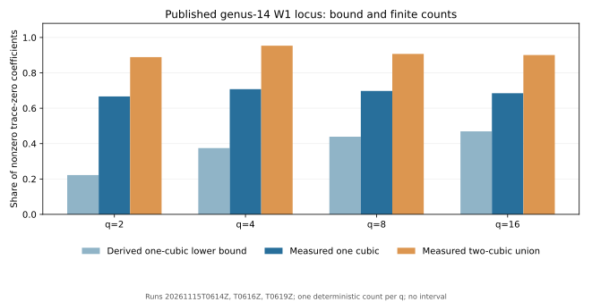

# Run 20261115T0616Z: q=16 product-union census

One deterministic native Rust bitset census over
`F2[w]/(w^28+w+1)`, with `q=16`, on Darwin arm64 `Mac.attlocal.net`.
Frozen specification: [`AMENDMENT_4.md`](../../AMENDMENT_4.md).
`cargo test --release` passed 2/2; then
`cargo run --release -- --q16-products` completed. No statistical
interval applies. An S3 checkpoint gate preceded the run; its checkpoint
identifier was not copied into this run directory.

Each cubic yielded **11,490,570** square-root coefficients. Their union
had **15,110,970**, their overlap **7,870,170**, and the nonzero
trace-zero population was **16,777,215**. The complement was
**1,666,245**. The frozen nonsplit prediction **61,425** failed. All
counts are exact for this field representation and run; the complement
formula is not a general theorem.

Source SHA-256 at execution:
`0e5a758c1aa3c859ec10ce96867833c1f2d6df57a38f4ab4ccc1a5cad32b84ab`.
Executable SHA-256:
`5bd882f5894323525e6d507dae9b6c9f468e4be322e34f93c406f3bcef1664add1`.
`/usr/bin/time -l` recorded 14.19 seconds wall, 1.57 seconds user,
0.07 seconds system, and 68,665,344 bytes maximum resident size.
These are aggregate census timings. Raw files:
[`result.txt`](result.txt), [`timing.txt`](timing.txt), and
[`cargo-test.log`](cargo-test.log). The proof and interpretation are in
[`SIDON_BOUND.md`](../../SIDON_BOUND.md).
