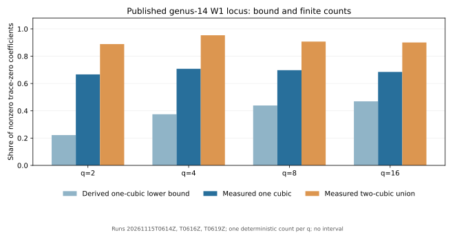

# Run 20261115T0619Z: pairwise projective-subspace ranks

One deterministic native Rust all-pairs rank census per `q=2,4,8,16`
and cubic arm on Darwin arm64 `Mac.attlocal.net`. Frozen specification:
[`AMENDMENT_5.md`](../../AMENDMENT_5.md). `cargo test --release`
passed 2/2; then `cargo run --release -- --rank-pairs` completed. The
pre-run S3 checkpoint was `20261115T061910Z-7c3612375b78`.
There is no statistical interval.

| q | projective representatives | pairs per cubic | intersection dimension 2 | exceptions |
|---:|---:|---:|---:|---:|
| 2 | 7 | 21 | 21 | 0 |
| 4 | 21 | 210 | 210 | 0 |
| 8 | 73 | 2628 | 2628 | 0 |
| 16 | 273 | 37128 | 37128 | 0 |

Both cubic arms had the same row values. The computation used binary
Gaussian rank and checked divisibility by `ell` before converting to
`k`-dimension. This is finite evidence for the all-`q` Sidon argument in
[`SIDON_BOUND.md`](../../SIDON_BOUND.md); the theorem uses an independent
Frobenius proof.

Source SHA-256 at execution:
`89864a32382e49d3425fd543853d09a83e64d2c97c4a42682fb1becdb5ac5716`.
Executable SHA-256:
`17c86a4de8317f8c16800dbec93293ecb035b3b8d37631c9c5a3e319515e63eb`.
`/usr/bin/time -l` recorded 2.33 seconds wall, 0.06 seconds user,
0.01 seconds system, and 2,342,912 bytes maximum resident size.
Raw files: [`result.txt`](result.txt), [`timing.txt`](timing.txt), and
[`cargo-test.log`](cargo-test.log). Aggregate run timing does not price
a GHS attack.
