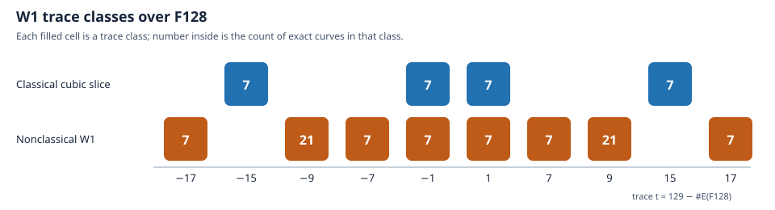
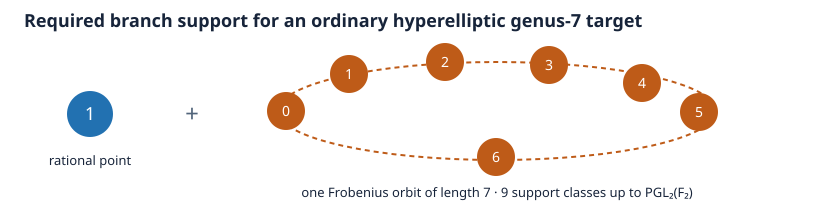

# n=7 GHS Prym trace-class screen

15 November 2026. Source and protocol: [PROTOCOL.md](PROTOCOL.md), [THEOREM.md](THEOREM.md), and the new [complete hyperelliptic classification](HYPERELLIPTIC_CLASSIFICATION.md). Raw results: [successful CSV](reports/run-20261115T0821Z/curves.csv), [summary](reports/run-20261115T0821Z/summary.txt), [hyperelliptic census](reports/hyp-census-20261115T0855Z-result.txt), and [independent replay](reports/hyp-replay-20261115T0853Z/result.txt). Earlier stopped runs and amendments are preserved. All derived and measured statements in this report await an independent PCC verdict. [pcc:unverified]

## What the bound says

For ordinary E over F128 with trace other than ±13, its seven-dimensional Weil restriction is simple. Every nonzero algebraic map from that variety into a Jacobian needs target genus at least seven, by [Diem's Theorem 3](https://www.esaga.uni-due.de/f/ulrich.goertz/iem-archiv/dissertation_diem.pdf). This applies to cover correspondences and excludes a genus-six algebraic target for these source curves. It is a lower bound on target dimension, not on attack cost.

Hess's [Theorems 14–15 and Section 8.3](https://www.cambridge.org/core/services/aop-cambridge-core/content/view/315278965D8D277A85812D9498236A88/S146115700000108Xa.pdf/generalising-the-ghs-attack-on-the-elliptic-curve-discrete-logarithm-problem.pdf) put the source factor in the complementary seven-dimensional Prym of the genus-fourteen W1 cover; the norm through its natural genus-seven deck quotient is zero. [Achter–Casalaina-Martin's Theorem A](https://www.math.colostate.edu/~achter/math/prym1224.pdf) supplies the characteristic-two principal polarization for the ramification type, subject to confirming this cover's divisor locally. A principally polarized Prym need not be a Jacobian. The broad search for genus-n Jacobians in the Weil-restriction class is already an internal prior lead (`LEAD-TRF-weil-restriction-jacobian-class`).

## Exact q=2 result

The fixed field representation is F2[z]/(z^7+z+1), with E(a,b): `y^2+xy=x^3+a x^2+b`. The census contains 56 coefficients satisfying the W1 coefficient pattern and both a twists, 112 exact curves. Exactly the 56 rows with `a=1` are W1; the `a=0` rows are a paired coefficient control. Fourteen coefficients lie in the classical cubic kernels. The other 42 give six trace classes absent from this classical coefficient slice, plus two shared trace classes. The table lists one exact nonclassical representative for each class.

| trace t | E(a,b) | #E(F128) | degree-7 places if genus-7 Y exists | classical coefficient trace class? |
|---:|:---|---:|---:|:---|
| -17 | (1,26) | 146 | 35 | no |
| -9 | (1,8) | 138 | 27 | no |
| -7 | (0,14) | 136 | 25 | no |
| -1 | (1,28) | 130 | 19 | yes |
| 1 | (0,28) | 128 | 17 | yes |
| 7 | (1,14) | 122 | 11 | no |
| 9 | (0,8) | 120 | 9 | no |
| 17 | (0,26) | 112 | 1 | no |

{width=65%}

The classical coefficient slice across both twists has traces `{-15,-1,1,15}`; its actual W1 rows have traces `{-1,15}`. Every observed trace is ordinary and outside the ±13 exceptional subfield-isogeny traces, so the genus-seven floor applies to all 112 curves. The degree-seven place bound `18-t>=0` is met in every row. The nonclassical coefficient slice is an arithmetic screen across two twist families; W1 status additionally requires absolute `Tr(a)=1`. The equations and subset do not constitute a new vulnerable family; the orders here are small and this run has no attack-cost measurement.

A second native program [replayed all 112 orders](reports/replay-20261115T0833Z/RUN.md) by directly testing every (x,y) pair in the fixed field, with a separate carryless multiplication routine. It matched the CSV orders, traces and place-count values. This is a local algorithmic cross-check; a PCC signed verdict and independent geometric review remain open.

[`TraceExceptions.lean`](TraceExceptions.lean) checks the five q=2 base-trace evaluations in Lean 4.35.0; `#print axioms` reports none. This finite theorem does not cover the geometric transfer or Diem's theorem.

## Hyperelliptic target geometry

The [characteristic-two parity lemmas of Borodin–May](https://arxiv.org/pdf/2508.16886) give a sharper necessary screen: an ordinary genus-seven hyperelliptic Y with this sparse L-polynomial must have exactly one F2-rational branch point and one Frobenius orbit of seven branch points. Up to `PGL_2(F_2)`, there are [nine possible branch supports](BRANCH_SUPPORT_BOUND.md).

The [same proof for any even q](BRANCH_SUPPORT_BOUND.md) gives an exact branch-support count up to `PGL₂(F_q)`: with `S=1+q+q²+q³+q⁴+q⁵`, the count is `S/7` when `7∤(q−1)` and `(S+36)/7` when `7|(q−1)`. For example, it is 9 at q=2, 195 at q=4, and 5355 at q=8. This bounds the shape of a genus-seven hyperelliptic target; it does not count vulnerable elliptic curves. The three sample arithmetic values are checked in the Lean ledger, while the general orbit proof remains paper-level.

The [complete finite census](HYPERELLIPTIC_CLASSIFICATION.md) tested 294,912 normalized equations over those supports. A separate direct `(x,y)` program reproduced every stage count and trace bin. The only genus-seven hyperelliptic Jacobian traces are `±15, ±13, ±9, ±1`, with one F2-isomorphism class per trace in this normalized search. Intersecting with the W1 source traces gives:

Of the 56 actual W1 equations, 42 pass the genus-seven hyperelliptic isogeny-class existence screen (traces `{-9,-1,15}`) and 14 (traces `{-17,7}`) fail it. The separate 56 `a=0` paired controls include 42 passing and 14 failing equations. The +9 passing rows are published W0, and the −9 passing rows are W1. These counts do not certify any subgroup transfer.

The trace-set intersection and witness seventh-count arithmetic were checked in [`HyperellipticTraceLedger.lean`](HyperellipticTraceLedger.lean). The Lean input lists come from the native census; the geometric completeness theorem and Jacobian isogeny application remain paper-level and require independent review. The [proof map and prior-work check](HYPERELLIPTIC_CLASSIFICATION.md) give the exact scope.

| W1 trace class | genus-seven hyperelliptic target with the required Weil polynomial | source status |
|:---|:---|:---|
| `−1`, `+15` | exists | classical or shared W1 coefficient slice |
| `−9` | exists, with explicit equation | W1 isogeny-class geometry lead |
| `−17`, `+7` | excluded by complete F2 hyperelliptic census | W1; other target geometries remain open |

For example, `E(1,8)/F128` has trace −9, and `Y/F2: y²+(x⁷+x³+x²+x+1)y = x¹⁵+x¹⁴+x⁶+x⁵+x⁴+x³+x` has the required genus-seven Weil polynomial; the bit encodings are `v=0x8f, u=0xc07a`. This is an isogeny-class match. An explicit correspondence from this E to J_Y, its subgroup action, and complete attack cost are not yet established. Nonhyperelliptic genus-seven targets remain outside this census.

{width=75%}

## Next discriminating step

The −9 W1 isogeny-class witness is the focused geometry follow-up; the +9 direct route is published W0. [Hess, Section 6](https://www.cambridge.org/core/services/aop-cambridge-core/content/view/315278965D8D277A85812D9498236A88/S146115700000108Xa.pdf/generalising-the-ghs-attack-on-the-elliptic-curve-discrete-logarithm-problem.pdf) gives a general isogeny barrier: W0 curves have group order divisible by four, while W1 curves have group order two modulo four. Thus an isogeny over the same source field cannot turn the −9 W1 curve into a W0 curve; the q2 nonintersection is an instance of this published theorem. For −9, construct an explicit k-rational algebraic correspondence from A to J_Y and evaluate it on a chosen prime-order source subgroup. Also examine nonhyperelliptic genus-seven targets for the excluded hyperelliptic traces. Then run complete relation/decomposition, linear algebra, target recovery and matched rho with setup charged. A point-count match alone does not supply a map or a lower-cost logarithm algorithm.
