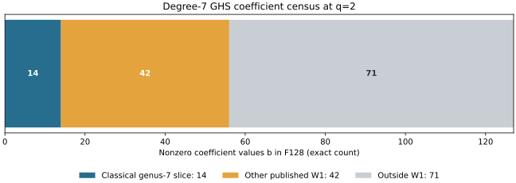

# Degree-seven Prym screen: a classical GHS collision

15 November 2026. **Finding:** The proposed dihedral genus-seven Prym
target is the already known classical GHS target on precisely the
coefficient slice where the construction works. The exact criterion
is `b∈ker(T³+T+1)(sigma)\{0}` or
`b∈ker(T³+T²+1)(sigma)\{0}`, with trace-one twist. It yields
`2(q³−1)` nonzero coefficients over `F_(q⁷)` for `q=2^ell`.
This is a bound on this symmetric construction, not a census of all
GHS-vulnerable curves. See [the derivation](THEOREM.md) and
[protocol amendment](AMENDMENT_1.md).

The q=2 classical slice has 14 coefficients among 127 nonzero b
values. The published W1 locus has 56 by the prior native
[membership study](../ghs_n7_membership_20261114/REPORT.md), so
42 W1 coefficients remain outside this classical slice. The figure
data and layout source are [figure-data.json](figure-data.json)
and [plot_coefficients.py](plot_coefficients.py).
The prior second-moment bound gives at least
`ceil(M²/D)−(q³−1)` nonclassical W1 coefficients **per cubic arm**,
where `M=(q³−1)²` and `D=M+(q²+q+1)(q²+q)(q²−1)`;
this is 1472 at q=4. It bounds structural eligibility only.

The exact positive control is
`K=F2[z]/(z⁷+z+1)`,
`E:y²+xy=x³+x²+z⁴+z²`, `#E(K)=130=2·5·13`.
Its target `X:W²+W=1+1/(s⁸+s⁴+s+1)` has genus seven and
`#J_X(F2)=130`. Translating `s↦s+1` gives the classical GHS
equation `W²+W=1+1/(s⁸+s⁴+s)`. The [formatted-source native run](reports/run-20261115T0725Z/RUN.md)
checks the source order, D4 defining identities and target point
counts through degree seven; its output matches the
[first run](reports/run-20261115T0718Z/RUN.md) byte for byte.
A separate Sage library replay checked
an order-13 subgroup map and recovered scalar seven; its script and
native divisor replay are still missing, so that map receipt is
preliminary. `PrymCollision.lean` checks two abstract algebraic
implications under explicit closure and injectivity hypotheses; it
does not check the curve geometry.

**Prior work:** [Menezes–Teske (2004), Remark 2](https://cacr.uwaterloo.ca/techreports/2004/corr2004-25.pdf)
states the classical specialization and genus formula; §5.2 covers
W1. [Hess (2004)](https://www.cambridge.org/core/services/aop-cambridge-core/content/view/315278965D8D277A85812D9498236A88/S146115700000108Xa.pdf/generalising-the-ghs-attack-on-the-elliptic-curve-discrete-logarithm-problem.pdf)
supplies the general cover and norm-conorm setting. Targeted KB
queries at revision `9141e386254340a9bdba3036f2bb706a`
found adjacent Prym and GHS records but predate this study;
the primary-source collision decides this case.

**Novelty classification:** the exact equation and D4 factorization
are explicit examples; the eligible family and genus-seven target
are known. The full GHS cost and matched rho cost were not measured
in this study. The q16 cost arm was stopped by the predeclared
prior-work falsifier. The next search should require `b` outside
both cubic kernels and a subgroup-preserving cover that escapes
the standard rational-base quotient obstruction.
The separate [hyperellipticity screen](HYPERELLIPTIC_SCREEN.md)
derives a possible obstruction for that natural quotient outside
the classical slice; its function-field and descent steps still
need independent verification.
