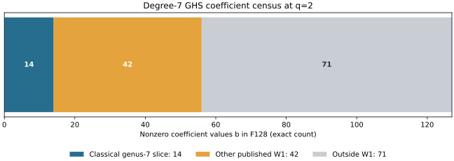

# Native finite calibration — formatted-source replay 20261115T0725Z

**Protocol:** `../../PROTOCOL.md`, corrected by `../../AMENDMENT_1.md`
and `../../AMENDMENT_2.md`.
**Workload:** `K=F2[z]/(z^7+z+1)`, `E:y²+xy=x³+x²+0x14`,
`X:W²+W=1+1/(s⁸+s⁴+s+1)`. One release run of
`cargo run --release --manifest-path research/ghs_n7_prym_transfer_20261115/Cargo.toml`;
one requested and one completed, no seed or timeout. Host
`Mac.attlocal.net`, Darwin arm64, local unisolated execution.
Git commit before run `5d414672f962fa41da00cc8f4b7f0c11538d3092`;
source SHA-256 `993eb5e85793ee3e222dfcb18cc207937340430dd4f1e958ee439b7b2d149a93`.
S3 checkpoint `20261115T072438Z-5d414672f962` was pushed and its gate
passed immediately before this captured run.

**Raw records:** [result.txt](result.txt) and [timing.txt](timing.txt).
The native process asserted exact finite-field operations and completed
with exit code 0. It counted `#E(F128)=130`, 16 split `(s,x)` pairs in
F128 for the D4 closure check, and the following target points:

| m | 1 | 2 | 3 | 4 | 5 | 6 | 7 |
|---|---:|---:|---:|---:|---:|---:|---:|
| #X(F2^m), measured exact | 3 | 5 | 9 | 17 | 33 | 65 | 136 |

Derived from these counts and the genus-seven functional equation:
`L_X(T)=1+T^7+128 T^14`, `#J_X(F2)=130`. `cmp` found this run's
`result.txt` byte-identical to run `20261115T0718Z`. The invocation
had 1.30 s elapsed including Cargo compilation, 0.01 s child user CPU
and 0.03 s child system CPU; these are execution-record values, not
an attack benchmark. The
run did not execute divisor arithmetic or index calculus.

The graph partitions the 127 nonzero F128 coefficients into the
14-value classical cubic slice, 42 other W1 coefficients and 71
outside W1. The W1 union of 56 comes from the earlier native
membership run in `../../../ghs_n7_membership_20261114/REPORT.md`;
the classical slice count is the exact algebraic formula at q=2.
