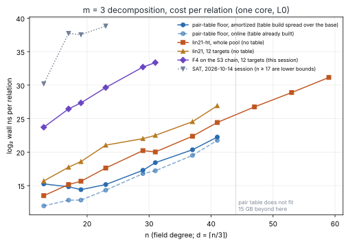
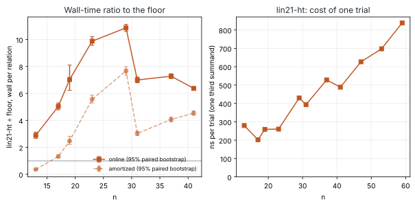
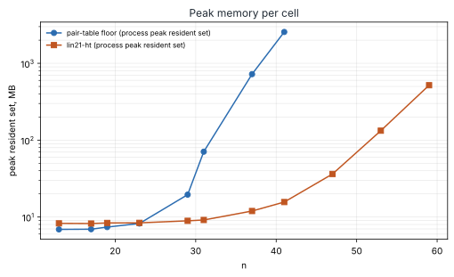

# Gröbner-free relation finding: what is on file, and a table-free linear `2 + 1` arm on the frozen m = 3 cells

**Result.** On the six cells and the same targets as the 2026-10-14 matched
study, plus five larger cells, a three-summand decision that uses neither a
Gröbner basis nor a pair table (`lin21-ht`) gives the pair-table floor's
verdict on all 16,384 pool targets where the floor runs. It scans the same
number of third summands (slope difference in counted work
0.0006, 95% [−0.0004, 0.0016] per bit), costs 2.9 to 10.9 times the floor's
online wall time per relation, and peaks at 16 MB at n = 41 where the floor's
process peaks at 2,558 MB. It runs to n = 59, where the pair table would hold
5.5·10¹¹ entries. Against F4 on the S₃ chain in the same session it is 375
times cheaper per relation at n = 13 and 8,500 times at n = 31.

It does not grow more slowly than the floor, and by construction cannot: it
tries every base point as third summand. All numbers are
`[pcc:unverified]`: one session, one shared host (L0), no validator replay.

**Classification.** Stage diagnostic (AGENTS.md §8): decomposition cost per
relation. No end-to-end, `vs_rho` or exponent claim.

**Files.** [`PROTOCOL.md`](PROTOCOL.md) (frozen in `c90b1d9d54` before the
claim grid), [`run_grid.sh`](run_grid.sh), raw records [`runs/`](runs/) and
[`runs.log`](runs.log), [`ANALYSIS.md`](ANALYSIS.md) /
[`ANALYSIS.json`](ANALYSIS.json) / [`cells.csv`](cells.csv) (frozen
2026-10-14 estimator), [`SUMMARY.md`](SUMMARY.md) /
[`SUMMARY.json`](SUMMARY.json) (whole pool), [`S4CHECK.json`](S4CHECK.json),
[`REPORT.pdf`](REPORT.pdf), run report
[`reports/run-20261113T1541Z/`](reports/run-20261113T1541Z/). Instrument:
[`examples/ic_algebraic_floor/`](../../examples/ic_algebraic_floor/)
(`linear21.rs`, arms `lin21`, `lin21-ht`, subcommands `linpool`,
`linsummary`, `s4check`).

## 1. What the repository already has

The request called Gröbner-free relation finding thinly explored and poorly
benchmarked. In this repository the first half does not hold: about thirty
dated studies cover it. The second half holds in one specific way: the
studies use different targets, units and baselines, and the one matched study
predates the two cheapest non-Gröbner arms.

| family | on file | state |
|---|---|---|
| SAT / SMT on the Weil descent | in-house CDCL with XOR rows, CryptoMiniSat, CaDiCaL, cvc5, Z3, WDSat (`sat_pdp_pricing_band_20261111`, `pdp_smt_oracle_20261008`, `phase_paired_native_20261026`, `n83_chain_sat_*`) | enumerates: about one conflict per candidate; censored from n = 17 at m = 3; the "below rho" row did not survive pricing conflicts |
| exhaustive search (FES, crossbred, XL) | `fes_then_batched_20261112`, `fes_k13_validated_20261112`, `ic_framework/solvers.rs` | m = 2 only, n ≤ 23; validation run blocked |
| lattices / small roots | `RESEARCH_PRIME_FIELD_BREAKTHROUGH_PROGRAM.md`, `coppersmith_s3_theta2_20261023`, `smallroot_*_20261026`, `prime_leads_chase_20261113/L2-lattice` | reach δ ≈ 0.10–0.16 against 1/2 (S₃), 1/4 (S₄); nine variants killed at desk or toy scale today |
| local search | `semaev_qubo_annealing_20261110` | closed |
| tables and root finding | pair table, k-sum, aimed gather (the leaderboard's rows) | generic; this is the incumbent |
| linear S₃ | `ic_m2_linear_ladder_20261024`, `ic_m2_cycle_leads_20261030`, `examples/ic_m3_cycle.rs` | end-to-end m = 2 to n = 41; never run against the floor on shared targets |

The matched study is
[`ic_m3_algebraic_vs_mitm_20261014`](../ic_m3_algebraic_vs_mitm_20261014/README.md):
F4, F6-IC, hybrids and SAT against the pair-table floor. This study adds the
linear arm to it.

## 2. The arm

For a target `R` and each base point `P₃`, put `Q = R − P₃`, `u = x(Q)`,
`s = x₁ + x₂`, `p = x₁x₂`. On `y² + xy = x³ + ax² + b`,

    S₃(x₁, x₂, u) = p² + u·p + u²·s² + b,

which is F₂-affine in `(s, p)`. `lin21` is the repository's existing solve
(`n` equations, `3d − 1` unknown bits). `lin21-ht` eliminates `p` first:
`p = u·(s + H(s) + H(b/u²) + ε)` with `H` the half-trace and `ε ∈ F₂`,
subject to `Tr(s) = Tr(b/u²)`. The decision is then "the top `n − 2d + 1`
coordinates of `p` vanish", `n − 2d + 2` equations in `d + 1` bits (at n = 41:
15 by 15 against 41 by 41). The split `x₁ = s·H(p/s²)` needs no elimination.
The linear structure is prior art here (§1); the reduced system, the batched
form and the comparison are what this study adds.

## 3. Results

Seed 20261014, the pools and arm targets of the 2026-10-14 study on the six
core cells. One core, shared 4-vCPU container (L0), one job at a time.

### Whole pool, `lin21-ht` against the floor

| n | d | \|F\| | p | floor ns/rel (online) | lin ns/rel | lin ÷ floor online [95%] | lin ÷ floor amortized [95%] | trials ÷ adds | ns/trial | floor peak MB | lin peak MB | disagreements |
|--:|--:|--:|--:|--:|--:|--:|--:|--:|--:|--:|--:|--:|
| 13 | 5 | 33 | 0.494 | 4.02·10³ | 1.16·10⁴ | 2.89 [2.66, 3.13] | 0.36 [0.34, 0.38] | 0.717 | 280 | 6.9 | 8.3 | 0 |
| 17 | 6 | 63 | 0.274 | 7.29·10³ | 3.67·10⁴ | 5.04 [4.78, 5.29] | 1.32 [1.23, 1.41] | 0.854 | 202 | 6.9 | 8.2 | 0 |
| 19 | 7 | 117 | 0.404 | 7.33·10³ | 5.15·10⁴ | 7.03 [6.23, 8.10] | 2.46 [2.21, 2.82] | 0.768 | 259 | 7.4 | 8.4 | 0 |
| 23 | 8 | 237 | 0.247 | 2.05·10⁴ | 2.03·10⁵ | 9.88 [9.57, 10.21] | 5.56 [5.28, 5.88] | 0.868 | 260 | 8.2 | 8.4 | 0 |
| 29 | 10 | 1,017 | 0.279 | 1.13·10⁵ | 1.23·10⁶ | 10.87 [10.60, 11.13] | 7.68 [7.37, 7.98] | 0.849 | 430 | 19.5 | 8.9 | 0 |
| 31 | 11 | 2,101 | 0.479 | 1.53·10⁵ | 1.07·10⁶ | 7.00 [6.79, 7.22] | 3.03 [2.87, 3.20] | 0.719 | 394 | 70.8 | 9.1 | 0 |
| 37 | 13 | 8,191 | 0.488 | 7.49·10⁵ | 5.45·10⁶ | 7.28 [7.10, 7.46] | 4.07 [3.89, 4.25] | 0.718 | 528 | 722.8 | 12.0 | 0 |
| 41 | 14 | 16,223 | 0.277 | 3.54·10⁶ | 2.26·10⁷ | 6.37 [6.27, 6.48] | 4.53 [4.38, 4.70] | 0.851 | 489 | 2,558.1 | 15.7 | 0 |
| 47 | 16 | 65,363 | 0.284 | no table | 1.13·10⁸ | | | | 627 | | 36.3 | |
| 53 | 18 | 262,523 | 0.287 | no table | 4.99·10⁸ | | | | 697 | | 132.9 | |
| 59 | 20 | 1,049,853 | 0.287 | no table | 2.38·10⁹ | | | | 839 | | 518.7 | |

Pools: 2,048 targets, except 1,024 at n = 53 and 512 at n = 59. Intervals:
paired bootstrap over targets, 2,000 replicates. "Amortized" spreads the
floor's table build, and the linear arm's setup, over the base's columns. At
n = 13 the amortized ratio is below 1 because the table build dominates a
33-point base.

### Counted work

OLS slope of log₂ work per relation on n, eight floor cells: linear-arm
trials 0.3352 [0.3311, 0.3397]; floor group additions 0.3346
[0.3313, 0.3382]; difference **0.0006 [−0.0004, 0.0016]**. The two scan the
same base; `trials ÷ adds` is 0.72 to 0.87 because their scan orders stop at
different first witnesses.

### The 12-target arms under the frozen 2026-10-14 rule

| arm | cells | slope (log₂ wall ns/relation per bit) | floor on the same cells | Δ 95% | verdict under the frozen rule |
|---|--:|--:|--:|--:|---|
| `f4-chain` (rerun, this session) | 6 | 0.533 | 0.193 | [0.329, 0.352] | grows faster |
| `lin21` | 8 | 0.368 | 0.275 | [0.079, 0.114] | grows faster |
| `lin21-ht` | 8 | 0.324 | 0.275 | [0.040, 0.057] | grows faster |

The rerun reproduces the earlier F4 row (0.534, Δ [0.315, 0.338]). For the
linear arms the wall-time Δ is the cost of one trial rising from about 250 to
500 ns across n = 13 to 41 (840 ns at n = 59) while the trial count tracks the
floor's: a polynomial factor on this range, as the protocol said it might
read. Per relation, `lin21-ht ÷ f4-chain` is 1/375 at n = 13 and 1/8,500 at
n = 31 (12 targets each); `lin21-ht ÷ lin21` lies between 0.13 and 0.70
(0.17 at n = 41).

### Predictions

| # | prediction | outcome |
|--:|---|---|
| 1 | no disagreement with the floor | held: 0 of 16,384 pool targets; 264 of 264 child solves agree, every witness adds up |
| 2 | counted Δ inside [−0.02, 0.02] | held: [−0.0004, 0.0016] |
| 3 | online wall ratio between 2 and 30 | held: 2.89 to 10.87 |
| 4 | ns/trial at n = 59 at most 6× that at n = 13 | held: 3.0× |
| 5 | linear arm under 100 MB on every cell; floor over 2 GB at n = 41 | **failed in part**: 132.9 MB at n = 53 and 518.7 MB at n = 59 (the process holds the 10⁶-point base and its index tables); floor 2,558 MB at n = 41 |
| 6 | `lin21-ht` cheaper than `lin21` on every cell | held |

Prediction 5 was wrong because memory is linear in `|F|`, not constant. The
supported statement is `O(|F|)` against the floor's `O(|F|²)`: 16,223 points
cost 15.7 MB against 2,558 MB.

## 4. What this leaves open

To tie rho with `m` summands and `d = n/m`, a relation may cost at most
about `2^{n/2 − n/m} = |F|^{m/2 − 1}`, and the linear algebra on `|F|`
columns must stay under `2^{n/2}`, which needs `m ≥ 4`. At `m = 4` the
budget is one scan of the base per relation. The floor and the `2 + 1 + 1`
form of this arm both cost `|F|²`. So the missing piece is exact: **a
three-summand decision in time polynomial in n, with no scan of the base**,
the analogue for S₄ of what the affine form does for S₃.

Desk derivation (checked by `s4check` below): with `e₁, e₂, e₃` the
elementary symmetric functions of the three abscissae and `u = x(R)`,

    S₄ = e₃⁴ + u⁴e₂⁴ + b²e₁⁴ + b²u⁴ + (b + u⁴)e₃² + b·u²·e₂² + b·u³·e₃
       + e₃·(u·e₃² + u³·e₂² + u²·e₁²·e₃ + b·u·e₁²).

The first line is F₂-affine in `(e₁, e₂, e₃)`. The second is the whole
obstruction: four monomials, `e₃³`, `e₂²e₃`, `e₁²e₃²`, `e₁²e₃`. Linearising
them as new unknowns costs about `31d` bits against `n` equations, so plain
linearisation reaches `d < n/31` where `d ≈ n/3` is needed. `s4check`
evaluated the identity on 2,095 witnesses from six cells (n = 13 to 47): zero
on all, zero on none of 2,095 controls with one abscissa swapped, and the
second line non-zero on 2,010 of them.

Next experiments, cheapest first:

1. **m = 4, `2 + 1 + 1`** against the m = 4 floor on the frozen m = 4 cells. `[pcc:unverified]`
   Expected: the same picture at `|F|²`; it fixes the constant.
2. **Rank of the obstruction.** Over a pool of witnesses, the F₂-rank of the
   four non-affine monomials after the affine equations are imposed. If it is
   far below `25d`, a guess-and-linearise hybrid costs less than a scan.
   Kill: rank within 10% of generic.
3. **Kernel regime, `d > n/3`.** The reduced system has `2^{3d−n}` candidates
   per trial; test whether the split condition prunes them faster than
   enumeration.

## 5. Limits

- One session, one shared host, wall time at L0. Ratios near 3 to 11 are
  robust to that; the third digit is not.
- The no-table cells use curves with cofactors 1,318, 428 and 22,894.
- "No table" at n ≥ 47 is by size (2.1·10⁹ entries and up; the measured
  19 bytes per entry at n = 41 gives about 41 GB at n = 47), not by a failed
  build.
- Prior art was searched in the checkouts, not in `research-kb` (not
  installed in this container). The statement that the linear arm had not
  been run on these targets should be rechecked there.
- No replay certificate, validator report or rho reference: no
  `benchmarks/README.md` or leaderboard row.
