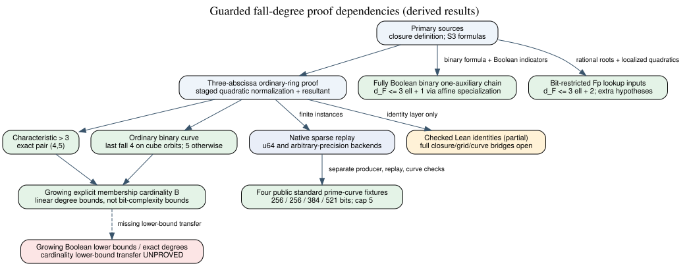
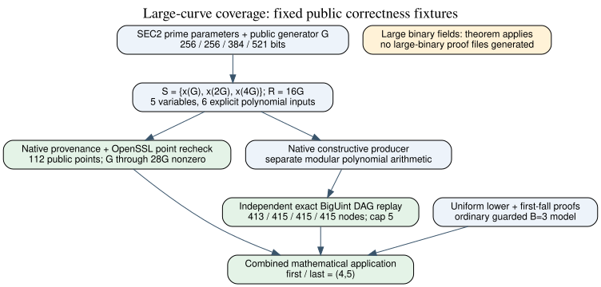

# Guarded fall-degree proof and extensions — 2026-10-28–29

This is a mathematical result report and development-verification record.
It is not an experiment timing report or a claimed ECDLP improvement.

The solid arrows are dependencies in the written derivations. The dashed
bridge to growing Boolean lower bounds is unproved. The Lean box now covers
the complete original prime-field guarded three-abscissa exact pair `(4,5)`,
including the degree-five construction and graded top-syzygy/Koszul first fall.
Other presentations retain their separate formalization status.

## Result

The ordinary coefficient-field model uses three membership equations, two
third summation polynomials, and an inverse guard for distinct first-pair
abscissas. For three abscissas in characteristic greater than three, every
unsatisfiable instance has exact first/last pair `(4,5)` under the stated
ordinary-top/Koszul first-fall definition.

In characteristic two the curve model is
`Y^2+XY=X^3+a2*X^2+a6`, `a6 != 0`. The first fall is four. Last fall is four
for split cube-orbit membership `g(T)=T^3+c`, and five otherwise. The exception
cannot occur over `GF(2^n)` with odd `n`.

For growing cardinality `B`, the odd-characteristic bounds are
`max(5,B+1) <= d_F <= 3B-4`, with first fall `B+1`. The binary extension has
`B+1 <= d_F <= 3B-4` for `B>=4`, with its separate three-abscissa classification.
These bounds are derived, not fitted to measurements. They involve a degree-`B`
membership input and do not prove analogous growth in a fixed-degree Boolean
presentation.

For the fully Boolean binary two-S3 chain with a single shared auxiliary
`u`, three linear `ell`-bit base embeddings, and explicit equations for every
bit, a separate direct argument proves `d_F <= 3*ell+1` for `ell>=1`,
independently of `n`. It holds with or without the inverse guard and needs
no rational-lift assumption. After fixing the base bits, the remaining
equations are affine in all auxiliary bits. Support-aware staged assignment
indicators localize each affine contradiction within the stated cap.
This may require exponentially many proof rows; it gives no growing lower
bound. See [the complete proof](../extensions/characteristic_two/boolean_upper_bound.txt).

## Method and verification

The local upper proof reduces the first-pair state to the missing third
abscissa, normalizes quadratic fibres by successive multiplication and monic
division, and derives a scalar resultant without exceeding degree five.
The scalar grid has normal forms of degree at most four, so staged inversion
derives one. Characteristic two uses a Frobenius cancellation in place of
division by two. Closed separating superspaces give the lower bounds.

Growing-base upper bounds lift local three-element proofs using an exact
triple-selector partition of unity. The lower bound uses the regular
leading-form core and a degree-`B` closed separating space. It assumes no
first-fall/solving-degree heuristic.

Native replay checks each historical DAG operation against its separately
supplied input. The pinned GF16 cube-orbit unit fixture checks the exceptional
four-degree case and serialized proof replay. No new field/base/target sweep
was run in this integration. The full library test and native/Lean checks are
recorded in `../validation/` and the PR.

The Lean project now proves the full original prime-field exact pair through
`GuardedExactPair.exact_pair_prime`. It proves the actual generator degrees
and leading homogeneous forms, defines the graded top map and classical
Koszul span, and proves first fall four with a nonzero lower-degree lift.
For last fall it constructs the degree-five refutation through cubic
normalization, staged resultant extraction and a nine-point grid inverse.
Explicit rational quadratic roots prove the scalar nonvanishing condition
from polynomial UNSAT, and the constructed refutation supplies the unit ideal.
The earlier checked uniform degree-four obstruction gives sharpness.
The original curve/point hypotheses and the implication from prime `p>3` to
nonzero six are included in the final wrapper. See the [complete proof and
verification](../formal/complete-exact-pair.md), [current proof map](../formal/PROOF_MAP.json)
and [resolved central problem](../../../problems/guarded-fall-degree-lean-exact-pair.md).
The old identity and partial-formalization sources/receipts are unchanged.

The repository identity records bind these four checked identities to the
Lean source hash: odd resultant `IDC1h56e099b3201f45e4`, binary integer lift
`IDC1h1fcce05743df34d3`, guard cancellation `IDC1h0808f60fce83a05e`, and
missing root `IDC1h304bc867d3d73267`. See [replay](../identities/replay.json)
and [serialized recheck](../identities/recheck.json). Their native checker
does not execute Lean or certify the closure theorem; the complete universal
Lean proof is the separately checked source chain above.

## Relation to existing work and open scope

[Sources](../SOURCES.md) records the primary literature checked and links to
the existing fall-degree ledger and E12 continuation. The latter's mixed
labels and independent-replay limitation are unchanged. There is no transfer
theorem here that converts coefficient-field cardinality lower bounds into
Boolean Weil-descent lower bounds. The direct Boolean upper theorem applies
only after the actual input encoding is checked against its hypotheses.

No performance dashboard, leaderboard, or benchmark graph changed: this work
has no measured cost ratio, speed improvement, or full-DLP result to add to
those axes. The study-local graph records dependencies rather than invented
measurements. The historical Python sources and raw parameter/certificate
files are provenance evidence; the new execution paths are native.

The remaining research obligation is a growing Boolean lower bound or exact
degree result, together with an encoding audit before applying the new upper
theorem to any existing ledger.
Partial Lean identity verification does not discharge it. Larger-cardinality
exact last-fall values also remain open between the proved bounds.

## Large standard-curve applications

The native checker now includes arbitrary-precision replay, alongside the
unchanged machine-word rules. Four public prime-field fixtures use secp256k1,
secp256r1, secp384r1, and secp521r1. Their field sizes are 256, 256, 384,
and 521 bits; separate sparse replay accepts 413, 415, 415, and 415 proof
nodes, each with maximum degree five. Pair `(4,5)` follows from the uniform
theorem, not a new large-field degree-four closure computation.

The public membership set is `{x(G),x(2G),x(4G)}` and the target is `16G`.
The curve checker rechecks all nonzero multiples through `28G`, exact
parameters, all six inputs, and the serialized binding. Both target signs
are excluded by the public scalar bound. These are known-answer correctness
fixtures; no new scientific sweep or timing comparison was run. See
[records, commands, and scope](../extensions/large_curves/README.md).

OpenSSL 3.5.7 independently matches all 112 public points and all four sets
of curve parameters; its native helper and exact comparison receipts are
retained with the fixtures.

A separate prime-field bit-restricted presentation has upper bound
`d_F<=3*ell+2` for supplied multilinear normal forms, with all lookup images
rational point abscissas and surjective auxiliary bit encodings. The
coefficient field stays `F_p`. For raw inputs the bound becomes
`max(3*ell+2,d_raw)`. The proof localizes to coprime univariate quadratics,
which have a degree-two refutation. It is not a bound for `GF(2)` carry
circuits, and lookup/proof size can be exponential. See
[the exact theorem and degree audit](../extensions/large_curves/prime_bit_restricted_upper.txt).

