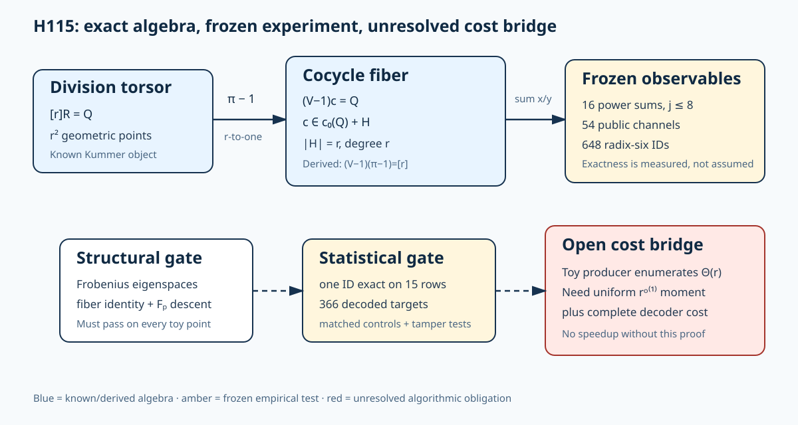

# H115 Frobenius--Kummer resolvent moments

H115 tests a new frozen observable, not a result. On a prime-order curve it
maps the `[r]`-division Kummer cocycle through the exact factorization

```text
(V-1)(pi-1)=[r]
```

and studies low-order power sums over the degree-`r` fiber of `V-1`. The
candidate family has 648 fixed radix-six predicates, evaluated on five tiny
curves, 15 generator rows and 366 nonidentity row-targets with matched
random-line, label, rational-line and coordinate-isomorphism controls.



The key distinction is cost: compressing an `r^2` torsor to a degree-`r` fiber
does not make it subexponential. The frozen producer must count its explicit
`Theta(r)` fiber enumeration. A speed claim additionally requires a uniform
`r^{o(1)}` construction of the selected moment and complete decoder.

Files:

| Artifact | Role | SHA-256 at freeze |
| --- | --- | --- |
| `PRIOR_ART.md` | Primary-source overlap and scoped novelty screen | `7637f17a6cd0051ae9ea048e6726eb945632a320c591caea96e585d66f258697` |
| `PROTOCOL.md` | Human mechanism, controls, acceptance and cost boundary | `5879cc70605291f295aa286516ec88ca2243e273924f511927bd119807acf5e7` |
| `PROTOCOL.json` | Machine-readable frozen family and run policy | `c8412d94f3e6cc928c13c93572a8796cea3a983b5fcd4e6b043a75bc5b1a2363` |
| `CURVES.json` | Five exact structural toy fixtures | `babd2556951ecfcaee66a5c6966364ca136bf1f62fb0a51511f391768255d295` |
| `PROOF_MAP.md` | Generic identities, score handoff, decoder and cost obligations | `99319afcea8e17b60c668a446535b4c1bb2864f0b4aa877ee193407e08f1a7e0` |
| `mechanism.svg` | Editable algebra/evidence diagram | `7cdc6fb0c6a4f2719e72641119649825b51f81e46f78d5210ee56eb367da3d7e` |
| `mechanism.png` | Inspected 1,200-by-640 rendering | `6dfa6ac9033d15f9424125b290a7546fbb54f2dc394862336ba002567f23ef79` |
| `h115_curve_fixture_check.rs` | Native base-field cohort/isomorphism checker | `bd47365d63c0091371e36a3cd3f6f243b21b319e6fec0cd460e0d66f56275757` |

Post-freeze proof artifacts:

| Artifact | Role | SHA-256 |
| --- | --- | --- |
| `H115FrobeniusKummerResolvent.lean` | Generic factorization, exact fibers, finite score, radix-six decoder and cost boundary | `55137b5f366e8dc345a42b67c3b815e23a07051f0042fc319580d02b76c79ee0` |
| `lakefile.toml` | Pinned mathlib project | `c8281549c072207f652ff9cbf642a29e954eb24dcab0481024c5599ff0c31554` |
| `lean-toolchain` | Pinned Lean toolchain | `d5edba4e4b8faad9c1baeadb265716d20d03be4d1a2647dc5e35b0c0325bea7b` |
| `lake-manifest.json` | Resolved dependency graph | `05bb6c0943a46ac7b9afe4831996b3fcd2091949c7c8b9c085b5ea269f818dfb` |
| `LEAN_PROOF_GATE.md` | Strict compile receipt and remaining obligations | self-hash intentionally omitted |
| `IMPLEMENTATION_CLARIFICATIONS.md` | Pre-measurement extension, identity-control, torsion and serialization conventions | self-hash intentionally omitted |
| `h115_sha256.rs` | Native SHA-256 and deterministic seed/digest primitive | `4d508fe8fed91c71e0150446c53f024ff97fa8a9519d812a672ea59ef2329786` |
| `h115_field.rs` | Native extension-field, curve, torsion and irreducibility layer | `577015b44fae9828b9bddf1b2afc0403e4f44d732b3a01325f42253f0982cc82` |
| `h115_producer.rs` | Frozen producer, controls, exact scoring and scalar-blind decoder | `f0644129c8d7c0161cbddac3283f94453983d25b6f6cdeaf327b170c1fc579bd` |
| `PRODUCER_SOURCE_GATE.md` | Strict non-scoring compile/selftest receipt | self-hash intentionally omitted |

The first post-freeze native check is structural only:

```text
rustc --edition=2021 -D warnings h115_curve_fixture_check.rs -o h115_curve_fixture_check
./h115_curve_fixture_check
```

It independently recounts all five base-field groups, checks primality,
nonsingularity, traces, Hasse bounds, `d=ord_r(p)`, extension sizes, every
nonidentity point's order and the `lambda=2` coordinate-isomorphism fixtures.
It reports 5 curves, 15 rows and 366 row-targets. It does not construct the
extension torsion or read any scalar label, moment or predicate.

No candidate moment scores, selected IDs, decoder outcomes or runtime
measurements exist. External novelty and a generic/subexponential ECDLP
algorithm are not claimed.
