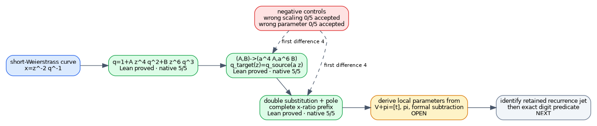

# Outcome

The source-gated five-curve panel matched all 24 frozen coefficients for the
curve equation, target rescaling, double substitution and normalized x-ratio.
Both negative controls first differed at coefficient four in every cell. An
independent recurrence verifier reconstructed the retained arrays and rejected
a one-field mutation. [pcc:unverified]

| p | scale | correct coefficients | wrong scale first diff | wrong parameter first diff |
| ---: | ---: | ---: | ---: | ---: |
| 31 | 25 | 24 | 4 | 4 |
| 211 | 14 | 24 | 4 | 4 |
| 241 | 225 | 24 | 4 | 4 |
| 431 | 34 | 24 | 4 | 4 |
| 587 | 40 | 24 | 4 | 4 |

{width=88%}

Each cell recorded 81,732 additions, 81,183 multiplications and five inversions
at precision 24. These exact counts describe this fixed instrument only.
[pcc:unverified]

# Proof and experiment chain

{width=96%}

Lean defines `WeierstrassCoordinateUnit` by
`q=1+A X^4q^2+B X^6q^3`, proves the cleared affine identity, proves rescaling
to `(a^4A,a^6B)`, and assembles the complete normalized x-ratio prefix theorem.
The exact axiom audit reports 80 theorems, zero failures and zero trusted native
decisions. Source SHA-256 begins `8af7cc31f5ed3749`; build and audit logs are in
`../../lean/receipts/`. [pcc:unverified]

The experiment was frozen at commit `57b5bfc003`. Producer SHA-256 begins
`8f57ec8b5948dabf`; verifier SHA-256 begins `1e5facd4ec26a182`; retained TSV
SHA-256 begins `693ebaedc341bf0c`. The producer uses fixed-point iteration and the
verifier uses a coefficient recurrence.

Identity certificate `IDC1h692b3e04c6a4f0cd` seals the polynomial coordinate-
rescaling step at 32 issuer and 32 domain-separated checker points and points to
the audited Lean source. [pcc:unverified]

# Evidence boundary

The coordinate equation, target scaling and full regularized x-expression are
now checked at both the generic proof layer and the five frozen instances. The
remaining premise is the local endomorphism statement that identifies the two
parameters supplied to that theorem. The next proof must derive it from
`V+pi=[t]`, the local Frobenius series and formal-group subtraction, then connect
the resulting normalized ratio to the retained recurrence jet.
[pcc:unverified]

Raw evidence is `../../CURVE_COORDINATE_RESULT.tsv`; the independent summary is
`../../CURVE_COORDINATE_VERIFY.json`; complete commands and hashes are in
`../../CURVE_COORDINATE_EXPERIMENT.md`.

# Sources

- Bostan, Morain, Salvy and Schost, *Fast algorithms for computing isogenies
  between elliptic curves*, arXiv:cs/0609020.
- Mathlib revision `d13f23b723b8a846827a245b89c10fc7d3f11612`.
- Study source receipt `../../PRIOR_ART.md` and proof map `../../PROOF_MAP.md`.

